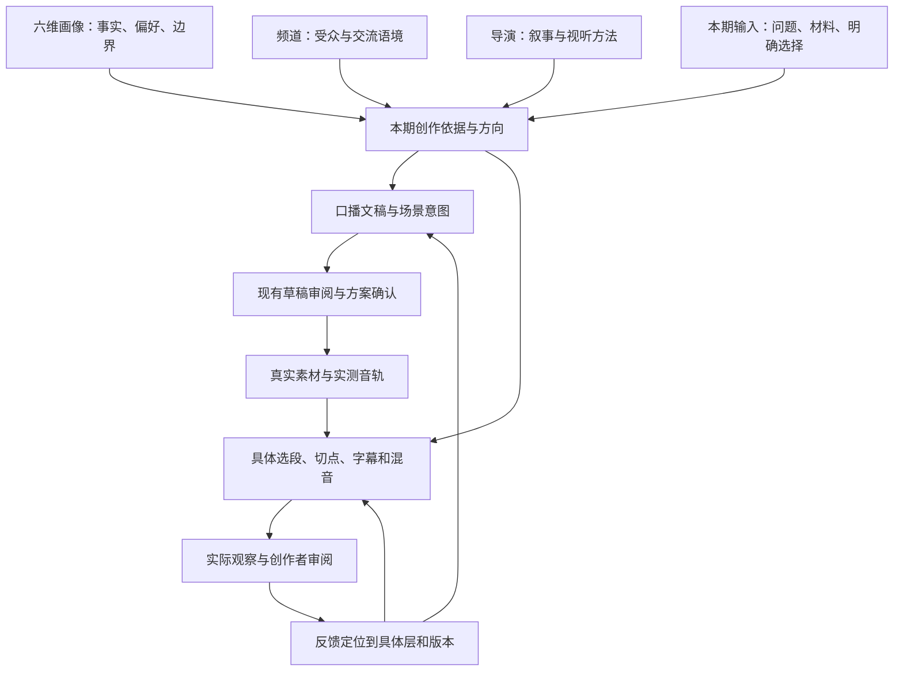

# V2.1 版本规划 · 创作依据、上下文与自然表达

状态：**2026-10-25已授权在easel-v2.1-rebuild集中实施；完整规划保留，实施证据见CRE-01。** 规划日期：2026-10-24。

父任务：[CRE-01](../project/tasks/CRE-01_creative-context-expression.md)。本文维护方案，实施授权与结果由父任务记录；现行需求、生产断点和已冻结作品不因本文改变。

## 1. 目标、依据与本轮边界

目标是让作品忠实于创作者，符合本频道的交流语境，体现所选导演的表达方式，并让文稿、声音、画面和剪辑共同服务本期内容。创作者可以只提供一句感悟或一个问题，由AI主动研究、展开、挑战和提出方案；不要求创作者预先写好整篇稿件。

2026-10-24用户要求先整理完整方案、不改代码和制作；2026-10-25明确授权在新建easel-v2.1-rebuild分支实施。当前代码与离线测试已获授权。后续用户先授权API真实模型验收，随后明确“代码补齐后进行停止”；该停止点后被明确的“处理旧代码、补充遗漏、进行后端接口真实测试”替代。当前按此执行，真实API测试使用隔离数据。部署、媒体制作、发布及长期配置写入不在本轮范围；实际进度由CRE-01维护。

依据：[产品需求](../product/requirements.md)中的002～006、019/020及自然表达补充；[领域职责](domain.md)；[实施合同§6.1](contracts.md#natural-expression-design)；本会话对实际请求与作品记录的只读调查。六维字段以现有Profile及源码为准，模板README中的旧管线注入说明不当作V2实际行为。个人画像原文、作品原稿、运行身份和请求回执留在本地受管数据，不复制进本文。

**V2.1采用整体设计 → 一次性完成版本范围内实现 → 统一调试与验收 → 授权后交付切换。** 用户最新决定替代此前“P1先实施并真实比较，再决定P2”的排程；P1与P2均纳入版本设计，证据要求保留到设计和统一调试中，不作为逐项开工审批。一次性实现指连续完成约定范围，允许模块顺序、开发检查点及基础测试，不要求一次提交、不禁止修复，也不承诺首版零缺陷。

V2.1是现有V2的改进版本，复用生产骨架和业务身份，不另建产品、数据库或生产状态机。本文件保留原路径和CRE-01编号，作为唯一版本设计；任务卡维护整体执行状态。分支已按2026-10-25授权建立；版本命名不等于已打标签或发布软件。

### 1.1 版本交付范围

| 交付项 | V2.1目标行为 | 验收依据 |
|---|---|---|
| 创作依据协作 | 一句问题也能启动方案；六维画像、频道、导演参与本期具体选择，事实和设置不被风格覆盖 | §3～4，§9的P2-A |
| 上下文输入 | 完整记录保留，模型收到无重复且语义完整的任务视图，当前任务恢复身份不变；历史跨版本任务只读、不继续执行 | §5，§10.1 |
| 文稿与视听表达 | 按本期问题组织思路；镜头有明确作用，实际剪辑使用素材与实测音轨；已有审阅能定位具体缺陷 | §6，§9的P2-B/C |
| 事实与反馈 | 来源、核验程度、个人理解可区分；实际观察范围如实展示，长期经验只按明确范围保存 | §7～8，§9的P2-D |
| 兼容与交付 | 新片、改稿、局部修订及当前任务回执路径有证据，统一受测版本能追溯与回退 | §9～10及父任务 |

不纳入：新Agent或审核循环、固定拆分生成调用、新事实平台、自动学习、自动删画像维度、新检索供应商、全自动音画审片，以及无关发布/内容库重构。已有反馈与保存能力以接线核对和必要缺口修复为限，不为齐全而新增模块。不把“完美融合”“AI味清零”设为自动评分或版本硬承诺。

## 2. 已知事实与不能直接推出的结论

受查源码基线：`easel-v2-rebuild / 5f1c6d3a206c8faa40344762f6c8d3346005ec35`，叠加当时既有Dirty。当前另有改稿基准、结果解析、拆镜音效及恢复修复，部署和验证事实以[状态](../project/status.md)与[S6-14A](../project/tasks/S6-14A_conversation-integration.md)为准，不纳入本方案重新实施。

| 证据 | 可确认的结论 | 不能直接推出 |
|---|---|---|
| 已查两部作品的请求中存在画像、频道和导演；其中改稿样本逐次比对导演内容一致 | 配置确实进入了相应请求 | 风格已正确落实、整部作品已通过验收 |
| 一个历史首版剪辑上下文327,617字符，其中artifacts为305,168字符，约93%；profile为2,800、director为1,664字符 | 首版剪辑完整素材元数据存在显著体积，当前代码仍直接传入metadata | 冗余已被证明是写稿AI味或剪辑欠佳的唯一原因；字符数等于Token数 |
| 改稿样本早期replan首个写稿请求的plan为空；现有Dirty已补reference_plan_revision | 旧轮修订基准丢失已有修复工作承接 | 需要本方案再修一次；最新版本真实改稿效果已验证 |
| 一次改稿经历三次语义审查、两轮内容修正，主要改开头和结尾；审查将无编号视为自然推进 | 实际审查判断过度依赖局部表达，结构与视觉问题没有充分解决 | 增加审查次数必然改善质量 |
| 历史文化题材样本没有public_fact_evidence，最初规划工具为空 | 该路径没有形成工具支持的查证链 | 已证明某条引文错误；没有工具记录就意味着所有内容不可信 |
| 导演文字已确认，但受查版本没有试片正式接受记录；作品显式选用了导演 | 仍在风格试用阶段，未丢失导演选择 | 必须先完成多部试片才能接受；可以自动绑定频道默认 |
| 实际存在技术检查、抽样视觉检查与局部修订，完整听感和连续语义仍有未测项 | 工程链路已具备继续试用的基础 | 已证明稳定日更、全自动审片或持续省心发布 |

上述样本不混用：一个样本的剪辑上下文体积，不能解释另一个样本在写稿阶段的全部问题。本轮只读复算字符数口径为`len(json.dumps(context, ensure_ascii=False))`，不含整条请求的其他指令、schema和图像载荷。

## 3. 六维画像怎样与频道、导演配合

六维画像不只是身份。它已经覆盖表达、受众、平台、边界和经验；频道与导演必须在此基础上细化，不能分别再造一个创作者。

| 画像维度 | 提供什么 | 频道/导演怎样使用 | 需要防止的偏差 |
|---|---|---|---|
| identity | 身份、真实经历、创作动机与关注范围 | 频道选择本期交流语境；导演理解观察角度 | 把职业变成所有选题的主题；把内部动机写成公开故事 |
| style | 作者的措辞、语气、思考与表达偏好 | 导演将这些偏好落实为本期叙事及视听选择 | “朋友式”被固定成碎句、吐槽或一种开头 |
| audience | 主画像面向的人群、理解基础与交流关系 | 频道细化本系列的观众侧重点；本期决定所需背景深度 | 频道覆盖主画像的基本关系；为迎合观众改变作者立场 |
| platforms | 平台意向、形式与发布习惯 | 方案解析实际规格，发布环节处理账号和平台要求 | 把B站等同于固定片长、固定节奏；把平台安排当发布授权 |
| preferences | 真实、隐私、出镜、声音和协作边界，以及软偏好 | 程序落实明确设置与授权；导演在允许范围内创作 | 将所有偏好都当不可变禁令；为了风格放宽隐私或真实性 |
| memory | 已确认经验、判断变化、反馈与适用条件 | 为本期提供有关经验；导演借鉴已认可表达 | 把一次故障、单次流量或模型推断变成长期规律 |

四类创作依据的职责：

- **画像**提供长期主人设与表达基础；同一画像下不同频道不产生独立身份或经历。
- **频道**说明这次与谁交流、在哪个主题范围内交流；可以保留开放探索，不要求所有内容服务职业、变现或教学。
- **导演版本**承担叙事和视听方法，跨内容复用风格；不迁移参考作品事实，不静默覆盖固定声音和字幕。
- **本期内容**提供当前问题、材料、已确认判断和单片要求；可以补充或修正长期认识，但不自动改写长期配置。

### 3.1 重叠与冲突处理

不使用一条“本期>导演>频道>画像”的总优先级来处理所有问题，应按信息类型处理：

| 信息类型 | 处理规则 |
|---|---|
| 音色、字幕、画幅等明确设置 | 沿现有本片→频道→画像解析规则，在方案展示和确认时固定；导演提出建议但不静默覆盖 |
| 真实经历、身份、引用与证据 | 保留来源和确定程度。用户明确纠正旧事实时用于本期；事实矛盾且会影响表达时集中澄清，不机械保留旧画像 |
| 隐私、权益、预算、发布权限 | 继续执行现有保护；普通风格选择不能扩大授权。内部可理解的信息不等于可公开表达 |
| 叙事、语气、镜头与节奏 | 结合本期目的解释画像偏好和导演风格；允许单片差异，不把普通选择变成重复确认 |
| 核心观点和导演核心特征实质冲突 | 说明具体冲突和取舍，合并到既有方案确认；不由模型悄悄替换用户观点或换导演 |
| 长期保存 | 单片确认只作用于该作品；更新画像、频道默认或导演版本需用户明确指定保存范围 |

不选画像、频道或导演的作品仍可创作，只使用明确提供的依据，不借用其他用户或频道的经历，不暗建默认导演。

## 4. 逻辑分层与现有产物

这里的分层定义每一步要完成的创作判断；不等于增加Agent、付费节点或用户审批次数。V2.1沿现有规划、供料、剪辑、审阅及修订任务推进。

图中的回退沿既有范围确认和依赖失效规则，不表示确认后可以任意改稿。素材阶段能否调整镜头实现，由方案中的适配许可决定。

### 4.1 本期创作依据与方向

在现有方案中明确：本期要讨论的具体问题；已确认判断与未解问题；与本期有关的画像依据；频道观众需要的背景；导演在本片的具体处理；必须保留与允许替换的部分。

复用`summary`呈现简短创作方向，`core_views`承载本片拟表达观点，`facts`承载事实与来源说明，`constraints`、`adaptation_permissions`明确固定与可调部分。来源身份沿既有`conversation_basis`及输入/证据引用保留。模型填写某个字段不表示用户已确认或外部事实已查证。

输出应是创作决定及简短依据，不要求展开模型内部思考。说明“为什么本期重讲这一处、其他部分如何处理”比重复“真实、自然、有电影感”有用。

### 4.2 文稿

写完整的说话思路，按内容需要决定长短、详略和停顿。信息完整不等于每项平均展开，不要求每段都有结论。导演注释、资料清单与正文分开；必要出处在口播或画面何处说明，由可理解性与事实用途决定。

`script`与各场景`narration`保持一致，后者是实际TTS文本。修改保留否定、条件、归因、时间与不确定性。新观点是待确认提案，未经确认不转为作者长期立场。用户原稿明确要求逐字保留的路径不自动润色。

### 4.3 视听方案与实际剪辑

`scene.purpose`说明场景要让观众理解或感受到什么；`visual`说明画面如何实现，以及它承担解释、证据、环境或情绪中的何种作用；适配许可说明替代实现范围。可混合功能，不要求每个镜头承担证明责任。

规划给出方向和估计时长；实际素材、声音产生后再决定取段和切点。一个镜头可覆盖多句，一段声音可跨多个画面。连续性是选择理由，不以“同一张桌、同一人物、同机位”冒充已取得素材。

### 4.4 用户如何审阅

复用现有摘要/完整方案：先看到本期方向，再能读完整稿件、分镜和真实设置。只在实质冲突或关键信息缺口时提问。原方案确认仍统一处理，不要求用户逐层批准。

首版交付说明技术、视觉、声音及连续语义各自观察范围；用户可用普通语言指出问题，由系统定位段落/场景并判断影响范围，不把填写专业反馈表交给用户。

## 5. 上下文精简设计

### 5.1 完整存储与任务输入分开

完整Profile快照、导演版本、频道依据、Plan、素材元数据、许可证据、操作回执继续作为权威记录保存。发送给模型的是从这些记录确定性生成的任务视图；精简不更改数据库记录、不重写冻结方案、不用模型摘要代替权益或授权校验。

V2.1上下文工作包处理占比最大的素材元数据，以及Plan中与顶层重复的画像/导演/会话依据。完整六维画像和所选导演各保留一份，相关字段即使为空也保持明确语义。暂不开发按相关性自动删除画像维度的系统，也不为约2,800字符的画像增加付费摘要。

全片共用规则保留一份；素材特有的限制仍逐项保留。只有内容相同、作用域相同的重复记录才可折叠；相似措辞不自动等价。若不同来源发生冲突，保留冲突及来源，不由去重程序裁决语义。

### 5.2 模型素材视图的保留范围

以下是设计清单，实施前应结合现有调用点逐字段核对，不能直接复制修订路径已有白名单：

| 类型 | 必须保留给任务的语义 | 可留在完整记录、从本次模型输入移除的内容 |
|---|---|---|
| 所有素材 | asset句柄、类型、输入用途、场景关系、候选/已选状态；必要来源、使用限制、署名要求、权益未决状态；已有实际观察及观察范围 | 重复的全片导演/用户brief、供应器执行日志、存储和登记过程元数据 |
| 视频/图片 | 实际内容观察、有效区间、时长/分辨率等有关技术属性；是否有原声/烧录文字；`material_uses`中的用途关系 | 与当前决定无关的完整技术探测日志；不能删除影响裁切、复用或权益的字段 |
| 配音 | 已冻结正文、声线身份、实测时长、可靠字幕锚点及其证据等级、段落/场景映射 | 重复供应商配置文本和同一信息的多份序列化副本 |
| BGM/音效 | `candidate_role`/已选用途、事件与场景绑定、取源和时间窗口、绝对时间限制、混音相关测量、是否实际听过 | 全片导演和供料请求的重复副本；不能把候选角色改写成已试听认可 |
| 图解 | board_id、状态索引与顺序、文字/数量/概念标识、scene关联、实际像素及其来源；与字幕共存的必要信息 | 重复生成描述；不能只剩一张PNG和一句“图解” |
| 字体/字幕 | 字体句柄、实际样式、布局有关信息 | 与当前布局无关的登记历史 |

模型只见到一个句柄不会自动获得查阅完整记录的能力。当前任务所需约束必须直接带入；如果信息不足，先补充已存在且获准的证据，不声称模型能够任意回查数据库。

### 5.3 程序边界、指纹与恢复

下表对应本轮只读核对的现有字段，不要求“所有哈希不变”，也不引入新账本。实施前仅沿实际受影响调用点补齐字段清单。

| 对象与现有字段 | 当前含义及本次处理 |
|---|---|
| 已冻结方案及`plan_revisions.plan_hash`、画像快照、导演版本、素材原始记录 | 原始创作依据和证据不因投影改写；冻结方案内容不变，其哈希不变。视图变化不创建新的画像或导演版本 |
| 模型任务视图及内部版本 | 是由原始记录生成的输入，可随精简变化。实施时在现有装配/请求记录中确定版本承载位置，并可追溯源记录与投影规则；不将内部视图版本冒充服务`config_version` |
| `TaskContext.fingerprint` | 当前由`creative_data()`和`expression_policy`计算；改变其中内容会改变指纹。若精简落在更下游的编辑装配，不能笼统声称该指纹必然变化或必然不变 |
| `material_intent_context_hash` | `FrozenIntentCompiler`用上述指纹判断已保存素材意图是否可复用，不一致会报`material_context_changed`。P1优先限定在编辑输入；若改共享装配，必须证明原素材意图路径及恢复兼容性，不能清空已存意图触发重新生成 |
| `runs/tasks.input_fingerprint` | `service._run`创建运行及首个任务时由作品ID/修订、运行种类、方案版本、target和payload计算，并非完整模型输入哈希。只改变任务视图不重写旧运行/任务字段；其他受影响任务创建点单独核对 |
| `operations.input_hash`、`request_json` | 当前哈希对应实际请求；模型请求含`messages/tools/schema`。新请求使用新视图时哈希可以变化。既有操作保存的请求和哈希不变，同一操作ID配不同请求会被`reserve`拒绝 |
| MODEL `operation_id`、`request_key`及回执 | 当前模型操作ID来自task ID、可选namespace与调用序号，`request_key`默认取操作ID；不由上下文指纹直接决定。既有操作沿原身份与请求处理，成功结果复用原回执；不能更换namespace、task或视图版本绕过已发送/UNKNOWN保护 |

源码依据：[任务上下文](../../../easel/production/context.py)、[素材意图复用](../../../easel/production/material_intent.py)、[运行创建](../../../easel/production/service.py)、[模型操作](../../../easel/production/model_operations.py)、[请求预留与校验](../../../easel/production/operations.py)。具体已实现版本、当前恢复范围和验证证据见CRE-01。

- 复用`context.py`、首版`creation.py`和修订`revisions.py`的装配边界；投影时深拷贝，不原地修改Plan或素材。
- `allowed_handles`、作品归属、完整Rights检查和程序绑定保持原实现；模型不能用输入摘要修改权限或跳过完整记录校验。
- 对发送视图采用明确的内部版本，随现有请求内容/指纹与回执追溯；不新增第二套业务账本。
- 不在已发送操作恢复时重新按新版视图计算请求来逃避原身份。旧请求/未知提交保留原回执；新视图先用于新获准任务。正在运行任务不得因代码更新自动切换或重发。
- 内部统计总输入、分字段字符、工具/schema与媒体规模；供应商返回Token用量时另记真实值。不能用字符数冒充Token，也不为达到体积目标截掉约束。

精简验收首先以“重复内容减少且必要语义完整”为准，不承诺精简就能增加电影感。先对代表性私有旧请求做不联网的投影对比，列出删去/保留的字段及理由；下降幅度如实报告，不预设压缩百分比或Token硬阈值。

## 6. 自然表达：分别处理文稿、画面和声音

“AI味”是用户对效果的感受；系统需要把它定位到可修改的问题，不尝试判断作者身份，不接检测器，不设置去AI分数。

| 方面 | 应重点改善 | 不能机械执行的规则 |
|---|---|---|
| 内容与结构 | 空泛铺垫、没有新增含义的重复总结、假因果、平均分配的论点段落；保留真实矛盾、条件和不确定性 | 每段必须有例子；禁止编号；禁止所有总结；固定三幕或反转 |
| 作者声音 | 保留已有立场、措辞习惯与表达力度，使用经确认样本理解风格 | 为了亲切新增经历、情绪或虚构失败；强制吐槽和自嘲 |
| 口语节奏 | 按完整意思组织长短句，减少无意义断句和每句强调 | 所有长句都拆短；加入嗯啊、假呼吸、碎句就算真人感 |
| 场景与镜头 | 画面有用途，相邻镜头形成关系；关键解释得到适当支持 | 每句逐字配图；禁止办公桌/风景；每个镜头都必须举证 |
| 剪辑与配乐 | 按语义、动作和情绪决定切点与留白，重复物件有变化和作用 | 固定几秒切一次；每段都降音乐、停半拍；强制快剪或全程BGM |
| 配音 | 冻结文本适合朗读，已选声音和实际支持的参数用于合成，听感以实际音轨为证 | 用导演形容词冒充TTS参数；未试听就宣称自然；擅自换音色 |

复用`expression_policy.py`的共同原则及write/visual/review片段；不把另一份完整Humanizer提示词叠进每个阶段。现有规则已经提及的要求应先核对执行效果，不重复增加同义规则。

P2每个拟修改点都要在原任务内说明：**已有哪条规则、哪份实际输出未做到、缺口属于信息缺失/任务表达不清/执行判断失误中的哪一类，以及这次具体改变什么。** 原因尚不能确定时记录待验证；仅重复强调“自然、像朋友、不机械配图”不能成为扩写提示词的理由。这是实施范围说明，不增加生产审批或审核轮数。

优先让现有字段表达本期选择。例如，自省主题可以由AI提出：“本期讨论我是在找事实，还是在给自己下判决；典籍支持这个区别，不做完整思想史梳理；现代情境帮助理解，结尾保留未解问题。”这只是可讨论方向，既不是所有作品的模板，也不是用户必须先提供的材料。复用`summary/core_views/facts/scene.purpose/visual`承接，不新增创作方向对象，不把本文整体塞进Prompt。

### 6.1 现有审查如何使用这些标准

作者在既有生成内自检；已有独立草稿审阅的路径继续使用它，没有独立审阅的路径不在本版本追加调用。适配时应显式识别路径覆盖，不能将自主旁白路径的审查结果泛化到所有作品。

沿用`findings / suggestions / limitations`，每个具体缺陷指出句段或场景、证据、受损的理解/事实/明确选择，以及应回到哪一层修正。明确选用的导演要求也是核对依据，但笼统“像AI”或“没有电影感”不直接触发全片返工。

- 确实改变作者观点、遗漏必要条件、把示意当证据，或违背已明确的本片表达要求：具体缺陷。
- 无实际冲突，仅存在另一种同样合理的镜头或措辞：可选建议。
- 未拿到素材、未听声音、未看连续画面：观察局限，不能用推测补成通过或失败。
- 用户已明确指出某处不符合自己的表达：成为本片修订依据，不因“只是审美”忽略；其长期适用性仍另行确认。

例如，一个场景宣称解释某个工具怎样降低操作门槛，画面却只展示环境整理，应核对其解释目的是否兑现；如果该场景本来只承担环境或情绪作用，就不能据此要求精准操作复演。

## 7. 研究、事实和素材可行性

复用现有输入、会话依据和公共事实检索。事实表达区分三个可组合的维度：**来源**（用户提供、公开材料等）、**核验程度**（已核对原文、仅有搜索线索、待核实等）、**表达性质**（引文、事实陈述、个人理解或拟议判断等）。它们不是互斥标签：用户提供的引文可能尚未核对；个人理解可以有公开资料支持，但不因此成为原作者原意。来源是用户、或文字放进`facts`，均不代表已验证。`core_views`在方案确认前是拟表达判断，不自动写入长期画像。

本版本使用现有facts文本、来源记录及输入引用表达上述区别，不假装`list[str]`已经提供程序级查证保证。只有实际实施发现必要关系无法可靠表达时，再设计有限字段扩展，不先建事实管理平台。

重要原文引句、归属、数字和支撑核心结论的外部事实，应有可核对来源与定位。当前`public_facts.py`返回搜索摘要，明确不等于核过原文。原文可来自用户已提供材料或获准且实际可用的读取能力；当前能力不足时标注缺口，不能声称已验证。新检索服务、付费和来源访问按既有授权处理。

是否必须先解决取决于影响：可选例子可以删去或保留为明确的不确定讨论；支撑核心结论的关键引用未解决时，应在方案确认前提出取舍。加“据说”不能把无法支撑的精确引文变成可靠依据。

素材供料与公共事实研究分别处理。普通库存场景可先规划；特别依赖同地点、人物、连续动作的镜头需要明确替代方案，必要时再在获准的只读检索能力内做有限预检。当前规划工具未提供素材检索时，不宣称能在规划阶段调用；接入属于后续可选范围。不能承诺未提供的个人实拍、录屏、精确无品牌画面必然存在。

## 8. 反馈沉淀与导演校准

优先使用创作者已认可的少量稿件/片段作为参照，并附“认可什么、适用于什么”；不复制参考片经历或全文，不要求先上传样本才能创作。当前没有足够样本时保持试用状态，不声称仅凭风格文字即可稳定复现。

| 反馈类型 | 默认归属 | 长期保存条件 |
|---|---|---|
| 本片一句话不准确、镜头不合适 | 本片方案/修订记录 | 不自动长期化 |
| 作者持续认可的用词与交流习惯 | 画像style/preferences的候选建议 | 明确确认具体条目；沿已有受控保存入口 |
| 某频道受众需要更多背景 | 频道定位/受众的候选修改 | 明确确认作用范围 |
| 可复用的叙事、运镜、节奏处理 | 导演版本候选 | 沿已有版本和试片接受流程，不覆写历史版本 |
| 可复用理解及其适用条件 | 画像memory候选 | 用户确认，不从单次流量或一次成功自动推导 |

作品接受与导演接受继续分开。正式首版可以兼试片，创作者可按已有规则接受；跨题材观察有助于验证稳定性，但不强制若干部试片、日更或固定数量配额。

现有对话画像保存仅覆盖部分文件的受控追加，不能宣称六维自动更新系统已经完成。遇到旧条目需要纠正/替换，走适用的明确编辑流程，不通过无限追加制造相互矛盾的画像。

人工审阅用于校准和接受，不替代系统改善生成的责任。只有当具体声音/连续视频确实进入有能力的观察路径，才能宣称相应检查完成；沿现有manual配置如实交付未测范围，不因本方案擅自切换审核模式。

## 9. V2.1整体实施与统一调试

### 9.1 阶段与执行方式

| 阶段 | 工作及产物 | 退出条件 |
|---|---|---|
| A 整体设计 | 本文定义范围、行为、模块边界、兼容方案与验收；CRE-01登记全部工作包、授权和依赖 | 设计资料完整，开发前明确版本范围及开发授权；规划轮止于此；当前授权见CRE-01 |
| B 集中实现 | P0固定基线，连续完成P1、P2-A～D、接线和基础测试；同步受影响合同/使用说明 | 范围内实现与必要接线全部具备，无占位实现；基础测试通过，固定可追溯受测版本 |
| C 统一调试验收 | P3先综合离线/恢复回归，再在授权范围内做分项质量对照和端到端审片；缺陷修复后回原场景 | 对照§10和任务矩阵逐项记录证据，范围内缺陷闭环；未获授权的真实项保留NOT_TESTED |
| D 交付与切换 | P4整理交付版本、测试、已知局限、操作与回退说明，核对部署/切换授权 | 软件、真实生产和Creator接受分别记结果；只有相应条件满足才声明版本验收完成 |

开发中的基础测试用于尽早发现实现错误，不以模型创作效果对照作为P2开工前提；统一调试在完整实现后进行。范围内的开发、调试修复与回归在相应授权内连续执行，不每完成一个工作包就向用户要求再批准一次。新增需求、改变已确认合同、扩大费用/权限才按现有工程规范处理。

### 9.2 工作包、落点与依赖

以下工作包全部属于CRE-01，不建立多张相互争抢状态的父任务；P编号保留前序讨论的追溯关系。

| 工作包 | 具体产物与主要落点 | 依赖及完成条件 |
|---|---|---|
| P0 基线与样本 | 固定HEAD、必要Dirty、源码/服务/指令版本；登记两个历史样本的阶段、原始输入和观察范围；核对字段及身份清单 | 集中实现起点；复用S6-14A、CTX-01既有成果，不做全库重审；私有记录不入Git |
| P1 上下文投影与兼容 | 在`context.py/creation.py/revisions.py`现有装配中形成确定性素材视图；保留六维与导演各一份，视图版本和源记录可追溯；按§5.3保护当前任务意图复用及请求身份 | 依赖P0；完成类型语义正反例、源记录不变、指纹/回执恢复检查；不以真实效果作为P2开工门槛 |
| P2-A 创作依据落实 | `planning.py`及现有方案装配/展示使用§3冲突规则；`summary/core_views/facts/scene.purpose/visual`表达本期决定，单句输入仍可由AI展开 | 依赖P0定义的依据；复用P1接口约定。依据存在与表达兑现分别验证，不增加方向对象 |
| P2-B 文稿与既有审阅 | `expression_policy.py`、规划/改稿生成与已有审阅指令按§6消除重复规则、明确结构与作者声音；审阅指出具体段落、证据和修正层 | 与P2-A衔接；不加审核轮数，保留受保护原稿、改稿基准和用户明确选择 |
| P2-C 视听与编辑接线 | 规划、素材意图/选材、`creation.py/revisions.py`已有指令一致使用场景目的与适配边界；实际编辑依据观察、实测音轨、可用区间，不承诺虚构连续素材 | 依赖P1接口和P2-A场景语义；保留图解/音效/原声保护，局部视觉修订不改旁白 |
| P2-D 事实、审阅与经验边界 | 现有facts/输入引用、方案展示、交付观察说明及已有反馈保存入口区分来源/核验/判断，保留作品接受与导演接受的不同含义 | 与P2-A～C统一接线；已有能力不重建，必要缺口同版本修复；无自动长期写入 |
| P3 统一调试与验收 | 全部实现后固定版本，执行§10矩阵；记录首次失败、分类、修复、关联回归和整体剩余项 | B阶段结束后进入；对照条件独立固定，费用与真实调用按授权；不得只用一条作品给所有模块记PASS |
| P4 版本交付 | 更新权威文档、版本证据、已知限制、部署/回退说明；正常审片中的具体经验按明确认可保存 | 依据P3结果；无限期“积累足够作品”不作为版本退出条件，自动学习不在范围内 |

### 9.3 P2设计依据与改动边界

P2纳入本次完整实现，下面固定其问题与方案；实施时补齐具体调用点及样本定位，不能用“待P1效果出来”重新搁置P2，也不能借版本开发全面改写所有提示词。

| 已有依据/实际缺口 | 本版本具体处理 | 统一调试要检查的结果 |
|---|---|---|
| 已有六维、频道与导演输入，但配置存在不代表生成作出本期选择 | P2-A让现有摘要和场景字段承载选择与必要背景；规则重复去重，冲突按类型处理 | 一句输入能获得有讨论重点的方案；换导演不改身份/事实/固定声音，频道改变语境不强加职业主题 |
| 已有自然表达规则；受查改稿审阅主要修开头结尾，将无编号近似视作自然推进 | P2-B在现有写稿/审阅任务中明确全文信息推进、作者判断及重复内容的检查对象，返回有定位的缺陷 | 保留四条依据与条件；不能只靠拆短句、去编号即判完成；不杜撰经历，不禁止所有总结 |
| 方案用反复办公桌及同机位描述表达连续性，实际素材可行性与画面作用未充分落实 | P2-C区分场景意图、拟议实现和真实观察；编辑将素材用途、音轨及时间约束接入具体选择 | 镜头能解释其用途；库存素材不冒充同一现场；不把办公桌本身设为禁用元素 |
| 历史样本无完整原文核验链；文本审阅无法证明完整听感 | P2-D在已有事实/引用及交付说明中表达缺口和观察边界；只使用已有获准研究能力 | 用户提供不等于已核验；未听/未看不记PASS；能力不足明确标注，不伪造研究或检查 |

这里将已观察问题转成设计假设与可验证行为，不预先宣称根因已全部证明或效果必然改善。统一调试若推翻假设，应回查数据、任务表达或执行判断，并在同一工作包调整；不靠重复增加“更自然”的同义句收口。

### 9.4 统一调试中的归因与修复

版本可整体实现，验证仍应分开原因。保留基线及按职责可识别的提交/差异，统一调试时在隔离测试装配或检查点中对照，不为实验新增面向用户的开关或第二套生产链路。

P1对照使用同一冻结方案、素材、实测音轨、观察记录、编辑指令和模型服务，仅改变视图；P2对照固定同一视图与事实/配置，改变待验证的具体表达规则。完整V2.1再做接线与端到端验证。无法隔离变量时记录为组合效果，不能分别归因。优先复用已有媒体，不默认重搜素材、重配音或重跑整片。

调试记录按首次失败区分：设计遗漏、实现缺陷、样本/观察不足、创作选择。前三类先定位根因再修复/补证据；仅存在不同合理审美时记录建议，用户明确反馈则定位到本片表达要求。修复后复验原场景并继续整体验收，不为每条报错新建任务，也不无限扩展版本范围。

### 9.5 版本隔离、兼容与交付安排

开工时固定包含必要既有修复的开发基线，不从裸HEAD遗漏当前Dirty。开发隔离优先采用具名受控分支/工作树；现有状态仍记录了统一主工作区的历史要求，实际选择遵循届时用户最新分支授权，并记录取舍。2026-10-25已按用户指定从最新V2创建easel-v2.1-rebuild；未搬运私人文件、未打标签。无论采用何种工作区，V2.1研发都不自动部署到当前可用V2，也不改变已有生产断点。

按2026-10-25最新决定，V2.1只保留当前规则与视图的一条执行路径，删除旧格式恢复分支。历史成果/请求保留查看，非当前版本任务不得自动升级或继续调用，应通过重新规划建立当前任务。当前任务仍按原请求复用成功回执，UNKNOWN不得重发；不清空缓存、意图或历史数据。本次无数据迁移。

交付记录源码SHA/必要Dirty、构建/配置版本、视图和指令版本、验证结果及未测项。部署前核对当前授权、在途/UNKNOWN及兼容条件；切换失败时停止新派发，按具名代码/配置版本回退可兼容部分，保留新旧请求、媒体和证据，不降级或清空业务数据，不重发未知操作。软件切换与视频发布是独立授权。

现有V2正常创作不等待V2.1全部完成，仍遵守当前生产停止和费用边界。V2.1则在整体实现及相应验收完成后交付，不把局部P1通过称作版本完成。候选B（拆分生成调用）、新增原文抓取或规划期素材预检仍在范围外，有新证据再单独评估，不提前加入本版本。

## 10. 验收与证据

### 10.1 基础检查与统一离线验证

| 项目 | 正例与反例 |
|---|---|
| 六维及设置 | 六维各保留一份；本片明确音色/字幕正确继承；无画像路径不借用他人内容；导演不能覆盖固定设置 |
| 输入投影 | 对视频、图片、配音、BGM、SFX、图解、字体逐类检查关键语义；相同共用信息去重，素材特有限制与冲突保留 |
| 权益与素材 | 缺失权益、不同作品句柄、受限原声、绝对时间音效、图解状态缺失不能被精简隐藏或放行 |
| 冻结与恢复 | 投影不修改源记录；旧请求成功结果可追溯，UNKNOWN不重发，新视图不能绕过原操作身份 |
| 修改范围 | 原稿与最新改稿要求正确进入上下文；仅视觉修改不改变旁白；手工保护稿不被自动自然化 |
| 路径覆盖 | 新片、replan、局部修订、自主/固定时长分别检查已有路径；不虚称所有路径有独立审核 |

语义检查至少覆盖以下代表性正反例，而非只断言字段存在：

- 同为`material_uses`，普通视频保留场景用途；图解另须保留board与状态索引、顺序及跨场景关系；声音用途须结合事件、取源窗口与时间基准保留。只剩同名字段却无法还原用途，判为信息损失。
- 全片共用限制内容与作用域均相同时可去重；某素材另有署名、原声禁用或仅限特定区间的限制，不能被全局“已获许可”覆盖。
- 场景相对音效可随获准的场景调整，绝对时间事件仍受原时间限制；精简后不能把两者统一成一个场景标签。
- 保留BGM的候选角色及观察状态，不能由`candidate_role`推出已试听认可；配音锚点须保留可靠程度，估算时码不能升级为实测对齐。
- 相同输入与视图版本重复投影得到相同结果、源记录不变；新视图导致新请求哈希变化可被解释，旧操作请求不改写，成功/在途/UNKNOWN路径不因版本切换重新发送。共享指纹变化不得使旧素材意图静默重算。

离线检查能证明被覆盖的数据和保护逻辑，不证明稿件像作者。对投影差异作人工核对；用少量能发现语义损失的测试，不新增仅镜像实现的测试。上述例子是实施后的验收要求，本轮尚未运行。

### 10.2 完整实现后的创作质量验证

以下验证统一在完整实现后的P3进行，顺序由依赖和定位需要决定；不是P1/P2逐项开工审批。验证产物必须与修改阶段对应，不以同题文案对比替代编辑输入验证：

| 改动 | 固定条件与验证产物 | 结论边界 |
|---|---|---|
| P1编辑素材上下文精简 | 同一冻结方案、素材、实测音轨、观察证据及模型/服务条件；先离线比较语义与体积，再获准比较对应剪辑输出，按要判断的效果决定是否渲染/审听 | 文稿对比不能证明P1有效；编辑指令通过不等于连续音画更自然；首要目标是减少重复且不丢必要信息 |
| P2创作依据与表达 | 固定事实、画像/频道/导演版本、规格和服务；比较文稿、场景意图及具体表达。若改的是选材或编辑指令，补对应阶段验证 | 文稿更自然不代表配音或剪辑改善；同时变更的因素不能各自归因 |
| 正常创作中的成片 | 真实审听、观看，记录具体缺陷、人工修改负担和观察范围 | 一条被接受的作品不能证明长期风格稳定，也不自动代表导演已接受 |

方案比较可隐藏新旧标签，由创作者指出偏好与具体原因；模型审查仅提供辅助证据。若效果混合，保留分项结果，不强行得出总分。无对应调用授权时保留待验证状态，不为补齐评测主动制作。

检查四件事：

1. **忠实**：事实、观点、隐私、条件和不确定性得到保留，新建议没有伪装成作者既定立场。
2. **作者声音**：是否符合创作者认可的表达，而非只变成通用流畅文案；必要正式、诗性或有意重复仍可存在。
3. **视听作用**：关键解释是否可理解；环境镜头是否适量且有用途；实际声音、切点和连续关系是否自然。
4. **使用成本**：规划/制作实际调用量、费用、耗时、因同一问题返工情况及用户人工介入；记录数值，不预先承诺省钱或日更成功率。

方案层只得出文字与分镜结论。完整听感、连续剪辑和最终自然度须在获准制作后观察。分别记录SOFTWARE_PASS、REAL_PRODUCTION_PASS与CREATOR_ACCEPTED；只有相关证据齐备才记相应通过。

### 10.3 版本验收与停止条件

| 结果 | 必须具备的证据 | 不能替代 |
|---|---|---|
| 实现完成 | P1、P2-A～D接线及基础测试完成，必要文档同步，固定受测版本 | 不等于统一调试通过 |
| SOFTWARE_PASS | 同一候选版本的类型语义、身份恢复、各路径及关联回归通过；无范围内未闭合软件阻断 | 不等于模型表达质量或真实音画通过 |
| REAL_PRODUCTION_PASS | 获准的真实模型/媒体流程完成，技术与所声明观察范围通过，具体版本及成本可追溯 | 不等于Creator认可，未测声音不能记通过 |
| CREATOR_ACCEPTED | 创作者审阅对应方案/作品并明确接受，保留对象及版本 | 不自动代表导演接受或长期风格稳定 |
| V2.1版本收口 | 完整范围交付、验收矩阵均有结论、阻断已处理、相关真实质量验证及用户接受有证据，交付/回退说明齐备 | 无真实授权时只能离线交付，父版本保留PARTIAL，不能假报完整验收 |

不设置必须做够多少部试片、AI检测器分数或固定创作频率。针对既有问题的具名样本与一次获准的完整接线验证可以提供本轮证据，不能证明所有未来作品稳定；后续长期表现作为使用反馈，不阻止有界版本收口。非阻断建议记录适用范围，后续事项归既有候选池，不在调试中无限扩围。

规划与任务建档已交付，2026-10-25进入获准的代码实现与离线验证，实际结果见CRE-01。真实模型对照、媒体制作、部署与版本切换未执行；无相应授权时完成离线工作并保留真实待验项，不停在内部工作包等待重复批准。

## 11. 开源参考与采用边界

本会话已只读研究以下材料；未安装、执行或声称其效果优于Easel。引用帮助说明取舍，不把第三方工作流作为本项目授权或指令。

| 来源 | 采用思路 | 不照搬部分 |
|---|---|---|
| [Humanizer](https://github.com/blader/humanizer/blob/main/SKILL.md)、[Humanizer-zh](https://github.com/op7418/Humanizer-zh/blob/main/SKILL.md) | 整段结构、作者样本、信息与确定程度保护，模式只作线索 | 禁词机械替换、检测器保证、固定润色仪式或额外Agent；本项目已参考，避免重复叠加 |
| [OpenMontage场景规划](https://github.com/calesthio/OpenMontage/blob/e01dbf433f46eeb91d39bf905e194162921019a3/skills/pipelines/documentary-montage/scene-director.md)、[实际剪辑](https://github.com/calesthio/OpenMontage/blob/e01dbf433f46eeb91d39bf905e194162921019a3/skills/pipelines/documentary-montage/edit-director.md) | 区分创作方向、场景意图、真实素材和剪辑决定 | 固定情绪时长表、强制音乐或哲理尾卡、多阶段审批 |
| [OpenDirector](https://github.com/weige9930/OpenDirector/blob/fbfb41406742350113c61fce51ade1d68a96d93f/skills/opendirector/SKILL.md) | 镜头有叙事用途；结构校验与语义质量分开 | 把生产字段齐全当艺术效果通过；将实拍/生成前期流程全部搬进库存视频 |
| [MoneyPrinterTurbo脚本与搜索词](https://github.com/harry0703/MoneyPrinterTurbo/blob/main/app/services/llm.py) | 文稿、检索意图和生产步骤分工 | 用关键词相关性代替画面理解与导演选择 |

## 12. 主要风险和评审建议

- 去重误删单素材限制：先投影差异检查和语义覆盖，再真实验证，不按字符预算粗暴截断。
- 创作方向变成新模板：只要求说明与本期有关的决定，不强制案例数、段落数、固定开头与收尾。
- 对AI味过度纠正：保留作者已有语气和必要重复；自然表达不改变事实和观点。
- 事实来源或素材能力不足：如实呈现具体缺口，复用可用输入和允许的替代，不虚构观察。
- 画像越来越长或互相冲突：长期保存要求具体认可、适用条件及正确作用域；不自动追加每次反馈。
- 观测能力有限：完整音画不能由文本自评替代；人工反馈帮助改进生成，不成为无限返工的理由。

V2.1的执行决定：**四类依据、六维画像、输入精简和表达改进整体设计、集中实现，完成后统一调试验收。** P1/P2是版本内工作包，验证按环节分开、开发不逐项审批；保留事实、权限、运行身份和既有V2成果。以根因和受测证据修复，避免提示词不断叠加或任务无限扩围。
