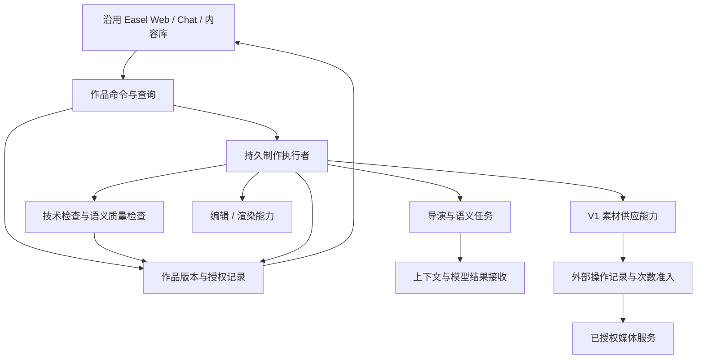
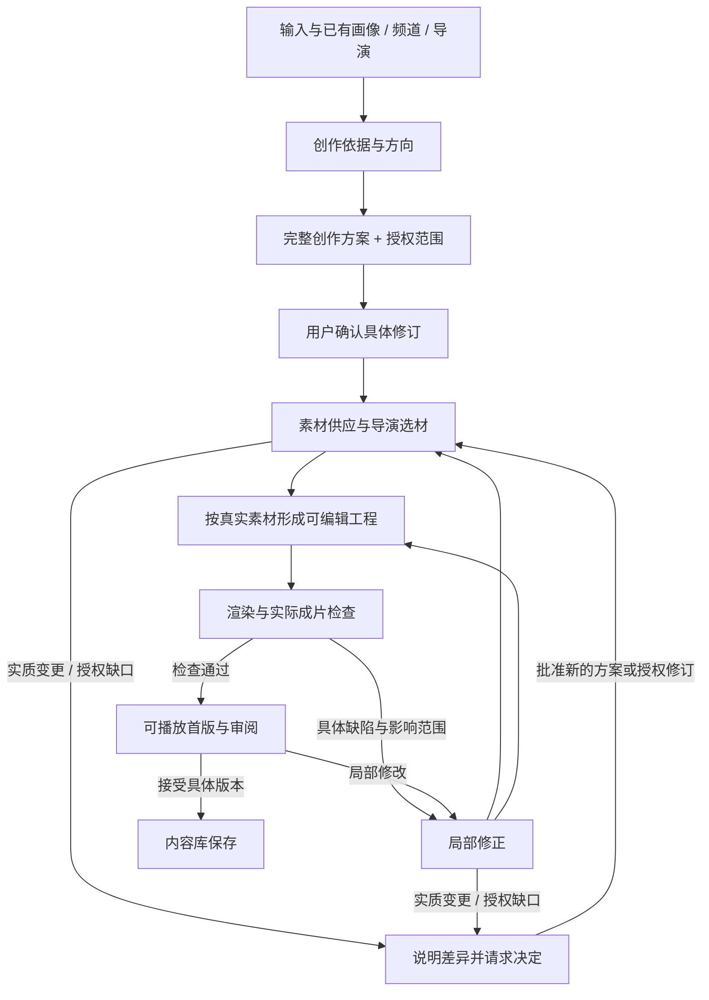

# Easel 领域职责与设计边界

状态：**主线、职责与案例衔接已确认；本文维护逻辑架构，不将技术推荐或待实现合同认作已验证能力。** 2026-10-17。输入为 [S4 定稿](../product/requirements.md)、[源码差距清单](../history/v2/11_REQUIREMENT_GAP_MAP.md)与用户认可的[完整创作案例](../history/v2/13_PRODUCTION_WALKTHROUGH.md)。历史设计阅读基线（非当前基线） `201bfc043b18cc161ae138176cfcdd5e7e6f89d4`；当时所引业务事实基线为 `8eeafb6b`。

选型推荐、替代方案及风险集中见[架构选型建议](../history/v2/14_TECHNOLOGY_SELECTION.md)。**数据、状态机、API、发送准入及恢复的 Coding 合同唯一维护在[可执行设计](contracts.md)**；本文解释其逻辑依据，不另定字段或执行规则。实施依赖与验收归属见[任务包](../project/tasks/S6_IMPLEMENTATION_PLAN.md)，当前阶段和唯一下一动作见[当前状态](../project/status.md)。原八项验证是测试素材，不是选型前置。

**整体源码与二开入口**：[Easel 整体实现架构与二开导读](overview.md)覆盖普通底座、Web/Agent/生产调用链、数据权威、持久恢复、素材与编辑以及扩展/测试落点。它描述 2026-10-23 HEAD＋Dirty 的实现快照；本文保留已确认逻辑职责，实施合同与运行验收仍分别维护。

阅读顺序：**§1 已确认边界 → §4 职责 → §6 主线交接 → §10 模块沿用/迁入/新增 → §12 待验证问题**。语义契约不等于已定表结构；逻辑模块不等于独立 Agent、进程或服务。

## 1. 已确认边界与方案依据

2026-10-23进入S6收口/S7统一规划，正文与演绎分离、内容修订、真实审阅和交付规格见[统一任务包§5](../project/tasks/S6_IMPLEMENTATION_PLAN.md#s7-architecture)。实现继续沿用作品/导演/任务/资产职责，字段与失败路径见实施合同末节；软件与真实验收状态见任务包§10，本文既有职责不变。

按已确认方向整理：**保留 Easel 的画像、Web、聊天和媒体工具；新增围绕作品的确认与执行能力；迁入 V1 素材库；导演负责创作判断，程序负责状态、权限、计数和恢复。** 一个产品内导演职责可以执行不同任务，不据此新增一批必须独立部署的 Agent。

2026-10-18 用户进一步明确：以对话作为视频创作主交互，沿用 Easel 创作能力，以已经跑通的后端为基础。具体[交互设计与 Easel 管线映射](../product/interaction.md)和[实施合同 §9](contracts.md)在 2026-10-18 当时均为待评审提案；后续已由 [S6-14A](../project/tasks/S6-14A_conversation-integration.md) 实施并部署，软件交付不等于真实质量及 Creator 接受通过。S5 的逻辑职责不因此改变。

| 方案 | 收益 | 主要代价/证据 | 本轮建议 |
|---|---|---|---|
| A 只增强当前聊天与视频 Skills | 改动少，保留全部现有入口 | 聊天历史与 SSE 不是作品权威状态；靠 Prompt 难以保证次数、取消、版本和外部操作恢复 | 保留入口和工具，不以其独立承担生产编排 |
| B 整体搬回 V1 Creation/Delivery/Hypit | 已有大量生产、素材及恢复代码 | 旧协议/Attempt、报价和阶段预算不符 S4；S3 有自主 FAIL、复杂上下文与恢复缺口；当前无频道多对多 | 不整体搬回；有据复用素材与局部检查 |
| C 在官方底座上建立小范围作品执行边界，迁入素材能力 | 满足确认后自主、版本、次数和恢复，同时保留现有产品 | 需要新增作品管理与集成；跨外部调用的崩溃窗口仍要专门验证 | **推荐**；先实现真实纵向闭环，再按实测扩大 |
| D 引入分布式工作流/多个独立服务 | 未来可扩容 | 当前本机单用户范围没有对应需求，增加部署与恢复成本 | 当前不选 |

已确认的职责与交接边界见 [ADR-S5-001](decisions/ADR-S5-001-work-production-boundary.md)。接受范围限于以下逻辑决定，不包含技术选型：

| 已确认边界 | 不变量 |
|---|---|
| 主人设与风格 | 既有六维画像就是主人设；一画像多频道，频道与导演多对多；跨频道复用风格不带入其他经历 |
| 规划与交接 | 创作依据→完整方案确认→真实素材制作→实际成片检查→局部修订→接受保存；方案/制作/修订三层规划引用同一作品及确定版本 |
| 创作与程序 | 模型做叙事、视听、选材和语义判断；程序管理身份、版本、权限、次数、引用、状态和恢复；最终接受归用户 |
| 自主执行 | 确认后在范围内自主完成；仅实质变更、授权缺口或无法继续的问题需要决定，不新增逐阶段审批 |
| 成果与副作用 | 先核实/复用已有成果；未知提交不盲重发；局部修改不默认重创作全片；重渲染不等于重新生成 |
| 质量与接受 | 技术检查、实际视听检查、可审阅首版及用户接受分别留证据；待修预览不能冒充合格首版 |
| 复用范围 | 沿用 Easel 基础，按 S4 迁入 V1 素材能力；旧生产执行链、历史数据与旧预算规则不整体照搬 |

上表已确认；下文具体实现建议与验证计划属于技术落实，不能反向改写这些边界。

## 2. 实际读取的 V1 设计与源码

用户提供的独立历史区域已核查：V1 源码归档工作树与 V1 历史复盘目录分别存在。前者 HEAD 为 `57c8e2ad`、工作区干净；后者 README 与 22 项问题表只读使用，原始日志/配置/媒体未复制入 Git。公开可追溯历史结论引用 [S3 固定报告](https://github.com/webxia/Easel/blob/4a92247b071c31d37ed623327d8058e62c64037b/docs/v2/10_V1_LESSONS_AND_REQUIREMENT_INSIGHTS.md)，不发布私有原件。

| V1 当时怎么做 | 源码/旧设计依据 | V2 推荐取舍 |
|---|---|---|
| Profile 回答“谁”，Creative Mode 回答“怎么表达”；规则分叙事、画面、声音、剪辑、QC | [Creative Mode 实现](https://github.com/webxia/Easel/blob/57c8e2ade21af9fb6abccdab3f7ba8e50132314f/easel/creative_mode.py)、[导演规则样例](https://github.com/webxia/Easel/blob/57c8e2ade21af9fb6abccdab3f7ba8e50132314f/creative_modes/clear_memo_video/director-treatment.md)、[V1 目标架构](https://github.com/webxia/Easel/blob/57c8e2ade21af9fb6abccdab3f7ba8e50132314f/docs/architecture/easel-video-architecture-v1.md) | 沿用区分方式；主人设仍是已有六维画像，新增频道和“参考→试片→导演版本”体验，不能沿用旧单导演首期范围 |
| 作品 JSON 原子替换、文件锁修改；Delivery 另持执行锁，作品状态由 Attempt 投影 | [Creation](https://github.com/webxia/Easel/blob/57c8e2ade21af9fb6abccdab3f7ba8e50132314f/easel/creation.py) `edit_creation`、[Delivery](https://github.com/webxia/Easel/blob/57c8e2ade21af9fb6abccdab3f7ba8e50132314f/easel/creation_delivery.py) `execution_lock/next_operation` | 保留“一个作品同一时刻只有一个有效执行者”和状态可重建；不认定多锁天然错误，也不复制所有旧状态字段 |
| 展示/确认方案携带 specs、脚本、场景、说明、声音等；按文本行切出部分来源 | [Proposal](https://github.com/webxia/Easel/blob/57c8e2ade21af9fb6abccdab3f7ba8e50132314f/easel/creator_proposal.py) `_plan_payload`、[来源目录](https://github.com/webxia/Easel/blob/57c8e2ade21af9fb6abccdab3f7ba8e50132314f/easel/integrations/planning_authority.py) `catalog` | 完整确认内容要保留；场景身份由稳定语义 ID 表示，不使用 Markdown 行号作业务身份 |
| 语义审核收集确认内容、规格、导演、人设、事实与候选证据，但部分路径未带完整适配许可 | [语义审核](https://github.com/webxia/Easel/blob/57c8e2ade21af9fb6abccdab3f7ba8e50132314f/easel/integrations/planning_semantic_review.py) `questions`、[候选审核](https://github.com/webxia/Easel/blob/57c8e2ade21af9fb6abccdab3f7ba8e50132314f/easel/integrations/planning_candidate_review.py) `directory_for`；S3 L12/L14 | 上下文需包含本任务所需的约束与授权；不固定复制旧 A/B 多批审核，不让下游重造用户硬要求 |
| 素材有独立入库、作用域、复用、权益、检查、供应与生成实现 | [素材库](https://github.com/webxia/Easel/blob/57c8e2ade21af9fb6abccdab3f7ba8e50132314f/easel/materials/library.py)、[素材复用](https://github.com/webxia/Easel/blob/57c8e2ade21af9fb6abccdab3f7ba8e50132314f/easel/materials/application/library_reuse.py)、[库内优先](https://github.com/webxia/Easel/blob/57c8e2ade21af9fb6abccdab3f7ba8e50132314f/easel/materials/application/library_first.py)、[使用条件检查](https://github.com/webxia/Easel/blob/57c8e2ade21af9fb6abccdab3f7ba8e50132314f/easel/materials/application/rights.py) | 按 S4 指令迁入相关能力；原 tenant/creator/Attempt 字段须适配已有画像/新作品，不带入多人产品或旧数据 |
| 阶段调用预算、生成报价与多处运行回执 | [Delivery](https://github.com/webxia/Easel/blob/57c8e2ade21af9fb6abccdab3f7ba8e50132314f/easel/creation_delivery.py) `reserve_delivery_call`、[生成集成](https://github.com/webxia/Easel/blob/57c8e2ade21af9fb6abccdab3f7ba8e50132314f/easel/integrations/material_generation.py) | 生图/生视频按 S4 实际提交计次；技术调用仍留观测和有界重试，但不混入用户额度；不重建持续金额预算产品 |
| Hypit 原生制作/局部修订、声音文字保护 | [Hypit 集成](https://github.com/webxia/Easel/blob/57c8e2ade21af9fb6abccdab3f7ba8e50132314f/easel/integrations/hypit/service.py)、[局部修订](https://github.com/webxia/Easel/blob/57c8e2ade21af9fb6abccdab3f7ba8e50132314f/easel/integrations/hypit/native_revision.py)；[V1 ADR-001](https://github.com/webxia/Easel/blob/57c8e2ade21af9fb6abccdab3f7ba8e50132314f/docs/decisions/ADR-001-creation-hypit-mainline.md)、[V1 ADR-004](https://github.com/webxia/Easel/blob/57c8e2ade21af9fb6abccdab3f7ba8e50132314f/docs/decisions/ADR-004-material-layer-v1.3-baseline.md) | 优先评估 Hypit 作为本地编辑/渲染能力，素材生成由素材供应负责；局部保护思想可用，旧执行链不自动迁入 |
| 结果原件、解析/验证、派生与回执分开 | [V1 ADR-005](https://github.com/webxia/Easel/blob/57c8e2ade21af9fb6abccdab3f7ba8e50132314f/docs/decisions/ADR-005-agent-result-processing.md)、[结果回执](https://github.com/webxia/Easel/blob/57c8e2ade21af9fb6abccdab3f7ba8e50132314f/easel/integrations/output_receipts.py) | 沿用可追踪接收和不覆盖有效结果；不让 parser 自行调用模型，不搬旧协议矩阵 |

以上是有界源码阅读，不是全部 V1 文件逐行审计。历史“Accepted”只对当时版本有效；S4 已改变频道、导演形成与预算范围。

## 3. 产品关系与权威信息

- **画像**：直接引用既有 Profile；作品确认时记录所用内容快照/摘要以支持历史追溯，这是作品证据，不是第二套主人设。未选画像时不读其他画像记忆。
- **频道**：属于该画像，保存定位/偏好及可选导演、默认导演版本、音色/字幕；不保存另一份可独立演化的人设。普通临时作品可以无频道。
- **导演**：保存风格草稿、参考证据、试片和接受后的版本。风格规则涵盖叙事与视听，不能锁成脚本套路。跨频道带风格，不带原主题事实。暂不引入跨用户共享市场。
- **作品**：组织输入、方案修订、授权、运行、输出与接受记录；聊天只是交互入口。无频道/无画像作品也遵守相同生产边界。
- **本片设置**：本片→频道→画像的有效音色/字幕在方案展示时解析并固定；导演只能推荐，不静默覆盖。默认改变只影响之后的新方案。
- **双重接受**：正式首版兼作试片时，“接受这部作品”和“接受/保存这位导演”可在同一交互中明确表达，但记录为两个独立选择；任一不能自动推导另一项。

## 4. 职责与边界

图示为职责，不代表独立进程或微服务数量。制作生命周期不依附 HTTP/SSE 连接存活；本机后台执行者的技术取舍见[选型建议](../history/v2/14_TECHNOLOGY_SELECTION.md)，实现合同见[可执行设计 §5.1](contracts.md#51-worker-与持久编排)，不在这里另设接口验证前置或引入分布式调度平台。

| 职责 | 负责 | 不负责 | 需求/风险 |
|---|---|---|---|
| Web/作品命令 | 制作进度/步骤/成果预览、用户输入、确认指定版本、取消/修订/接受命令、查询 | 绕过作品记录直接发起另一条付费视频链 | 005～008、024、027 |
| 作品记录 | 版本身份、已确认约束、授权、最终选择、运行/产物引用 | 判断叙事是否好、发明事实 | 002、008、019、020 |
| 导演/语义任务 | 参考拆解、方案、事实语义、选材取舍、局部改写、风格质量 | 写额度、伪造素材权益、宣告用户接受 | 001、004、014、019、032 |
| 持久执行者 | 有效任务推进、取消、操作准入、恢复、状态投影 | 改核心观点、由异常推断授权扩大 | 006、013、024～026、033；S3 L17/L20 |
| 素材能力 | 入库、检索、下载、复用、授权内生成、来源/权益事实与技术资格 | 替导演改故事、创建最终时间线、自动放宽必用素材 | 011、012、021、031 |
| 编辑/渲染 | 合法已选媒体到时间线、字幕/音轨、渲染与可验证输出 | 自行采购/生成收费素材、重新定义确认内容 | 009、010、015、022、023 |
| 检查 | 程序验证身份/媒体/额度/引用，模型检查语义与审美；失败有明确范围 | 用模型分数代替用户接受、为了 PASS 降条件 | 014～018、030 |
| 上下文/结果接收 | 限定本次任务信息、版本与引用；保存允许保留的回执、解析和诊断 | 全量复制旧会话或私有原件、偷偷补造缺失模型结果 | 001、032、034；S3 L07/L12/L15 |

### 4.1 通用自然表达与导演的结合（2026-10-22）

依据[本期需求补充](../product/requirements.md#natural-expression)，自然表达是一项共用创作能力，嵌入现有生产任务，不另建 Agent、后处理服务或质量关卡。**通用基线定义应避免的表达问题，导演决定适合这部作品的表达方式。**

| 依据 | 职责与边界 |
|---|---|
| 通用自然表达基线 | 减少空泛、冗余、机械叙述及无意义视听安排；保护原意和信息，不内置聊天型人格或电影风格 |
| 六维画像、本片要求、频道定位 | 提供身份/事实、受众、禁区及有效选择；不保存通用规则副本，不因能力更新改画像 |
| 导演版本 | 将基线落实为具体叙事、声音、画面和节奏；保留正式、诗性、幽默等差异，不因通用能力更新而新建版本或重做试片 |
| 既有模型任务与程序 | 模型结合文体及实际媒体判断表达；程序从单一受信规则源装配任务上下文，绑定版本、引用、保护项与恢复，不用词表或分数替代语义判断 |

相同基线覆盖V2视频生产各既有路径的**新任务**，按规划、选材、编辑、审片和修订任务提供相关部分；参考拆解仍如实记录原片，不能先“自然化”参考证据。无导演时依据本片内容与已选画像工作，不暗建默认导演。规则更新独立于导演生命周期；按用户最新决定不兼容旧任务，只保留旧数据/UNKNOWN保护，新任务正常恢复仍须可用。单一规则快照与显式任务片段的实现边界见[实施合同 §6.1](contracts.md#natural-expression-design)，不建设动态策略引擎。2026-10-22最初范围未扩展TTS或编码；该阶段取舍不限制后续已批准扩展，当前具体合同见实施合同末节，实际结果见状态页。

## 5. 作品依据与版本关系

完整方案是后续创作的依据：摘要与全文同源，用户确认具体修订后不能就地改写。制作规划可以根据真实素材在许可范围内细化；实质变更需要新的明确确认。运行和任务引用这些依据，外部操作引用相应授权，产物记录实际使用的输入与制作版本，用户接受最终绑定具体输出。新作品不继承旧作品授权，修订则保留并复用合格成果。

这些关系对应的数据记录、版本和写入条件统一见[可执行设计 §3～4](contracts.md#3-数据与文件合同)，本节不维护第二套字段表。

硬要求必须有用户/画像/确认方案的来源；导演提出的景别、光线、镜头实现等需标注可调整范围，不能默默变成素材源必须天然具备的属性。程序校验身份和关系，模型判断是否违背语义；关键冲突交用户，不把“可自主选择”升级成未决问题。

场景/片段有稳定 ID 与类型；Markdown 是展示，不是身份来源。局部修改后 ID 保留或明确替换，旧来源仍可追溯。未决事实不能用空字符串伪装满足。

## 6. 主线衔接与大模型的分层创作

用户已认可本节主线、模型/程序职责及[90 秒视频完整案例](../history/v2/13_PRODUCTION_WALKTHROUGH.md)的衔接方式。案例仍为纸面推演，不是运行通过记录，案例里的次数、素材和经历不是实际授权或事实。

主线采用**程序推进明确阶段，导演在阶段内根据真实反馈规划和创作**。阶段是产物交接边界，不是固定脚本套路，也不是每一步换一个 Agent。模型可以提出下一项创作动作，程序依据当前版本、依赖、权限及操作记录决定是否执行；不能由模型一句“完成”推进状态。

图中的返回边均需指定受影响部分；确认实质变更时回到最早受影响阶段，不固定从选材重跑。补额度只更新授权并继续原缺口；修改观点则先更新方案。此前有效产物继续保留。

### 6.1 每一步怎样交接

| 阶段与输入 | 大模型如何工作 | 程序如何承接 | 交给下一步的产物与通过条件 |
|---|---|---|---|
| ① 理解输入：本次要求、可选画像/频道、导演版本、用户素材 | 区分真实经历、观点、公共事实和创意表达；先提具体方向，只问关键缺口；理解原片内容与必用部分 | 解析本片→频道→画像默认项，登记输入和来源，核验媒体可读性及当前服务能力 | 创作依据：事实/观点、必用/参考、风格依据、规格、明确要求及真正未知项；不能把其他画像经历带进来 |
| ② 创作方案：依据与必要的初步可行性证据 | 规划叙事弧线、信息取舍、脚本、场景目的、视听节奏、声音/字幕；说明素材可替代范围，提出 AI 补料次数建议 | 可做授权内的只读检索/预览与工具能力探测；不在方案确认前偷偷生成收费素材；完整方案与摘要绑定同一修订 | 完整创作方案供用户一次确认；包含不可改变内容、可自主创作范围、素材策略、实际音色/字幕选择及授权；尚未拿到素材不能假称已取得 |
| ③ 确认转执行：用户确认的方案和授权 | 将场景目的拆成当前可执行的素材需求和制作依赖；不另写一份改变原意的新方案 | 固定确认版本和输入证据，原子接收重复确认，创建/恢复同一有效运行；检查服务、权限、额度 | 可执行制作计划：稳定场景身份、需求、依赖、已有成果和待执行项；所有硬要求可追溯，缺项明确报告，不能靠模型补造授权 |
| ④ 素材与导演适配：场景目的、真实候选及供应结果 | 看真实图像/片段并选择；判断叙事适配、风格、可裁切区间；素材不合适时改检索或调整镜头实现，有明确缺口才请求生成 | 必用→允许的库内复用→外部→授权 AI；执行来源/权益/媒体资格检查、操作准入和结果登记 | 已选素材及片段区间、用途、来源和权益依据；每个未满足场景有具体原因。模型不能把不存在的文件或搜索摘要当作可制作媒体 |
| ⑤ 编辑创作：确认方案、已选素材、音色字幕设置 | 根据真实画面和实际旁白时长细化剪辑、镜头时序、声音与字幕；保持全片叙事，允许在范围内重排实现；生成可编辑制作表达 | 工具提供真实媒体句柄与时长，校验工程语法、引用、时间和配置；调用编辑/渲染工具；禁用工具暗中采购或替换音色 | 可复现的编辑工程/时间线及媒体依赖，绑定方案和制作修订；旁白只生成必要内容，已有有效音轨直接复用；通过后渲染候选版本 |
| ⑥ 成片自检：实际渲染视频、方案、导演规则和技术结果 | 结合实际画面、声音、字幕检查事实表达、节奏、风格和配合关系；输出缺陷位置、依据、严重性和局部修复建议 | 检查文件可播放、时长/画幅、音视频轨、素材引用及必要媒体检测；缺陷进入有界修复，修后重新检查受影响部分与全片一致性 | 具体可播放版本、与其绑定的检查记录和残留问题。技术通过不能替代语义检查；文本自评不能冒充观看/听取成片 |
| ⑦ 审阅与保存：可播放首版及用户自然语言意见 | 理解修改对象，提出最小必要影响范围；扩大范围时解释；不能把审美建议推成必须全部重做 | 对比当前/历史版本，保留接受记录；按依赖复用，新增生成次数随修改说明；接受命令绑定实际版本 | 可比较的新版或用户明确接受的内容库作品；不自动发布，不把接受作品自动当作接受导演 |

### 6.2 规划分三层，衔接靠产物和证据

1. **创作层规划**回答“这部片讲什么、为什么这样讲、观众获得什么感受”。完整方案包括脚本与场景设计，但不是提前假定所有具体素材已存在。事实、观点、必用内容与用户指定的视听要求固定；导演自行提出的光线/镜头实现保留已确认的调整范围。
2. **制作层规划**回答“用实际找到的素材怎样实现”。选择素材与细化剪辑可以局部往返。例如搜不到天然具有某种灯光的镜头，导演可以在许可范围内用合适实景和调色实现气氛；不能因此要求用户重确认整片，也不能伪造某段真实经历。
3. **修订层规划**回答“这一个问题影响哪些内容”。根据实际首版的缺陷或用户意见形成局部变更，而不是重新理解整个需求并重做所有素材。换一句旁白可能连带时长、字幕和相邻剪辑；只改字幕字号通常不需要重新生成旁白。

三层不是三个独立主人设或必须独立的 Agent。导演形成也有单独准备流程：参考视频拆解→带时间证据的风格草稿→本次内容试片→明确接受导演版本；它产出的风格版本进入上述主线，不把参考片的事实或逐句脚本带入新作品。

每次交接使用**同一个作品、已确认方案修订、当前制作修订、任务输入与产物引用**。程序组装当前任务上下文：必要的完整语义约束、适配许可、相关场景、真实候选、已完成成果、局部缺陷；不依赖模型从长聊天里记住，也不让模型反复抄身份和授权字段。下游发现冲突要返回具体来源与差异，不能私自把创意形容词升级成用户硬条件。

计划在真实工具结果到来后更新；只有受影响的依赖失效。程序根据明确引用计算直接影响，导演补充叙事/节奏影响，不能用文件依赖图声称语义影响已全部发现。对局部与整体影响有疑义时先说明，不扩大执行范围。

长片按叙事段落安排局部制作，但各段共享全片大纲、术语/人物事实、风格和声音设置；合成后检查跨段连续性与全片节奏。分段不是把 900 秒需求拆成互不相干的短片，也不是偷偷缩短输出。

### 6.3 失败返回哪里，何时暂停

| 情况 | 恢复位置与处理 |
|---|---|
| 检索暂时错误、下载中断 | 有界重试原任务；保留其他成果，不能升级为整片重做 |
| 候选不合适/素材不足 | 回到对应场景选材或镜头实现；说明新证据，避免相同搜索无进展循环；实质变更或额度缺口才请求用户 |
| 生图/视频发送结果未知 | 核实原操作，禁止通用框架自动重放提交；详见 §7 |
| 模型输出格式不合法 | 提供具体解析错误，有限修正同一输出；不能用另一条流水线掩盖失败，也不能自动放宽内容检查 |
| 真实内容/声音/字幕/引用缺陷 | 返回受影响素材或编辑阶段，修复后产物重新绑定检查；旧版 PASS 不能转贴新版 |
| 单纯审美建议 | 根据确认风格判断是否阻碍交付，不设置无意义的满分门槛；残留建议可以随可审阅版展示 |
| 必需模态检查不可用 | 如实记录未验证项；不能让看不到视频/听不到声音的模型宣称验收通过；必要时交待修预览 |
| 无新证据的反复失败或预算/时限/质量冲突 | 停止该循环，保留成果，提供追加、换素材、修改要求或暂停等具体选择；不能无限重试或静默降级 |
| 程序缺陷/服务配置损坏 | 保存现场并明确故障；产品自主创作不包含修改仓库或靠研发人员救火后声称自主通过 |

各类自动修复需预先设置技术尝试上限与无进展停止条件，具体数值通过试验校准；这些不是新增的用户付费额度。质量要求不随尝试次数降低。

作品进度从产物和有效任务记录投影，不由素材层、渲染器或聊天分别宣布完成。**接受是绑定具体输出的独立记录，不是与制作中、待修或已取消互斥的状态**：用户已接受旧版时仍可以制作新版，新运行失败或取消不抹掉旧接受。状态机、取消和恢复合同见[可执行设计 §3.3](contracts.md#33-状态机)；关闭页面仍不等于取消作品。

### 6.4 制作过程可观察：作品进度视图

用户补充明确要求制作中知道每一步在做什么，详见[需求 024 的补充](../product/requirements.md#v2-exp-024-补充--制作过程可观察)。该体验属于主线，不是仅供研发看的日志或最后才交付的报告。以下是职责设计，具体组件布局未冻结。

- **默认概览**：当前阶段/动作，已完成项，并行任务，真实等待/恢复原因，是否需要用户决定，已有成果入口与生成次数。阶段可以回到局部修复，不伪装成永远单向前进的百分比。
- **展开步骤**：本步目的、关联方案/场景、输入/素材、关键动作与简短选择依据、实际产物、下一步。模型提供可读的选择/变更摘要；程序校验引用和操作事实，不能让模型文字决定“已完成”。
- **实际预览**：脚本、选材缩略图/区间、已完成配音试听、可播放的候选片或修订版按存在状态展示。未完成不造预览；素材预览与候选片不冒充已通过检查的首版。
- **事实来源**：作品/任务状态与产物记录负责当前快照，带身份和顺序的关键执行事件解释变化；外部服务状态来自已核实回执。SSE 等只负责输送，断连可重新查询快照与缺失记录，不靠浏览器内存作唯一状态。
- **恢复与版本**：显示最近状态更新时间，区分制作等待和展示断连；关联作品、运行、方案/产物修订，重复/迟到事件不得覆盖新版。重试保留可见记录，旧成果继续可查，不能以重开页面掩盖错误或重新提交。
- **控制边界**：观察不暂停制作、不触发付费，不新增步骤审批。用户提出修改仍走既有影响范围与授权规则；取消入口复用既有语义。不展示原始凭证、其他画像资料、模型内部思维过程或调试堆栈。

示例（模拟显示）：“选材：4/5 场景已有可用素材；结尾背景生成结果待核实，正在查询原任务；旁白已完成，可试听。生图已用 0、待核实 1、可用 1 / 授权 2；视频已用 0 / 授权 1。”这里 4/5 只指素材场景，不等于整片完成 80%；查询成功确认提交后才更新已用/待核实显示。

## 7. 生成次数与外部副作用

用户额度只包括 **IMAGE 与 VIDEO 实际提交次数**。旁白、查询、下载、复用不计入这两类额度；旁白仍遵守服务授权、新增收费说明和复用要求。内部技术重试可有明确上限，但不能变成用户未批准的新收费额度。

逻辑边界是：预留不能冒充实际提交，已提交后失败仍计次，结果未知需保留占用并核实原操作。查询、下载和复用沿用原操作；明确的新生成另计一次，不能借恢复、换运行或换导演重置消耗。取消阻止新的派发，但不承诺撤回已在途的外部生成。

Provider 的幂等或查询能力决定如何核实未知结果；缺少可核实身份时应如实停止，数据库不能与网络发送形成原子事务，也不能宣称外部 exactly-once。发送窗口的所有权、服务模式权限、额度条件更新及状态转换统一见[可执行设计 §3.2～3.3](contracts.md#32-最小记录与不变量)，具体实现与故障测试由[操作任务](../history/tasks/S6-03_operations.md)负责。

**可执行权限边界**：付费凭证仅由受控适配器取得；创作/制作 Agent 不能持有可绕过准入的媒体服务凭证或任意付费网络通道。模型建议请求，程序授权发送。保留当前通用聊天能力不代表它可独立执行 V2 付费视频流程。若选定 Harness 不能提供这样的工具/文件/网络隔离，必须通过专门验证或更换执行接入方式，不能用 Prompt 声明代替权限保障。

## 8. 持久化与执行权威

存储和编排候选的推荐、替代及风险唯一见[选型建议 §2～3](../history/v2/14_TECHNOLOGY_SELECTION.md#2-应用形态与执行编排)；V1 JSON/文件锁的源码依据保留在本文 §2。选择数据库或图框架不等于持久执行自动可靠，也不据此新增分布式平台。

框架只拥有技术检查点；用户确认、授权、外部操作和产物接受由作品领域规则裁决。检查点和素材库都不能形成第二套可独立变更的生产状态、额度或确认记录。跨数据库和媒体文件的写入不能假称原子；已有有效结果必须能够核实接收，不能因登记中断再次收费生成。

执行者所有权需跨进程核验，不能因超时默认前执行者已停止；过期结果仍需按原操作核实，保护已付费成果。存储布局、文件接收、引用删除、所有权和重放细则集中在[可执行设计 §3、§5～7](contracts.md#3-数据与文件合同)。存储演进只针对新 V2 数据，旧 V1 原件不升级或续跑。

## 9. 模型上下文、原生工具与渲染选择

- 复用 Easel Harness/模型配置入口，但增加按任务限定的上下文：完整必要的事实/禁止项/适配许可、所选导演、当前场景和真实素材证据。省掉重复回抄，不能省掉授权边界。
- 提供来源句段的稳定引用，模型只产出新增语义、创作文本和必要选择；程序绑定已有身份、版本、摘要和引用。JSON/文档/原生工程格式各自严格接收，失败保留诊断，不用模糊补齐把失败改成通过。
- 专用语义任务与有工具的创作执行分别描述能力；不预选供应商或要求所有任务都必须工具调用。HTTP 200/finish-stop/空工具输出不等于有效业务结果；查询、格式错误、语义修订、素材不足各有恢复含义。
- 产品执行工作区只提供产品指令和当前作品范围，核查实际加载内容；根研发 AGENTS、旧调试说明、其他画像和凭证不能因 cwd/默认注入泄漏。**单纯分目录不算隔离已实现。**
- 当前 [直连 API](../../../easel/direct_api.py)明确没有本机工具，只能承担其实际支持的语义任务；[Harness](../../../easel/harnesses/base.py)支持 cwd/env/权限等，但是否足以满足任务隔离必须实测。
- 编辑/渲染候选、替代与源码风险见[选型建议 §5](../history/v2/14_TECHNOLOGY_SELECTION.md#5-编辑渲染本地-ffmpeg-与可编辑工程)。具体接入决定与必要局部验证由[编辑器任务](../history/tasks/S6-09_editor-adapter.md)负责；完整时长、四声音模式、三类输入及局部修改的覆盖按[实施验收分工](../project/tasks/S6_IMPLEMENTATION_PLAN.md)落实，不作为选型前置。候选名称或局部样片不能冒充完整能力已实现。
- 不立即删除官方视频技能或非视频能力。新 V2 作品入口只能有一个执行负责方；旧工具可作为被调用能力，不能形成第二个绕过授权的独立生产入口。具体迁移入口在实施前做回归评估。

### 9.1 大模型职责与工具接口

| 创作任务 | 模型必须获得的证据 | 模型输出 | 程序保留的决定权 |
|---|---|---|---|
| 参考拆解/导演形成 | 实际参考视频、声音、时间位置及用户认可的试片 | 风格规律、适用范围、非固定套路的叙事方法；观察与推断分开 | 版本保存、用户接受、引用权限 |
| 方案规划 | 当前输入、已有六维画像、所选风格、事实来源、能力信息 | 可讨论的完整方案和可调整范围 | 有效版本、默认解析、确认与授权 |
| 选材和镜头适配 | 真实候选画面/区间、权益状态、当前场景目的 | 选用理由、区间、替代或生成需求 | 文件存在/技术资格、范围、权益规则及调用次数 |
| 编辑与局部修订 | 已选媒体、实际音轨时长、工程状态、变更要求 | 可执行编辑表达、局部变更及语义影响 | 引用/时序校验、渲染、产物版本与保护 |
| 语义与风格检查 | 实际成片的视听证据、确定的检查目标 | 具体缺陷与位置，不能只返回笼统评分 | 技术事实、是否满足必要检查、是否可交付；最终接受仍归用户 |

上述是任务角色，不是必须部署五个 Agent。默认复用同一导演规则，按任务提供上下文；不要求每一步先规划、再执行、再找多个模型投票。只有实测表明独立审核能识别漏检且收益足够时再引入额外审核角色。

工具接口以业务动作和真实结果为中心，如查素材候选、检查某媒体、提交已授权的生成请求、编辑指定场景、渲染指定工程。程序注入作品/版本/授权身份，模型填写创意内容和必要选择；结果返回真实媒体引用、状态、错误类别和可继续动作。模型不能直接写完成标志、扣额度或用虚构工具结果推进。技术超时、素材不足、格式错误和语义不符必须有不同返回含义。

模型能力按任务验证：文本任务不假定需要多模态；选材、参考拆解和成片检查必须有匹配的视频/图像/音频证据与处理能力。抽帧、ASR 和技术检测是辅助证据，不能单独证明运动连续性、真实音色或完整听感；抽样覆盖不足明确记录。模型和上下文容量尚未选定，不先承诺一次调用看完所有 900 秒素材。

## 10. 模块沿用、迁入、新增与交接

以下是**责任归属与代码复用计划**，不是模块已迁入、具体接口已冻结或可以无修改复制的声明。源码证据集中见[S4 差距 §2～5](../history/v2/11_REQUIREMENT_GAP_MAP.md)，V1 固定版本见本文 §2。

### 10.1 沿用 Easel 的基础

| 模块/源码入口 | 沿用部分 | 接入主线时必须补齐 |
|---|---|---|
| `easel/persona.py`、ProfilePage | 六维画像文件、选择与编辑 | 频道引用、有效默认解析、作品历史依据；验证实际上下文隔离，不新增第二套人设 |
| `web/app.py`、App/ChatPage | 聊天、附件、上传、事件展示 | 将输入转为作品依据，标记必用/参考；补作品级制作进度、步骤与成果预览；作品确认/取消/接受绑定版本，SSE 不是持久任务状态 |
| OutputsPage 与 outputs API | 媒体预览、文件浏览和下载入口 | 接入作品版本/接受记录/引用保护；ready/published 不等于用户接受 |
| `tts.py`、`asr.py`、`audio_ops.py`、`video_ops.py`、`assemble.py` | 配音、转写、音视频处理与合成工具基础 | 固定音色不静默回退；实际时长/字幕预览；由当前作品执行者调用，工具不能绕过授权自行采购 |
| 模型配置与 Harness 接口 | 已有服务配置、模型调用接入 | 按任务传必要证据，核验实际工具/指令/凭证隔离；直连 API 不能假称具有本机工具 |

沿用指保留能力基础与入口；原有非视频功能继续保留。修改上述入口前需检查回归影响。

### 10.2 迁入 V1 素材能力

| S4 项/源码模块 | 迁入后的责任与输出 | 适配/拒绝照搬的部分 |
|---|---|---|
| M01 `library.py` / `store.py` / domain models | 文件身份、入库同意、作用域、来源、使用记录，输出稳定素材引用 | 旧 tenant/creator/Attempt 与新画像/作品适配；不迁旧历史库、凭证或重复人设 |
| M02 `library_reuse.py` / `semantic_index.py` / `dedup.py` | 合法范围内检索、去重、复用候选 | 候选交导演判断，不能自动成为已选素材；索引资源与新用途重新检查 |
| M03 `library_first.py` / `routing.py` / `supplemental.py` | 库内优先、有限外部供应，返回候选或具体缺口 | 不足交导演适配；生成请求走统一准入，不在检索循环隐式发起 |
| M04 providers registry / acquisition / inspector / rights | 来源获取、媒体资格、使用条件与署名证据 | 供应商文件存在不代表现在可用；公开可下载不代表可用；模型不能虚构权益 |
| M05 generation / generation_modalities / 观察记录 | 发送/查询/接收生成资产，保留原任务身份和结果 | 调用必须引用作品授权与操作记录；用户计次唯一权威在程序准入边界，不能保留旧阶段预算为第二套账 |

旧 `material_layer/material_supply/material_generation` 集成依赖 Creation、Attempt、Hypit workspace 和报价；按新边界重接，不能把这些依赖整体拖回 V2。源文件与旧测试仅提供复用依据，迁入后仍需适配测试与真实验证。

### 10.3 需要新增或补齐的逻辑模块

| 责任模块 | 接收 → 输出 | 与现有基础的关系 |
|---|---|---|
| 频道与导演管理 | 已有画像、参考视频、试片接受 → 频道关系、导演风格版本及默认搭配 | 新增产品关系与接受体验；V1 Creative Mode 的风格表达仅参考，不照搬固定目录或旧产品范围 |
| 作品/方案/授权记录 | 输入、完整方案及明确确认 → 确定修订、授权、运行、接受记录 | Chat/内容库入口沿用；状态权威新增，展示从其投影 |
| 导演任务上下文与结果接收 | 当前约束、真实证据、场景和成果 → 创意内容、素材选择、编辑表达、局部变更 | 复用调用基础；新增任务化上下文、严格接收与诊断，不让模型回抄/修改权限身份 |
| 持久制作与操作准入 | 已确认版本、依赖和授权 → 可恢复任务、原操作身份、计次、取消及进度 | 新增所需行为；技术实现可使用候选框架，不预先决定全部自研 |
| 编辑工程与局部修订接入 | 实际选材/音轨、计划、修改范围 → 可编辑工程、渲染版本、影响依赖 | 媒体工具沿用；Hypit/FFmpeg 等接入待验证，V1 局部声音/文字保护思想参考 |
| 制作进度投影与步骤展示 | 任务/操作/产物事实、关键变化与可读摘要 → 当前状态、步骤记录、预览、恢复提示 | 沿用 Web 事件通道与媒体预览，新增作品级快照/恢复/版本过滤；不另建生产状态权威 |
| 检查、审阅与接受保存 | 实际成片、技术/视听证据、用户意见 → 缺陷修复或可审阅版本、最终接受 | 补齐完整体验与证据；保存/展示入口沿用，模型不能宣告用户接受 |

这些责任可在一个本机应用内实现，不等于同等数量的新服务或独立 Agent。先使用能满足边界的最少实现。

### 10.4 不整体迁入与落实顺序

不整体迁入 V1 Creation/Delivery/Attempt 执行链、旧阶段调用预算/持续报价、旧状态数据库、历史媒体与凭证。V1 导演、局部修订、结果接收的有用思想可参考；具体代码迁入需与选定编辑能力及新合同匹配后确定，不能扩大已确认的素材库迁入范围。

具体依赖、落实顺序及验收分工由[实施任务包](../project/tasks/S6_IMPLEMENTATION_PLAN.md)唯一维护。实施中尽早用小样本穿过完整链，再分批覆盖正式范围；不以局部通过缩减 S4 的 1～900 秒等要求，也不另从本文的验证清单开始前置实验。文档中的复用计划不扩大实施、付费调用或数据迁移授权。

## 11. 需求覆盖与设计验证

| 设计部分 | 对应 V2-EXP | 必须验证的反例/场景 |
|---|---|---|
| 画像/频道/导演/默认版本 | 002、003、010、019、020、034 | 跨频道不换人设；临时改音色不污染默认；试片接受不自动变作品接受；无画像不读其他记忆 |
| 方案/上下文/语义身份 | 001、004、005、011、014、032 | 同一摘要与全文；过期确认；适配许可不丢；场景重排不混入 Markdown 表头；个人事实不虚构 |
| 执行/操作/次数/取消 | 006、012、013、024、025、026、033 | 同时提交不超额；发送前后崩溃；UNKNOWN 不重提；关页继续、取消停止新操作；凭证绕过被阻断 |
| 素材/质量/渲染 | 009、015、016、018、021、022、023、031 | 权益不明拒绝；库内复用；供应不足不变硬要求；四模式/900 秒/画幅；待修不能标完成 |
| 修订/保存/接受/入口 | 007、008、017、027、028、029、030 | 只改画面不改声音文字；旧版可选；删除不破坏引用；能力缺失不静默换服务；同版记录干预与耗时 |

验证层次：文档/合同审查 → 无付费软件与崩溃测试 → 经授权的真实 Web 到视频 → 用户审片。真实测试样本、供应商和额度另行明确。技术通过不能替代自然音色、导演风格或 Creator 接受。

## 12. 集中的待验证清单与决策边界

以下 **NOT_TESTED 是 2026-10-17 S5 建立本表时的历史基线**，不代表后续 S6/S7 已实现项全部未测。当前具名验收看[当前状态](../project/status.md)与[实施任务包](../project/tasks/S6_IMPLEMENTATION_PLAN.md)，源码落点看[整体实现架构](overview.md)；本表保留验证问题，不维护第二份实时状态。源码存在、纸面案例认可、文档检查均不等于下列验证通过。以下主要是实施后验收问题；选型可依据现有源码/官方资料形成推荐，仅关键疑点需要小实验，不要求先完成整表。

| 编号 / 问题 | 验证对象与证据 | 失败时如何处理 |
|---|---|---|
| V01 指令与权限隔离 | 捕获选定执行接入实际加载的指令/工具/可访问范围；研发指令、其他画像、付费凭证绕过均需反例验证 | 修接入边界或替换候选；不能靠 Prompt 声明已隔离 |
| V02 交接保真与版本确认 | 带事实、适配许可、必用原声和固定音色的上下文样本；过期/重复确认、场景重排测试 | 修上下文/接收和身份契约，不能新增无必要审批或丢弃限制 |
| V03 持久恢复和执行所有权 | 关页、重启、取消、并发/过期执行者、流程代码升级、检查点与领域记录跨写入；操作/产物关联完整 | 调整持久执行方案；不得让旧执行者覆盖新版本，框架无合格证据不锁定 |
| V04 外部操作与次数 | 发送前后崩溃、回执丢失、并发占额、原任务查询/幂等能力；分别验证软件替身与所选 Provider | 无法核实则明确 UNKNOWN 并保留占用；不重提、不把测试替身通过当作服务保证 |
| V05 素材迁入与使用条件 | 作用域/入库/摘要/复用/来源/署名/删除引用测试，实际外部获取及索引可用性 | 修适配或报告供应缺口；不以找不到素材为由放宽事实/权益要求 |
| V06 声音和字幕稳定性 | 同文试听、固定音色跨片稳定、实际画面字号预览、原声保护、配音与字幕对齐、默认优先级 | 保留已选设置并报告具体不可用项，不静默换音色/重配；自然听感需实际听取 |
| V07 编辑与渲染范围 | 对已接入编辑能力分批验证：1～900 秒、四声音模式、两画幅、三类输入及组合、原声片段；必要的候选局部对照按负责卡执行 | 明确能力缺口并比较实现；不能用 90 秒案例缩减需求或默认整片生成视频 |
| V08 局部修订保护 | 只改字幕/画面/一句旁白等样本，检查直接依赖、语义影响、邻接处、历史版和生成复用 | 修依赖与编辑表达；无法保持范围先说明，不默默扩大重做 |
| V09 实际自检与导演效果 | 对实际视听证据检查缺陷，避免脚本自评替代；同导演跨内容试片、事实/风格一致性、无进展停止 | 修创作上下文/工具/检查方法；残留阻断标待修，不能降标准刷 PASS |
| V11 制作过程可观察 | 对照真实执行核查动作/并行任务/产物/计次；等待、重试、未知、断连、刷新、乱序及旧版事件测试；无假进度且不漏隐私 | 修事件投影/快照恢复与摘要；状态不可核实时明确未知，不用模型叙述伪造完成 |
| V10 完整体验与效率 | 同版本 Web 到可审阅版、用户接受保存、无画像、不自动发布、原有功能回归；记录耗时/调用/人工干预 | 区分软件、真实生产、自主完成和用户接受；有研发救火不能记自主通过 |

[T01～T08](../history/tasks/S5_VALIDATION_PLAN.md)和[早期研究实验](../history/v2/12_PRODUCTION_FLOW_RESEARCH.md)保留为测试意图与证据来源；V01～V11 的实际负责卡和验收阶段由[实施任务包](../project/tasks/S6_IMPLEMENTATION_PLAN.md)维护，不构成另一条排程。技术数值如自然语速/时长误差、自动修复上限与效率目标需实测校准，不能先用任意阈值改变验收。

已确认范围见本文 §1；技术取舍见[选型建议](../history/v2/14_TECHNOLOGY_SELECTION.md)，Coding 合同见[可执行设计](contracts.md)。当前进展、未测事实及唯一下一动作只在[当前状态](../project/status.md)汇总；本文不要求重新访谈已确认需求，也不把局部后端缺口扩展为全部任务阻塞。

## 2026-10-20 已批准：综合 main 与受控管线回合

新管线不再拥有独立部署Agent：main承接普通讨论及业务管线，普通回合保留原综合技能/工具；进入管线时，宿主通过既有Conversation Segment建立独立原生会话范围，插件在模型前替换受控产品指令、收窄九工具，并在每次执行前核验票据与拒绝旁路。业务权限仍由WorkService/Operation裁决，不能以模型声称进入管线授权。退出本轮不自动取消生产。既有easel-video/awei-creative停止配置，新会话统一main；按用户决定不迁移/兼容旧会话，历史数据保留，不自动重放旧结果。此决定替代此前将独立easel-video作为正式装配要求的部署选择，不改变作品域状态机。

<!-- 旧路径章节锚点兼容；现行正文以本页内容为准。 -->

