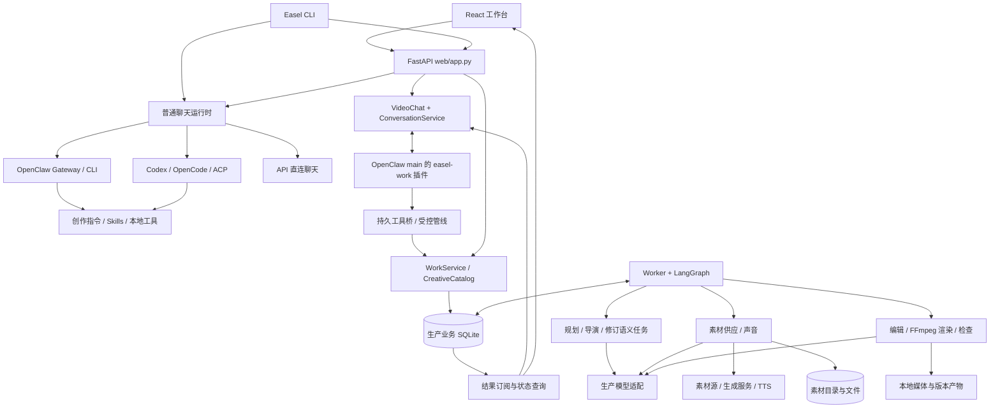
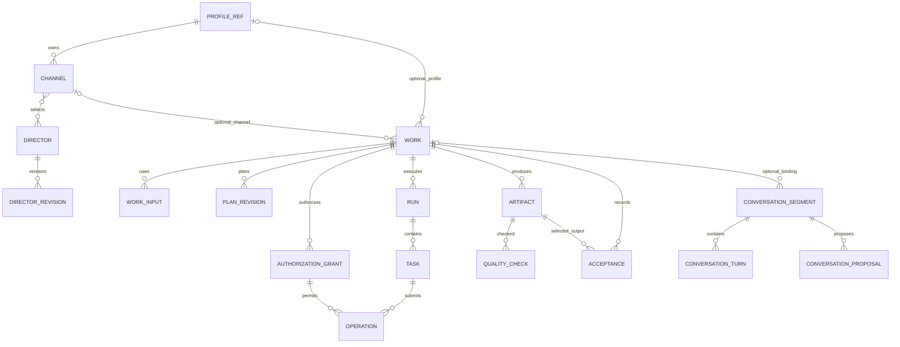
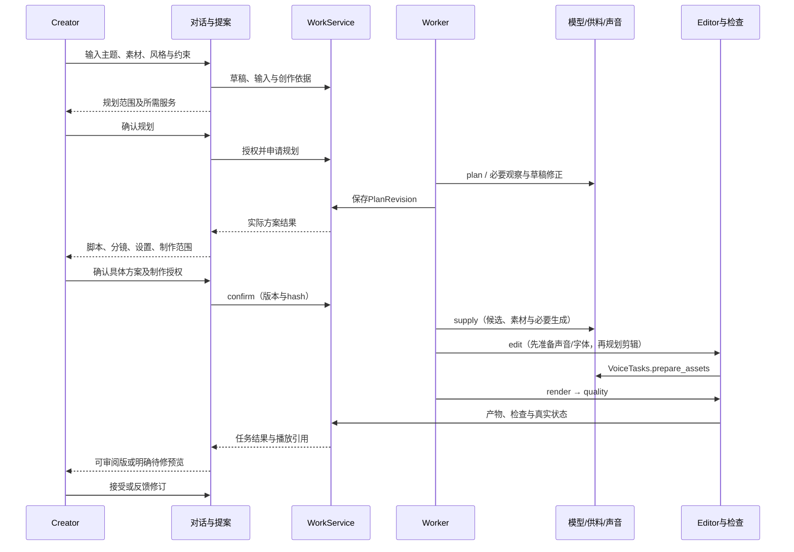

# Easel 整体实现架构与二开导读

本文是 [领域架构](domain.md)的**实现视图**：解释当前源码如何装配、数据归谁管理、一次用户操作经过哪些模块，以及后续二开应在哪里接入。逻辑职责仍由 02 定义，字段和行为合同仍由 [15_IMPLEMENTATION_DESIGN](contracts.md)定义；本文不另建需求、排程或验收标准。

**源码阅读快照：2026-10-23，`easel-v2-rebuild`，HEAD `79ebae55ed9c089a5ecc4c6c8b56b42734e8eeea` 加本次复核时工作区未提交改动。** 此处描述包括 Dirty 与未跟踪源码，不能直接等同于该提交或已部署服务。2026-10-23 已再次逐项核对核心调用点与关键测试断言，并纳入本轮读取到的长等待退场改动。工作区同时有其他研发活动，本文不是一个可复现的干净提交快照。阅读覆盖入口、装配、接口、领域存储、执行、外部适配、前端状态和关键测试；不是所有技能脚本逐行审计，也没有重新执行付费生产或平台发布。实际发布和验收以[当前状态](../project/status.md)及具名运行记录为准。

建议先读 §1～§4 建立全景，再按 §5～§9 跟踪链路；实际改代码时查 §10～§12。

## 1. 系统全景：一个本地工作台，两种执行方式

Easel 的基础形态是本地创作工作台：Python CLI 启动 FastAPI，React 提供聊天、画像、技能、内容、账号及发布界面，Agent 通过技能与工具完成工作。V2 在这个底座内增加受控视频生产域：用户仍在聊天中讨论和确认，作品、授权与生产进度由持久业务记录管理，后台 Worker 完成制作。

这里的两种执行方式是**普通 Agent 工具执行**与**V2 领域任务执行**。它们共享入口与部分能力，但不能互相代替：一个普通视频 Skill 存在，不代表它已接入 V2 的作品身份、额度、恢复和接受合同。

图中的方框是职责，不表示各自部署为微服务。当前 Web 可在一个进程内装配生产 Worker；OpenClaw Gateway 和渲染子进程有各自生命周期。LangGraph 是进程内编排库，不是额外工作流服务器。

## 2. 仓库地图与装配入口

| 区域 | 当前职责 | 二开首先阅读 |
|---|---|---|
| Python 包与命令 | `easel` 命令分发、聊天、Web 启动、生产 Worker、诊断 | [pyproject.toml](../../../pyproject.toml)、[cli.py](../../../easel/cli.py)、[commands](../../../easel/commands) |
| Web 应用 | 生命周期、普通聊天、配置、上传、内容、账号、发布、热点和排期 API；挂载 V2 路由 | [app.py](../../../web/app.py) |
| 前端 | 页面、会话与流式响应、生产状态投影、审片入口 | [App.tsx](../../../web/frontend/src/App.tsx)、[components](../../../web/frontend/src/components)、[lib](../../../web/frontend/src/lib) |
| Agent 接入 | 运行时选择、原生会话绑定、进程/RPC、工具授权问答 | [harnesses](../../../easel/harnesses)、[gateway_questions.py](../../../easel/gateway_questions.py)、[direct_api.py](../../../easel/direct_api.py) |
| 创作指令与技能 | 普通创作 Agent 的行为、按需工作流程与脚本 | [创作工作区](../../../agents/workspace)、[skills](../../../skills)、[技能规范](../../SKILL-SPEC.md) |
| 对话与生产桥 | 管线分段、提案确认、可信来源、执行票据、任务结果交付 | [conversation.py](../../../easel/conversation.py)、[conversation_bridge.py](../../../easel/conversation_bridge.py)、[conversation_pipeline.py](../../../easel/conversation_pipeline.py)、[conversation_results.py](../../../easel/conversation_results.py) |
| V2 生产域 | 作品/版本/授权、任务执行、模型、供料、声音、编辑、检查、修订 | [production](../../../easel/production) |
| 素材基础层 | 目录、不可变文件、权益、作用域、复用、去重、检索 | [materials](../../../easel/materials)、[迁入说明](../../../easel/materials/MIGRATION.md) |
| 开发与验证 | 自动检查、单元/组件测试、前端 Node 测试、真实 E2E 规程 | [tests](../../../tests)、[scripts](../../../scripts)、[工程规范](../development/engineering.md) |

`web/app.py` 仍包含大量底座业务，不能假设所有业务都已经拆成 router/service；V2 的独立路由也不是独立部署服务。`easel/integrations/hypit` 与技能中的视频能力存在于仓库，不表示当前 V2 runtime 使用它们渲染。

### 2.1 启动与生命周期

- `easel web` → `cli.cmd_web` → `runtime_env.web_environment` → 启动 `web/app.py`。生产开关为 `EASEL_PRODUCTION_ENABLED=1`。
- Web lifespan 在启用生产时构造 `production.runtime.create_runtime`，启动 `ProductionRuntime.run_forever` 和 `VideoChat.results_forever`；关闭时停止任务并关闭 harness 会话。
- `create_runtime` 是 Web 与独立生产 worker 共用的装配根：创建或复用 `WorkService`，装配 `OperationService`、模型 transport、规划、供料、声音、编辑、修订 handler，再构造 Worker。
- CLI 的 `cmd_production` 支持状态查看及独立 worker 执行；状态查看在库不存在时不创建业务库。实际启动 Worker 会装配服务，不能把它当纯诊断命令。
- `production` 是 Python 可选依赖组；LangGraph/SQLite checkpoint 的固定版本见 `pyproject.toml`。不启用视频生产时，普通聊天不应因该组缺失而无法使用。
- 前端为 React 19、TypeScript、Vite，构建与 lint 入口在 [package.json](../../../web/frontend/package.json)。Web `/` 优先返回 `web/frontend/dist/index.html`，缺少构建时回退到 `web/static/index.html`；另保留 `/onepage`。所以服务能打开不证明新 React 构建已部署。具体依赖约束以源码为准，不把文档中的版本视作升级批准。

### 2.2 配置、能力与实际运行配置

[direct_api.read_settings](../../../easel/direct_api.py)先读根目录 `.env`，再由进程环境覆盖。普通聊天还有 harness 设置与 OpenClaw 自身配置，不能把它们当一份模型配置。V2 `model_configuration` 使用 `EASEL_DIRECT_API_*` 形成生产创作模型身份，不取当前聊天 Agent 的模型身份；可选 `EASEL_REVIEW_*` 另装配完整音视频审片模型。

`create_runtime` 在创建时读取 settings 并构造 transport、供料/声音/审片对象，部分闭包持有这份 settings；能力 API 则会重新读配置。修改配置文件后不能假设现有 Worker 已全部热更新，需要核对已装配实例与能力展示是否一致。`capabilities` 中 available/readiness 主要是配置、协议及本地条件检查，部分返回明确带 `verified_live=False`；不证明远端账户资格、余额或真实调用成功。

## 3. 普通 Easel 底座：聊天、画像、技能与运营

### 3.1 聊天运行时不是单一模型接口

[Harness 注册表](../../../easel/harnesses/__init__.py)将 API 直连、OpenClaw 与其他适配区分处理。OpenClaw 继续使用自己的 Gateway/CLI 路径；Codex、OpenCode、ACP 使用统一 `Adapter.run(RunRequest, emit, ask, bind)` 接口。`RunRequest` 包含工作目录、环境、原生会话、模型、超时和权限设置；适配器将原生事件转成 token/activity/问答等宿主事件。

普通 Web 聊天从 `/api/chat/stream` 进入，按会话绑定与当前配置选择运行时。OpenClaw HTTP 与 CLI 的传输差异由 `web/app.py`、[gateway_endpoint.py](../../../easel/gateway_endpoint.py)、[openclaw_cmd.py](../../../easel/openclaw_cmd.py)协调；其他适配由 `harnesses` 承担。API 直连是仅聊天分支，不能据此宣称支持任意技能或 V2 生产工具。

会话至少有三类身份：前端 UI session、宿主 turn、运行时 native session/run。它们服务于不同生命周期；新增功能时不能只用一个字符串替代所有身份。普通聊天后端使用 supervisor 与浏览器 SSE 转发分离的方式，断线只停止转发，后台回合仍可落盘并供重连读取。主动“停止回复”、断开页面与取消 Work 是不同动作。

### 3.2 Profile 与指令加载

[persona.py](../../../easel/persona.py)统一画像名校验、文本读取、画像提示与每轮提醒；六维文件为 identity、style、audience、platforms、preferences、memory。普通 Agent 路径会传入当前画像提示，API 直连另有构造消息的方式；V2 则通过受控上下文和冻结方案带入对应资料，不能假设各路径都由同一种文件加载机制实现。

仓库根开发规则、普通创作规则、管线系统提示、生产模型任务提示分别有不同作用域。参考 [prompt-stack](../../prompt-stack.md)和 [agent-harnesses](../../agent-harnesses.md)。仅把文件放在不同目录不足以证明运行隔离；实际调用的 cwd、原生会话、插件钩子与工具权限才决定生效边界。

### 3.3 技能和非视频功能

技能以 `SKILL.md` 描述工作流程，可带 `EASEL-META.md`、scripts、references 和 assets。`skills/shared` 提供共享知识/脚本；Web 的 `get_skills`、`find_skill`、`/api/skills`、`/api/skill` 负责发现、展示或调用入口。技能内容不是生产数据库，也不是 Worker handler 注册表。

现有运营页面包括热点、选题、排期、内容库、账号、发布、数据与画像配置。主要 API 仍在 `web/app.py`：`/api/trends`、`/api/ideas`、`/api/schedule`、`/api/accounts`、`/api/publish/{platform}`、`/api/analytics/{platform}` 等。底座会按场景调用模型、平台脚本或浏览器自动化，后续扩平台需核对各自脚本与认证流程，不能仅新增一个前端按钮。

选题和排期数据分别保存在 `outputs/_ideas.json`、`outputs/_schedule.json`，API 以临时文件替换保存；它们没有接入 V2 的 Run/Task/Operation 体系。排期 CRUD 和 `source=scheduler` 字段本身不能证明存在定时自动发布执行器。

发布中心的 localStorage 草稿、普通 outputs 文件与 V2 Artifact 各有身份。V2 成片可进入现有内容体验，但**Creator 接受作品不等于授权平台发布**。本轮对这些非视频能力完成入口与依赖定位，未重新登录账号或验证平台接口。

## 4. 前端、HTTP 与对话工具的职责分层

| 层 | 主要入口 | 权威边界 |
|---|---|---|
| React 应用 | `App.tsx` 管理页面、会话、流与重连；`ChatPage`/`VideoConversation` 展示对话和视频管线 | 展示与交互，不决定生产成功或用户授权 |
| 前端数据访问 | `api.ts`、`conversationApi.ts`、`productionApi.ts` | 发送请求、解析事件和类型；不能替代后端校验 |
| 生产订阅 | `useWork.ts` 读取快照、订阅 Work SSE，并轮询补偿 | 事件用于触发刷新，最新业务快照用于展示；`newerSnapshot` 避免旧响应覆盖新状态 |
| 对话 API | `/api/chat/video/{session}` 及 enter/proposals/reference-import；`VideoChat` 承接专用流 | 绑定当前对话段和提案，不直接实现媒体生产 |
| 插件内部桥 | `/api/chat/work-tools/entry、claim、prepare、dispatch、result、end` | 认证与原生调用身份校验；不是给模型自由访问任意 URL 的接口 |
| 生产 API | `/api/production/works`、plans/confirm、authorization-grants、resume、revisions、outputs/accept、events | 使用 `WorkService` 执行业务命令；HTTP 202 表示接收，不表示完成 |
| 目录与设置 API | channels/directors、voice-options、subtitle-fonts、作品 settings/preview | 能力与默认设置、试听/字幕预览；可用配置不自动变成某作品授权 |

Work SSE 当前只读取 URL 的 `after` 参数，没有读取 `Last-Event-ID` 请求头；前端 `useWork` 的 EventSource 未显式带 after，重连通常取得 snapshot，再由查询和每 5 秒轮询补偿。不能仅根据浏览器支持 EventSource 重连就写成已实现无缝增量事件续传。`newerSnapshot` 比较的是 Work ID 与事件 cursor，不是任意业务字段版本。

路由依据：[production_api.py](../../../web/production_api.py)、[production_settings_api.py](../../../web/production_settings_api.py)、[conversation_api.py](../../../web/conversation_api.py)。前端本地会话存储见 [store.ts](../../../web/frontend/src/lib/store.ts)，它是用户界面状态，不能用于重建生产授权。

## 5. 受控对话：如何把自然语言变成可信业务命令

当前正式接法是 OpenClaw 的综合 `main` 加受控管线回合，而不是额外部署一组导演 Agent。`VideoChat.stream` 要求专用 Gateway URL/token，并经 `require_persistent_gateway` 核验 protocol=2、main、工具集和 main-pipeline-v1；失败不回退到普通 main/CLI 或其他 Harness。普通聊天支持 Codex/ACP，不等于受控生产对话也已兼容这些入口。[video_workspace.py](../../../easel/video_workspace.py)构造产品管线提示和工具策略，[easel-work 插件](../../../agents/plugins/easel-work/tools.mjs)执行原生生命周期钩子：

1. 普通回合可通过自然入口申请进入视频、频道或导演管线；入口必须绑定当前真人消息和真实会话。
2. `ConversationService.enter` 建立/选择 Conversation Segment，保存画像、频道、导演、作品等上下文。改变目标可能切到另一原生段，不能把旧目标历史直接当新目标授权。
3. 宿主 reserve 当前 turn；插件 `before_prompt_build` 向桥 claim，取得受控系统提示与九工具白名单；`before_agent_run` 检查准备结果，失败则阻断执行。
4. `before_tool_call` 拒绝名单外工具，对允许工具调用 prepare；dispatch 使用票据、原生身份和参数校验后再执行。隐藏工具与执行前拒绝是两道不同检查。
5. `ConversationService` 与 `conversation_pipeline` 把用户输入、提案、确认和当前 Work 版本绑定起来，再调用 `WorkService` 或 `CreativeCatalog`。模型可以提出意图，不能自填成功回执或绕过授权。
6. 原生结束、管线 handoff 和后台结果交付各自登记。后台结果事件不是新用户消息，不能借它自行 answer、授权或开下一轮制作。

九工具的服务端定义在 `conversation_bridge.TOOLS`：`easel_pipeline`、context、create_draft、request_plan、input_evidence、register_inputs、update_brief、request_revision、propose。名称以该映射为准；`pipeline` 通过 mode/action 收敛业务动作，并非只有九种业务能力。

**提案与方案不同。** Conversation Proposal 是需要用户回答的操作提议，具有 body hash、来源和目标版本；PlanRevision 是真实规划任务形成的作品方案。讨论摘要、模型声称已规划或待答卡不能代替 Plan。brief 中用户硬要求必须能追溯到本段或可信交接的用户消息；归纳和建议不能伪装成用户原话。

[work_bridge.py](../../../easel/work_bridge.py)保留早期桥及共用协议定义；当前正式视频路由使用 [PersistentWorkToolBridge](../../../easel/conversation_bridge.py)。修改桥接时应从 Web 挂载和插件 protocol 反查实际路径，避免只改到历史实现。

### 5.1 输入、导演和长期偏好的闭环

- [conversation_inputs.py](../../../easel/conversation_inputs.py)校验附件属于当前会话的 `_inbox` 范围、句柄与真实文件；`WorkService._input` 再登记用途、摘要和权益。上传成功与登记为 WorkInput 是两步，附件元数据不等于已观察素材。
- [reference_import.py](../../../easel/reference_import.py)支持显式的公开 HTTPS **视频直链**参考导入：检查公网 IP、连接固定到已检查 IP、每次跳转复验、有界下载并用媒体探测核实视频。它不是任意平台网页解析器。导入先写 `conversation_imports`，失败保留 needs_review；成功只登记 `usage=reference`、Rights UNKNOWN、`style_reference_only`，不能直接获得成片素材使用权。
- 导演分析由 `PlanningTasks.analyze_director` 执行；`CreativeCatalog` 分别保存风格确认、导演接受与频道默认选择。接受导演时核对试片实际方案引用了该 DirectorRevision；有风格文本或选择试用不能冒充已接受导演。
- `ConversationService._profile_save` 是明确提案确认后的长期偏好回写：仅 style/preferences/memory，1～3 条追加内容，校验 before_hash、文件锁和路径，以临时文件替换落盘。已写成功但 DB 回执中断时，可通过 after_hash 识别同一结果。它不是自动改写所有六维画像；接受视频也不会自动触发此保存。

## 6. 数据模型：权威记录、投影与媒体文件

### 6.1 领域关系

此图省略字段和部分外键，精确关系以 [migrations](../../../easel/production/migrations/__init__.py)及 [conversation migration](../../../easel/production/migrations/conversation.py)为准。例如 acceptance 同时绑定具体 output，channel default 指向导演版本，task_dependencies/artifact_edges 分别表达执行依赖和产物依赖。

| 对象 | 回答的问题 | 不可混同 |
|---|---|---|
| Profile / Channel / DirectorRevision | 谁创作、面向谁、采用哪版表达风格 | 频道不是第二套画像，导演风格不是本片事实 |
| Work / WorkInput / WorkBrief | 本次作品身份、输入用途、用户依据 | UI 会话不是作品；一个会话可存在多个段 |
| PlanRevision | 具体脚本、场景、设置与冻结依据是什么 | 修改目录默认值不重写旧方案 |
| AuthorizationGrant | 哪个用途、版本、服务及生成范围被允许 | 配置了 Key 不等于作品被授权 |
| Run / Task / TaskDependency | 本次执行、具体阶段及前置关系 | Run 成功不自动代表作品质量通过 |
| Operation | 某次 MODEL/VOICE/IMAGE/VIDEO 外部请求身份与发送结果 | 任务重入不意味着允许重新发送 |
| Artifact / ArtifactEdge | 实际文件、摘要、版本及依赖 | 文件存在不等于可展示、检查通过或已接受 |
| QualityCheck / Review / Acceptance | 检查证据、反馈与明确选择 | 自动检查不代替用户接受 |
| Event / CommandReceipt | 增量通知与命令幂等回执 | SSE 文本不是新的业务权威 |

### 6.2 存储位置与一致性

- `outputs/_production/production.sqlite3`：作品、授权、运行、操作、产物元数据、事件及受控对话业务状态。`Store.connection` 提供只读一致快照，`transaction` 使用 `BEGIN IMMEDIATE`；初始化启用 WAL、外键和按版本迁移。
- `outputs/_production/checkpoints.sqlite3`：LangGraph 检查点，默认与业务库分开。只用于执行恢复，不能覆盖领域事实。
- `outputs/_production/materials`：素材 catalog 与内容文件，由 `MaterialService`/`MaterialLibraryCatalog` 管理；目录不是第二套生产状态机。
- `outputs/_production/renders`、`outputs/_production/voice`：渲染工作目录、声音缓存及回执；`outputs/works/<work_id>/artifacts` 是 `register_file` 将文件按内容摘要复制并登记的作品产物目录。源缓存与作品副本可能同时存在，数据库 Artifact 不是一份独立媒体字节。`artifact_edges` 记录同作品依赖，output_revision 按作品递增。
- `outputs/_sessions`、`outputs/_harness`、原生运行时自身状态目录：聊天事件/结果、harness 设置和会话绑定。OpenClaw 原生历史不等同于 ConversationService 的授权记录。
- `profiles`：现有画像文件；确认方案保留对应快照，追溯历史时读取冻结依据而非最新画像。
- 浏览器 localStorage/sessionStorage：会话展示、草稿和重连标记；清除浏览器缓存不应被解释成删除 Work 或撤销授权。

`Store.execute_command` 用 command_id 与完整请求 hash 返回原回执；同 ID 不同请求拒绝。修改 Work 需要 expected_revision，防止旧页面覆盖新状态。Plan 内容不可原地修改，Operation 请求身份不可改写，部分不变量同时由 SQL trigger/唯一索引保护。

跨业务库、素材目录、检查点与文件系统没有统一分布式事务。代码通过稳定身份、摘要、引用、原子文件操作和恢复检查衔接；不能因为用了 SQLite/WAL 就声称跨资源 exactly-once。新增文件写入必须考虑“字节已落盘、业务记录未提交”及反向失败的恢复。

## 7. 一部视频从输入到交付

### 7.1 规划与模型任务

[planning.py](../../../easel/production/planning.py)提供 `plan` 与 `analyze_director`。它整理作品依据、输入观察、导演、设置和能力目录，运行受控语义任务，校验输出并保存规划结果。[context.py](../../../easel/production/context.py)定义传给模型的任务上下文；[model_tasks.py](../../../easel/production/model_tasks.py)管理 HTTP transport、结构化输出、有界工具轮次和格式修正；[model_operations.py](../../../easel/production/model_operations.py)把实际 MODEL 请求纳入 Operation 记录。

注意有两个不同的 `TaskContext`：`production/context.py` 是给模型的创作数据，`production/worker.py` 是携带 lease/epoch 与受保护事务的执行上下文；二者不能互换。

生产模型任务是独立受控调用，不是把普通聊天全部历史转发一次。`ModelTaskRunner` 检查 text/image/audio/structured/tools 等所需能力，提供限定工具注册表与引用句柄，再验证 Pydantic 结果；解析器不应越权另开无限模型调用。公共事实查询由 [public_facts.py](../../../easel/production/public_facts.py)提供受控工具，媒体观察由 inspection 等模块提供，不能拿附件名称代替观看证据。

[expression_policy.py](../../../easel/production/expression_policy.py)将通用自然表达规则按角色融入任务；导演保持创作差异。[prosody.py](../../../easel/production/prosody.py)当前实现的是有限停顿编译，不是通用情绪/表演系统：`narration.py` 将已确认 narration_pauses 映射到连续口播，`voice.py` 通过 `compile_pauses` 生成 MiniMax 标签，将 literal_text、pauses、prosody_version 进入请求与身份校验。只支持代码列出的 MiniMax 2.8 HD/Turbo 声音组合，不支持时明确失败；没有暂停位置时沿用原文字。源码接通不等于真实听感通过。

### 7.2 供料与素材域

[supply_tasks.py](../../../easel/production/supply_tasks.py)是 V2 任务适配层，组合内部素材库、外部素材源和授权内生成；[material_intent.py](../../../easel/production/material_intent.py)表达素材意图，[material_binding.py](../../../easel/production/material_binding.py)关联素材与创作约束。[production/materials.py](../../../easel/production/materials.py)将 Work 的范围映射给通用素材层。

通用素材层分为 domain（媒体、Rights、技术资格）、application（获取、供应、复用、去重、检查）、library/store（目录和文件）、semantic_index（检索）。可见、可复用、当前作品可用是不同判定。源素材的参考权、制作使用权、原声使用要求和跨作品复用许可不能互相推导。

当前 [providers](../../../easel/production/providers) 的文件存在性与自动供料装配必须分开：`configured_supply` 按配置装配 Pexels、Pixabay、Wikimedia 音频、ReviewedPublicSources，以及 MiniMax image/video 生成适配。Unsplash 在能力目录标记 discovery、`supports_auto_supply=False`，目前是 preview-search 入口，未装入自动供料 provider 列表；不要写成已完成自动 Unsplash 取材。哪些真正可用由配置、能力、权益和本片授权共同决定。供料产物注册会保留素材引用、digest 与作品内关联，不能只把 URL 塞进时间线。详细素材设计继续维护在 [18_MATERIAL_LAYER_ARCHITECTURE](materials.md)。

素材语义索引提供 EmbeddingProvider 和持久向量接口，但默认 `MaterialService`/`configured_supply` 没有装配 embedding provider；有 query 的检索在 provider 缺失时走 `METADATA_FALLBACK`。因此不能仅凭 semantic_index 文件或类名宣称正式生产已经使用远端向量检索；新增 embedding 接入还要核对索引身份、作用域、失效和回退。

### 7.3 声音、字幕、编辑与渲染

- [voice.py](../../../easel/production/voice.py)和 [voice_tasks.py](../../../easel/production/voice_tasks.py)负责固定声音身份、合成与任务衔接；[narration.py](../../../easel/production/narration.py)、[voice_budget.py](../../../easel/production/voice_budget.py)处理旁白组织/预算，[speech_alignment.py](../../../easel/production/speech_alignment.py)、[subtitles.py](../../../easel/production/subtitles.py)处理对齐与字幕。固定音色与每部作品的演绎是两个维度。
- [creation.py](../../../easel/production/creation.py)的 edit 结合有效素材、声音、确认方案和实际观察生成 `CreativeEdit`，经过源长度、帧数、时间线与支持特性校验后转成 `EditProject`。局部补料/修正有边界，不能把全部供应职责转给编辑器。
- [editors/base.py](../../../easel/production/editors/base.py)定义 `EditProject`、`Scene`、`AudioClip`、`Caption`、`AssetManifest` 和 `EditorAdapter`。模型选择 asset_id，程序提供受控 root、locator 和 sha256，不让模型任意指定本机文件。
- 当前装配使用 [FFmpeg adapter](../../../easel/production/editors/ffmpeg.py)，接口为 capabilities/check/build/observe/cancel/collect；独立 [render_worker.py](../../../easel/production/editors/render_worker.py)处理本地渲染。job、工程、输出及执行锁支撑进程间观察和恢复。
- 当前 `EditProject` 明确支持 1080×1920 / 1920×1080、24/25/30 fps、1～900 秒和 silent/music/voice/mixed；这些是源码合同，不等于每种组合均完成真实验证。4K 不在此合同内。Schema 接受的范围还要与执行器取交集：例如 EditProject.scenes 上限为 1000，但 FFmpegEditor.check 当前拒绝超过 128 个镜头；不能只从 Pydantic schema 宣称执行能力。
- [boards.py](../../../easel/production/boards.py)、[creative_captions.py](../../../easel/production/creative_captions.py)承接图解及创作字幕能力；它们仍需要落到可验证媒体/时间线，并不构成另一条自由代码执行产线。

### 7.4 检查、交付与接受

`CreationTasks.quality` 将技术检查与语义/视觉检查分别留证；[quality.py](../../../easel/production/quality.py)、[inspection.py](../../../easel/production/inspection.py)、[edit_observation.py](../../../easel/production/edit_observation.py)、[visual_repair.py](../../../easel/production/visual_repair.py)参与实际媒体观察与有界修复。不同 QC 配置可能产生不同覆盖范围；manual 模式不是完整语义 PASS。这里的成片 technical 判定具体是视频流存在、与工程时长差不超过 0.1 秒、宽高匹配、是否有音轨符合 audio_mode；编辑器另有素材摘要、格式、源长度、时间线与能力检查。这些不等于已实现完整响度、黑帧、冻结帧或口播自然度的确定性检查。

Work 状态、Artifact 质量状态和检查记录必须一起读，不能只看 `reviewable` 或 `needs_fix`：

| 当前分支 | Work / Artifact | 检查与接受条件 |
|---|---|---|
| 完整自动审片通过且无 limitations | reviewable / passed | 技术与完整语义证据分别登记；仍须显式接受 |
| 技术失败或语义仍有问题且未进入下一修订 | preview_needs_fix / needs_fix（部分错误停在 needs_decision） | 保留实际 findings；不自动接受 |
| 明确启用 manual，技术通过、无已知质量失败 | reviewable / needs_fix | semantic=not_tested，manual_review_required=true；不是发现了缺陷，也不是自动语义 PASS |

manual 的可选视觉抽样仅在相应开关及 narration_policy 条件成立时运行；抽样无缺陷也不写完整 semantic pass。存在具名 findings 时可进入一次有界修订，涉及保护范围则需决定；不能拿 manual 开关掩盖已有 fail/partial。

`WorkService._accept` 校验输出所属、质量、文件与 digest。manual 路径还要求 `manual_review_confirmed=true`、Work reviewable 且 Run succeeded。程序核验的是明确确认字段，不能证明真人实际看完整片。接受写 `acceptances` 与 `accepted_output_id`，不会把 Work 改成一个不存在的 accepted 状态，也不会抹掉 semantic=not_tested。作品接受与导演接受分别记录。

[ConversationResults](../../../easel/conversation_results.py)关联真实业务结果并管理交付，[VideoChat](../../../web/conversation_api.py)将结果带回原生对话。当前插件 `awaitExecution` 默认每秒短轮询、同步等待预算 300000 ms；预算到期发 interrupted=true，返回“后台原任务继续”，不取消 Run、不重发生产。原回合正常退场后，既有结果订阅可接续；网络中断则保留未核实状态。

恢复交付有明确条件：已 applied 的提案回执含 `_result_delivery`，当前段/Work/active Run 仍匹配，运行进入可交付终态且有未消费事件，原生会话前缀正确，同一 UI 会话没有 reserved/dispatching/active/unknown 回合或有效 delivery lease。`reserve_next` 为结果事件生成稳定 turn ID；`complete_delivery`/acknowledge 校验非空回复、记录消费并防止与恢复回合重复交付。未结束的原生 UNKNOWN 可使订阅等待，不能承诺任何断线都会立即自动回传。

这些订阅不会自动覆盖所有由独立 API/CLI 创建的 Run。独立生产 Worker 也不启动 Web 的结果 relay；对话交付仍依赖 Web、Gateway 和插件可用。结果回合可以解释方案/成片，不能把系统结果事件变成新的制作授权。

## 8. 执行、授权和恢复为什么分三层

### 8.1 领域命令层

[WorkService](../../../easel/production/service.py)处理 create/input/plan/confirm/grant/resume/cancel/revise/accept 等命令，核验当前版本、方案 hash、授权目的和目标。它创建 Run、首个 Task 及领域事件；后续 Task 与依赖主要由 Worker 根据 handler 返回值追加。命令返回只说明事务已接受，不能由 HTTP 层承诺媒体成功。

[runtime_readiness.py](../../../easel/production/runtime_readiness.py)在模块加载时记录 `easel/production` 下非符号链接 Python 文件的 mtime_ns/size，后续比较文件集合和这两个属性。它不是源码内容哈希，也不覆盖 web、conversation、插件或前端，更不检查配置文件；`reload_required=false` 不能证明整个部署与工作区相同。差异存在时 `WorkService.command` 除 cancel/accept 外拒绝新命令；不能仅以 Git HEAD 或网页可打开证明部署一致。

### 8.2 持久执行层

[Worker](../../../easel/production/worker.py)通过事务 claim Run，使用 owner_id、owner_epoch、lease_expires_at 和心跳排除过期执行者。TaskContext 写入前复验执行所有权、取消状态及当前 Plan。任务依赖由业务库读取，只有依赖成功才可执行；流程版本不兼容会暂停等待明确处理。

[PersistentGraph](../../../easel/production/graph.py)的状态主要保存 run_id/task_id/task_kind。resolve 每次重新读取领域待办，执行节点回到 Worker.dispatch；恢复到已完成节点时，Worker 依据任务状态跳过 handler。检查点恢复不是重新执行一遍全部任务。任务链是动态追加的：`WorkService._run` 为 planning/production/revision 分别建 plan/supply/revise 首任务；handler 返回 `TaskResult.next_kind/next_payload` 后，`Worker._finish` 在同一事务内保存当前结果、插入下一任务和依赖。正常制作为 supply → edit → render → quality，质量修订可继续追加 revise 等任务，并非确认时已经展开完整固定 DAG。配音由 edit 内调用 `VoiceTasks.prepare_assets`，runtime 注册的是 voice_preview，而非独立 voice 生产阶段。

一个 Worker 实例一次执行一个 Run，内部逐项推进；多个实例可通过 SQLite lease 竞争不同 Run，但这不等于已经实现单 Run 并行供料或完整多机部署。进程退出释放执行权与 Creator cancel 不同。

### 8.3 外部副作用层

[OperationService](../../../easel/production/operations.py)持久保存请求身份、授权、服务/模型/模式、配置版本、请求 hash 与外部任务回执。`reserve` 登记意图，`mark_sending` 在事务内再次核验并授予一次本地发送窗口。IMAGE/VIDEO 的次数限制与 MODEL/VOICE 记录不是同一计数口径。

发送后中断且没有确定回执时进入 UNKNOWN；Worker 接管遗留 sending 时也将其转为 unknown。Provider 的 `observe` 与 `submit` 分开，查询必须按声明的 query 能力执行；`not_found` 或超时不自动证明请求没发出。同步模型不具备远端查询时，不能承诺一定可找回结果。

因此三层分别解决“命令是否重复”“任务是否已完成”“外部请求是否已发送”。只给 HTTP 加重试、只恢复 LangGraph、或只在 Prompt 写不要重复，都不能同时解决这三类问题。

## 9. 修订、取消、删除与清理

[revisions.py](../../../easel/production/revisions.py)从明确输出版本和反馈创建修订，观察原结果、提出变更并校验保护范围。画面修订与旁白修订的影响不同：仅改画面需要保护声音/文字；改旁白可能影响重配、时长、字幕及画面同步，必须按当前合同确认范围与新增消耗。原版本保留。既有确认范围内的画面修订可以沿用原 PlanRevision，生成新的 EditProject/输出版本并直接进入 render；不是每次修订都生成新 Plan。旁白/图解或越出保护范围的改动由 `confirm_revision_scope` supersede 当前等待运行，启动 planning 提出新方案，再经方案确认制作。新结果使用明确的产物/方案关联，不原地覆盖已确认历史。

取消是停止之后可阻止的操作，不代表远端付费任务被撤销或结果不存在。runtime maintenance 会观察被取消运行的渲染并保存晚到回执，不将它冒充新的可审阅版。旧 UNKNOWN 继续留证。

[deletion.py](../../../easel/production/deletion.py)管理作品删除与引用感知清理队列；素材目录另有 usage/reference 和回收规则。当前工作区 [maintenance.py](../../../easel/production/maintenance.py)提供运行统计及显式渲染镜头缓存预览/清理，检查在途、UNKNOWN、已接受产物和文件锁，并以 preview_hash 绑定实际清单；它明确不是自动全盘清理器。不得按文件年龄删除 outputs 或把所有目录视为可重建缓存。

## 10. 安全与权限实际落在哪些位置

| 边界 | 当前执行位置 | 修改时要保留的性质 |
|---|---|---|
| 浏览器写请求 | `web/app.py:local_write_guard` | 本地来源/Origin 等校验；不能据此声称具备互联网多租户认证 |
| 文件和媒体 | `_safe_output_path`、`reference_guard`、`MaterialFileStore`、Artifact 内容路由 | 根目录、符号链接、引用、摘要与可展示资格；不能拼模型路径读取任意文件 |
| 原生工具调用 | 插件 hooks、PersistentWorkToolBridge | 原生身份、票据、参数、受控工具集和调用状态一致 |
| 用户授权 | Conversation Proposal + WorkService + Grant | 真实用户来源、当前目标与确认范围，不由模型文本授予 |
| 外部提交 | OperationService + Provider 协议 | 请求身份不可变、发送前复验、UNKNOWN 不盲发、额度占用 |
| 执行者写回 | Worker lease + TaskContext | 旧进程、旧 Plan 和已取消任务不能覆盖当前成果 |
| 数据与历史 | Store 事务/约束、Artifact digest/edges、素材 usage | 历史依据可追溯，删除与复用考虑真实引用 |
| 配置与诊断 | runtime_env/configuration、脱敏输出、原生诊断 | 配置与本片授权分开；不将 Key、私人 Profile、原始回执纳入 Git |

当前 `web/app.py` 的启动仍监听 `0.0.0.0`；其源码明确说明 Origin/Host 防护针对浏览器跨站请求，能直连端口的裸 HTTP 客户端可伪造这些头。将服务迁到公网/不可信局域网属于部署安全边界变化，不能把“本地工作台”理解成已绑定回环或已具有用户认证。

这些是源码中的边界定位，不是本轮重新完成的渗透测试或权限验收。新 Harness、插件版本、代理部署和公开网络暴露都需要重新核实对应边界。

## 11. 二开落点与应配套的验证

| 想做的改动 | 主要落点与依赖 | 最先检查的测试入口 |
|---|---|---|
| 新增普通创作技能 | skills、元数据、共享脚本；确认普通 Agent 的发现与调用 | validate_skills / validate_skill_commands；[技能映射](../../skill-function-mapping.md) |
| 新增聊天运行时 | harnesses/base、registry、adapter、store；Web 配置、事件、问答、原生会话 | `tests/test_agent_harnesses.py`、`tests/test_codex_permissions.py` |
| 改管线自然语言入口/确认 | 插件 tools、conversation_api、bridge、pipeline、conversation；同步前端投影 | `tests/production/test_conversation_pipeline.py`、`test_conversation_handoff.py`、`mainPipelinePlugin.test.mjs` |
| 增加作品字段/状态/命令 | contracts、增量 migration、Store、WorkService、API、前端类型与事件 | `tests/production/test_store.py`、`test_contracts.py`、`test_work_api.py` |
| 增加模型能力/结构化任务 | configuration、context、model_tasks/model_operations、planning/creation | `tests/production/test_model_tasks.py`、`test_planning_runtime.py`、`test_model_call_diagnostics.py` |
| 新增素材源或生成服务 | providers、configured_supply、Rights、素材库、Operation 与能力目录 | `tests/production/test_material_supply.py`、`test_materials_rights.py`、`test_generation_adapter.py`、`test_operations.py` |
| 调整声音、演绎或字幕 | voice、prosody、narration、alignment、settings、复用身份、editor | `tests/production/test_voice_subtitles.py`、`test_continuous_narration.py`、`test_voice_budget.py` |
| 增加编辑特性/替换后端 | EditorAdapter、EditProject、AssetManifest、creation 投影、render/QC、能力声明 | `tests/production/test_editor_contract.py`、`test_render_local.py`、`test_edit_source_bounds.py` |
| 改恢复或执行并发 | Worker、Graph、Operation、版本/取消/检查点与领域写回 | `tests/production/test_worker.py`、`test_graph_resume.py`、`test_operations.py` |
| 改局部修订或接受 | revisions、artifact_edges、质量/保护范围、proposal 与授权 | `tests/production/test_revision_pipeline.py`、`test_revision_acceptance.py` |
| 改结果交付/前端进度 | ConversationResults、VideoChat、App、useWork、taskReplies | `tests/production/test_conversation_results.py`、`test_conversation_execution_wait.py`、`test_tool_call_delivery_boundary.py` |
| 加存储维护能力 | deletion、maintenance、material usage、渲染锁及清单 | `tests/production/test_deletion.py`、`test_materials_reference_guard.py`、`test_s7_packages.py` |

测试名称是定位入口，不表示本轮执行过，也不是允许删去其他适用测试。跨层改动先确定业务不变量，再检查契约/持久化、运行调用、前端投影与恢复的完整影响；按[工程规范](../development/engineering.md)选择回归和真实验收范围。

几个常见误区应在设计时排除：

- 增加供应商不能只改配置项：还需能力、授权身份、权益、请求/回执与 UNKNOWN 行为。
- 新编辑器不能直接替换一个 shell 命令：须兼容时间线表达、资产清单、作业观察、取消、收集、修订和检查。
- 改提示词不能代替后端身份/授权修复；后端实现也不能代替模型真实创作质量验证。
- 优化默认参数不能使历史 Plan 或复用身份静默改变；旧作品应继续使用其冻结依据。
- UI 新状态必须来自业务事实，不能根据等待时长虚构进度；普通聊天 done 不能关闭 Work。

## 12. 证据、限制与文档维护

本文以源码装配和调用链为依据，关键证据入口如下。维护时优先更新对应章节，不另建“最新版架构”副本。

| 要复核的结论 | 直接源码入口 |
|---|---|
| Web/CLI 共用生产装配 | `web/app.py:_lifespan`、`easel/cli.py:cmd_production`、`production/runtime.py:create_runtime` |
| 普通与受控聊天分流 | `web/app.py:api_chat_stream`、`web/conversation_api.py:VideoChat` |
| 受控 main 实际工具边界 | `agents/plugins/easel-work/tools.mjs` 的 before_prompt_build/before_agent_run/before_tool_call；`conversation_bridge.py` |
| 领域权威与幂等 | `production/store.py:execute_command`、`production/service.py:command`、migrations |
| 检查点不越权 | `production/graph.py:PersistentGraph`、`worker.py:_start/_check_lease` |
| 外部不确定性 | `operations.py:mark_sending/observe`、`providers/base.py` |
| 当前编辑器真实装配 | `creation.py:CreationTasks.__init__`、`editors/ffmpeg.py` |
| 断线交付与业务取消分离 | `conversation_results.py`、`web/conversation_api.py`、`production/runtime.py:maintenance_once` |
| 前端状态是投影 | `App.tsx`、`lib/useWork.ts`、`lib/productionApi.ts` |

本次文档任务的完成条件是：覆盖整体层次、核心执行链、数据归属、恢复/权限、底座能力和二开落点，引用能够回到实际文件，保持既有逻辑/实施合同的权威分工。未改产品代码、未迁移数据库、未重载服务、未启动模型/媒体/发布调用；文档路径检查结果在本次交接中报告。

### 12.1 2026-10-23 再审核修正记录

本轮只修正文档中的实现描述，没有据此改业务代码或改变设计合同。关键纠正与直接依据：

| 纠正/补齐 | 直接核对的源码或既有测试 |
|---|---|
| reviewable 不等于自动语义通过，needs_fix 不一定代表已知缺陷；接受不是新增 Work 状态 | `CreationTasks.quality`、`WorkService._manual_review_ready/_accept`、`tests/production/test_manual_review_gate.py` |
| 首任务与动态后续依赖、配音属于 edit、单 Worker 的执行范围；schema 与 FFmpeg 实际准入取交集 | `WorkService._run`、`Worker._finish/run_once`、`CreationTasks.edit`、`runtime.create_runtime` |
| 300 秒同步等待退场与有条件的结果订阅，不承诺无条件交付 | 插件 `awaitExecution`、`ConversationResults.poll/reserve_next`、`PersistentWorkToolBridge.complete_delivery`、`tests/production/executionWaitPlugin.test.mjs` |
| 新鲜度检查范围与配置实例读取边界 | `runtime_readiness._capture_production_sources`、`direct_api.read_settings`、`runtime.create_runtime` |
| Unsplash 仅发现入口，向量接口未默认装配 | `configuration.capabilities`、`configured_supply`、`MaterialService.candidates`、`MaterialSemanticIndex.search` |
| SSE after 参数与快照回退、静态构建回退 | `production_api.events`、`useWork.ts`、`web.app.index` |
| 参考导入、导演接受、显式偏好保存和修订版本分流 | `reference_import.py`、`CreativeCatalog._director`、`ConversationService._profile_save`、`RevisionTasks.revise/confirm_revision_scope` |

以上测试文件用于阅读既有断言，本轮未执行产品测试，未宣称本次 SOFTWARE_PASS 或 REAL_PRODUCTION_PASS。复核后本文 89 处路径检查通过，连同原架构页/导航共 174 处通过；空白和代码块闭合检查通过。全库路径检查仍有其他研究/历史运行文档的 7 处既有失效引用，未混入本轮修订。文档检查通过不能替代实现验证。

仍需按具体开发任务补充的证据包括：所选部署实际加载的插件/指令版本，各 Harness 的真实工具兼容性，Provider 当前账户权益和查询语义，全部媒体规格组合及跨作品审美/听感效果。这些不确定性不能由本轮静态阅读补记 PASS，也不自动成为新的开发任务。
