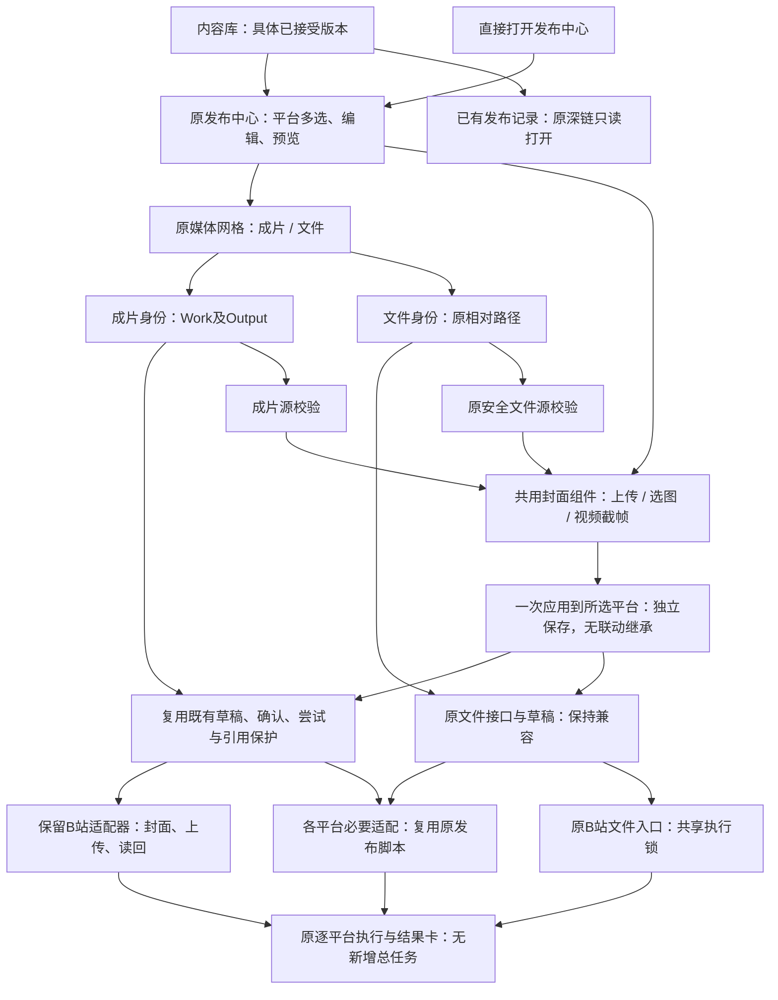

# 成片确认到发布：完整方案

状态：**首批设计已获实施授权：B站单平台；真实投稿未授权、未验证。** 2026-10-23 用户明确批准 PUB-01 开发，并选择B站。原设计调研基于长期主线及既有Dirty；本轮独立实施基线为 `41a4d047`，不包含主工作区未提交修复。执行结果由父任务记录。

父任务：[PUB-01](../project/tasks/PUB-01_acceptance-publication.md)。需求决定、开发步骤、验收和收口由该任务承接；本文维护方案，不重复维护执行状态。

## 1. 目标与范围

让Creator从原对话或内容库选定成片，审阅并接受具体版本，再复用Easel发布页准备内容、确认目标账号及动作，最终取得可追溯的平台结果。接受作品不自动发布；发布不是视频制作完成的前置，发布失败也不重做成片。作品接受、导演接受、长期偏好保存、发布授权继续独立。

首批按用户决定完成B站单平台纵向闭环；后续平台另行确定。设计覆盖多平台分项结果，但不默认所有平台同时实施。自动运营、数据归因、无人值守定时发布、跨平台自动删帖/撤回、全账号管理重建不纳入首批。已有排期入口可保留，排期记录不等于已具备定时发布执行能力。

## 2. 当前源码事实与复用边界

| 环节 | 已有实现及证据 | 需要补齐 |
|---|---|---|
| 审片/局部修订 | [WorkCards](../../../web/frontend/src/components/WorkCards.tsx)播放、比较、反馈、下载；对话支持版本接受提案 | 发布入口应携带准确作品和输出，避免用户重新选裸文件 |
| 接受版本 | [WorkService._accept](../../../easel/production/service.py)校验归属、质量、文件摘要，写acceptances和accepted_output_id；manual需明确完整审阅确认 | 复用原命令，不再造一套接受状态；接受回执供发布准备引用 |
| 内容库 | [OutputsPage](../../../web/frontend/src/components/OutputsPage.tsx)从production/library读取已接受作品 | 已接受版本卡增加准备发布入口，与原对话共用一个发布草稿 |
| 发布编辑 | [PublishPage](../../../web/frontend/src/components/PublishPage.tsx)已有平台选择、文案改写、预览、标签、媒体选择、二次确认；草稿部分字段存在localStorage | 后端持久草稿，绑定版本/账号/动作；媒体不再依赖用户从目录重新挑选；修改后确认失效 |
| 发布服务 | [web/app.py](../../../web/app.py)的api_publish分发既有publisher脚本，已有媒体类型/安全路径检查 | 不能把裸路径PublishRequest当作品发布合同；新增受控适配入口并复用脚本调用，保持原入口兼容 |
| 登录与验证 | 既有账号页、登录检查、抖音异步状态和短信交互 | 锁定真实账号身份及会话变化；按发布尝试隔离状态文件，避免同平台多请求覆盖 |
| 结果 | 原platform_readback有结构化对账结果；抖音和web_publisher的快手路径已接入。Web仍主要读取returncode或平台级状态文件，追加日志/日历 | 复用读回算法，补齐结果持久化、作品关联及Web状态投影；不要重复建设对账器 |

平台表仅说明本次读取到的路由，不证明账户或平台当前可用：小红书与抖音分别调用既有发布脚本；快手/视频号等沿web_publisher；B站存在biliup视频投稿分支；公众号走图文封面与后台草稿，不接收本次MP4作为视频投稿。首批不要将公众号草稿记为公开视频发布。前端无目标时仍残留“B站请用复制/终端”提示，与当前PUBLISHABLE和后端分支不一致，实施时对齐能力声明与文案，不因旧提示另造发布器。

旧发布页的预检评分是提醒，不能升级为额外创作审核Gate。现有长度提示、登录成功或脚本返回0均不证明平台正式接受，更不证明公开可见。

### 2.1 再审核补齐的原生能力与限制

- [platform_readback.py](../../../skills/shared/scripts/platform_readback.py)已有ReadbackResult、WorkItem与verified/unverified/login_required/readback_error四档，携带平台内容ID、状态、候选和证据。抖音脚本已调用，web_publisher注册表目前接入快手；模块也有B站相关实现，但本页直接biliup分支未据此证明接通。小红书当前发布脚本主要靠跳转、toast或表单重置判断，不能推导同等级读回能力。接入前逐平台核对真实调用链与既有测试。
- 原读回按标题、时间窗及发布前ID快照匹配，不是对远端视频字节的完整摘要证明。须保留匹配证据与歧义，不能把verified一律译为公开可见；仍按matched.status区分审核/公开等实际状态。新增发布层应保存原结构化结果，避免重新解析一句“成功”或再抓一套接口。
- 抖音未核实、登录失效等会写error及非零退出码，Web再显示失败；这可能发生在提交之后。新增投影应保留发送阶段和四档原因，不能把它们标为“确定未发送，可重试”。现有短信和状态文件按平台命名，扩展时除请求隔离外还应对共享浏览器/账号会话串行或加锁，防止同平台并发串号或覆盖现场。
- 原发布页已有逐平台正文overrides、一稿多改、复制文案、保存日历草稿、登录检查、短信验证和普通媒体选择，应逐项复用。日历草稿、浏览器编辑草稿、平台草稿是三种不同对象；现有localStorage仅存标题/公共正文/平台/overrides/标签，单一键未按作品或账号隔离，未保存媒体和真实接受依据，不能直接认领为持久发布草稿。
- publishAll在最终window.confirm之前自动执行模型预检；performPrecheck读取公共body而发布使用effective(platform)改写稿。方案应将模型预检/文案辅助明确为可选且按实际授权调用，检查每个最终目标的内容快照；确定性发送校验仍由程序执行。模型评分不作为新的硬门槛，也不代替用户确认。
- 原PublishRequest只有title/body/media/tags，没有独立cover、account_id、visibility或action。现有媒体规则拒绝图片和视频混发；视频封面不能简单塞入media数组，须按选定适配器已有能力扩展。确认页只展示实际支持字段，无法设置的可见范围/封面不能假装已生效。
- [_publish_env](../../../web/app.py)已有EASEL_CALENDAR_AUTORECORD=0，防止Web和脚本重复记日历；新流程保留单一回写所有者，并以发布记录身份实现本地投影去重。模型辅助中断只影响草稿编辑，不能被当作平台发布已取消。

## 3. 用户完整旅程

1. **审片**：原对话展示可播放版本及实际检查范围。Creator完整看听，提出修改则沿原修订链；技术错误、已知质量失败不靠发布入口绕过。
2. **接受**：明确“接受版本N”。展示具体目标并复用既有确认；manual分支要求完整审阅声明。接受成功进入内容库，后续新版不会自动替换此选择。
3. **准备发布**：用户点击/说“准备发布这个版本”，带入作品、输出、接受回执及文件摘要，打开现有发布编辑区域。这个动作只建草稿，不向平台提交。首批优先页内复用，后续对话可投影同一草稿，不另建发布Agent。
4. **补齐发布信息**：选择适用平台与真实账号，填写标题、正文、标签、封面及平台必需项。可复用原文案辅助；模型只给候选，调用按实际授权，不能默默改事实、署名或替用户选择账号。缺封面可选本地合法图片/抽帧；付费生成另按授权。
5. **最终预览**：展示视频版本缩略图、账号昵称/可区分标识、平台、实际动作（公开视频/投稿/平台草稿）、文案/封面/署名、可见范围等适用字段。用户确认当前这份内容。没有实现的动作不显示为可用；未选账号不得凭Profile或频道推定。
6. **执行**：服务端复验确认内容、接受记录、文件摘要、Rights、目标账号和能力，登记持久发送意图后调用原publisher。短信/登录验证继续沿既有交互，完成后重核账号与原意图，不自动切号或重发。
7. **交付结果**：原对话、内容库和发布页读取同一发布记录，按平台分别展示草稿已存、投稿已提交、审核中、已公开、明确失败或待核实，附真实链接/回执及可执行下一步。一个平台成功、另一个失败不合并成“全部成功”。

示例：接受版本2 → 为账号A准备抖音文案 → 确认本次发布 → 平台返回审核中。此时作品仍是已接受版本2，发布结果为审核中；不能显示“已公开”。之后修改成版本3不改写版本2的发布历史，需重新准备并确认。

### 3.1 制作完成后的引导钩子（本次新增需求）

**用户要求已明确：视频制作完成后，需要说明后续可以怎么做。** 以下交互与实现方式仍待方案评审，尚未编码。钩子是既有交付结果中的后续动作提示，不新增Agent、工作流或自动发布任务。

复用[ConversationResults](../../../easel/conversation_results.py)的制作/修订终态结果、现有结果订阅和[WorkCards](../../../web/frontend/src/components/WorkCards.tsx)；当前已经能回传实际视频、说明检查范围并等待反馈，也有接受/下载/局部修订能力，欠缺统一的后续动作引导与准备发布衔接。

| 实际状态 | 展示说明及可用动作 |
|---|---|
| 有可审阅版本、未接受 | 展示实际视频和检查范围；提示“完整审片”“提出局部修改”“接受此版本”“下载视频与署名”。只有满足接受条件才提供可执行接受动作 |
| manual待审 | 明确技术检查与完整语义/声音未测边界，提示看完整片后再决定；不得由助手代勾完整审阅 |
| 有预览但存在已知质量失败 | 明确待修预览与具体问题，提供修改/查看证据/适用下载；不诱导接受或发布 |
| 已接受版本 | 提示“已保存到内容库，可准备发布、下载、继续修改或基于此片创作新作”；发布能力未接通前只说明尚未接通，不显示可提交按钮 |
| 失败、取消或UNKNOWN且无合格成片 | 说明保留成果、缺口与合法恢复选择；不显示“制作完成”或发布引导 |
| 发布已提交/待核实 | 指向原发布记录查看/核实，不再次展示可重复提交的默认按钮；新意图另行确认 |

建议完成文案：“版本2已生成，可以播放审阅。技术检查已通过，完整声音与语义仍需你确认。看完后可以提出局部修改，或明确接受这个版本；也可以先下载视频与署名。接受后可准备发布。”文案必须由真实检查结果调整，不能固定声称技术或质量通过。

触发条件是可交付终态及真实可展示Artifact，不是模型一句done、render进程退出或等待超时。按作品/输出/事件身份复用现有交付去重；刷新恢复卡片不重复发送助手消息，同一结果回传不再自动生成新提案。新修订版本可以出现新的版本引导，不能误用旧接受选择。点击“准备发布”只进入草稿；所有动作均核对当前版本/状态，不从结果事件推导接受或发布授权。用户表示暂不处理后停止主动催促。

发布完成后的钩子继续在同一交付区域显示分平台结果和真实链接，可查看帖子/草稿、核实待定结果或回到已保存作品；不自动开启数据分析、定时运营或重发。

## 4. 状态、身份与保存建议

以下是身份与恢复约束；本批落地接口及取舍见§10，未实现的扩展不能作为现有能力。

- **发布草稿**：关联work、output、digest、接受回执、Profile（可空）、平台和账号身份；版本化保存标题/正文/标签/封面/署名/动作与适用设置。选择目标账号不应强制给无画像作品创建Profile。
- **确认记录**：绑定草稿版本与完整内容摘要、实际用户决定、目标账号和动作。改文案、封面、媒体、平台、账号或可见范围须重做最终确认；只改显示布局不失效。
- **发布尝试**：每个平台/账号独立请求身份、发送阶段、实际适配器、时间、错误和可核实回执。发送前原子核验确认摘要并登记发送占用，避免确认后编辑与双击的竞态；崩溃跨过提交边界时只查询/对账，不重放上传命令。重放同一请求返回原记录；不能只以视频hash去重，用户可以明确发起另一次合法发布。
- **平台结果**：平台帖子/稿件/草稿ID、链接（若有）、实际状态及证据。保留脚本回执，但无明确平台凭据的returncode=0只说明执行结束，不足以记录已公开。

准备/待确认/已确认/发送中/待核实是本地流程；草稿已存/已提交/审核中/已公开/被拒绝是平台事实，必须分开记录。发布前取消可阻止发送；发送后停止等待不等于撤回，真实撤回另有平台动作和授权。

接受选择变化或文件/封面内容变化时，旧待发确认失效并提示重新核对。已发历史保持原版本。发布引用应参与既有删除/引用保护，待发或结果不明时不得删掉对账所需文件。私有凭证、验证码和原始用户回执留既有本机安全位置，文档仅登记脱敏证据。

## 5. 复用方式与必要改动

| 落点 | 建议改动 | 保留的职责 |
|---|---|---|
| WorkCards、OutputsPage、App路由 | 将已接受输出传入现有发布页；返回结果可回原作品 | 原审片、接受、修订和内容库投影 |
| PublishPage | 以持久草稿为事实源，复用编辑/平台预览/账号验证/短信组件；准确显示动作与分项结果 | 文案辅助与原媒体发布体验 |
| 生产/发布接入服务 | 解析受管Artifact、核验acceptance/digest及确认，维护发布记录、请求幂等和引用 | WorkService继续拥有作品，不把平台状态塞进Work状态机 |
| 原发布分发与脚本适配 | 提取可复用调用边界，避免内部HTTP绕行或复制整套分支；标准化真实回执与查询能力 | 账号登录、平台上传与既有技能脚本 |
| 查询/回写 | 原对话与内容库读取发布记录；发布日志/排期作为派生记录 | 补写日志失败只修复本地投影，不再调用发布 |

存储优先评估现有生产库的增量记录与引用机制；外部操作借鉴Operation现有幂等/UNKNOWN原则，先核对其类型与授权模型，不能未经设计把发布伪装成MODEL或媒体生成。仅在需要的职责边界新增代码，不搭建第二套任务编排平台。

若原账号接口只暴露当前平台登录会话，首批绑定并核验该实际会话即可，不为此先建设多账号中心；无法可靠区分目标账号的平台应先补身份核验再开放真实发送。

已有普通文件发布继续兼容。新的“从作品发布”必须经过受控入口，不能因旧API仍接受媒体路径就宣称所有发布都已受作品权限管理。若后续要求全入口统一强制接受，需要单独评估官方原生行为兼容范围。

## 6. 异常与恢复

| 场景 | 预期行为 |
|---|---|
| 双击、刷新、响应丢失 | 查询同一持久请求，不再提交；跨窗口沿原发布记录恢复 |
| 发送前确定性校验失败 | 明确未发送，可修草稿/环境后重新确认；保留原因 |
| 超时、进程崩溃、连接断开 | 若可能已提交，标待核实，按平台可用能力查询；不能自动失败重发 |
| 平台不支持查询或回执不完整 | 展示具体不确定性，允许用户在真实平台核实；确认补录有来源。无法核实则保持UNKNOWN，不承诺exactly-once |
| 多平台部分成功 | 保留成功项，仅对失败/待核实项处理；重试本身须区分安全恢复和新发布意图 |
| 账号过期/切换/验证中断 | 暂停并显示目标账号，恢复后重新核验；验证码不进入文档或模型上下文 |
| 文件已改/接受选择已变/权益不适用 | 阻断旧草稿发送，给出具体差异；不偷偷换媒体或账号 |
| 发布成功后本地日志/排期写入失败 | 从已保存回执修复投影，不重复真实发布 |
| 平台转码或后续下架 | 原本地成片摘要保持；平台派生结果及状态另记，不回写成片质量或伪装撤回成功 |

## 7. 分批实施与验收建议

方案评审结论与开发授权分别记录在现有[父任务PUB-01](../project/tasks/PUB-01_acceptance-publication.md)，复用该卡记录选定平台、批准范围、依赖和验收，不另建重复父任务。仅认可方案不解除“暂不改代码”；明确获准开发后才实施相应批次，真实发布另核实业务授权。以下批次为建议，不自动全部进入实施。

- **第一批：完成引导与版本到发布草稿**。按§3.1在原对话/结果卡展示真实状态与后续动作，覆盖首次成片、新修订、manual、失败/UNKNOWN及去重；已有接受逻辑回归；原对话/内容库进入同一草稿；媒体与账号绑定、持久恢复和确认失效。用本地夹具证明未发生外部提交。
- **第二批：单平台真实闭环所需适配**。先完成fake adapter正反例、发送窗口与未知结果恢复，再在用户明确账号、内容、动作及真实发布授权后跑单平台验收。真实公开发布会产生外部内容，不能用“测一下”隐含授权。
- **第三批：多平台与适用扩展**。逐平台验证视频能力、草稿/投稿/公开状态、回执/查询与限制；仅复用已证实能力，不由单平台通过推导全平台通过。

完成引导专项验收：首次成片与新修订各指向准确版本；manual/已知失败/UNKNOWN文案不同；刷新和结果重投不重复消息；接受后动作更新；旧卡点击重新校验；暂不处理不催促；所有引导均不自动付费、接受或发布。

必要软件验收：拒绝未接受/错误归属/摘要变化/失效确认/账号变化；多次提交不重复派发；发送前后崩溃；UNKNOWN查询不提交；日志写入失败不重发；多平台分项；公众号草稿与公开发布区分；原普通文件发布回归；发布引用与删除冲突；复用原读回四档及平台审核状态；同账号并发互斥；确认后编辑竞态；平台改写稿与预检/发送内容一致；草稿隔离及封面独立字段；单一日历回写不重复。

真实验收分列：作品已接受、发布请求确已提交、平台审核状态、实际公开可见。具名证据绑定源码/Dirty/部署、账号与输出（私有身份本机保存）；未验证项写NOT_TESTED。现有制作G0～G6保持原语义，发布另在所属Task验收，不把G6改成自动发帖。

## 8. 待用户决定与推荐默认

| 决定 | 推荐 |
|---|---|
| 首批平台与账号 | 选一个已有登录/视频发布链路的平台、一个明确账号；具体由用户指定 |
| 入口 | 原对话与内容库均能进入，复用同一发布页与持久草稿 |
| 动作 | 每个平台只提供已核实支持的动作；需要公开发布时明确确认，存平台草稿不声称已发 |
| 多平台/排期 | 首批单平台做完整；多平台分项扩展；无人值守定时发布后置 |
| 发布包装 | 原文案/预览能力优先；封面和改写由用户审阅，付费生成另授权 |

这些是推荐，尚不是用户已确认需求。最终方案审阅后再更新[需求](../product/requirements.md)、[交互](../product/interaction.md)和[实施合同](contracts.md)的相应条款；实际执行与验收登记原项目体系。方案编写与复审不修改官方文档、不改代码、不调用模型/发布；后续文档提交授权记录在父任务，不表示方案批准或开发授权。

## 9. 本轮源码复核结论

已修正首版遗漏：原平台读回对账并非空白，应直接复用；补入复制/日历草稿/平台改写、自动模型预检副作用、封面与账号字段缺口、并发会话隔离、发送竞态和日历回写去重。新增制作完成后的用户引导合同，沿既有结果订阅和卡片实现。所有现状为源码静态核对，未实际调用账号、平台、模型或发布；本文仍为待审阅方案，未修改代码或官方文档。

## 10. PUB-01首批落地合同（2026-10-23）

### 接线及唯一职责

- [publication.py](../../../easel/production/publication.py)使用现有Store事务与迁移5，新增草稿与尝试两张表；不扩展Work/Run状态机，不创建生产任务或调用模型。接受仍由WorkService原命令完成。
- [publication_api.py](../../../web/publication_api.py)挂在原Web本机写保护之后：准备、读取/保存/取消草稿、读取账号、最终确认投稿、只读回核实。准备按接受回执与平台复用草稿，保存采用修订比较；确认摘要绑定完整文案、账号、具体输出、接受回执和文件摘要。
- [B站适配边界](../../../easel/publication_bilibili.py)复用原生skill的 `build_cmd`、biliup与platform_readback的账号/稿件读取。既有Web裸文件投稿与新入口共用B站文件锁；不重建上传器。当前账号会话复制到临时私有目录（0600），同次核验与上传使用同一副本；退出时删除，不返回凭证。原CLI/外部手工投稿不受Web锁控制。
- [PublishPage](../../../web/frontend/src/components/PublishPage.tsx)内增加接受版发布区域；原编辑页保留。WorkCards与内容库携带作品/输出准备草稿，刷新可从持久列表恢复。原对话结果事件复用同一delivery投影与原去重机制，不新增消息调度器。原页面模型预检改为显式可选点击。
- 首批动作是B站投稿，审核通过后可能公开。字段为标题、正文、标签、分区、自制/转载、转载来源、只读素材署名、实际账号。署名从原输出依赖提取并随简介提交，不能静默截断。投稿可见性沿用原CLI默认，不开放定时/仅自己可见。2026-10-24封面增量已支持本地选图与成片截帧；未选图继续平台默认，详见末节。

### 事务和失败恢复

1. 账号、投稿前稿件列表、工具可用性及媒体私有快照检查均在上传前。失败持久记录在草稿，保留未提交状态；修正后须用户再次最终确认。读取账号是显式网络动作，不调用模型。
2. 最终事务重新检查草稿修订、确认摘要、当前接受记录及源文件，写入不可重复的尝试身份并占用草稿。编辑与发送不能穿过该边界；相同修订重送请求只返回原尝试。同一成片与账号仍有sending/unknown时，重新接受也不能绕过旧投稿记录。确认页面不是额外内容审核。
3. 保存发送状态后才调用原biliup；上传非零退出、超时、崩溃或读回失败均不能证明未投稿，因此保持sending/unknown，仅提供核实。重启不会自动重派。若崩溃发生在占用之后、实际上传之前，也保守待核实，不宣称远端精确一次。
4. 读回复用原B站稿件接口，首轮仅唯一的完整标题、发布时间窗口、发前ID差集可作为对应稿件证据；歧义保留unknown。已取得平台ID后按原ID查询，返回平台实际状态；verified不是已公开。该匹配不证明远端视频字节摘要，同期站外同名投稿仍是待真实验证的限制。
5. 日志权威为SQLite尝试，不再调用原skill的日历写入分支；日历只读投影已核实且平台明确公开的记录，投影故障不会再次发布。未公开/审核中仍在发布记录可见，不伪记published。
6. 待发草稿和sending/unknown引用阻止删除；未发送草稿可取消，显式重新准备可恢复草稿但旧确认失效。已核实历史允许删除本地输出，保留版本摘要、内容和远端结果，不清除投稿证据。

### 验证与部署边界

离线测试用临时Store、fake平台和合成文件验证事务/HTTP/并发/恢复/删除/账号与状态映射；biliup只执行 `upload --help` 核对实际参数，没有真实登录查询或上传。本轮不迁移生产库、不部署；部署时需先备份并通过原Store显式迁移，合并主工作区既有Dirty修复后重跑回归。生产内容、账号是否有效、平台接口实际可用以及完整Web真实投稿均保留NOT_TESTED。

## 10. 原对话接受、平台适配与发布衔接补充方案（2026-10-24）

**收窄首批已获开发、离线测试及部署授权；真实发布仍未授权。** 用户要求将本轮发现归入[PUB-01](../project/tasks/PUB-01_acceptance-publication.md)，与[自然定长及图解方案](natural-duration-board-proposal.md)一起收敛。不得据此中断、恢复或改写正在运行的规划，不投稿。以下为上一轮只读核查时的事实，不宣称是持续监控结果。

### 10.1 根因与证据

| 问题 | 已确认事实 | 责任边界 |
|---|---|---|
| 口头接受成功但未落库 | 用户说“接受此版”，回复“接受已记录”；该回合只有读取结果，作品acceptances为0，未有发布草稿 | 对话未调用已有accept路径却宣称写入成功。接受前置条件是否充分应单独判断，不能用缺项解释虚假成功 |
| 产品能力与当前工具权限混淆 | 已有PublicationService、B站适配器、发布页、账号核验及投稿/读回；当前创作对话工具没有发布草稿/投稿衔接动作 | 当前会话不能直接调用，不代表Easel没有发布能力；本轮未见账号核验回执，不能断言没有登录 |
| 只做包装却重新规划 | 回复承诺标题/简介等发布包装；实际调用intent=replan，创建planning运行，原制作运行被superseded，当前方案指针清空 | 语义分流将发布包装与作品重新规划混在一起。不能将“更适合B站”一律理解为重建视频方案 |
| 首帧黑误推为黑场问题 | 工程开头有0.8秒fade_in；0秒黑帧符合淡入行为 | 单帧不能证明持续黑场、首屏不可读或需要重剪；“前三秒决定留存”不是本片已验证事实 |
| 画像偏好被说成绝对不能发布 | 现有偏好写人工审阅后手动发布，当前用户又提出适配并发布 | 人工审阅、最终确认、系统代为执行投稿应分开；真实冲突需按原授权机制说明，不能自行代发，也不能把偏好当成技术能力缺失 |

### 10.2 修复方式：只补已有机制之间的连接

**P1 · 原对话明确接受，实际完成持久写入。** 复用easel_pipeline现有accept动作、WorkService接受命令与人工审阅字段。补齐明确意图下的直接应用衔接：沿现有明确选择／恢复的真实用户来源、具体目标、版本校验与幂等回执机制处理，不以新增一轮“确认接受”替代实现。用户已明确接受且人工审阅等必要事实齐备时，完成接受并按回执回复；只有具体必要事实缺失时才补问，不能推断manual_review_confirmed。普通赞许不代替接受，写入失败或仅读取不得宣称成功。作品、导演接受和投稿授权仍分别处理。

**P2 · 原对话提供真实能力及具体草稿入口。** 当前服务端有发布能力，受限创作对话没有对应准备／保存动作，应补薄的对话桥接，调用已有Publications服务，不新建发布器或发布状态机。上下文区分产品支持、当前可用动作、账号未核验和最终授权状态。前端复用已有publication导航事件和选中草稿ID，原对话的入口直接打开对应草稿，不能只让用户去发布页重新找作品。入口来自真实持久回执，不让模型编造链接或ID。账号核验和最终投稿继续由现有发布页承接，首批不向创作模型开放上传执行工具。

**P3 · 原对话生成的包装必须进入对应草稿。** 用户要求B站包装后，以已接受的具体版本调用现有Publications.prepare；复用原对话模型整理标题、简介、标签、分区等现有字段，通过范围有限的草稿更新动作调用Publications.save。不能仅回复一段文案，也不另起视频planning或后台文案Agent。桥接只更新许可字段并保留素材署名、账号和投稿动作，草稿修订号及确认摘要由原服务维护；冲突读取原记录，不覆盖更新后的草稿。

当前AcceptedPublication是草稿表单，不等于已经接上聊天文案；本项明确补齐“对话结果→持久草稿”，不以一句“复用文案辅助”代替接口设计。无歧义的当前作品/接受版由现有上下文绑定；多版本或修改范围不明确才澄清。prepare/save/重复回合使用原幂等身份与已保存回执，刷新恢复相同草稿。打开动作只导航，不再次重置草稿。

首批不新建章节、置顶评论自动发布能力；封面后续增量见末节。不支持的字段可作为建议，但不能声称已保存到平台。未接受版本可讨论包装建议，不创建可执行投稿；明确接受后再进入原草稿链路。全过程保持视频Plan、制作Run和媒体不变。

**P4 · 内容修订与发布包装按意图区分。** 由Agent结合整段请求、当前版本和实际修改目标判断，不加关键词路由。只改发布元数据走草稿；改画面、声音、字幕或片长走现有revise并保留未受影响的媒体；明确重写观点、脚本或结构才进入replan。复合请求按实际依赖衔接：必要修订→新版本交付与接受→对应版本发布草稿；不把包装草稿当作新版视频Plan。新增声音、媒体调用及实际投稿分别核对权限，不能由“适配”推导无限制作授权。

**P5 · 黑场结论以连续证据为基础。** 复用现有媒体观察和时间线，核对首帧及随后淡入区间，区分正常淡入、持续黑场和用户明确不喜欢淡入。没有缺陷证据时只作可选建议，不触发修订或审核。此项不新增黑帧阈值、平台留存评分或强制开头模板。

发布草稿始终绑定具体接受版本；修改视频后，新版本未接受前不能替换待发媒体。已存在的发布确认摘要、账号校验、去重、失败恢复及UNKNOWN保护保持。素材署名复用既有来源记录，不把“请人工重新核对所有素材”变成每次必走的新清单；真实缺项如实处理。

### 10.3 验收条件

| 范围 | 正例 | 必要负例／不变量 |
|---|---|---|
| 接受 | 在原对话明确接受、版本及必要人工审阅事实齐备后直接获得持久回执，不重复确认；相同回合重放不重复写入 | 仅读取、失败或缺项不得说接受成功；不代签人工审阅，不把赞许当接受 |
| 能力与账号 | 对话正确说明已有B站能力和现有发布入口，账号状态来自核验结果 | 未查询不能说没登录；没有工具不能说产品不支持；不自动上传 |
| 发布包装 | 原对话标题、简介等实际保存到绑定接受版的草稿；打开入口定位同一草稿及内容，刷新可恢复 | Work的current_plan_revision、制作active_run_id和已完成Run状态不变；不启动planning、TTS、素材获取或渲染 |
| 分流 | 只包装、局部改画面、明确重新规划及复合请求各走对应已有机制 | 不靠“B站”“适配”等关键词一刀切；重新规划须有真实意图，不额外发明确认步骤 |
| 版本与授权 | 新视频版本必须以自身接受记录准备投稿；现有最终确认核对账号/版本/内容 | 旧确认不得授权新媒体，重复发送仍幂等，UNKNOWN不能重发；准备草稿不等于投稿 |
| 开头证据 | 淡入和持续黑场的离线片段通过既有观察区分，结论注明观察范围 | 不凭0秒一帧断定失败，不把平台惯例当用户硬要求 |

离线使用假平台适配器、真实持久事务及现有前后端测试，覆盖从对话到接受/草稿的衔接，不能只测试发布服务内部。后续经授权可在Web定向验证接受、草稿、入口与版本保持，全程不点击最终投稿；真实B站投稿单独授权并保持NOT_TESTED直到实际取得证据。不得以新增用例或规划完成提前关闭PUB-01。

### 10.4 与时长／图解方案的交付顺序

- 时长和图解解决成片生成；本节解决接受与发布衔接，互相引用，不复制实现或另立发布父任务。
- PUB的接受及包装分流修复可独立做离线验证，不依赖图解重排完成，也不要求重新制作当前视频。
- 如果用户选择先修视频再发布，则先完成对应版本修订，再接受该版本并准备发布草稿；如果接受现有版，可直接衔接该版。两条路径由用户实际决定，方案不替其选择。
- 本轮仅收敛文档；既有运行继续保持现场，本方案不批准其后续制作或发布。

### 10.5 审核后收窄及端到端场景

本轮用户仅授权更新文档，首批路径明确为：原对话接受 → 持久回执 → 原对话提出B站包装 → 具体发布草稿prepare/save → 原对话打开该草稿 → 现有发布页读取账号、保存与最终确认。聊天负责准备，现有发布页负责真实投稿；不允许退化为“请自行复制文案上传”，也不重建聊天投稿器。

离线集成必须覆盖完整对话序列：已有人工审阅事实、明确接受、收到成功回执、要求包装、草稿持久保存、入口定位及刷新；断言制作Plan/Run未变、没有新制作Operation。覆盖缺少审阅事实、只有赞许、草稿冲突、重复回执、不同版本及投稿UNKNOWN。UI验证只查看草稿时不得触发submit。真实账号/投稿仍需后续授权，不以假适配器通过声称B站已发布。

与图解方案同时收窄：图解只改基础排版、美观和既有状态/高亮呈现，不实施动态focus或剪辑派生图管线。PUB不等待这项美观优化才能交付已接受版。

### §10 首批实现落点（2026-10-24）

本轮用户已授权收窄方案开发、离线测试和部署。对话沿现有pipeline offer/apply直接接受真实用户明确选择；publication_prepare/publication_save只桥接Publications.prepare/save，共享原事务和回执，不调用平台账号、上传或模型服务。草稿修改限定包装字段，保留署名、账号、动作和版本冲突保护。pending返回本作品草稿及未核验账号事实；原对话持久回执给出具体草稿链接，现有发布导航支持hash恢复并进入原发布页。最终账号与投稿确认不迁入聊天。语义分流提示区分包装、局部修订和重写；真实模型遵循情况仍需原Web验证，离线通过不等于真实平台闭环。

### 原发布交互与执行回执收敛（2026-10-24）

成片发布使用原发布中心的编辑/预览布局，与普通文件发布作为可切换模式，避免同时塞入三列。最终确认复用Easel overlay/modal，列出真实账号、成片版本、稿件、署名及动作。未确定结果的记录展示只读内容、执行证据与下一动作；只开放原记录核实，不出现可再次投稿按钮。原对话的接受持久回执提供既有prepare入口，模型中断不要求重签。

BilibiliSession继续使用原生biliup命令与平台读回，不重建发布器。工具执行证据先持久保存；原始CLI输出只在匿名临时文件和随会话清理的私有临时目录存在，API/库只保存严格allowlist。平台结果仍独立核实，退出0不等于投稿成功，超时/非0也不证明未提交。历史缺失执行证据明确标缺失，不补造、不重发；统一沿原attempt核实。当前状态摘要默认复用已有投影，完整历史可显式读取，未修改官方压缩或模型额度。

### 明确未投稿恢复与上传线路修复（2026-10-24）

UNKNOWN不因查询为空自动解除。经官方后台核实全部稿件/进行中/未通过/草稿无本片后，显式resolve-absent复用原failed_before_submit与草稿修订：服务端重验同账号、完整且未变的发前列表、当前版本/摘要和无远端ID；原尝试留证、原草稿恢复，新的最终确认才可发送。已有远端ID时只核实原稿件，不展示未投稿恢复。

复用biliup原--line参数，EASEL_BILIBILI_UPLOAD_LINE为可选部署覆盖；本机因1.2.4自动测速异常回退到过期证书线路而选择已验证tx。没有全局固定线路、关闭TLS校验或重建上传器。CLI阶段、非零退出、错误类别和带日志前缀/Rust格式的平台回执安全持久化；平台返回稿件ID但列表未同步时展示“已提交B站·平台状态待核实”，verified只表示查到实际稿件，审核通过与公开可见另列。

## 11. 投稿封面衔接（2026-10-24，软件通过、已部署）

原CLI已有 `--cover`，缺口是具体发布草稿没有封面字段、选图预览与封面文件交付，导致总是平台默认。复用原素材树及媒体网格、Pillow图片处理、observe_media本地FFmpeg抽帧、既有草稿版本/摘要和最终确认弹窗；不另建发布器或审核流程。

- 来源：本机上传PNG/JPEG/WebP、原公共图片素材列表、具体已接受成片的一个时间点。候选统一为保持比例的JPEG，预览后选用，再保存草稿；不触发生图、视频制作或模型调用。
- 存储：候选按草稿及内容摘要存入私有publication-covers目录，内容只保存digest/width/height；预览走草稿归属接口，不暴露任意文件。选用后不依赖原图片继续存在。
- 投稿：封面随content纳入已有revision与confirmation_hash，最终弹窗显示实际保存的图；原session复制并校验封面字节，交给原CLI参数。变更后旧确认无效，文件缺失/变化不能上传。
- 旧已发记录不补写cover字段；submitted不可修改，核实与防重复机制不变。未选自定义图不承诺平台最终截取哪一帧。
- 当前仅基础选图/截帧，无裁剪编辑器、文字设计或图片生成。实际携带自定义封面的B站投稿NOT_TESTED；本次明确不修改已发布作品。

## 12. 原发布中心接入管线成片（2026-10-24，已采纳并进入实施）

本节依据用户“可以发布多个平台，但发布中心找不到媒体”的反馈及后续设计请求。仅方案授权，不修改代码、部署或投稿；首批B站已有实现与真实证据保留，不能外推其他平台已经验证。归属PUB-01，LIB-01记录导航与媒体选择漏验。源码基线为easel-v2-rebuild / 7fabc192。本节已按用户授权采纳只读审核结果收窄，阶段仍为方案；本轮仅更新文档与结构图，不实施、不部署、不投稿。

### 12.1 根因与修复边界

- `PublishPage` 原平台列表、平台文案、账号、预览和发布按钮仍在；`FilePublishPage`只从`fetchOutputs`递归收集图片/视频，而且网格仅显示前40项。
- `get_output_tree`及`_safe_output_path`有意排除`outputs/works`和私有生产目录。新视频通过Work/Artifact访问；原`PublishRequest.media`只有文件路径，因此只补前端列表也无法安全提交。这是缺少媒体来源适配，不应解除目录保护或复制一份视频冒充普通文件。
- `LibraryWorkDetail`准备发布直接进入现有B站草稿；“成片发布/文件发布”把来源和平台能力混在一起，使用户误以为管线视频只能发B站。
- 当前Publications的prepare硬编码B站，验证、账号、snapshot/readback也带有B站语义；不能简单传一个platform就声称多平台闭环。原其他平台脚本能力仍可复用，但各自回执能力须如实映射。
- LIB-01历史回归只证明普通文件仍可发布、成片能打开已有B站记录，未覆盖“新成片进入原多平台选择器”。历史PASS保留其范围，本节增量尚未验收。

### 12.2 用户路径与界面

**沿用一个发布中心和原编辑/预览布局，以平台选择决定投稿目标，以媒体选择决定内容来源。** 不新建第三个发布页面，不要求用户理解Artifact或管线目录。

1. 用户直接打开发布中心：保留原平台多选、标题/正文、逐平台文案、账号、预览及发布结果卡。媒体区在同一网格提供“全部 / 成片 / 文件”筛选，复用原卡片、选中态及日夜主题；卡片显示标题、版本、时长/缩略图。可搜索或展开更多，不能继续把第41项之后的作品藏起来。
2. 从内容库具体已接受版本点“发布”：进入同一发布中心并选中该版本；不默认只选B站、不自动投稿、不覆盖已有未保存的文案。已有普通发布草稿保留；切换来源时沿当前页面的草稿编辑机制处理，不静默覆盖。未接受版本保持预览/继续创作入口，不自动接受或作为待发成片。
3. 查看“发布记录”仍直接打开原记录，保留原hash深链及刷新恢复；查看、切换筛选、预览不能prepare或调用平台。用户主动编辑某个平台的成片稿件时才沿原prepare/save持久化，并复用已有草稿。
4. 发布中心可选多个平台，媒体类型约束沿原发布器。例如公众号仍是图文草稿能力，不能因为支持多平台就把同一MP4强行当公众号封面。所选媒体不适配时在原平台卡内说明，保留其他可用平台及原图片/图文流程。
5. B站已有封面选图、截帧、保存、分区、账号及最终确认完整保留，在对应平台编辑区使用。其他需要封面的平台复用同样的选图/截帧、预览、保存与最终确认交互，支持将选中图片一次性应用到所选平台、之后各自编辑，见§12.6；不宣称现有脚本已经全部接通。
6. 复用原最终发布确认展示本次实际将执行的平台、账号、具体版本、文案和适用封面；一次用户确认对应各平台自己的确认摘要，不再对相同事实逐平台重复询问。已提交/待核实平台展示原记录并从本次执行集合排除，不妨碍尚未发布的其他平台。对话入口也导航到同一编辑/记录体系，不再自称只能手动上传或只能B站。

图中共用的是界面及必要的图片处理，不是把普通文件迁入Work或B站数据合同。普通文件草稿不强制迁入生产发布表；成片才沿已有版本及引用保护。原发布记录、制作状态和历史媒体保持原位。

### 12.3 实现落点与复用方式

| 层 | 必要改动 | 复用及不变量 |
|---|---|---|
| 媒体选择 | 在原发布页合并安全文件列表与现有已接受作品投影；使用带来源判别的前端类型，文件path或work_id/output_id，预览分别沿mediaUrl及Artifact接口 | 不建新素材表，不移动文件；不把内部JSON/配音/检查日志铺进选择器；不通过路径扩权 |
| 导航与文案 | 原内容库发布入口携带具体版本；原publication深链继续可用；编辑状态按来源和目标草稿区分 | 查看不写入，接受不等于投稿；不覆盖当前普通文件草稿，不隐式调用模型适配/预检 |
| 服务端来源 | 复用Publications._source的归属、接受、文件摘要等校验，普通文件仍走_safe_output_path；旧media:list[str]保持兼容，成片使用独立的明确身份参数/既有草稿ID | 客户端不能提供任意绝对路径；在执行前重新校验同一版本；不放开受保护目录，不新增审美检查 |
| 分平台草稿与尝试 | 保留现有B站实现，按实际复用点提取接受版本、草稿、确认、尝试及引用逻辑；成片沿原draft/attempt表，平台字段及回执由原适配器负责，默认B站调用兼容 | 不新建总任务、第二套发布状态机或媒体索引；既有记录不改值、不改ID；扩展平台约束沿Store事务迁移。不同平台独立去重，相同平台/账号/版本重复请求复用原记录 |
| 执行 | 将原脚本命令构造与调用抽为共享函数，由旧文件接口和成片薄适配调用；B站保留已有专用适配器 | 不重写上传器，不重复日志/日历回写；保持抖音短信交互、异步状态、平台执行互斥；不把两个请求的验证码/状态串在一起 |
| 结果 | 各平台回执按现有能力保存到原attempt；有可核实稿件身份才表示平台已核实，否则显示“执行结束，平台结果待核实” | 脚本退出0不等于公开成功；发送后断网/超时不自动重发。已有B站UNKNOWN和读回保护不降级；不为不具备读回能力的平台伪造snapshot/成功 |

参数化前必须审阅现有B站假设：`account.uid`、content默认字段及验证、snapshot/readback、并发锁、日志/日历写入、去重SQL中平台维度。当前submit强制调用snapshot/readback，路由固定注入BilibiliAdapter；不能要求其他平台伪造这些方法或返回空快照冒充支持。只提取已存在且确实共用的持久逻辑，B站专用验证及读回保留在原适配器，不建设通用插件框架。待核实去重SQL当前只有output_id和account.uid，扩展时必须纳入平台；成功记录同样按具体平台、账号和版本判断，不能绕过原记录再次发送。账号身份沿已有账号服务，命名空间含平台；无可靠身份时如实提示既有登录问题，不把其他平台的同名UID当成同一账号。其他平台没有既有结果核实能力时保留待核实状态与平台后台入口，本期不新增爬虫、运营监控或自动重试。

发布引用沿原draft/attempt机制保护，防止选入成片后用户删除导致上传中途丢文件；仅浏览媒体网格不创建引用。普通文件原删除语义保持。制作Plan/Run、素材、配音和成片字节全部不变。B站适配器必要的临时发送副本保持原实现；本方案禁止的是向内容库再永久复制一套成片。

### 12.4 分步实施与复杂度

1. **媒体与导航**：补选择器、具体版本导航和旧草稿保护；做只读Web验收。独立可验证，但这一步完成不代表可以实际多平台投稿。
2. **受控接线与封面**：保留B站实现，提取必要共用逻辑，逐平台复用原发布脚本并补封面实际消费。先明确各平台媒体类型、账号来源、封面入口、异步/短信及回执能力，再完成对应离线适配；原文件请求保持兼容。不重做图文、定时发布或账号管理，也不以B站快照协议要求所有平台。
3. **保护回归与Web验收**：临时库验证从内容库及发布中心两个入口到最终确认；fake平台验证多目标部分成功、重复点击和未知结果。授权部署后再在正式Web只读/准备范围验证，不动已经发布的作品。

复杂度判断：媒体列表和导航为低至中；平台化执行整体为中等，但各平台自定义封面接入成本尚不确定，不能全部估为小改；主要风险是B站专用持久服务与其他平台原脚本回执、封面上传能力的差异。复用现有表、服务和脚本可控制范围，但不能作为“仅前端修复”交付。若实现发现必须重写某平台发布器才支持当前媒体，应记录该平台具体缺口并保留原能力，不能以重写全平台作为本次前置条件，也不能将未接通平台记为完成。

### 12.5 保护矩阵与验收

| 保护对象 | 必须覆盖的验收 |
|---|---|
| 媒体可达 | 普通文件和已接受成片同时可找、可选、可预览；超过40项仍可找到；从内容库携带精确版本；有新版未接受时不误替换接受版 |
| 原文件与图文 | 原图片多选/视频单选、Markdown文案、平台适配、账号、公众号草稿、日历及普通文件发布调用保持；预检/模型适配仍由用户主动触发 |
| B站现有闭环 | 原草稿深链、封面与最终确认一致；旧已发版本打开原记录不重复上传；未知只核实；旧文件入口与成片入口共享执行锁；账号/摘要变化使旧确认失效 |
| 多平台执行 | 原支持的视频平台可收到同一接受版的正确文件、各自文案和账号；平台间UID相同不互相误锁；A成功B失败后不重发A，B未知不盲重试；短信状态归属正确 |
| 版本与访问 | 非接受/跨作品/删除/隐藏版本、路径穿越、媒体摘要变化被原机制拒绝；旧media请求兼容；网格GET及打开页面无prepare/submit或生产写入 |
| 删除与制作 | 待发/发送中/未知成片沿现有引用保护；取消未提交草稿沿原机制释放；Plan/Run/素材/配音/输出摘要不变；普通文件删除路径不被成片逻辑接管 |
| 交互一致 | 原布局、按钮、卡片、主题、窄屏可用；具体版本/账号/标题/封面在确认里一致；页面刷新读回草稿/结果，不出现第二套底部常驻状态或重复确认 |

离线使用临时库和fake publisher，验证实际命令参数及持久记录，不能只测UI有按钮。Web验证媒体选择到最终确认后退出，先不实际投稿。真实平台上传、审核、公开播放逐平台记NOT_TESTED，待具名授权与回执后分别更新。当前本节只有源码调查和方案，无新增软件或真实发布PASS。

### 12.6 多平台封面统一交互（用户补充要求）

用户明确B站与其他平台使用同一发布入口，需要封面的其他平台也使用相同操作。纳入本次设计，仍未授权实施。

- 当前PublicationCover、prepare_cover依赖已接受视频及publication草稿，不能直接套用于普通文件/公众号。提取现有图片校正、缩放、编码、预览交互为共用部分，分别接入原安全文件来源与成片_source；普通文件不创建Work、不代签接受，生产私有路径不开放。文件封面沿原发布上下文保存并用安全引用发送，不能借用另一成片的草稿ID。复用既有封面组件和候选处理：本机上传、已有图片、所选视频截帧 → 预览 → 选用并保存 → 最终投稿确认。图文没有视频时不显示截帧，保留原多图及正文图片行为。
- “应用到所选平台”是一次性赋值，不是通用封面持续继承。之后各平台独立修改、保存；再应用时展示将更新的目标，不能静默覆盖已经单独编辑的封面。成片选择结果按目标平台草稿保存，复用现有摘要、归属、修订号和确认机制；修改A平台不能覆盖B平台已保存的图或已发布稿件。未选时保留原默认行为，平台必需封面时提示具体缺项，不新增审核。
- 平台尺寸/比例要求在适配器核实后显示并体现在预览；不假设通用比例，不静默裁掉主体，不新增复杂封面编辑器。现有图片处理不足时明确要求换图。图文首图默认封面保留，显式选封面不打乱正文顺序。
- 当前源码证据：B站已有stage_cover及CLI参数；公众号已有必需的--cover；web_publisher声明--cover但需逐平台核验实际步骤是否消费；抖音_select_ai_cover会选推荐封面；本轮未在小红书脚本检索到明确自定义封面参数，需进一步核验。需要封面的目标平台缺接线时，在原脚本补齐，不新建发布器。用户明确选图不得被推荐图替换。
- 只有预览没有实际上传不算完成。尚未接通的平台如实显示不可用及具体原因，不能静默丢弃选图；该平台验收保持未完成，不能以其他平台通过代替。
- 补充验收：通用图/平台覆盖隔离、刷新恢复、选图/截帧/最终确认/发送文件摘要一致、用户封面优先、未选保持默认、文件缺失或变化阻止发送、取消不改原稿。fake publisher验证参数与字节，并用对应脚本的模拟页面/上传控件验证封面参数实际被消费，不能只检查命令含--cover；真实封面效果逐平台保留NOT_TESTED直到实际验证。

### 12.7 审核收窄后的保护边界与补充回归

- **原发布中心为唯一操作面**：保留原编辑/预览、平台卡、主题与窄屏行为；已有记录详情仍可深链访问。无需第三个页面、新媒体索引、新总发布任务、队列或批量调度器。
- **一次确认、逐平台执行**：复用原逐项执行循环，确认时固定各平台文案/媒体/账号/封面及适用修订摘要；修改后仅对应目标的确认失效。局部成功不回滚、不重发；不增加批次事务。中断后先读取原记录，不能因重新打开页面而重跑全部平台。
- **两种草稿不混写**：普通文件沿原本地发布草稿，成片沿原持久草稿。内容库导航不覆盖本地标题/正文/platforms/overrides/tags；返回文件来源及刷新后可找回原编辑。仅给新封面和来源选择补必要状态，不统一迁移所有草稿。
- **缺少自定义封面不关闭原能力**：平台原默认发布仍保留；未接通的新增选图动作明确不可用。已选自定义封面但不能上传时不能静默丢弃并继续发送，需回到该平台编辑解决具体问题，不阻塞其他目标。

| 补充回归 | 通过条件 |
|---|---|
| 文件/成片切换 | 原本地草稿完整保留，成片不同版本和平台草稿不串写；刷新/返回/原深链均恢复对应上下文 |
| 封面来源解耦 | 普通视频可截帧、图片可选用且无需Work/接受记录；图文无视频时不显示截帧；成片仍严格绑定具体版本；两类路径越权均被拒绝 |
| 一次应用与独立保存 | 应用后各平台得到独立值；改A不影响B；再次应用不静默覆盖平台单独编辑；部分保存失败不得宣称全部保存 |
| 原脚本实际消费封面 | 假命令验证准确文件摘要；脚本模拟上传步骤验证实际选图，抖音推荐逻辑不覆盖显式封面；无自定义封面保留默认；公众号原正文图片顺序不变 |
| 平台隔离与原异步交互 | 不同平台相同UID不互锁，同平台发送仍互斥；旧文件与成片并发不串短信/状态文件；日历和日志不重复写入 |
| 部分成功与刷新 | A成功、B明确发送前失败、C未知各保留准确记录；重试B不重发A/C；确认后修改B不影响A已保存回执；无新增总任务驱动重派 |
| B站不退化 | 原账号读取、分区、署名、封面、摘要确认、snapshot/readback、UNKNOWN恢复与已发防重复全覆盖，普通B站文件接口仍可用 |

验收按平台分别记录“媒体接入 / 默认发布保持 / 自定义封面接线 / 真实回执验证”，不能把公共UI通过写成全平台通过。所选视频不适配的图文能力保留原路径，不扩建新视频接口。每步可单独验证，但全部已批准范围未完成时不将父任务交付为COMPLETE。当前只做文档检查，未运行代码测试或真实平台操作。

### §12 实施状态

用户已另行授权代码、离线回归、部署及Web验证，原“仅方案”措辞属于设计阶段，不再作为本轮实施停止点。已实现媒体与导航、原发布脚本接线和共用封面操作，实际范围/限制及证据见[PUB-01本轮记录](../project/tasks/runs/2026-10-24-pub-multiplatform-web-01.md)。各平台线上封面控件与实际上传仍NOT_TESTED；原已发作品未变，不据软件通过关闭真实平台验收。

#### 投稿分区目录与交互补充

B站编辑沿原tid合同存储，界面通过共用组件展示投稿分区名称和层级，最终确认显示完整名称路径。目录来自原登录态下官方投稿准备接口，复用platform_readback只读请求；失败显示原生上传脚本常用分区及回退说明，允许刷新与高级编号输入，不自动重选旧稿。普通文件与成片入口共用该交互，前者将所选tid传给原CLI。该目录不使用网页浏览tid_v2，不作为新审核或强制白名单。
