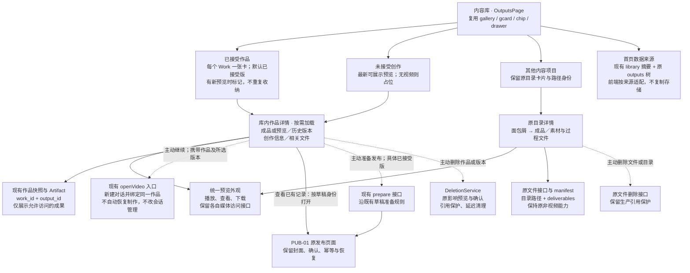

# LIB-01 · 内容库交付物与 Easel 原生交互收敛

- **关联需求**：[需求](../../product/requirements.md) V2-EXP-008、027、028、034，以及未接受作品可管理的补充要求。
- **目标**：用户从同一个内容库按作品找到成品、版本和相关材料，沿用 Easel 卡片、面包屑和预览交互；保留视频恢复、接受、导出和发布能力。
- **阶段**：已交付（COMPLETE，本轮收窄范围）。
- **授权与停止点**：2026-10-24 用户要求新建任务，对比原 Easel 交付物、保持一致且不影响其他功能，先梳理方案。本轮只调查和写文档；未授权代码、部署、数据迁移、删除、制作或投稿。
- **审核后决定**：用户要求按审核结果收窄方案与结构图，补齐现用功能保护和回归验收，仅改文档。本版以此收窄范围为准；仍未授权实施或部署。
- **实施授权（2026-10-24，覆盖上两项停止点）**：用户明确按收窄方案实施，保留已有改动；完成代码和保护矩阵离线回归后部署与调试，调试通过后提交并推送远端。沿本会话指定的 easel-v2-rebuild 唯一主线；不授权付费生成、恢复生产、真实删除或平台投稿。现有PUB-01记录及生产断点保留。
- **基线**：easel-v2-rebuild，HEAD e8f6da1215785cbfb0bee56d838112eba721206b；开工无已跟踪 Dirty，个人二维码、图片目录与临时脚本保持原样。官方对比采用本地 upstream/main a097ddfbb704c9d1eeb1db49a056fdbca9c2351a，不宣称是最新远端，未合并或切换基线。
- **关联任务**：[PUB-01](PUB-01_acceptance-publication.md)继续负责发布草稿、封面和平台回执，本任务消费其能力；不关闭或覆盖其真实验收断点。

## 1. 已证现状与根因

对比官方同名文件与当前[内容库页面](../../../../web/frontend/src/components/OutputsPage.tsx)，并核对[文件接口](../../../../web/app.py)、[作品库接口](../../../../web/production_api.py)、[作品投影](../../../../easel/production/service.py)和[原 manifest](../../../../skills/shared/scripts/manifest.py)。本轮为源码调查，未操作真实页面或业务数据；视觉判断待后续 Web 复验。

| 项目 | 官方 Easel | 当前视频管线 | 差异结论 |
|---|---|---|---|
| 收纳单位 | 主题目录，展示头来自 .easel.json；无展示头也能浏览文件夹 | Work 与 Artifact 持久身份，成片有版本及明确接受指针 | 数据职责不同，不能直接用目录状态替代接受记录 |
| 首页 | 封面卡片、标题、类型、平台及文件数，点击进入 | 原目录列表上方追加未接受和已接受两组，直接放播放器与操作按钮 | 三套展示并排，卡片密度和层级不一致；是当前混乱的直接来源 |
| 交付物 | manifest 的 deliverables 区分成品与素材、过程文件 | 可展示 output、导出包及关联方案；素材、配音、剪辑和运行证据由生产域管理 | 不是少了全部成果，而是内容库缺少统一的作品详情组织 |
| 版本 | 普通文件按目录组织，无强制接受语义 | 库列表只投影已接受版或最新可展示预览；历史版本在作品详情能力中 | 已接受 A 后生成 B，库首页仍只见 A，不能看清还有新版本 |
| 状态 | draft、ready、published 是项目展示头 | 制作状态、技术检查、人工接受和发布回执是不同事实 | 不可直接映射为一个“完成”或“已发”标签 |
| 操作 | 文件预览、目录导航、媒体访问和文件删除 | 恢复、接受、版本导出、具体版本发布、带影响预览的作品删除 | 要统一交互外观，保留各自命令与保护 |

当前文件树主动排除生产管理目录；这是防止绕过 Artifact 访问与删除保护的边界，不能为了“显示齐全”取消。当前内容库文件筛选只作用于目录内文件，并未形成覆盖视频作品的统一浏览。现有 [WorkCards](../../../../web/frontend/src/components/WorkCards.tsx) 已有版本、导出、接受和修改能力，应拆用展示能力，不能整块嵌入其完整制作控制台。

## 2. 收敛方案

### 2.1 一致到哪里

保持原 Easel 的“内容库 → 项目卡片 → 成品与相关文件 → 预览”路径。首页不再直接展开视频播放器。统一使用现有 gallery、gcard、chip、drawer、按钮、颜色及日夜主题，生产作品卡片点击后进入库内详情，播放只发生在预览或详情。

首页保留需求已确认的分区：**已接受作品、未接受创作、其他内容项目**。三组使用同一规格卡片；一个 Work 只占一张，已接受作品有新预览时在原卡标记“有未接受版本”，不复制到另一组。其他内容项目保留原目录身份和导航，不按标题合并，也不改写其 manifest。首批不做统一数据库、标签体系或全库搜索工程。

作品卡展示标题、视频类型、明确版本和简短状态。默认预览已接受版本；尚未接受则取最新可展示版本，无视频显示原图标占位。首批沿用视频缩略预览，不后台生成新封面；投稿封面属于具体发布草稿，不自动当作全作品封面。

### 2.2 交付物怎么放

| 库内位置 | 内容及默认展示 | 来源和边界 |
|---|---|---|
| 成品 | 已接受具体版本；尚未接受时明确称预览，提供播放及下载 | 现有 output 与接受指针，不因浏览自动接受 |
| 历史版本 | 版本号、接受标记及实际检查结论；按需展开，不同时加载所有播放器 | 现有可展示 Artifact，不以最新版本覆盖已接受版 |
| 创作信息 | 已有明确关联的版本方案、频道与导演信息、来源与署名 | 无法归到所选版本的信息单独标为“当前作品信息”，缺少历史记录则明示；不以当前默认补历史，不补建历史追溯系统 |
| 相关文件 | 已有可交付文档、字幕、导出包和允许展示的素材 | 只读取已有可展示成果；缺什么不自动生成。视频和署名导出沿原出口 |
| 发布 | 已有记录按草稿身份直接打开；无记录时对具体已接受版提供“准备发布” | 查看不调用准备接口；复用 PUB-01 现有状态文案，不自行归并成“已发” |

素材、配音、图解、剪辑指令和检查记录是生产依据，不都属于最终交付物。用户可读且已有安全展示入口的放在相关信息；内部 JSON、日志、凭证、临时文件和不可展示 Artifact 不铺满内容库。原目录项目的“成品 / 素材与过程文件”能力保留，不要求所有体裁迁移到 Work。

### 2.3 复用与实现边界

1. 在现有 OutputsPage 内抽取必要的卡片和预览展示。仅在内容库内复用样式，新增样式限定作用域，不重构全局按钮、抽屉或媒体组件。前端用带来源判别的视图数据区分文件项目与生产作品，身份仍分别是目录路径和 work_id；只作展示适配，不另建内容库表或写双份 manifest。
2. 扩展既有 library 读投影的必要摘要：更新时间、接受版本、最新可展示版本及有新版本标记。详情按需读取现有作品快照和 Artifact；不在首页逐部加载完整任务、事件和预算。新字段保持原默认接口语义，原调用方不被迫迁移。
3. 从现有 WorkCards、交付投影中仅复用版本展示、交付信息和下载，不整块嵌入控制台，不复制配置、授权、接受、比较、修订和恢复逻辑；原功能及入口保持可达。现有 App.openVideo 会新建对话并绑定同一作品，不是找回原聊天；本期继续使用此入口并携带所选版本，不改会话管理或任务订阅。打开对话本身不等于恢复制作，后续执行沿原命令与授权。
4. 删除沿现有两条后端：普通文件用原路径接口，生产作品用 DeletionService 与影响预览、版本校验和引用保护。显示统一，不能把整部作品交给通用文件删除。删除本地作品不表示远端撤稿，发布记录保留策略沿现有合同，不在此任务扩张平台删除。
5. 先不改生产存储位置、生成协议、运行恢复、接受条件、发布幂等、封面保存、账号选择或媒体权限。无数据迁移时可回退展示代码，已有成果无需搬回。
6. 查看已有发布记录使用现有 openPublicationDraft 和读取接口；只有用户主动准备发布才调用 openPublication 的 prepare 流程。详情挂载、预览、刷新不调用 prepare，也不自动核实平台或投稿。多个尝试不拼成新的前端状态机；复用 PUB-01 对具体草稿的回执解释。

审核依据：[现有对话入口](../../../../web/frontend/src/App.tsx)、[发布入口与状态文案](../../../../web/frontend/src/lib/publicationApi.ts)、[作品订阅](../../../../web/frontend/src/lib/useWork.ts)。详情只按选中作品加载；若复用订阅，关闭详情即释放，不让首页每张卡启动轮询或 SSE。首批不为列表新建实时同步服务。

### 2.4 实施结构图（本轮实现边界）

实线表示页面导航或读取，虚线表示用户主动选择后进入既有业务流程。图中的统一卡片与作品详情是本任务要补齐的展示层；其余接口、身份及业务规则复用现有能力，不新建第二套内容库。

实施对应：L1补首页摘要；L2统一三组卡片；L3补作品详情并复用预览；L4接回图中虚线动作。三个分区是同一个首页的区域，不是三个新页面。只读浏览不能沿虚线自动执行；接受A后产生B的样本必须验证首页、详情、下载与发布始终绑定各自具体版本。生产作品不能转接到普通文件删除，生产管理目录也不能加入原始文件树。

图中“统一预览”只统一内容库内外观，文件与 Artifact 仍使用各自访问接口；“创作信息”遵循版本归属规则。原 WorkCards 的接受、比较、修订等操作继续保留在已有界面，不在本图新增第二套制作控制台。打开发布页不表示触发投稿或平台查询。

## 3. 后续工作包与实现难度

| 顺序 | 工作包 | 依赖与复杂度 |
|---|---|---|
| L1 | 固定展示字段与状态映射，补库读投影必要摘要和正反例 | 中等；复用查询，不建新仓储。先确认已接受 A、最新 B 的展示 |
| L2 | 统一首页卡片，保留三个分区及原目录导航 | 低至中等；CSS 和组件复用，保护现有 jumpPath |
| L3 | 轻量作品详情、按需版本预览、导出及现有对话入口 | 中等；只展示可追溯信息，不复制制作控制台、不实现原聊天找回 |
| L4 | 分离查看记录与准备发布，接原删除流程及回归 | 中等；保留原命令身份和保护，测试无隐式写入，不新建业务状态机 |
| L5 | 离线验收后按授权部署并做 Web 定向复验 | 依赖前四项；真实删除和投稿另需明确授权，不能为 UI 验收触发 |

总评：主要是展示层收敛及少量只读投影扩充，可在现有架构内实现。风险集中于接受版本与最新版本混淆、删除路由误用、深链失效和整块复用 WorkCards 带入副作用。首批排除存储迁移、全体裁统一领域模型、自动整理磁盘、自动清理、批量操作和新审核步骤，避免任务膨胀。具体工时在实施前核对组件拆分后再估算。

## 4. 验收与不回归清单

### 4.1 现用功能保护矩阵

下列是实施后的必验范围，不是本轮已通过结果。不影响现用功能必须有对应回归证据，不能仅凭“复用”宣称成立。

| 现用功能 | 保护边界 | 必验场景与证据 |
|---|---|---|
| 文件项目与非视频内容 | 原树结构、路径身份、manifest、媒体接口和 HTML 沙箱不变 | 有无 manifest、嵌套目录、图片、音频、视频、Markdown、HTML；对话文件跳转、过滤、返回、刷新及下载；关联接口用例与 Web 操作 |
| 现有视频创作 | 不改规划、生成、恢复、授权或自动回传 | 离线验证入口仍传同一 work_id 与所选 output_id；进入对话不创建制作 Run，不自动派发素材或配音调用；原对话流与自动回传关联回归 |
| 接受、比较、修订与新作 | 不搬走或删除原 WorkCards 操作，不新增一套判定 | 原入口可达；既有接受事实和版本保护用例通过；从库继续后原操作可用，新作仍沿原授权规则 |
| 版本与创作信息 | 已接受版、最新预览和当前作品信息分开 | A已接受后产生B、选回历史版、历史信息缺失；检查播放、下载、署名与展示归属，不误用当前方案 |
| PUB-01与封面 | 原草稿、账号、封面、确认摘要、未知结果恢复不变 | 查看已有记录不调用 prepare；主动准备才调用；既有草稿、已提交及 UNKNOWN 样本可达，选图、截帧、保存、最终确认原用例通过，不真实投稿 |
| 删除 | 文件和作品删除接口分开，原预览校验与引用保护不变 | 取消无写入；临时库验证过期预览、共享引用、接受选择影响、待发布或待核实引用、在途延迟清理；真实作品不用于破坏性验收 |
| 全站UI和数据加载 | 新样式只作用于内容库；不改全局导航和公共组件行为 | 日夜主题与窄屏；聊天、发布页、封面选择器、设置及原发布入口烟测；关闭详情释放订阅，无首页逐作品轮询，单数据源失败不遮蔽另一来源 |

### 4.2 本任务正反例及交付判据

- 原生图片、音频、视频、Markdown、HTML项目：原卡片、面包屑、过滤、预览沙箱、媒体访问与对话文件跳转保持可用；没有 manifest 的目录仍可查看。
- 未完成且无视频、待修预览、待审阅、已接受四种样本都有清楚入口；查看不改变制作或接受状态。
- 已接受 A、更新预览 B：首页仍指向 A并提示新版本，详情可选 B；B 不自动成为接受版或可投稿版。历史版本下载与署名绑定正确。
- 内容库打开、刷新、播放、返回和过滤均不创建 Run、Operation、接受记录或发布草稿；主动继续按现有方式建立关联同一作品的对话，不承诺找回原聊天，也不因导航自动恢复制作或重新生成素材、配音。
- 发布按钮绑定所选具体版本；原草稿、封面及未知提交恢复入口可达，已投稿内容不重复投稿。实际投稿不是本任务 UI 验收的必要动作。
- 删除取消无写入；离线临时库验证实际删除保护共享引用、已保留版本及在途记录，生产 Artifact 不走普通文件删除；原普通项目删除不受破坏。
- 日夜主题、窄屏、长标题、空库、单数据源失败均可用；首页不批量展开播放器、不逐作品请求完整快照；不新增外部调用或加载付费资源。
- 适用前后端离线用例、构建、差异与文档检查通过后才能记录 SOFTWARE_PASS；真实 Web 另记结果，未测保持 NOT_TESTED。

离线使用临时库、许可测试媒体和 fake 服务，检查浏览前后业务记录及写接口调用；不启动真实制作来证明UI无副作用。Web复验需后续授权部署，按矩阵操作并记录受测版本；若任何现用功能回归，先在本任务修复并复验，不删除原功能、放宽保护或跳过失败用例换取通过。纯文档阶段只做文档检查。

## 5. 实施与交付证据（2026-10-24）

按用户本轮实施授权完成L1～L5。库首页使用原gcard卡片，详情按选中作品读取快照与本地发布记录；未挂载WorkCards控制台，也不启动详情轮询或SSE。版本方案通过成片所属Run关联，关联缺失时不套用当前方案；频道、导演及来源的进一步信息沿创作对话与署名出口查看。library在原默认scope和artifact_id语义上只增加摘要字段，无schema或存储迁移。

| 验证项 | 实际结果与证据 |
|---|---|
| 后端全量离线 | `python -m pytest -q --ignore=outputs`：2381 passed、16 skipped，165.53秒；排除用户运行数据中的历史测试副本，不排除源码测试。覆盖生产域、对话恢复与回传、接受/修订、发布与封面、删除、引用及原文件接口 |
| 新增库读取用例 | [test_content_library.py](../../../../tests/production/test_content_library.py)4项：接受A与最新B、空草稿、隐藏/删除排除、全表只读及已有发布记录零上传；与原work_api合跑11项通过 |
| 前端全量离线 | `node --test tests/frontend/*.test.mjs`：139 passed、0 failed；新增[contentLibrary.test.mjs](../../../../tests/frontend/contentLibrary.test.mjs)12项覆盖组件回调、读取生命周期、所选版本身份、发布读取失败、原文件预览/过滤/导航/删除分流 |
| 构建与lint | BUILD_PASS；lint退出0，原有linkifyOutputs转义及AcceptedPublication依赖警告各1条；原有大于500KB包提示保留 |
| 正式部署 | 本机原LaunchAgent服务重启，确认新摘要字段与浏览器实际脚本index-BRzu39bA.js、样式index-BBwbDSVo.css，DEPLOY_PASS |
| 正式Web定向 | 已接受作品卡片、历史版本切换、对应视频和署名下载链接、原B站记录导航、聊天/技能库/设置只读烟测通过。729px视口、465px内容区域无横向溢出，首页无带播放控件的视频 |
| 同构建隔离Web | 临时库与合成媒体：接受A有B预览、无成片草稿、长标题、日夜主题、原项目分区、Markdown、HTML沙箱、图片及音视频播放、删除影响提示取消均通过；原封面选图、预览、保存、最终确认图片及截帧通过。仅临时草稿保存和候选生成；零投稿尝试，未调用prepare、resume或平台核实 |
| 生产成果保护 | 部署前SQLite备份；前后29表中28表摘要不变，cleanup_jobs仅19条既有保留项维护时间戳更新，状态/引用/登记的文件摘要无变化。没有制作在途，6条历史UNKNOWN保留；作品、运行、操作、成果、接受与发布记录不变 |

受测基线e8f6da12加本任务增量；本机保留源码摘要、测试日志、备份与截图，详细边界见[Web复验记录](runs/2026-10-24-lib01-web-01.md)。最后界面文案精简后重跑前端139项及构建，并在正式浏览器核实最终脚本已加载；后端实现未再变更。

**结果**：COMPLETE；SOFTWARE_PASS、BUILD_PASS、DEPLOY_PASS及本任务Web定向复验PASS。真实删除、付费制作、远端投稿与新的Creator接受NOT_TESTED且不属本次验收，不将隔离媒体播放记为REAL_PRODUCTION_PASS；PUB-01与CTX-01剩余真实验收保持原样。

**Git交付**：功能与验证提交ce08475c6e885a21f5ee84267f9db18bca3c145b已推送origin的easel-v2-rebuild，远端SHA核对一致。仅显式提交14个任务文件；个人资料与诊断数据保持本地。查询未返回本分支CI运行记录，CI为NOT_TESTED，不以本地通过代替远端结果。此后的文档收口提交不改变受测源码和部署构建。

**下一动作**：用户可直接使用已部署内容库；更小手机视口及真实删除、制作、投稿仅在后续明确需求与授权下验证，不自动追加业务操作。

## 交付后发布媒体衔接漏项（2026-10-24）

用户指出新成片无法在原多平台发布中心选择。此前回归只覆盖原文件发布及已有B站记录可达，不覆盖该路径；保留历史交付证据，本次方案由[PUB-01](PUB-01_acceptance-publication.md)承接，见[发布方案§12](../../architecture/publication-proposal.md#12-原发布中心接入管线成片2026-10-24proposed)。内容库负责精确版本导航和回归，不新建发布业务。本次仅方案，未改代码或部署。

审核收窄后，内容库只补具体版本导航及媒体可达验收；原文件草稿切换保护、超过40项可选、选择后不自动prepare/投稿纳入回归。封面和多平台执行仍唯一归PUB-01，不在内容库复制发布控制器。当前只更新方案文档。

本次关联PUB-01增量已实现并部署：内容库具体版本可进入同一发布中心选择平台，原已有发布记录入口保持；正式Web已验证，无新增制作或实际投稿。软件/真实验收及未测边界以PUB-01本轮记录为准。
