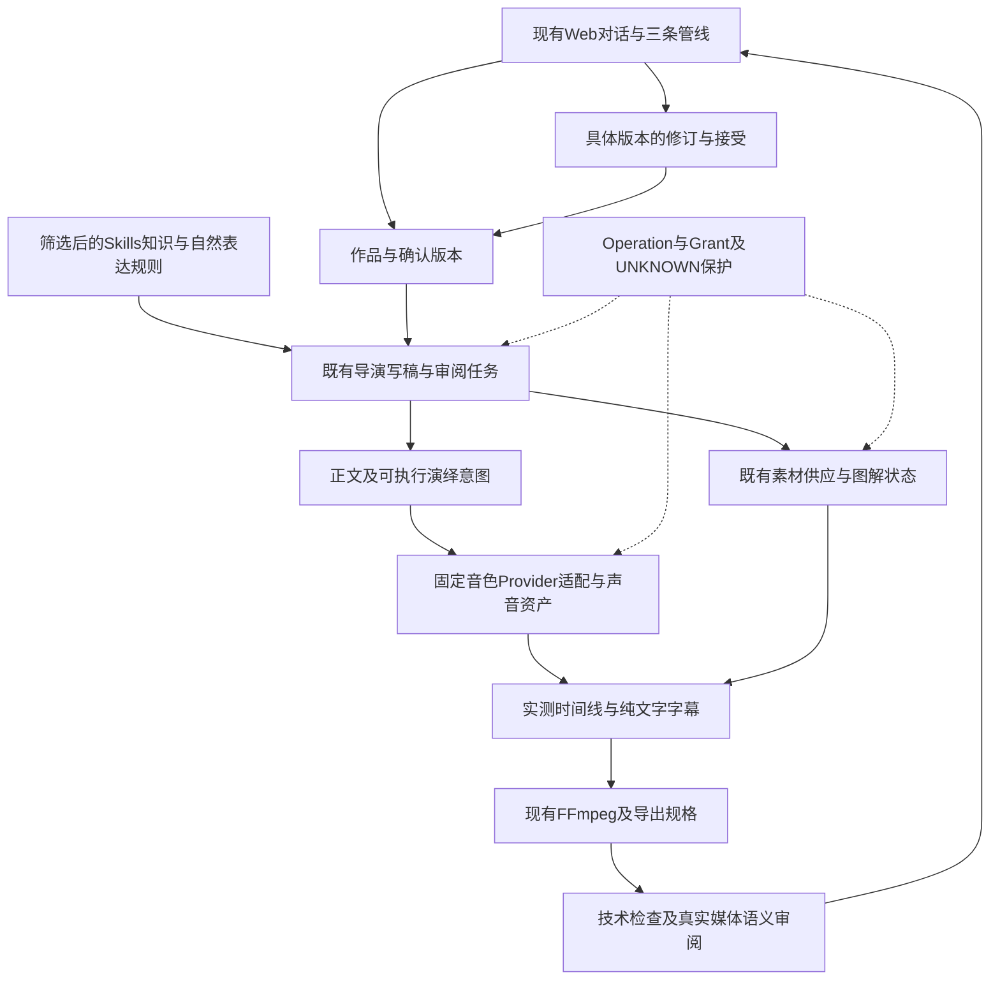
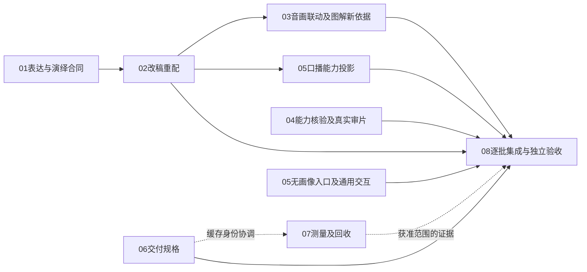

# Easel V2 · S6 收口与 S7 统一实施规划

> **阅读边界**：本卡保留原目标、依赖及逐轮执行证据。当前断点与授权从[状态](../status.md)及本次用户指令读取；下方各日期的暂停、停止、待部署、下一步与一次性提交许可仅适用于该轮，不能作为当前常驻规则。

> **2026-10-23 最初规划记录**：用户认为S6基本完成，并要求统一梳理S6/S7、优化及当前口播问题；经方案审核后授权文档降噪及首批代码/测试，完成后停止。S6按工程闭环阶段收口，质量与接受缺口移交S7规划，不补记PASS。**§4～§10为统一方案；首批实施见§10.2，其余PROPOSED。§1日期排程为历史。** 候选原始证据仍只登记在[当前状态候选池](../backlog.md#s7-candidates)，本文件维护任务归并、依赖和验收，不另建平行Backlog。实施合同仍以[15_IMPLEMENTATION_DESIGN](../../architecture/contracts.md)为准，实施前按实际选定批次更新。

本文件维护实施依赖、需求覆盖与分批执行证据；通用执行规则只在development维护。Coding 合同见[可执行设计](../../architecture/contracts.md)，推荐与取舍见[技术选型](../../history/v2/14_TECHNOLOGY_SELECTION.md)。当前阶段与授权范围见[当前状态](../status.md)及用户当次指令；各卡记录自身实施结果。

## 1. 基线、顺序与交付

> 本节是S5/S6初始安排及当时增补，不重派首张卡，也不延续旧停止指令；当前批次见§10和状态页。

**2026-10-22 本期范围补充**：按用户明确决定，通用自然表达纳入F3，设计及验收唯一见[实施合同 §6.1](../../architecture/contracts.md#natural-expression-design)，并由既有S6-14A记录后续实施证据。不重新打开01～13或新增独立Agent/制作流程。同日最新授权为完成实现与离线测试、文档收敛、部署及提交推送，旧制作停止保持；历史“只按具名故障修复”不否定这项新增需求。视频清晰度全部留S7，自然表达的跨作品完整矩阵也留S7，不能把本期通用功能一起延期。

- 从**包含本实施设计及已完成依赖代码**的已审查提交开工，实际工作树与基线见[当前状态](../status.md#唯一执行入口)。S5 基于 S4，业务事实仍为 `8eeafb6b`，V1 只读 `57c8e2ad`。依赖尚未合入时可从具备成果的父分支创建叠加分支，PR base 指向父开发分支，不绕过主线合并授权。
- 首张卡为 **S6-01 领域合同/事务存储**。02 与 03 可在依赖满足后分工，06/08/09 按表中依赖推进；同文件或合同变更须协调。依赖按可用产物判定，不只看文档状态。
- **S6-01～S6-14 是保留的任务 ID，不代表全部必须在路线图 S6 阶段一次完成。** 阶段定义以[路线图](../roadmap.md)为准，分批验证不能缩减 S4 正式范围。
- **2026-10-19 用户关闭其它S6独立任务**：S6-01～13已实施并全部CLOSED；S6-14历史轮次CLOSED_HISTORY（质量仍PARTIAL），只保留当前一部真实自主作品/人工审片；S6-14A A1～A8 CLOSED、A9 CLOSED_DIAGNOSIS、A10 CLOSED_LEGACY_FIX，声音/交互/成片尚未完成项并入当前三个方向；S6-15维持CLOSED/COMPLETE。S7完整规格矩阵暂缓。详见[唯一当前状态](../status.md#唯一研发下一动作)。行政关闭不等于旧NOT_TESTED/FAIL/Creator未接受被改为PASS，不得重派旧卡。
| 里程碑 | 任务与证据 | 能证明什么 |
|---|---|---|
| 执行基础 | 01～05 | 可观察、可恢复的软件骨架；不证明真实出片 |
| 制作主线 | 06～11（按依赖推进） | 接通素材、可播放首版和自检；仍需真实证据 |
| **已结案素材层依赖** | [S6-15](../../history/tasks/S6-15_material-layer-hardening.md) G0～G4：现状/缺口、合同回查、补强与素材层验收 | 素材库和供应链可安全交给制作主线，**不代替真实出片** |
| **S6 首次真实生产与审阅** | 14 第一段，01～11 实际就绪后，用已支持输入和本次明确风格执行 | Web 到真实可审阅作品、Rights/授权/次数、恢复正反例及用户实际审阅；不冒充产品内接受保存或完整范围通过 |
| 产品体验补齐 | 12～13，依赖满足即可推进，无须等待 14 全部完成 | 局部修订、版本比较、内容库接受、频道和参考形成导演；均是必做需求 |
| **S7 质量、效率与完整范围验收** | 14 第二段，01～13及首次真实闭环就绪 | 完整 T08、S4 全范围、跨题材、音色、质量/耗时/调用及各类正反例；不得省略未测范围 |

S6-14 分段记录结果：第一段通过而第二段未完成时，卡整体为 **PARTIAL**，可据第一段证据判断 S6→S7，但不宣称全部产品完成。用户审阅可单独记录；产品内版本接受保存只有 S6-12 接通并实测后才可记通过。

| 任务 | 具体实施卡 | 依赖 | 需求主责任编号 |
|---|---|---|---|
| S6-01 | [领域合同、事务存储与迁移](../../history/tasks/S6-01_domain-store.md) | 无 | 002、005、020 |
| S6-02 | [作品命令、输入登记与旧入口保护](../../history/tasks/S6-02_work-api.md) | S6-01 | 003、011、027、034 |
| S6-03 | [外部操作准入、生成次数与未知结果](../../history/tasks/S6-03_operations.md) | S6-01 | 013、025 |
| S6-04 | [本机worker与LangGraph持久编排](../../history/tasks/S6-04_worker-graph.md) | S6-01、S6-03 | 006 |
| S6-05 | [作品导航与可观察制作工作台](../../history/tasks/S6-05_progress-ui.md) | S6-02、S6-04 | 024 |
| S6-06 | [V1素材核心迁入与作用域适配](../../history/tasks/S6-06_materials-core.md) | S6-01、S6-02 | 031 |
| S6-07 | [外部供应、权益与生成适配](../../history/tasks/S6-07_material-supply.md) | S6-03、S6-06 | 012、021 |
| S6-08 | [任务化模型与受控工具执行](../../history/tasks/S6-08_model-tasks.md) | S6-02、S6-03、S6-06 | 032 |
| S6-09 | [可编辑工程合同与渲染接入](../../history/tasks/S6-09_editor-adapter.md) | S6-01、S6-06 | 022 |
| S6-10 | [固定音色、句段资产与字幕预览](../../history/tasks/S6-10_voice-subtitles.md) | S6-02、S6-06、S6-08、S6-09 | 010、023 |
| S6-11 | [创作主线、首版与自检接通](../../history/tasks/S6-11_creation-first-cut.md) | S6-04、S6-05、S6-07、S6-08、S6-09、S6-10 | 001、004、014、015、016、033 |
| S6-12 | [自然语言修订、版本接受与内容库](../../history/tasks/S6-12_revision-acceptance.md) | S6-02、S6-05、S6-11 | 007、008、017、026 |
| S6-13 | [频道管理、参考拆解与导演版本](../../history/tasks/S6-13_channels-directors.md) | S6-02、S6-08、S6-10、S6-12 | 019 |
| S6-14 | [首次真实生产与完整范围验收](S6-14_integration-release.md) | 首次真实生产：01～11；完整范围：01～13及首次真实闭环 | 009、018、028、029、030 |
| S6-14A（新增子任务） | [对话式创作与生产后端接入](S6-14A_conversation-integration.md) | 第五轮成功后端；复用02/05/08/11/12/13 | 补齐既有对话体验；A1～A6软件/隔离、A7真实Web、A8局部修订均有具名证据，Creator待审 |
| S6-15 | [素材层现状审计与完善](../../history/tasks/S6-15_material-layer-hardening.md) | 01～13相关实现；历史集成依赖已结案，不再阻断14 | 既有 011/012/013/021/025/031/032/033 协同验收；**不改变既有主责** |

**2026-10-19调度快照（历史）**：01～13软件任务CLOSED；14历史轮次不再派发，原PARTIAL证据保留，当时仅一部真实自主视频及审片开放；14A A1～A8 CLOSED、A9/A10独立旧专项CLOSED；15 CLOSED。2026-10-23之后按§4收口和§6统一规划，不再按该旧快照派发。
每个编号001～034有唯一主责任卡；关联卡和S6-14提供集成/真实验收。单卡通过不意味着该需求所有体验都已通过，必须按验收层次记录。

## 2. 每张卡开始与完成的共同约定

通用约定已迁入[任务衔接规范](../../development/task-handoff.md)，这里只维护本批任务的依赖、覆盖和执行证据。

## 3. 覆盖关系与验收口径

- 原 T01→S6-02/08，T02→01/02/08/11，T03→03/04/07，T04→05，T05→06/07，T06→09/10/12/14，T07→08/11/13/14，T08→14。[原清单](../../history/tasks/S5_VALIDATION_PLAN.md)保留场景与判据，不形成另一条执行排程；T08 全流程在 14 第二段验收，首次首版验证不冒充完整 T08。
- 软件测试默认不付费。TTS 不纳入 IMAGE/VIDEO 额度不代表免费；试听/真实模型/Provider 按用户授权。UNKNOWN 不能为通过测试而放宽为自动重发。
- S7 完整验收必须覆盖 1～900 秒、四声音、三类输入及组合、两画幅、中文、无画像、跨频道导演、固定声音、字幕、参考形成导演、进度、局部修改、版本接受。导演形成、声音选择和内容库接受不能成为可省略的体验优化。
- 风格、自然音色与事实表达使用实际参考和完整视听证据，不用代码检查或模型自评分代替；样本/组合和标准须在验收前明确，不能事后改分母。

### 3.1 历史接手与结果记录

历史上的S6-01～14连续授权不等于今天继续执行所有旧任务：2026-10-19用户决定关闭其它S6工作项，当时只保留F1画像、F2交互、F3真实出片和人工审阅。2026-10-23按下文统一规划接手，不能从历史表重开旧软件实施或付费重跑。旧任务与证据留在原卡，唯一下一动作见[当前状态](../status.md)。新实施、制作及UNKNOWN处理仍须满足当前实际授权边界。

## 4. S6收口：保留成果，移交质量缺口

本次核查代码基线 `easel-v2-rebuild@79ebae55ed9c089a5ecc4c6c8b56b42734e8eeea`。现有未提交文档及未跟踪材料保留。范围覆盖01～15（含14A）、F1/F2/F3、当前状态17项候选（含本次审核补登记的无画像入口缺口）和末尾补记、最新真实E2E；不逐次重派历史失败，也不称全部历史日志已重新审计。

**阶段判断**：遵从用户“S6基本算完成”的决定，S6工程闭环收口，进入S7统一规划；用户后续批准完成本次八个工作包的代码与离线验证；真实E2E留到晚上，条件研究项仍不自动立项。真实作品已由正式Web完成规划、确认、供料、配音、渲染、同对话预览和Creator反馈；过程中有工程修复介入。当前作品技术可播放，但视觉抽样FAIL、自动视觉修订失败、口播未接受。阶段收口不修改业务库接受状态、不取消或重放原任务。

| S6任务 | 已有交付及证据 | S7接续，不重复开发 |
|---|---|---|
| 01 领域存储 | 领域合同、SQLite事务、版本；软件任务CLOSED | 仅为本次明确修订/导出合同必要扩展；历史数据保护 |
| 02 作品与输入 | 作品命令、输入、删除预检、旧入口保护CLOSED | 三类输入组合、无画像路径与既有入口回归 |
| 03 外部操作 | 授权、计数、持久回执、UNKNOWN保护CLOSED | 新演绎/修订请求身份及恢复负例 |
| 04 持久编排 | 本机Worker、LangGraph与业务账本接通CLOSED | 新修订步骤的恢复与幂等，不换调度器 |
| 05 进度界面 | 工作台及对话投影已实现，后续交互由14A承接 | 状态降噪、刷新、取消、恢复的统一表达 |
| 06 素材核心 | 复用、作用域、引用及权益已迁入CLOSED | 引用感知回收、具体匹配失败修订 |
| 07 素材供应 | 库存/生成适配及服务准入CLOSED | 现有Provider真实组合验收；新增Provider不默认立项 |
| 08 模型任务 | 显式上下文、受控工具、结构化验证CLOSED | 精简任务所需信息和观察证据；保持校验 |
| 09 编辑渲染 | EditProject与本地FFmpeg接通CLOSED | 1080P全链编码与缓存身份；4K后置 |
| 10 声音字幕 | 固定音色、句段资产、字幕及连续旁白已有实现和真实调用 | 演绎控制、改稿重配、对齐及听感 |
| 11 首版与自检 | 首版、技术检查、语义检查路径和有界自修已有实现 | 当前视觉失败与真实音视频观察覆盖 |
| 12 修订接受 | 视觉局部修订、版本比较/接受/内容库已实现 | 补齐口播内容修订；真实接受与复用验收 |
| 13 频道导演 | 频道、导演版本、参考分析和试片生命周期已实现 | 跨频道风格与事实隔离验证，不新增导演体系 |
| 14 集成验收 | 历史轮次保留；最新可播放真实预览、Creator提出修改 | 完整质量、无工程救场的独立生产和规格矩阵 |
| 14A 对话接入 | 三条对话管线、确认/回写/恢复及通用自然表达已部署 | 口播修订能力投影、交互与质量缺口 |
| 15 素材补强 | 用户已关闭CLOSED/COMPLETE，素材代表样本及权益证据保留 | 作为依赖复用，不重新打开G0～G4 |
| F1/F2/F3 | F1画像内容关闭；F2真实对话到预览已通；F3有真实成片和拒绝反馈 | F2交互进入S7-05；F3表达/声音/画面进入S7-01～04 |

最新证据：[E2E-05](runs/2026-10-22-web-e2e-05.md)。发布快照软件检查869 passed / 5 skipped、前端105项与构建PASS；工作区871包含未纳入发布的两项测试，不能混用分母。REAL_PRODUCTION_PASS=PARTIAL，CREATOR_ACCEPTED=NO，本轮尚未证明独立无工程介入首版。以上为既有结果，新实施验证见§10.2。

已完成的授权服务收窄、混合色彩范围渲染修复、显式本地渲染恢复、历史length告警归属修复移入回归集合，不重新排成开发任务。上游length的具体原因、视觉修订失败及口播问题仍有未闭合部分。

## 5. S7架构取舍：沿现有模块补能力

继续使用当前作品的一个频道、一个Director版本。产品已有多频道/导演关系保留，不为去AI味新增Director、六维画像或并行创作Agent。文案、演绎意图和选材属于导演；身份、版本、时码、引用、授权、缓存和恢复属于程序。

### 5.1 最小变更点

| 现有边界 | 计划扩展 | 不采用的替代方案及理由 |
|---|---|---|
| `expression_policy.py` / `model_tasks.py` / `planning.py` | 单一版本规则增加可落地的口播写作方法；导演在既有写稿/审阅任务内使用 | 动态加载114份技能、单独润色Agent或七轮评分会扩大上下文和流程，且旧技能包含冲突指令 |
| `contracts.py` / `voice_tasks.py` / MiniMax适配器 | 正文与演绎意图分离；先小范围停顿，能力校验后编译TTS请求；声音身份保持 | 将导演注释直接塞入字幕/朗读正文，或全片强制情绪，无法保证文字与声音保护 |
| `revisions.py` / `service.py` / `worker.py` | 在已有修订、扩大范围确认、Plan版本和资产依赖中接通改稿重配 | 新造“第二制作引擎”或调用旧Skill CLI会绕开授权/回执；仅补Prompt不能生成新的合法音轨 |
| `boards.py` / `material_intent.py` / `edit_observation.py` | 局部补料与选段校验；图解状态重排/改高亮须形成新依据和受影响图片，再进入编辑 | 高亮已固化在PNG，旧状态顺序受保护；不能放宽旧校验冒充图解修订，也无需任意代码执行 |
| `quality.py` / `inspection.py` | 核实实际音视频输入能力，区分技术、抽帧、音频、完整时间覆盖和Creator评价 | 给抽帧评分换名字，不能补足没听到声音/没看连续动作的缺口 |
| `editors/ffmpeg.py` / `subtitles.py` | 版本化1080P导出规格，覆盖中间镜头、字幕合成与最终输出，纳入缓存身份 | 只把最终CRF改低无法补回前序损失；不靠强锐化或放大实现4K |
| `conversation*.py` / `video_workspace.py` / Web组件 | 根据真实能力/版本生成可执行提案和简洁状态；错误附着相应回合 | 新增常驻技术面板、复制状态机或将全部历史当作当前故障会增加使用负担 |
| `deletion.py` / `materials/library.py` / `runtime.py` | 已登记资产复用现有引用感知回收；渲染工作目录/备份先盘点所有者、任务、引用和可再生性；测量运行开销 | 现有删除服务不覆盖全部渲染缓存；不得扩大路径白名单后按目录年龄清理，亦不需新运维平台 |

### 5.2 版本、保护与复杂度约束

- 本批只实现启用后新建作品及其修订；不处理旧作品迁移、规则升级或兼容。历史数据不删除。
- 最小修订链为“具体旧输出→变更范围→新内容依据→确认→只重新生成受影响音轨→更新必要字幕/时间线→新版检查”。能复用的素材复用；连续口播需要整段重合成时提前说明影响，不承诺逐句无缝替换。
- 稿件内容哈希、实际TTS输入及演绎控制、模型/音色/基础参数、编译规则版本须共同参与**Operation请求身份和独立音频复用键**，两处采用一致的声音输入依据。现有音频缓存可在创建新Operation前命中，只扩请求字段不足以使新演绎生效。纯字幕文本与供应商控制文本分开保存；同稿改停顿不得复用原音频，相同请求重放不得重复收费，恢复原演绎可复用合法旧音频。
- 修改旁白会改变时间；必须用真实音频时长重新对齐字幕和受影响剪辑，并保持已确认固定片长或重新说明变更。不得通过截断语音、长尾静默或静默变速凑数。
- 图解仅调整既有状态的停留/切点时可走视觉快路径；改变冻结状态顺序或高亮须复用新依据修订链，生成新版Plan及受影响的图解PNG，保留原版。沿已有范围确认，不另加逐图审批；该依赖不能只记作“音画联动”。
- 审片先核验当前生产模型；现有完整审片复用规划transport/runner。若缺少实际音视频能力，独立审核服务属于条件性工程接入，须明确服务选择、Grant、Operation身份与恢复，不是改一个配置或能力标签。未接通则自动完整审片保持BLOCKED，不能换掉全体创作模型，也不阻止本地1080P对比或明确标注范围的人工试听。
- 任何新字段/迁移/阶段只在实施前证明现有结构不足再增加。沿用任务记录与资产依赖，暂不建立通用依赖计算引擎、策略平台、第三套检查点或新独立运行服务。具体字段、状态与迁移只写入实施合同，本规划不冒充冻结schema。

## 6. 统一工作包、依赖和退出条件

复杂度是相对工程判断：低=单模块表达/投影；中=多个既有模块协同；高=跨版本、媒体时序与恢复。不是工期承诺。下列编号只用于本规划，未创建八张空任务卡；获准实施时在此更新状态，复杂合同单独更新权威合同。

| 工作包 | 内容及实际落点 | 依赖 | 复杂度 / 主要风险 | 可验证的退出条件 |
|---|---|---|---|---|
| **S7-01 自然表达与口播演绎** | 独立复核通用去AI味设计，合并现有规则与筛选Skills；写稿可说性、导演差异、受限停顿编译。`expression_policy.py`、`planning.py`、`voice_tasks.py`、`narration.py`、`providers/minimax_speech.py` | 无新增基础设施；真实试听需实际授权 | 写稿低；演绎中。风险是改坏原意、标记被念出、全篇一种语气 | 软件验证冻结输入/字幕正文保护、控制白名单、模型能力及请求/复用身份；改稿输出的事实、否定和不确定性由具名正反样本审阅，不能靠Prompt单测普遍证明；固定V6_1同模型短段对照，Creator判断听感，不用AI分数替代 |
| **S7-02 内容修订与重新配音闭环** | 补齐改稿/演绎变更的范围说明、新依据确认、TTS、字幕与必要时间线更新；保留视觉单改快路径。`revisions.py`、`service.py`、`voice.py`、`speech_alignment.py`、`creation.py`、对话能力投影 | S7-01的正文/演绎合同先定；可先做无演绎的改稿重配 | **高，第一批主要工程风险**。身份错绑、重复费用、音画漂移 | 具体版本发起→展示真实变更→确认后生成新版；原版保留；只改画面/字号不重新配音；同命令重放不重复收费；未知调用停住；实测声音/字幕/时长一致；助手不再承诺不存在的能力 |
| **S7-03 素材、图解与视觉局部修订** | 修复真实出现的关键词相近但画意不符、图解不逐项突出、切点与语义错位；处理选段证据/帧时间格式失败；新依据内重排/改高亮并重生受影响图片。`material_intent.py`、`material_binding.py`、`boards.py`、`edit_observation.py`、`visual_repair.py`、`revisions.py` | 独立视觉修订可先做；音画联动及图解冻结依据变更依赖02 | 中～高。不能以放宽证据校验换成功 | 对具名失败建立真实本地媒体正反例；选镜具有实际观察区间；图解新版与新Plan一致、旧状态仍受保护；原声/字幕保护正确；正式Web局部新版复验，无关资产不重新获取 |
| **S7-04 真实音视频审阅与质量证据** | 核验当前模型实际听音轨/看连续视频；复用完整视频分段和汇总；独立审核服务仅作有授权的条件适配。`inspection.py`、`quality.py`、`creation.py`、能力目录及MODEL授权边界 | 能力探测和软件测试可先做；综合样片随01～03积累 | 现服务复用中；新服务接入中～高，能力/权益另有外部不确定性 | 观察证据覆盖声音、连续动作和完整时间；故意缺音/漏段/错字幕夹具不能PASS；如接新服务，其授权/调用/恢复可核对；能力不足明确BLOCKED，不把人工接受冒充自动QC |
| **S7-05 对话、恢复与上下文效率** | 状态/失败说明与能力投影统一；恢复目标、上下文、length、重复确认、标题否定和时长文本同源；补正式Web无画像/无频道临时创作入口，复用领域已有可选画像能力。`conversation_pipeline.py`、`conversation_bridge.py`、`conversation.py`、`video_workspace.py`、`web/conversation_api.py`、前端 | 可拆独立小批；口播提案等02；无画像入口不阻塞批次A | 中。上下文删减或临时创作串入其他画像/默认授权 | 回放失败/刷新/取消/重复答复，一次准确交付，UNKNOWN不重发；无画像主动选择导演、创作/保存且不读取其他画像记忆；精简前后权限、版本与事实不丢失 |
| **S7-06 高质量1080P交付** | 素材清晰度/裁切约束，最终尺寸图解/字幕，统一中间与最终编码参数、色彩范围、缓存/回执身份；同素材比较ultrafast/CRF20与medium/CRF18候选。`editors/ffmpeg.py`、`editors/base.py`、`boards.py`、`subtitles.py` | 本地对比/编码合同可独立；最终作品集成验证使用03/04的可用成果 | 中。多次编码损失、旧缓存混用、耗时/文件增长 | 同片段同画幅对比清晰度/体积/耗时，包含文字、运动与裁切；改变规格不能复用旧编码缓存；无放大低清冒充提升；1080横竖屏真实播放与可读性通过后再定默认 |
| **S7-07 存储与运行效率** | 建立时延/调用/人工介入基准；区分已登记资产回收、渲染工作目录与备份保留；磁盘余量、记忆索引先验证。`runtime.py`、`deletion.py`、素材库/回执、模型诊断 | 测量与目录盘点可先做；缓存清理需所有权/任务锁/保留合同，与06协调身份而非整体等候 | 测量中；跨目录自动回收中～高。误删恢复依据、无依据优化 | usage缺失标未知；已登记资产保持原引用保护；新增缓存回收证明在途锁、有效成片、共享/UNKNOWN/恢复依据不被删除；清理预览可解释；同输入测量收益，不靠少检查换速度 |
| **S7-08 正式范围与独立验收** | 将S4 001～034和自然表达补充形成样本/负例/证据矩阵；真实Web新作品及版本接受/导出/复用、频道导演生命周期、跨题材稳定性；既有Easel入口回归 | 各项软件/部署检查就绪后逐批验证，综合退出依赖01～07的获准部分 | 工程中、真实验证高。配置/权益/费用不足不能掩盖 | 固定受测SHA，调试通过与无工程救场独立通过分列；功能矩阵每格有PASS/FAIL/BLOCKED/NOT_TESTED；支持范围无静默降级；Creator明确接受具体版本；未完成项及退出决定明确 |

### 6.1 批次与顺序

- **批次A：口播与可修改性**。先定01/02共同合同，以启用后新建的纯旁白作品及其内容修订打通第一条链，保留当前音色/模型与连续合成；先改稿、重配、对齐和回放，再凭同稿试听决定是否接少量停顿。通用写作规则不限定于该频道；纯旁白只是首条集成验收范围，其他声音模式继续列入08。同步做04的只读能力核验；05仅补准确能力提案。首批不包含跨规则升级旧作、逐句拼接、高级情绪标签、独立审片服务或图解状态重写。停止点：可比较的新版口播及修订链验证明确；没有改善证据不批量整片重配。
- **批次B：画面与可信审阅**。03解决当前具名缺陷，04完成实际音视频审核能力和完整时间覆盖；在A形成的真实声音时间基础上修切点。停止点：一部质量问题闭合的候选作品，进入Creator审阅；对无法解决的模型能力限制单列决定。
- **批次C：交付与效率**。06先1080P；05按具名交互问题收敛并补无画像入口；07先测量/目录盘点，再决定缓存回收。三者可独立排期，同一文件/合同须协调。停止点：获准范围有同版前后证据、无质量/安全回退；可选效率优化不阻塞已完成的口播交付。
- **批次D：覆盖与收口**。08在每批积累证据，最后用固定版本完成独立真实样本及完整维度覆盖。不能让边界矩阵成为第一条改稿重配前的全部前置，也不能因取了代表样本就宣称所有组合通过。

实线是相应能力的集成依赖，虚线是合同协调或获准范围证据；不表示必须八包全部完成才可交付。04能力核验、06本地对比、05通用交互和07测量可独立；已有视觉单改不因02未完成停用。自动完整审片不足时只保留其自身未通过状态，不伪造整体质量PASS，也不阻止独立的工程验证。

## 7. 所有候选与当前缺口的归并

候选详情与证据继续在[唯一候选池](../backlog.md#s7-candidates)，下表仅指向目标工作包，防止漏项/重复开发。八个工作包的确定性实现已获授权；§7.1条件项与真实付费试验不因该授权自动执行，当前结果见§10。

| 来源ID/现有问题 | 统一归属与处置 |
|---|---|
| EXPRESSION-C02 独立设计去AI味 | 01设计入口；显式复核而非只追加提示词，复用有效旧规则，不再造第二套自然表达系统 |
| EXPRESSION-C01 跨作品稳定性 | 01定义行为，08用不同内容/导演验证，避免与C02重复实施 |
| VOICE-C01 导演演绎 | 01受控实现，02完成修订接入；全套高级标签平台不进入第一批 |
| VOICE-C02 连续旁白/时长 | 02时序保护与08边界验收；沿用已有连续模式 |
| VOICE-C03 发音/混读 | 01中的条件项：有读错样本再接词典/语言控制；08记录覆盖，不无条件做全语言平台 |
| VOICE-C04 HD/Turbo | 01后的条件试验；固定音色/稿件做对照，费用/权益许可后才执行；不因名称直接换模型 |
| VOICE-C05 声音资产生命周期 | 保留研究，非S7首批必做；固定已有V6_1不依赖声音设计/克隆工作台 |
| VIDEO-C01 清晰度/4K | 06拆分：1080P本阶段优先；4K为二期条件包，见§7.1 |
| UX-C02 当前状态/降噪 | 05；旧length全局告警已修，只留回归，其他技术细节泄入正文仍需验证 |
| UX-C03 阻断说明 | 05统一已有成果、原因、可选恢复与新增消耗，原生助手自然表达 |
| FLOW-C02 确认/恢复合同 | 02处理内容修订范围，05处理确认/恢复投影；已修的服务收窄不重复排开发 |
| FLOW-C03 无画像正式入口 | 05明确实施入口/管线适配，08验收002/034；领域已允许空画像，不能只登记为“可能未测” |
| CTX-C01 上下文重复 | 05测量/按需投影，07观测收益；length与上下文的因果未证实，不先删历史/压思考 |
| MEM-C01 记忆索引认证 | 07先确定是否影响实际功能，需配置修复时另核授权；权威作品状态不依赖embedding |
| TITLE-C01 标题否定意图 | 05独立低复杂度修复，不作为口播链前置 |
| STORAGE-C01 存储回收 | 07；保留共享资产/UNKNOWN/恢复依据，外置盘及去重先测量 |
| VISUAL-R01 code-video | 仅参考确定性时间轴/帧检查思想；通用代码视频执行留后续研究，不替换FFmpeg |
| 当前口播平淡、语调及AI味 | 01＋02＋04，承接E2E-05真实拒绝反馈，不能以S6行政收口抹去 |
| 当前图纸语义不符、图解重点与切点错位 | 03＋04，原视觉FAIL保留，不整片无目的重做 |
| 自动修订invalid_model_output | 03检查素材选段证据、帧时码与结构化合同；无新证据不增加重试轮数 |
| 普通修订没有改稿后TTS；助手错误承诺 | 02补能力，05按实际能力限制提案；不能只修说法却宣称可重配 |
| 自动QC未听音频/全片连续动作覆盖不足 | 04，已有完整审片代码的真实能力核验与接通，不仅新造一套检查 |
| 方案自由文本逐秒表与结构化时长不同步（末尾补记） | 05优先同源展示；01/02保护真实片长，08回归，不强迫重跑已成功规划 |
| 压缩summary-tail告警、memory 401（末尾补记） | 已分别并入CTX-C01/MEM-C01，不建重复事项 |
| 旧S6完整规格、接受/导出/新作复用缺口 | 08接续，沿用既有功能，不把软件存在当全部真实PASS |
| 新阶段官方更新检查 | 本次已Fetch/Diff，见§9；合入须单独用户决定，不作为A批阻断 |

### 7.1 条件项和明确后置范围

- **4K二期**：完成1080P基线并有明确4K用途后，先扩展交付合同、源素材资格、画布、图解字体/布局、字幕、缓存/回执、资源预算及QC，再实测横竖4K。不能只把最终scale设为4K。当前未批准研发/部署，不纳入S7首批退出门槛。
- **可选模型/发音优化**：仅在当前模型经过改稿/必要停顿仍不能满足真实口播，或出现明确读错时，再评估HD、其他服务或词典。换服务需要成本、音色可迁移性和许可证证据；CosyVoice等只作参考，V6_1不能假定跨引擎可用。
- **V3/研究保留**：通用模型任意代码视频、Hypit/Remotion替换编辑后端、新素材Provider市场、声音克隆/设计平台、多人云端、自动发布运营均不因为本次任务整理变成S7必做。

## 8. 验收矩阵与落地检查

### 8.1 S4需求全量追踪

下面按主验收归属分组，001～034每项出现一次；跨包依赖按§6联动，不删除既有要求。

| 主验收包 | 需求编号 | 行为验收 |
|---|---|---|
| 01 | 004、010、014 | 导演主动表达、固定声音、人物/事实忠实；另含自然表达补充 |
| 02 | 007、026 | 局部修改与范围/新增消耗说明，音频内容修改和视觉单改均可执行 |
| 03 | 011、012、021、031 | 三类输入/组合、必用素材、库存优先/授权生成、来源权益和复用 |
| 04 | 015、016、033 | 画面声音字幕实际检查，真实交付状态，冲突/缺能力合法暂停 |
| 05 | 001、002、005、006、024、025、032、034 | 有依据讨论、完整方案确认、自主推进、进度/取消/恢复与事实依据保留；补无画像/无频道临时创作入口 |
| 06 | 022、023 | 横竖1080P、声音内容/音乐/字幕设置与中文优先 |
| 07 | 013、027、030 | 计数不回退、保存/删除与效率基准；完整验收指标由08汇总 |
| 08 | 003、008、009、017、018、019、020、028、029 | 频道/导演关系、具体版本接受、时长声音范围、独立验收、偏好/旧作隔离、既有Easel功能及本机配置；同时汇总各包的真实验收证据 |

### 8.2 分层而非笛卡尔积

1. **确定性软件层**：时长边界1/900秒及越界拒绝；四声音模式；两画幅；三输入类型及组合；有/无画像；字幕开关/样式；原声/必用素材；旧版选择与引用。用隔离数据覆盖合同、指纹、权限、恢复，不用付费样片验证每个参数排列。
2. **真实媒体层**：本地合法素材验证声音完整性、字幕时码、图解状态、裁切、切点、色彩范围、编码、损坏缓存与恢复。代表短/中/长时间线；用合成测试素材只证明软件，不冒充创作品质。
3. **真实服务层**：先能力小样，再按实际授权覆盖当前模型/TTS/库存/生成；0额度、拒绝、超限、UNKNOWN及缺能力以相应真实或协议证据明确标注。缺配置/权益的Provider标BLOCKED，不为了填表购买/换服务。
4. **真实Web层**：沿唯一E2E规范，在固定SHA完成讨论→方案→确认→自主生产→同对话播放→局部修订→具体版本接受/导出/新作复用。覆盖频道与导演创建/参考/试片/接受、默认变更不污染旧作品、无画像临时创作。无画像入口已由05适配并通过入口服务测试；正式浏览器交互仍需独立验收，不能用领域API可创建替代正式Web通过。
5. **Creator与风格层**：使用实际选择的声音和导演，覆盖具体叙述、认真分析等不同内容；跨导演样本须使用用户实际选定/确认的风格，不擅造测试导演替代。关注口播自然、理解顺畅、信息正确、图文同步及作者判断；不设置去AI分数。

真实样本建议逐批覆盖：短片纯旁白（首先解决本轮问题）、横竖切换的中短片/旁白+BGM、静音与纯音乐、带必用/原声的原片改编、无画像临时作品、长片及边界时长。允许一个样本覆盖多维，不预设必须制作多少部；开始付费矩阵前固定样本、时长容差和服务授权。完整范围未测完就保持PARTIAL，1秒不强制容纳不可能说完的口播，按内容/模式预算给出合理拒绝。

**批次A的最小验证集**：新作品固定新规则、默认规则后来变化不影响该作品；新作内改稿后新音频/字幕/时序一致；纯视觉修改不重配；同稿不同演绎不误用缓存、相同请求重放不重复费用、UNKNOWN保持停住。真实试听先比较原稿/改稿（音色、模型、参数一致），仅需验证停顿时再比较同一改稿的无控制/有控制版本，不同时换稿换模型来归因。逐句对照事实、条件和否定等语义，并记录Creator对平淡、重音、停顿的具体反馈。软件PASS不等于语义或自然度PASS；无改善同样是有效试验结果，不据此扩展自动重试。

### 8.3 每批完成标准

- **合同**：实施前更新受影响的唯一设计段落，明确新字段/版本、失败路径、复用与回退；没有代码的能力标DESIGNED。
- **软件**：相关正反测试与适用回归PASS；尤其口播变更、重复确认、UNKNOWN、字幕污染、时长超限和缓存失效。测试命令沿工程说明；不盲目用全套运行次数代替实际覆盖。
- **部署**：用户授权后检查在途任务、运行源码/前端摘要、备份及受保护引用；只重载必要组件，保留UNKNOWN，不对旧任务自动迁移。
- **定向复验**：先验证具体修复；记录是否工程介入。新版本旧版比较，不覆盖历史失败；有付费副作用时沿正式Web授权，不用API/SQL替代确认。
- **独立验收**：定向修复完成后，固定版本以正式Web运行独立样本；不得混用不同SHA的成功片段声称一次自主通过。
- **阶段收口**：分别报告SOFTWARE_PASS、DEPLOY_PASS、REAL_PRODUCTION_PASS、自主完成、CREATOR_ACCEPTED及完整范围状态。未实施条件项可后置但必须显式列出；S4必做未覆盖则产品范围保持PARTIAL，不能用阶段名称掩盖。完成获准范围后交用户决定，不无限延长优化。

## 9. Easel与开源参考：采用方法，不复制整套系统

资料读取于2026-10-23。以下为源码/官方文档依据与我们的工程判断，未运行外部项目效果对比；许可与具体版本依赖须在实际引入代码时复核。本轮没有新增依赖。

| 参考 | 已核查的可借鉴点 | 在Easel的落点与不采用范围 |
|---|---|---|
| 本仓库114份Skills；text-polisher/video-script/tts-voiceover/multi-voice-dubbing | 写稿具体化、口播与画面说明分离、供应商演绎映射；详细证据见E2E-05研究 | 01筛选知识；规则单一来源。不搬评分、固定Hook/CTA、逐句TTS或旧CLI执行链 |
| [Humanizer 3.1.0](https://github.com/blader/humanizer/blob/main/SKILL.md) | 保留信息和作者文风、按上下文处理模板表达 | 01与08；已有规则已参考，重复安装不是实现方案，不用检测器证明自然 |
| [MiniMax API](https://platform.minimax.io/docs/api-reference/speech-t2a-http)与[官方Skills](https://github.com/MiniMax-AI/skills/blob/main/skills/frontend-dev/references/troubleshooting.md) | 2.8停顿/语气标签及自动情绪；不同模型能力有边界 | 01适配层白名单、同声同稿对照；不默认强设情绪，不套其他模型指令 |
| [CosyVoice官方示例](https://github.com/QwenAudio/CosyVoice/blob/main/example.py) | 正文、声音参考与演绎指令分别处理 | 借鉴01职责划分；不安装新引擎、不假设固定音色可迁移 |
| [OpenTimelineIO时间线结构](https://opentimelineio.readthedocs.io/en/latest/tutorials/otio-timeline-structure.html) | 区分媒体可用范围、片段source_range与时间线位置 | 02/03完善现有EditProject的来源时码与帧对齐；不为此引入OTIO或重写编辑合同 |
| [LangGraph持久化](https://docs.langchain.com/oss/python/langgraph/persistence) | 检查点与长期存储各有职责，支持恢复 | 已有graph/worker继续用；付费Operation账本仍为准，不把图恢复视为远端恰好执行一次 |
| [FFmpeg编码](https://ffmpeg.org/ffmpeg-codecs.html#libx264_002c-libx264rgb)与[滤镜](https://ffmpeg.org/ffmpeg-filters.html) | x264编码参数、画幅/字幕/音频滤镜的可控处理 | 06同片段验证，候选medium/CRF18不冒充已验证默认；整体pitch改变不能代替语调设计 |
| [官方Easel本地产物检查点](https://github.com/ZJU-REAL/Easel/blob/3f1d4fb8b99694f7231ee97163b637df89b50d3b/docs/artifact-checkpoints.md) | 完整输入/参数指纹、产物摘要、原子提交、损坏缓存拒绝及真实FFmpeg故障恢复测试 | 06/07与现有本地缓存对照；不新加一层业务检查点，不将本地可重算逻辑套到付费调用 |
| [code-video](https://github.com/dxawdc/code-video) | 时间驱动画面与可复查帧的研究方向 | 03可参考思想，通用代码生成/film CLI与技术栈替换仍是VISUAL-R01研究 |

**上游检查**：本轮 `git fetch upstream` 后，`upstream/main` 从 `8d08b216105bd7c7057c84c97cd637cec44db609` 更新至 `3f1d4fb8b99694f7231ee97163b637df89b50d3b`，相对上次检查新增26提交，33文件、2044增/27删；这不是与当前V2所有差异的总量。重点为本地视频检查点/校验、原生工具预算及认证绑定、BOM配置读取与CI修复。未merge/cherry-pick、未改main或V2基线。建议后续单独选择BOM/CI修复审查，缓存测试思想用于06/07；工具预算不直接套用V2，尤其不能把上游默认unlimited解释为取消现有有界修正/授权。任何上游合入先报告差异并由用户决定。

## 10. 审核与实施结果

### 10.1 审核及范围

已核对声音请求/复用身份、图解新依据、无画像入口、审片服务授权及缓存回收边界。用户先授权首批，再要求本次全部工作包完成；独立E2E明确留到晚上。本次完成代码、离线测试、本地媒体验证和文档后停止；不部署、提交推送或恢复制作，不兼容/迁移旧作品。§7.1的4K、条件选型与研究仍后置，不以软件通过代替真实效果。

### 10.2 八个工作包的软件交付

| 包 | 已实施或复用 | 尚需真实验收的边界 |
|---|---|---|
| 01 | natural-expression-2复用既有写稿任务；正文与受限停顿分离；仅MiniMax 2.8编译；实际请求、编译版本和音频复用键一致 | 同V6_1改稿/停顿对照，事实语义和听感由Creator判断；不承诺提示词消除全部AI味 |
| 02 | scope=narration走范围确认→新规划→制作确认；保护画面、音色和固定片长；实测音轨驱动字幕/必要时间线，纯视觉修改仍复用声音 | 正式Web新版口播、时间同步及具体版本接受 |
| 03 | scope=boards生成新版图解依据，仅变更状态/高亮，保护卡片事实与口播；新状态生成对应PNG；观察时码按既有2ms容差复用已观察证据 | 语义选镜、切点和图解表达效果；库存补料及旧状态保护复用既有实现 |
| 04 | 可选独立review-api身份/transport/runner接入原完整审片；不继承创作凭证；能力目录标明未实测；原Grant/Operation/UNKNOWN约束继续生效 | 实际服务连续视频+音轨理解及负例；缺能力保持BLOCKED，不替换创作模型 |
| 05 | 正式自然入口允许无画像临时创作，仍须明确导演；有画像仍需频道；发布否定不误判标题；上下文摘要、length归属、恢复/重复确认复用既有已测链 | 正式浏览器无画像创作及不串画像；上游length原因不能由本地回执推断 |
| 06 | 1080P编码版本纳入job、镜头缓存、回执；统一libx264/medium/CRF18/yuv420p；源码候选未部署；素材清晰度约束、最终尺寸字幕/图解复用 | 横竖屏成片、真实文字/运动/裁切质量；4K不实现 |
| 07 | 只读运行统计、磁盘余量；显式预览哈希+锁的镜头缓存清理；保护在途/UNKNOWN、已接受作品、登记引用、成片与恢复依据；无自动删除 | 真实负载/账单/人工介入基准；记忆索引认证属本机配置待核，不改凭证；备份及共享去重不自动执行 |
| 08 | §8维护001～034全量映射、分层正反例及停止条件；独立验收检查表接入唯一E2E规范 | 用户晚上继续；固定SHA、正式Web、费用授权及Creator具体版本反馈。全范围仍PARTIAL |

**软件证据（2026-10-23，79ebae55之上的当前工作区）**：

- `.venv/bin/python -m pytest -q tests/production`：897 passed / 5 skipped（72.34秒）；新增S7定向16项通过。覆盖新停顿实际请求/复用、正文保护、无画像入口、图解事实、审片配置隔离、观察舍入、缓存锁/UNKNOWN/符号链接/摘要过期与最终产物保护。
- `node --test tests/frontend/*.test.mjs tests/production/*.test.mjs`：138 passed / 14 skipped；含新增发布否定标题测试。
- 前端 `npm run build -- --outDir /tmp/easel-s7-frontend-build` 与 `npm run lint` 成功；输出临时目录，未覆盖正式dist。保留既有包体积提示及linkifyOutputs的无用转义警告，不顺手扩范围修复。
- 14份变更Markdown、354处本地引用检查通过；`git diff --check`通过。

检查使用隔离临时库、fake远端和本地合成媒体，未调用付费服务。工作区包含既有未跟踪测试，测试统计不冒充发布快照。原S6语义失败/未接受证据保持。

**1080P本地对照**：同一2秒1920×1080/30fps testsrc2，ultrafast/CRF20：0.168秒、4,503,288字节、SSIM 0.999331；medium/CRF18：1.102秒、2,435,825字节、SSIM 0.998434。新候选在该样本更慢、更小，SSIM略低，不能写成画质提升证明。测试图没有真实文字/构图/裁切场景；上线默认及视觉收益须经晚间真实复验，不能靠参数名称判断。

**状态**：本轮八个包的代码、离线验证和文档交付完成，SOFTWARE_PASS / STOPPED；DEPLOY_NOT_RUN、REAL_PRODUCTION_NOT_TESTED、CREATOR_ACCEPTED无新增证据。软件交付与本轮真实工作包退出条件分列，不宣称完整S7验收通过。

### 后端调试续接：生成优先（2026-10-23）

按用户新增授权在既有主服务进行真实付费后端诊断；实施后的“不部署/不制作”停止点是此前边界，当前以本轮明确授权为准。审核发现并修复两处无具体缺陷仍重写/阻断交付的问题，未增加审核轮数或门槛；原则见根AGENTS，合同见实施设计。904项生产回归通过，自有四秒静音诊断片完成正式API正向交付，3次MODEL成功；语义仍NOT_TESTED，不代表口播质量或Creator接受。实际记录、保护证据与剩余验收统一见[后端调试01](runs/2026-10-23-backend-api-01.md)，不另建优化清单。

### 新片后端父任务续接（按新版统一开发规范）

用户明确以DIAGNOSTIC_API把完整视频流程跑顺，随后要求不复用旧测试素材/配音，已在原调试记录保留指令变更并正式cancel旧轮，新建市场题材作品。已真实完成新Planning、确认、18份新视频/新BGM/新V6_1配音、25秒首版、导出下载；媒体摘要未命中其他作品，声音有新VOICE回执。普通音效合法缺料按用户允许降级省略，未冒充实际混入。

本次CURRENT_BLOCKER：首版抽样把导演的动作/背影/秒段建议升级成硬门槛，与用户明确允许不逐字配动作不一致；原有局部修订进一步因模型用Plan ID而非已登记shot ID拆镜，连续返回“新镜头必须属于原场景”。证据见[接口调试01](runs/2026-10-23-backend-api-01.md)本轮私有索引，不存原始回执或个人ID。

必要方案：原视觉审核明确优先用户许可的适配范围，一般声画细节建议不升级为findings；保留核心误导/事实/字幕问题。修订校验继续严格执行原shot身份，错误反馈列出真正可用父ID、提示完整父ID-cutN；模型指令明确Plan ID与shot ID区别。复用现有RecordedModelTransport恢复已知本任务成功RevisionProposal回执，严格核对task/work/run/config/服务身份及无在途/UNKNOWN，再用绑定来源的新修正请求，不盲重发原请求。无新增审核/评分/Agent/表。

验证：生产全量914 passed / 5 skipped（74.87秒）；保留默认命名空间并补新增镜头ID正反例后定向22 passed（7.01秒），git diff --check通过。SQLite备份、确认空闲后重载既有主服务，通过正式resume返回202，当前继续本片修订/渲染复验。以上软件结果不能结束父任务；需返回原作品得到可审阅输出及导出、无在途/UNKNOWN，Creator接受仍由用户决定。部署为79ebae55上的具名Dirty工作区，不是固定提交独立验收；未提交推送或合入上游。

新片父任务回接结果：镜头ID修复续测暴露真实工具观察时点在恢复时丢失，已按绑定来源恢复合法工具回执的frame_times；定向22 passed。部署后同新片revise/render/quality均成功，进入reviewable，25秒1080P/30fps有声MP4和ZIP受控下载成功，最终技术pass/视觉抽样pass/semantic not_tested。新片21 MODEL+1 VOICE均成功、媒体跨作品摘要重复0；普通音效按批准降级省略，文生图未调用。DIAGNOSTIC_API创作/修订/交付父目标完成，待Creator听审；未自动接受或发布。旧片切换时的已取消规划1UNKNOWN与此前5条分别保留，全库6，新片0，不重发。详见原接口调试记录最新断点与结束证据，非完整Web或固定版本独立验收。

### 2026-10-23 正式Web父任务收口

按本次用户要求，正式Web业务写入完成G0～G5；真实新片在原对话自动交付且实际播放。BUILD/DEPLOY/REAL_PRODUCTION通过；技术及抽帧视觉通过，完整语义/听感和Creator接受未测。无需更改生产代码或新增审核；当前仅更新权威状态与本轮记录。首次长等待会话中断已凭实际日志归因且自动恢复，非阻断改进并入CURRENT_STATE既有候选，未擅自扩大实施。运行证据、授权、版本和剩余人工审片见[Web E2E-01](runs/2026-10-23-web-e2e-01.md)。此处不把DEBUG过程写成固定版本独立一次通过，不替代任务包全部规格矩阵验收。

### 2026-10-23 本轮对话进展与检查展示修复（用户明确授权）

CURRENT_BLOCKER：Web E2E-01真实长supply被Gateway约922秒中止；检查上下文未包含实际质量证据。方案：等待回执携带同Work/Run的真实事件游标，既有插件按变化上报原生工具进展；无事件时不制造心跳、不放宽卡死保护。输出快照按当前产物digest投影已有质量检查，交付分别说明技术、抽帧视觉和未测声音/完整语义，保留人工接受边界。无新增审核、业务状态或付费重试。复验：同阶段事件变化与静止反例、原生插件更新、手动审阅边界测试；空闲重载后原对话只读查询既有成片检查，不重做生产。完整长生产时长复验需区别于已完成作品的状态复验。

进一步源码核验修正：当前Gateway诊断仅记录工具start/end，不记录update，因此事件游标本身不足以防止stalled误判。既有同步等待预算改为300秒（早于约900秒看门狗），走原有interrupted等待结束及结果订阅，后台任务继续，助手正常说明制作中；未取消/重发生产、未关闭看门狗。仅真实事件更新仍用于工具进展。原场景只读复验曾遇会话压缩后权限准备拦截，保留首次失败；通过正常新回合恢复查询，不放宽权限检查。

修复验证：最终100项Python关联回归、5项Node插件测试PASS；无在途时备份并重载Web/Gateway，正式freshness=false。原对话最终checks展示定向PASS；生产Operation数量不变、未新增审核。长等待预算/接管为离线验证，尚无新超过15分钟付费生产复验，明确保留此覆盖边界。详情见同轮Web记录末尾，不将查询成功替代长等待真实证据。

### 2026-10-23 长任务真实复验02

同步等待正常退场及阻断终态自动回传已真实通过；BGM无候选且无合法换词恢复入口，G4阻断、成片未测。无额外审核/重发/声音降级，完整断点见[本轮记录](runs/2026-10-23-web-e2e-02.md)。

### 2026-10-23 BGM阻断修复（明确授权继续至成片）

CURRENT_BLOCKER：真实查询ambient acoustic instrumental及模型恢复同词均0候选；同源单词acoustic/instrumental实际各得8候选。采用Provider内空结果有限放宽（仅纯英文2～3词，最多3次单词查询），保留原查询优先、同源使用权/下载校验和导演选材职责；网络异常不当空结果重试。把已知music_material_gap接入既有resume提案，保留本片素材/方案/BGM，UNKNOWN不开放。验证Provider正反例、恢复上下文与生产相关回归，空闲部署后原Web正式提案/确认续作，直到成片自动回传。

本次修复结果：105项Python关联回归与diff-check通过；空闲备份后重载正式Web，reload_required=false。原Web合法resume确认后保留19份已登记视频素材，BGM取得、新配音完成，两版30秒MP4经既有task_result自动回原对话且实际播放，G5 PASS。技术PASS、抽帧视觉FAIL，未增加审核。Creator随后指出尾部空白听感，已核实约4.8秒无口播，BGM过低叠加3秒淡出；这是本片新反馈，尚未修复，不将交付成功等同接受。详见本轮运行记录。

### 2026-10-23 尾部声音衔接修复（用户授权原Web复验）

CURRENT_BLOCKER：两版固定30秒片的完整旁白约25.184秒结束，尾部约4.816秒无口播；BGM增益0.13叠加3秒淡出，实测尾部约−41～−49dBFS，Creator明确拒绝这种空白听感。不是播放器漏音或缺音轨。首版剪辑有源音量却没有具体混音收尾指导；普通修订甚至没有源音量测量，且容易把“保留配音资产”误解为冻结混音。

方案：复用已有技术测量，增加有界选段起点；普通非声音保护修订向创作模型提供实际音轨位置、剩余无口播段、源mean/max及gain换算电平。首版和修订共用收尾指导，按固定/实测定长策略安排画面和音乐，依据源响度选择gain、结尾短段淡出，不默认套低倍率。保留30秒合同和完整配音，不自动截片、拉伸声音或新增审核/判定阈值；视觉自动修订仍保持声音保护。原Web本次局部混音修订允许改已有音轨增益/淡出，保留所有媒体身份、配音与字幕时间。

软件：39项音频测量、连续旁白、修订验收和剪辑恢复测试PASS，包含真实FFmpeg选段音量反例及本次4.816秒/0.13增益算术回放；diff-check PASS。基线4812a675和已有Dirty，未覆盖其他并行修改。下一步空闲部署、原Web正式局部修订、自动回传后对照尾部客观音量与播放证据；没有完整听审不得宣称听感已验收。

尾部修复交付：补跑81项模型/视觉修订/对话回归PASS，合计120项。正式Web合法绑定原第2版并确认局部声音修订，新增MODEL成功2次、VOICE无新增；第3版原对话task_result自动delivered并实际播放。仅BGM gain=0.22、淡入1秒、淡出1.2秒；末两秒实测提高约12dB，全片峰值-8.5dBFS，固定30秒、原配音/画面/字幕不变。技术与本轮抽帧PASS，完整听感与Creator接受未测。首次未绑定output_id的提案失败已保留，现有bind入口恢复成功；通用入口说明改进并入UX-C03，不在本轮扩写审核。运行详情与唯一下一动作见本轮E2E记录文首；本任务修复、部署、自动交付验证已完成，停止进一步生产。

### 2026-10-23 根因复核：固定时长并非自然收尾

Creator指出第3版仅提高音乐，约4.8秒尾部仍在；此前完成结论仅覆盖混音，未解决节奏。实测同配音fixed分支保持30秒，voice_driven分支得到26秒。根因链：明确30秒被冻结为fixed→配音实长24.984秒→剪辑必须精确铺满30秒→局部audio修订锁定时长只能改增益/淡出。不是播放器或渲染器凭空补黑。

用户本轮明确允许本片“约30秒、完整口播自然结束”，约26秒，保留原素材/配音。新增既有revise命令的显式duration_seconds收尾参数，经原提案展示确认后执行：程序截短末镜和音乐、前移淡出，不重做配音或内容；完整配音、字幕、事件音效/原声不得截断。该编译路径无新增模型审核，无自动推断缩片权限。生成规则区分精确时长和约数目标，后者沿已有voice_driven执行。冻结Plan历史保持原样，新执行长度和授权留本次Run/工程；检查使用实际执行长度，非旧30秒。复验以26秒成片、原配音与前段保留、原Web自动回传为准。
