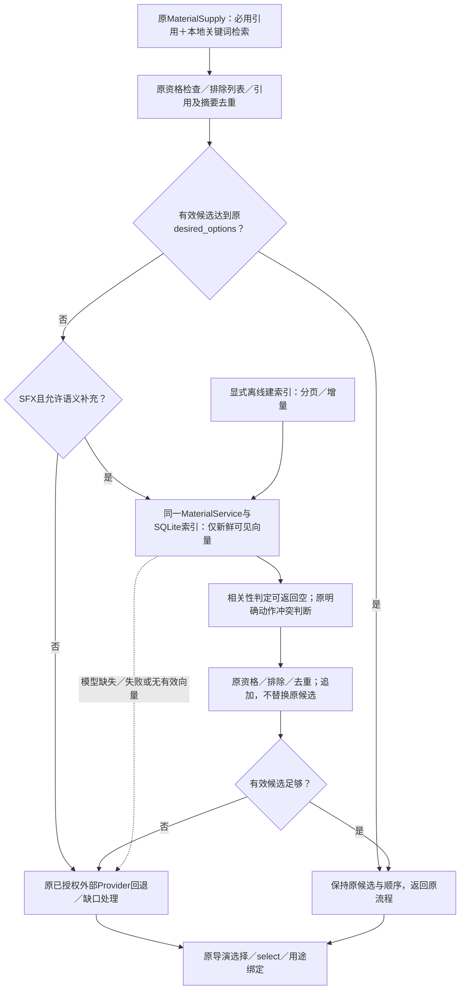

# SFX-01 · 本地音效检索与导入

- 目标：修复已实测的完整中文查询无命中、1000条前置截断、动作误排序；隔离库通过后追加导入生产素材库。
- 授权：2026-10-24用户明确要求实施及正式素材导入，并要求保留旧素材、不启动视频制作；用户确认本次素材按许可可用登记。许可原文保留，不改为CC0。
- 基线：easel-v2-rebuild acc457d3；主工作区存在无关会话修复Dirty，另建codex/sfx-local-search工作树避免混入。
- 阶段：实施与离线验证；不含服务重启、合并主线或视频生产。
- 范围：本地音频元数据检索、目录游标、定向回归；没有新模型、向量服务或Agent。

## 根因及方案

现有metadata_search先截取1000条，文本排序只计算词交集。中文整句未分词翻译，英文动作与否定信息没有区分；导入宽泛标签甚至会将单键标为typing。

目录增加按稳定素材ID的游标；索引分批读取可见候选，排序前不再截断为1000条，输出top-k限制保留。保留媒体、权限、Rights及可见性检查。音频元数据排序增加小型中英物体/动作词表，优先使用源标题识别动作，避免宽标签改变单键身份；过滤开关门反向、放置/破碎冲突，及“不破碎”的否定。已知上下文词仅参与排序，不宣称判断声音力度或真实听感。未覆盖词仍走原关键词检索，不宣称支持任意中文语义。

## 验证与证据边界

原独立库1415条：完整“玻璃杯轻放在桌面上”首位为Glass Set Down On Table；“电脑键盘打字声”首位为Computer Keyboard Typing；开关门分别召回相应动作。真实库没有明确卧室门打开素材，通用开门仅为候选，不能补写为精确声音。环境声可召回空调。单测包含第1001条命中、真实目录分页及跨owner不可见、宽标签不能把单键变打字、碎玻璃否定排除。完整中文并不证明轻重和混响符合要求，听审仍未覆盖。

正式导入通过MaterialService，scope取已有local owner，显式owner_shared_import授权用于跨作品复用；先SQLite在线备份及原记录摘要，再追加写入并验证旧记录原文全部不变。记录及素材不提交Git。生产库验证使用修复后的工作树代码；运行服务尚未加载该分支，不以数据导入成功冒充代码部署。

结果与提交、正式追加导入计数在收口更新；原生产任务停止断点保持。

## 本轮收口

- 184项关联回归PASS、2项既有SKIP；diff检查通过。隔离1415条后，生产库追加1415条，由305条变1720条；旧305条记录逐字节未变，已在线备份原目录数据库。新增记录通过显式owner_shared_import可在另一作品上下文检索。
- 生产实库以本分支代码查询：放杯完整描述唯一命中正确文件；木门打开、房间关门、电脑连续打字、环境声均返回相应候选。听感与具体画面仍未测，不标REAL_PRODUCTION_PASS或CREATOR_ACCEPTED。
- 旧文件内容复核发现有记录所指文件当前缺失；本轮未删除文件，缺少导入前文件快照，不将缺失归因于本次导入，也不宣称旧文件完整性全部通过。结果仅留本机执行证据，不自动恢复旧文件。
- 代码开发与素材追加COMPLETE；运行服务尚未部署本分支，自动生效未测。无新制作、模型调用、服务重启或主线合并。后续通过受控PR集成并在授权部署后验服务读取；不自动继续视频。

## 中英文语义检索接入方案（2026-10-24，PROPOSED）

本节保留原音效检索经审核收窄的方案，关联[S6-14A](S6-14A_conversation-integration.md)。方案阶段仅授权文档；其后用户已明确授权代码、离线测试及部署，实际结果以文末实施与最终交付为准，不将原PROPOSED标记误解为当前未实施。原历史导入和词表修复结果不自动证明语义检索效果；视频制作、远程付费调用和发布均未在本轮恢复。

### 目标与审核收窄决定

首批仅补足本地SFX中文/英文同义表达的漏检。**原检索优先，有效候选不足时才调用语义补充；原候选身份和相对顺序保留，语义结果只追加。** 不承诺完整中文理解，不把文本相似度当作实际听音。

审核发现全量排名融合可能改变已有正确选择，向量近邻可能虚假填满库存，score_audio的零分又同时表示动作冲突和未识别词义。本方案据此取消首批全量融合、通用重排序和两路分数合并；把补充放入原供料的不足分支，允许语义检索返回空结果，保留原外部回退。仅共用有源标题证据的动作冲突判断，不改原关键词分支的评分/排序行为，不增加制作审核或用户确认。

保留1415条导入音效、现有配音、素材许可及作品引用。不改变BGM检索、旁白、图像/视频、导演选择、公共Plan或成片恢复；错误讲话BGM继续在原候选资格及音轨绑定处拒绝，不因向量相似而改角色或准入。

### 核验现状与必要复用

源码基线easel-v2-rebuild / 5f1c6d3a及已有Dirty；下列现状来自只读核对，不是实施结果。

| 已有位置 | 可复用能力 | 首批必要补齐 |
|---|---|---|
| application/supply.py · MaterialSupply.supply | 必用引用、原本地检索、排除列表/去重、desired_options判定及外部回退 | 仅在原有效候选不足且非精确来源的SFX分支，插入一次可选本地语义补充 |
| production/materials.py · MaterialService.candidates/select | 已支持显式embedding_provider；统一资格、去重及选用 | 保留默认原检索；补充仍调用同一内部候选接口，所有候选经过原资格检查 |
| materials/semantic_index.py · EmbeddingProvider / MaterialSemanticIndex | SQLite、余弦排序、素材摘要/模型身份/维度失效检查 | 单一本地适配器；不新增向量库或服务。当前生产向量记录为0 |
| MaterialSemanticIndex.rebuild | 原index_record与持久化身份 | 默认list_scope只取100条；沿已有游标分页，覆盖全部目标音效并支持增量跳过 |
| MaterialSemanticIndex.search | 全库元数据分页、显式降级及过期记录诊断 | 共享音效须按已可见record的原scope读向量；只让新鲜有效向量参与补充，少数缺失不得使其余记录全部失效 |
| audio_search.score_audio | 原双语动作/物体排序及反例 | 原关键词行为不变；语义补充只复用明确动作冲突，不能把所有零分都视为冲突 |
| library_reuse / material_binding | 角色、Rights、文件、身份、共享授权及BGM讲话保护 | 原样复用，无第二套审批或音乐分类器 |

本机项目环境能找到torch、transformers、onnxruntime；未安装sentence_transformers，默认Hugging Face缓存目录未见MiniLM/BGE/E5模型目录。这不证明机器其他位置没有模型。实施前按显式路径核对旧本地模型是否可用，不把ASR模型当文本embedding模型。

### 收窄后的结构图

图中所有回退都保留已取得候选；回退不意味着新获外部调用授权。精确来源URL沿原身份解析路径，不改走语义近邻；必用引用失效仍走原错误，不能用相似音效替代。模型准备和索引构建不在创作请求中执行。

### 模型与依赖选择

实施选型补正（2026-10-25）：最终使用本地`BAAI/bge-m3`（revision `5617a9f61b028005a4858fdac845db406aefb181`）单个dense编码器，沿同一Sentence Transformers/EmbeddingProvider接线，1024维、CPU推理、官方CLS池化。原MiniLM/E5仅为离线对照，均未启用。实测按完整元数据检索会受路径等信息干扰，因此本地模型使用从原标题确定性去除包分类前缀与编号的派生投影；不改源记录。投影规则、官方模型revision及编码器包版本计入model_version，文本摘要和失效检查使用同一投影。原关键词semantic_text及其排序不变。没有新增稀疏/多向量索引、重排序器、查询分词改写或模型切换平台。[官方模型卡](https://huggingface.co/BAAI/bge-m3)。

下面的首选/备选为最初建议，实际决策以上述实测为准。

首选评估`sentence-transformers/paraphrase-multilingual-MiniLM-L12-v2`：支持跨语言相似度、384维输出，对称编码可适配现有embed(text)。[官方文档](https://sbert.net/docs/sentence_transformer/pretrained_models.html)、[官方模型卡](https://huggingface.co/sentence-transformers/paraphrase-multilingual-MiniLM-L12-v2)。首批只接一个本地模型，不搭建多模型切换系统；是否足够好以本地隔离样本为准。

`intfloat/multilingual-e5-small`只作为首选实测不足时的后续备选，其query/passage前缀需要用途区分，本期不预先扩展协议。[官方项目](https://github.com/microsoft/unilm/tree/master/e5)、[模型卡](https://huggingface.co/intfloat/multilingual-e5-small)。

单个adapter调用官方Sentence Transformers编码，作为可选依赖；核对Python>=3.10和现有依赖兼容后固定版本、模型revision和编码方式，纳入model_version。仅在需要语义补充时懒加载并在进程内复用；原候选足够的请求不调用或加载模型。显式本地模型路径、CPU/eval推理；查询、默认聊天启动和服务重启不自动下载。资源和冷/热耗时未测，不承诺具体速度，不加远程付费fallback。

### 接线及保护边界

1. **不足判定复用供料层**：由MaterialSupply在原必用引用、原候选资格、excluded_asset_refs及摘要/引用去重之后，使用既有desired_options判定；不能以检索上限max_candidates是否填满判断不足。默认只需1个候选的需求，已有合格候选时不得为了凑8个触发模型。重复或已排除候选不计入数量，原必用引用参与原有计数。
2. **原选择顺序保持**：原候选足够时，返回内容、顺序和外部调用行为与改动前一致。确需补充时，原有效候选保留为前缀；新候选经原资格与去重后追加，受原候选上限约束，不替换已绑定资产或改变历史版本。原_acquire_sfx已保存cue跳过逻辑及恢复语义保持。
3. **语义结果可以为空**：向量分数仅用于排序，不能把“存在近邻”直接当作满足需求。用固定正例、反向动作和无库存负例标定一个简单、模型版本绑定的相关性判定；无合适结果则返回空，沿原外部来源白名单、预算/授权和缺口处理继续。不仅调小top-k来伪装解决问题，也不预设未经验证的通用分数。若离线无法有效区分无关近邻，暂不默认启用该模型，不额外加LLM审核或逐片人工确认。
4. **动作规则只复用明确证据**：原score_audio输出和关键词排序保持。可从原实现提取共享的明确冲突判断，但须对原分支做等价回归；补充候选遇源标题中的开/关、翻页/合书、放杯/破碎、连续打字/单键冲突仍排除。词表未知、没有匹配证据不自动等于冲突；标签不能覆盖源标题动作。
5. **单一候选及资格机制**：configured_supply只将可选provider提供给SFX补充分支，原默认MaterialService.candidates仍走原检索。补充复用同一内部candidates显式provider参数、library_reuse和select，不新建供料服务/公共API。仅可见、用途兼容的音效进入补充；不根据相似度把music/voice重标为sfx。Rights、物理文件和署名等保护在原位置执行，资格后去重；BGM仍走原music_candidate_issue及绑定检查，不能走SFX开关绕过。
6. **原索引边界补齐**：沿游标覆盖1415条目标音效，保持原record.scope、SHA、文本摘要及模型身份；不按频道复制共享向量。只对目录已判可见记录按其原scope读取，跨owner隔离不放宽。有效向量可参与补充；缺失、过期、坏维度记录跳过并记录原诊断，它们仍有原关键词路径。没有有效向量即无语义补充，不在当前请求重建索引。无需设计全量混合排名系统，模式/原因须如实说明补充是否实际发生。
7. **增量准备与可关闭回退**：继续用既有semantic_text及文本摘要，不批量生成标签或改写源记录；文本投影如后续确需调整，必须进入编码版本并使旧向量失效。显式建索引跳过新鲜记录，失败可逐记录重试；首批无后台重建队列。关闭配置即使用原检索与外部回退；重建前可备份派生索引，不改目录、许可、配音、作品、业务状态或音频文件。

### 工作包、依赖与难度

| 顺序 | 收窄后的工作包 | 难度／主要风险 | 验收依据 |
|---|---|---|---|
| 1 | 固定原检索、同义表达、反向动作及无库存基准 | 低；既有行为需可比 | 候选ID/顺序、原外部回退及音效角色基线 |
| 2 | 单本地adapter、可选配置及懒加载 | 中；依赖兼容与资源 | 仅不足SFX调用；缺模型/故障回到原流程 |
| 3 | 原索引分页、共享scope、新鲜向量读取 | 中；覆盖与身份 | 1415条、100/1000边界、共享可读/越权拒绝、局部失效 |
| 4 | 原不足分支接线、相关性空结果和动作冲突共用 | 中；避免虚假填满候选 | 原候选足够时完全保持，不足时只追加，无关结果仍外部回退 |
| 5 | 原供料链路回归与真实本地模型隔离评测 | 中；匹配质量不能靠fake证明 | 同一组基准与负例，真实模型+目录副本，不启动视频 |

总体中等难度、可分步实现；取消首批全量融合和通用重排序后，主要实现落在既有索引与MaterialSupply不足分支。模型相关性和本机性能尚未实测；工时在依赖及真实离线基准确认后评估。没有增加Agent、审核、向量数据库、HTTP服务、翻译模型或制作步骤。

### 回归验收与现用功能保护矩阵

先固定测试集及可接受源标题集合，记录原结果，再用同一输入比较；相关性标注属于一次研发验收，不进入产品制作审核。以下为固定验收口径，实际执行结果及模型覆盖限制见文末，设计条目本身不代表PASS。

| 场景 | 必须满足的回归结果 |
|---|---|
| 原准确中文/英文查询已有足量有效候选 | 候选ID和顺序与基线一致；模型加载/编码调用为0；原外部回退行为不变 |
| desired_options=1且已有1条，上限仍有空位 | 不因未填满候选上限而触发语义补充 |
| 原候选不足／重复／excluded_asset_refs排除 | 按原有效计数触发；仅追加新的合格候选，保留原候选前缀，不用重复项填数 |
| 原必用引用与精确来源URL | 必用引用不被替换；失效仍原错误；精确来源不改为相似搜索 |
| 中文同义表达、口语与英文词形漏检 | 库存中真实相应标题进入补充候选；用目录副本跑通MaterialSupply→candidates→select，不能仅测裸模型 |
| 无对应库存、近邻均不相关、只有动作相反的素材 | 语义结果允许为空；不虚假满足desired_options，原已授权外部Provider/缺口路径仍执行 |
| 开/关、翻页/合书、放杯/破碎、连续/单键及宽泛标签 | 原关键词结果等价；语义补充排除明确冲突，未知词不因未匹配词表被一律拒绝 |
| 模型关闭、缺依赖、缺文件、加载/推理失败、无有效向量 | 原关键词候选保留，原外部回退可达；不下载、不重复重建、不新增确认 |
| 1415条全库及共享记录 | 100/1000边界和末条覆盖；按原scope读取，跨频道共享仅沿既有许可，跨owner不可见 |
| 少量缺失/过期/坏维度向量与已删除记录 | 其他新鲜可见向量仍可补充；坏记录不参与，不因旧向量复活删除记录；模型/文本版本变化正确失效 |
| BGM、旁白、图像/视频与错误讲话素材 | 不调用SFX语义补充；原结果/角色保持；已知错误BGM在library_reuse及material_binding继续拒绝 |
| Rights未知、文件缺失、未授权共享、同字节不同许可 | 原保护不放宽；资格后去重；语义排名不升级许可或身份 |
| 已保存音效cue、原素材/配音及恢复 | 沿原恢复跳过已供料cue，不自动重选/改版；已有引用、方案、配音、业务状态保持 |
| 性能与资源 | 记录真实模型冷/热耗时、内存、补充分支调用数；原足量候选路径不增加模型开销，原事件循环线程边界保持 |

比较指标包括Recall@k、反向动作误召回、无库存误补充及原结果一致性；不预先编造改善比例，不以任意近邻命中率代替相关性。既有BGM、素材身份/权限、供料恢复和动作回归一起执行。假模型用于故障和控制流测试，真实模型负责语义效果验证，两者分开记录。

上述内容形成时仅为文档方案；其后已获实施授权，实际软件回归、索引及部署结果见下文。原方案不授予视频制作或付费调用权限；真实创作与听感仍与软件接线分别验收，已有Dirty、个人资料及媒体保持。

## 2026-10-24 收窄方案实施授权

用户明确授权按原检索优先、有效候选不足才语义补充实施，复用原索引/供料，完成代码、离线保护矩阵后部署，不恢复制作。允许完成本地模型准备及派生索引接线所需操作；保留已有Dirty、素材、配音和业务状态，不增加审核或远程付费fallback。源码基线easel-v2-rebuild / 5f1c6d3a，开工前Dirty补丁保存在本机临时目录。先在目录副本完成真实模型离线标定；未通过无库存/动作保护前不默认启用。模型效果、部署、真实制作分别记证据，原父任务不自动关闭。

### 实施中的真实检索选型证据（2026-10-25）

代码首轮关联230项、全量2507项通过/16跳过/14警告；本地sentence-transformers 5.1.2安装未升级已有torch/transformers，pip check通过。原检索优先与保护控制流成立，但模型效果独立验收。固定目录副本1415条及12条正例/8条无库存负例后，MiniLM原完整元数据投影仅将正例覆盖从4/12提高至5/12，并有衣袖/拉链等误召回；移除目录路径/分类前缀的投影在裸排名上改善，但仍有无关近邻。E5按官方query/passage格式的对照也未得到足够好的正负例区分，因此两者均未启用到生产。

继续核对可沿原Sentence Transformers和EmbeddingProvider接入的BGE-M3，仅评测其单个dense向量，不引入稀疏/多向量索引、reranker或新业务流程。模型权重按官方固定revision和SHA校验，部分文件经可达镜像取得但必须匹配官方摘要。最终adapter只配置实测通过的一个模型；资源和相关性不满足则不默认启用，不拿fake控制流通过冒充效果通过。本节是实际失败回接，模型选择变化不改变SFX不足补充、外部回退及BGM保护边界。

### 最终离线模型与保护验证（2026-10-25）

- 固定1415条目录副本、12条有库存需求及8条无库存需求；不修改测试集合来提高结果。BGE-M3的派生标题投影裸排名提高覆盖，但两条已确认的错误对象仍有高分，故将其与4条无库存校准样本一起标定相关性值0.712；其余4条无库存样本用于对照验证。单值绑定本地模型/投影版本，不作为其他模型通用阈值，也不增加逐片审核。
- 使用实际adapter、现有index_record/供料及目录副本回放，12条有库存需求的有效命中由4增加到6；原4条准确查询的候选ID及顺序保持；其余6条在本地返回空，保留原外部/缺口路径，没有把已知错误对象当合格候选。8条无库存需求均无语义误补充。该小样本证明增量可用及保护成立，不表示全词义覆盖、独立大样本准确率或实际试听通过；这6条未召回仍属于覆盖限制。
- 真实模型进程峰值约2.08GiB；副本实测原检索约0.25～0.37秒，发生补充约0.72～0.75秒（含本地目录读取与资格检查），不承诺其他机器相同速度。正常原候选足量路径不加载/编码模型，由控制流用例验证。
- 软件矩阵新增验证了非致命本地诊断与外部错误分类分离：索引部分缺失/模型故障只进入search_diagnostics，不能污染原failures，使外部no_results仍可进入原SoundSearchEmpty恢复/降级；真正网络错误仍保持原阻断语义。未增加审核、重试轮或调用授权。最终关联234项通过/1条既有警告；其中两条新夹具的ProductionError导入路径修正后通过，未放宽业务断言。
- 初次全量2507通过/16跳过/14警告只覆盖当时版本；后续为模型投影及诊断分类修改主动中断两次在途全量，不记PASS。最终固定源码全量和部署结果在下节补齐。
- 正式派生索引已通过显式维护脚本生成1415条，原空索引已备份。生产目录两张素材/引用表摘要一致，未改素材、配音、作品或恢复任务；仅新增派生向量。此处为索引准备时的阶段记录；最终模型启用、回归及服务重启结果见下节交付。

### 最终交付与停止点（2026-10-25）

- 本次授权的软件接线、离线保护回归、派生索引准备和部署完成。源码为easel-v2-rebuild / 5f1c6d3a加本批及原有Dirty；其他任务同期产生的会话/发布改动保留，未提交或推送。最终全量`python -m pytest -q --ignore=outputs`为**2511 passed / 16 skipped / 14 warnings**（165.63秒），最终关联保护矩阵**234 passed / 1 warning**；固定受测源码在测试至部署后摘要一致。最终全量日志/tmp/easel-semantic-all-final.log，关联日志/tmp/easel-semantic-matrix-release.log，真实副本结果/tmp/easel-semantic-real-final.log，只留本机不提交私人素材。
- 模型使用官方固定BGE-M3 revision，文件与官方SHA核对；本机启用原SFX不足分支，值0.712绑定此模型/标题投影。显式维护脚本已写入1415条派生向量并备份旧索引。没有重新导入/删除音效或改变目录许可、引用。
- 部署时发现7860被同一工作区旧独立web进程占用，仅kickstart启动项无法替换；确认无活动制作/对话后停止实际旧监听进程，使用原com.easel.web恢复单一受管服务。最终运行PID 59344，gateway=true、backend.reload_required=false。没有改OpenClaw或前端，无schema迁移。
- 只读接线探针使用正式配置和原目录、未给外部源授权：翻页声返回原8条候选且模型未加载；“手指在电脑上连续输入”得到1条语义候选；已知错误对象和无库存查询返回空；外部调用为0，错误导赏BGM仍被识别为spoken_audio_not_music。该探针是本地检索诊断，不是新片Web E2E，也不改变原创作授权。
- 整轮及部署前后10张业务表摘要完全一致，素材目录library_assets/library_asset_usage两表摘要一致，原作品仍preview_needs_fix、无活动run；方案、素材、配音、输出和停止点保留。没有恢复、重新检索外部媒体、TTS、渲染或远程付费。环境仅新增本地SFX配置，旧.env已私密备份，可关闭enabled回到原检索，派生索引可用备份回退。
- SOFTWARE_PASS：功能控制流和保护矩阵成立。真实文本检索小样本覆盖为6/12，另外6条未召回走原回退；不标全词义完成。完整声音、真实新片供料/创作效果及Creator接受仍NOT_TESTED，用户自行在原Web验证。S6-14A父功能不因本次接线自动关闭。
