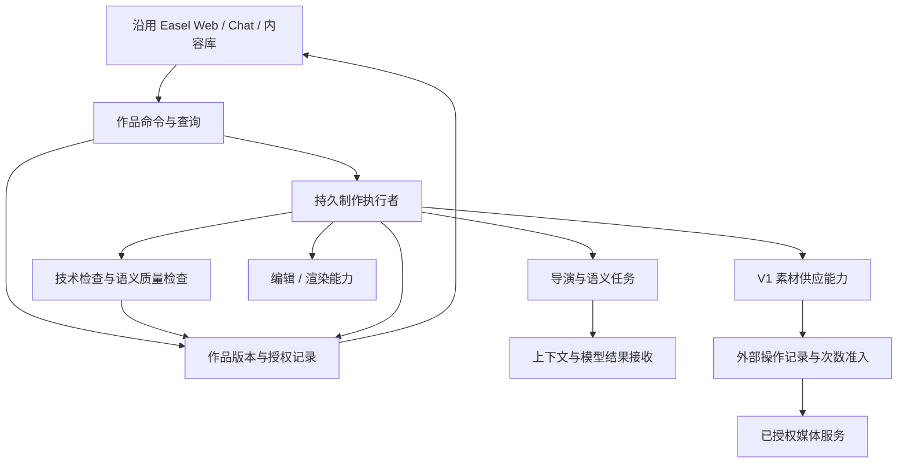
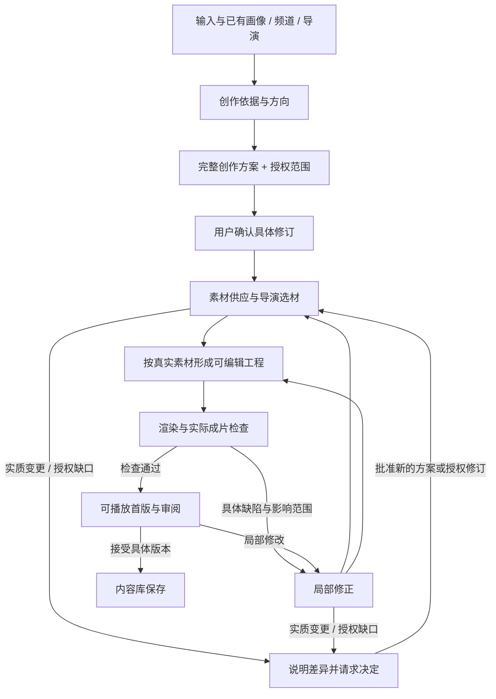

# Easel V2 · S5 架构评审稿

状态：**PROPOSED — 用户已认可主线和职责划分，整体架构尚未确认或冻结，未实现。** 输入为 [S4 定稿](01_REQUIREMENTS.md)和[源码差距清单](11_REQUIREMENT_GAP_MAP.md)，工作基线 `201bfc043b18cc161ae138176cfcdd5e7e6f89d4`；业务代码仍为 `8eeafb6b`。本稿替代本文件原先笼统骨架作为当前讨论文本，不追认旧草案为用户已接受决定。

## 1. 结论与方案比较

推荐：**保留 Easel 的画像、Web、聊天和媒体工具；新增围绕作品的确认与执行能力；迁入 V1 素材库；导演负责创作判断，程序负责状态、权限、计数和恢复。** 一个产品内导演职责可以执行不同任务，不据此新增一批必须独立部署的 Agent。

| 方案 | 收益 | 主要代价/证据 | 本轮建议 |
|---|---|---|---|
| A 只增强当前聊天与视频 Skills | 改动少，保留全部现有入口 | 聊天历史与 SSE 不是作品权威状态；靠 Prompt 难以保证次数、取消、版本和外部操作恢复 | 保留入口和工具，不以其独立承担生产编排 |
| B 整体搬回 V1 Creation/Delivery/Hypit | 已有大量生产、素材及恢复代码 | 旧协议/Attempt、报价和阶段预算不符 S4；S3 有自主 FAIL、复杂上下文与恢复缺口；当前无频道多对多 | 不整体搬回；有据复用素材与局部检查 |
| C 在官方底座上建立小范围作品执行边界，迁入素材能力 | 满足确认后自主、版本、次数和恢复，同时保留现有产品 | 需要新增作品管理与集成；跨外部调用的崩溃窗口仍要专门验证 | **推荐**；先实现真实纵向闭环，再按实测扩大 |
| D 引入分布式工作流/多个独立服务 | 未来可扩容 | 当前本机单用户范围没有对应需求，增加部署与恢复成本 | 当前不选 |

关联决定见 [ADR-S5-001](decisions/ADR-S5-001-work-production-boundary.md)。该 ADR 同为 PROPOSED。

## 2. 实际读取的 V1 设计与源码

用户提供的独立历史区域已核查：V1 源码归档工作树与 V1 历史复盘目录分别存在。前者 HEAD 为 `57c8e2ad`、工作区干净；后者 README 与 22 项问题表只读使用，原始日志/配置/媒体未复制入 Git。公开可追溯历史结论引用 [S3 固定报告](https://github.com/webxia/Easel/blob/4a92247b071c31d37ed623327d8058e62c64037b/docs/v2/10_V1_LESSONS_AND_REQUIREMENT_INSIGHTS.md)，不发布私有原件。

| V1 当时怎么做 | 源码/旧设计依据 | V2 推荐取舍 |
|---|---|---|
| Profile 回答“谁”，Creative Mode 回答“怎么表达”；规则分叙事、画面、声音、剪辑、QC | [Creative Mode 实现](https://github.com/webxia/Easel/blob/57c8e2ade21af9fb6abccdab3f7ba8e50132314f/easel/creative_mode.py)、[导演规则样例](https://github.com/webxia/Easel/blob/57c8e2ade21af9fb6abccdab3f7ba8e50132314f/creative_modes/clear_memo_video/director-treatment.md)、[V1 目标架构](https://github.com/webxia/Easel/blob/57c8e2ade21af9fb6abccdab3f7ba8e50132314f/docs/architecture/easel-video-architecture-v1.md) | 沿用区分方式；主人设仍是已有六维画像，新增频道和“参考→试片→导演版本”体验，不能沿用旧单导演首期范围 |
| 作品 JSON 原子替换、文件锁修改；Delivery 另持执行锁，作品状态由 Attempt 投影 | [Creation](https://github.com/webxia/Easel/blob/57c8e2ade21af9fb6abccdab3f7ba8e50132314f/easel/creation.py) `edit_creation`、[Delivery](https://github.com/webxia/Easel/blob/57c8e2ade21af9fb6abccdab3f7ba8e50132314f/easel/creation_delivery.py) `execution_lock/next_operation` | 保留“一个作品同一时刻只有一个有效执行者”和状态可重建；不认定多锁天然错误，也不复制所有旧状态字段 |
| 展示/确认方案携带 specs、脚本、场景、说明、声音等；按文本行切出部分来源 | [Proposal](https://github.com/webxia/Easel/blob/57c8e2ade21af9fb6abccdab3f7ba8e50132314f/easel/creator_proposal.py) `_plan_payload`、[来源目录](https://github.com/webxia/Easel/blob/57c8e2ade21af9fb6abccdab3f7ba8e50132314f/easel/integrations/planning_authority.py) `catalog` | 完整确认内容要保留；场景身份由稳定语义 ID 表示，不使用 Markdown 行号作业务身份 |
| 语义审核收集确认内容、规格、导演、人设、事实与候选证据，但部分路径未带完整适配许可 | [语义审核](https://github.com/webxia/Easel/blob/57c8e2ade21af9fb6abccdab3f7ba8e50132314f/easel/integrations/planning_semantic_review.py) `questions`、[候选审核](https://github.com/webxia/Easel/blob/57c8e2ade21af9fb6abccdab3f7ba8e50132314f/easel/integrations/planning_candidate_review.py) `directory_for`；S3 L12/L14 | 上下文需包含本任务所需的约束与授权；不固定复制旧 A/B 多批审核，不让下游重造用户硬要求 |
| 素材有独立入库、作用域、复用、权益、检查、供应与生成实现 | [素材库](https://github.com/webxia/Easel/blob/57c8e2ade21af9fb6abccdab3f7ba8e50132314f/easel/materials/library.py)、[素材复用](https://github.com/webxia/Easel/blob/57c8e2ade21af9fb6abccdab3f7ba8e50132314f/easel/materials/application/library_reuse.py)、[库内优先](https://github.com/webxia/Easel/blob/57c8e2ade21af9fb6abccdab3f7ba8e50132314f/easel/materials/application/library_first.py)、[使用条件检查](https://github.com/webxia/Easel/blob/57c8e2ade21af9fb6abccdab3f7ba8e50132314f/easel/materials/application/rights.py) | 按 S4 指令迁入相关能力；原 tenant/creator/Attempt 字段须适配已有画像/新作品，不带入多人产品或旧数据 |
| 阶段调用预算、生成报价与多处运行回执 | [Delivery](https://github.com/webxia/Easel/blob/57c8e2ade21af9fb6abccdab3f7ba8e50132314f/easel/creation_delivery.py) `reserve_delivery_call`、[生成集成](https://github.com/webxia/Easel/blob/57c8e2ade21af9fb6abccdab3f7ba8e50132314f/easel/integrations/material_generation.py) | 生图/生视频按 S4 实际提交计次；技术调用仍留观测和有界重试，但不混入用户额度；不重建持续金额预算产品 |
| Hypit 原生制作/局部修订、声音文字保护 | [Hypit 集成](https://github.com/webxia/Easel/blob/57c8e2ade21af9fb6abccdab3f7ba8e50132314f/easel/integrations/hypit/service.py)、[局部修订](https://github.com/webxia/Easel/blob/57c8e2ade21af9fb6abccdab3f7ba8e50132314f/easel/integrations/hypit/native_revision.py)；[V1 ADR-001](https://github.com/webxia/Easel/blob/57c8e2ade21af9fb6abccdab3f7ba8e50132314f/docs/decisions/ADR-001-creation-hypit-mainline.md)、[V1 ADR-004](https://github.com/webxia/Easel/blob/57c8e2ade21af9fb6abccdab3f7ba8e50132314f/docs/decisions/ADR-004-material-layer-v1.3-baseline.md) | 优先评估 Hypit 作为本地编辑/渲染能力，素材生成由素材供应负责；局部保护思想可用，旧执行链不自动迁入 |
| 结果原件、解析/验证、派生与回执分开 | [V1 ADR-005](https://github.com/webxia/Easel/blob/57c8e2ade21af9fb6abccdab3f7ba8e50132314f/docs/decisions/ADR-005-agent-result-processing.md)、[结果回执](https://github.com/webxia/Easel/blob/57c8e2ade21af9fb6abccdab3f7ba8e50132314f/easel/integrations/output_receipts.py) | 沿用可追踪接收和不覆盖有效结果；不让 parser 自行调用模型，不搬旧协议矩阵 |

以上是有界源码阅读，不是全部 V1 文件逐行审计。历史“Accepted”只对当时版本有效；S4 已改变频道、导演形成与预算范围。

## 3. 产品关系与权威信息

- **画像**：直接引用既有 Profile；作品确认时记录所用内容快照/摘要以支持历史追溯，这是作品证据，不是第二套主人设。未选画像时不读其他画像记忆。
- **频道**：属于该画像，保存定位/偏好及可选导演、默认导演版本、音色/字幕；不保存另一份可独立演化的人设。普通临时作品可以无频道。
- **导演**：保存风格草稿、参考证据、试片和接受后的版本。风格规则涵盖叙事与视听，不能锁成脚本套路。跨频道带风格，不带原主题事实。暂不引入跨用户共享市场。
- **作品**：组织输入、方案修订、授权、运行、输出与接受记录；聊天只是交互入口。无频道/无画像作品也遵守相同生产边界。
- **本片设置**：本片→频道→画像的有效音色/字幕在方案展示时解析并固定；导演只能推荐，不静默覆盖。默认改变只影响之后的新方案。
- **双重接受**：正式首版兼作试片时，“接受这部作品”和“接受/保存这位导演”可在同一交互中明确表达，但记录为两个独立选择；任一不能自动推导另一项。

## 4. 职责与边界

图示为职责，不代表独立进程或微服务数量。初期推荐同一本机应用中的模块与受管理后台执行者；制作不依附 HTTP/SSE 连接存活。后台执行者的实现形式在接口验证后定，不引入分布式调度平台。

| 职责 | 负责 | 不负责 | 需求/风险 |
|---|---|---|---|
| Web/作品命令 | 展示、用户输入、确认指定版本、取消/修订/接受命令、查询 | 绕过作品记录直接发起另一条付费视频链 | 005～008、024、027 |
| 作品记录 | 版本身份、已确认约束、授权、最终选择、运行/产物引用 | 判断叙事是否好、发明事实 | 002、008、019、020 |
| 导演/语义任务 | 参考拆解、方案、事实语义、选材取舍、局部改写、风格质量 | 写额度、伪造素材权益、宣告用户接受 | 001、004、014、019、032 |
| 持久执行者 | 有效任务推进、取消、操作准入、恢复、状态投影 | 改核心观点、由异常推断授权扩大 | 006、013、024～026、033；S3 L17/L20 |
| 素材能力 | 入库、检索、下载、复用、授权内生成、来源/权益事实与技术资格 | 替导演改故事、创建最终时间线、自动放宽必用素材 | 011、012、021、031 |
| 编辑/渲染 | 合法已选媒体到时间线、字幕/音轨、渲染与可验证输出 | 自行采购/生成收费素材、重新定义确认内容 | 009、010、015、022、023 |
| 检查 | 程序验证身份/媒体/额度/引用，模型检查语义与审美；失败有明确范围 | 用模型分数代替用户接受、为了 PASS 降条件 | 014～018、030 |
| 上下文/结果接收 | 限定本次任务信息、版本与引用；保存允许保留的回执、解析和诊断 | 全量复制旧会话或私有原件、偷偷补造缺失模型结果 | 001、032、034；S3 L07/L12/L15 |

## 5. 最小作品合同与版本关系

以下为语义契约，名称为设计用语，不冻结 JSON 字段/数据库表。

| 记录 | 必须表达的信息 | 写入/变化边界 |
|---|---|---|
| 创作方案修订 | 人设依据、频道/导演版本、输入及必用/参考、真实事实/观点、脚本、场景、声音/字幕、规格、锁定要求与可创作部分 | 导演建议，用户确认指定修订；摘要/全文同源，确认后不可就地改写 |
| 制作计划修订 | 场景/片段稳定身份、叙事目的、需要的素材、实际选材和制作安排、依赖 | 在确认范围内可自主变化；新增实质要求或偏离核心需新确认 |
| 授权 | 本作品、允许服务/模式、补料许可、生图/生视频额度、适用素材用途；追加和取消记录 | 用户确认形成，程序校验；新作品不继承旧授权 |
| 运行与任务 | 作品/方案修订、目标输出、执行者身份、必要任务与输入依赖、状态及错误类型 | 一个有效执行者推进；修订形成新运行，复用合格产物 |
| 外部操作 | 类型、输入指纹、服务/模式、授权引用、请求身份、提交/观察状态、原任务 ID、回执 | 程序在发送前登记；查询沿用原操作，不能因换运行重置消耗 |
| 产物与接受 | 媒体位置/摘要、输入和制作版本、来源/权益、检查结果、用户选定版本 | 成品验证后登记；用户接受绑定实际输出，修改另存 |

硬要求必须有用户/画像/确认方案的来源；导演提出的景别、光线、镜头实现等需标注可调整范围，不能默默变成素材源必须天然具备的属性。程序校验身份和关系，模型判断是否违背语义；关键冲突交用户，不把“可自主选择”升级成未决问题。

场景/片段有稳定 ID 与类型；Markdown 是展示，不是身份来源。局部修改后 ID 保留或明确替换，旧来源仍可追溯。未决事实不能用空字符串伪装满足。

## 6. 主线衔接与大模型的分层创作

用户已认可本节主线及模型/程序职责方向；当前先通过[90 秒视频完整案例](13_PRODUCTION_WALKTHROUGH.md)评审具体衔接，再确认架构。案例为纸面推演，不是运行通过记录。

主线采用**程序推进明确阶段，导演在阶段内根据真实反馈规划和创作**。阶段是产物交接边界，不是固定脚本套路，也不是每一步换一个 Agent。模型可以提出下一项创作动作，程序依据当前版本、依赖、权限及操作记录决定是否执行；不能由模型一句“完成”推进状态。

图中的返回边均需指定受影响部分；确认实质变更时回到最早受影响阶段，不固定从选材重跑。补额度只更新授权并继续原缺口；修改观点则先更新方案。此前有效产物继续保留。

### 6.1 每一步怎样交接

| 阶段与输入 | 大模型如何工作 | 程序如何承接 | 交给下一步的产物与通过条件 |
|---|---|---|---|
| ① 理解输入：本次要求、可选画像/频道、导演版本、用户素材 | 区分真实经历、观点、公共事实和创意表达；先提具体方向，只问关键缺口；理解原片内容与必用部分 | 解析本片→频道→画像默认项，登记输入和来源，核验媒体可读性及当前服务能力 | 创作依据：事实/观点、必用/参考、风格依据、规格、明确要求及真正未知项；不能把其他画像经历带进来 |
| ② 创作方案：依据与必要的初步可行性证据 | 规划叙事弧线、信息取舍、脚本、场景目的、视听节奏、声音/字幕；说明素材可替代范围，提出 AI 补料次数建议 | 可做授权内的只读检索/预览与工具能力探测；不在方案确认前偷偷生成收费素材；完整方案与摘要绑定同一修订 | 完整创作方案供用户一次确认；包含不可改变内容、可自主创作范围、素材策略、实际音色/字幕选择及授权；尚未拿到素材不能假称已取得 |
| ③ 确认转执行：用户确认的方案和授权 | 将场景目的拆成当前可执行的素材需求和制作依赖；不另写一份改变原意的新方案 | 固定确认版本和输入证据，原子接收重复确认，创建/恢复同一有效运行；检查服务、权限、额度 | 可执行制作计划：稳定场景身份、需求、依赖、已有成果和待执行项；所有硬要求可追溯，缺项明确报告，不能靠模型补造授权 |
| ④ 素材与导演适配：场景目的、真实候选及供应结果 | 看真实图像/片段并选择；判断叙事适配、风格、可裁切区间；素材不合适时改检索或调整镜头实现，有明确缺口才请求生成 | 必用→允许的库内复用→外部→授权 AI；执行来源/权益/媒体资格检查、操作准入和结果登记 | 已选素材及片段区间、用途、来源和权益依据；每个未满足场景有具体原因。模型不能把不存在的文件或搜索摘要当作可制作媒体 |
| ⑤ 编辑创作：确认方案、已选素材、音色字幕设置 | 根据真实画面和实际旁白时长细化剪辑、镜头时序、声音与字幕；保持全片叙事，允许在范围内重排实现；生成可编辑制作表达 | 工具提供真实媒体句柄与时长，校验工程语法、引用、时间和配置；调用编辑/渲染工具；禁用工具暗中采购或替换音色 | 可复现的编辑工程/时间线及媒体依赖，绑定方案和制作修订；旁白只生成必要内容，已有有效音轨直接复用；通过后渲染候选版本 |
| ⑥ 成片自检：实际渲染视频、方案、导演规则和技术结果 | 结合实际画面、声音、字幕检查事实表达、节奏、风格和配合关系；输出缺陷位置、依据、严重性和局部修复建议 | 检查文件可播放、时长/画幅、音视频轨、素材引用及必要媒体检测；缺陷进入有界修复，修后重新检查受影响部分与全片一致性 | 具体可播放版本、与其绑定的检查记录和残留问题。技术通过不能替代语义检查；文本自评不能冒充观看/听取成片 |
| ⑦ 审阅与保存：可播放首版及用户自然语言意见 | 理解修改对象，提出最小必要影响范围；扩大范围时解释；不能把审美建议推成必须全部重做 | 对比当前/历史版本，保留接受记录；按依赖复用，新增生成次数随修改说明；接受命令绑定实际版本 | 可比较的新版或用户明确接受的内容库作品；不自动发布，不把接受作品自动当作接受导演 |

### 6.2 规划分三层，衔接靠产物和证据

1. **创作层规划**回答“这部片讲什么、为什么这样讲、观众获得什么感受”。完整方案包括脚本与场景设计，但不是提前假定所有具体素材已存在。事实、观点、必用内容与用户指定的视听要求固定；导演自行提出的光线/镜头实现保留已确认的调整范围。
2. **制作层规划**回答“用实际找到的素材怎样实现”。选择素材与细化剪辑可以局部往返。例如搜不到天然具有某种灯光的镜头，导演可以在许可范围内用合适实景和调色实现气氛；不能因此要求用户重确认整片，也不能伪造某段真实经历。
3. **修订层规划**回答“这一个问题影响哪些内容”。根据实际首版的缺陷或用户意见形成局部变更，而不是重新理解整个需求并重做所有素材。换一句旁白可能连带时长、字幕和相邻剪辑；只改字幕字号通常不需要重新生成旁白。

三层不是三个独立主人设或必须独立的 Agent。导演形成也有单独准备流程：参考视频拆解→带时间证据的风格草稿→本次内容试片→明确接受导演版本；它产出的风格版本进入上述主线，不把参考片的事实或逐句脚本带入新作品。

每次交接使用**同一个作品、已确认方案修订、当前制作修订、任务输入与产物引用**。程序组装当前任务上下文：必要的完整语义约束、适配许可、相关场景、真实候选、已完成成果、局部缺陷；不依赖模型从长聊天里记住，也不让模型反复抄身份和授权字段。下游发现冲突要返回具体来源与差异，不能私自把创意形容词升级成用户硬条件。

计划在真实工具结果到来后更新；只有受影响的依赖失效。程序根据明确引用计算直接影响，导演补充叙事/节奏影响，不能用文件依赖图声称语义影响已全部发现。对局部与整体影响有疑义时先说明，不扩大执行范围。

长片按叙事段落安排局部制作，但各段共享全片大纲、术语/人物事实、风格和声音设置；合成后检查跨段连续性与全片节奏。分段不是把 900 秒需求拆成互不相干的短片，也不是偷偷缩短输出。

### 6.3 失败返回哪里，何时暂停

| 情况 | 恢复位置与处理 |
|---|---|
| 检索暂时错误、下载中断 | 有界重试原任务；保留其他成果，不能升级为整片重做 |
| 候选不合适/素材不足 | 回到对应场景选材或镜头实现；说明新证据，避免相同搜索无进展循环；实质变更或额度缺口才请求用户 |
| 生图/视频发送结果未知 | 核实原操作，禁止通用框架自动重放提交；详见 §7 |
| 模型输出格式不合法 | 提供具体解析错误，有限修正同一输出；不能用另一条流水线掩盖失败，也不能自动放宽内容检查 |
| 真实内容/声音/字幕/引用缺陷 | 返回受影响素材或编辑阶段，修复后产物重新绑定检查；旧版 PASS 不能转贴新版 |
| 单纯审美建议 | 根据确认风格判断是否阻碍交付，不设置无意义的满分门槛；残留建议可以随可审阅版展示 |
| 必需模态检查不可用 | 如实记录未验证项；不能让看不到视频/听不到声音的模型宣称验收通过；必要时交待修预览 |
| 无新证据的反复失败或预算/时限/质量冲突 | 停止该循环，保留成果，提供追加、换素材、修改要求或暂停等具体选择；不能无限重试或静默降级 |
| 程序缺陷/服务配置损坏 | 保存现场并明确故障；产品自主创作不包含修改仓库或靠研发人员救火后声称自主通过 |

各类自动修复需预先设置技术尝试上限与无进展停止条件，具体数值通过试验校准；这些不是新增的用户付费额度。质量要求不随尝试次数降低。

作品对外状态建议为：讨论中、待确认、制作中、需你决定、待修预览、可审阅、已接受、已取消。状态从产物和有效任务记录投影；不是素材层、渲染器和聊天分别宣布完成。关闭页面不取消制作；明确取消先阻止新派发，在途外部任务保留身份与次数。重启先核实在途操作，再恢复安全任务。

## 7. 生成次数与外部副作用

用户额度只包括 **IMAGE 与 VIDEO 实际提交次数**。旁白、查询、下载、复用不计入这两类额度；旁白仍遵守服务授权、新增收费说明和复用要求。内部技术重试可有明确上限，但不能变成用户未批准的新收费额度。

推荐的操作过程：

- 在一个原子事务中校验当前方案/授权/取消状态/剩余额度，建立操作并**预留**一个名额；预留不冒充已实际提交。
- 执行者通过受控适配器发送，记录已知提交证据后把预留转为已用。发送失败若能证明未提交，释放预留；已提交后失败仍计一次。
- 发送后断线或本地回执保存失败记 UNKNOWN：保留预留/占用状态、向用户区分“已用/待核实/可用”，查询原操作，不盲目重发、不自动退款。
- Provider 有幂等请求键及查询能力时使用同一身份恢复；没有可核实身份时停止并报告未知，不宣称外部 exactly-once。数据库不能与网络提交形成原子事务。
- 查询和下载只更新同一操作，既有结果可重新接收/校验，不再次提交生成；新生成请求无论是否用于恢复都再次计次。
- 同时派发及追加额度要串行核验，重启/新运行/换导演均不得重置作品累计次数。取消后不得开始新的发送；已进入发送窗口如实当作在途，不承诺可撤销。

**可执行权限边界**：付费凭证仅由受控适配器取得；创作/制作 Agent 不能持有可绕过准入的媒体服务凭证或任意付费网络通道。模型建议请求，程序授权发送。保留当前通用聊天能力不代表它可独立执行 V2 付费视频流程。若选定 Harness 不能提供这样的工具/文件/网络隔离，必须通过专门验证或更换执行接入方式，不能用 Prompt 声明代替权限保障。

## 8. 持久化与执行框架比较

| 方案 | 适合之处 | 本任务中的取舍 |
|---|---|---|
| V1 每作品 JSON + OS 文件锁 | 可读、已有原子写/跨平台锁经验 | 跨作品引用、外部操作和授权占额需要谨慎串联；不直接搬旧多处状态 |
| 本机 SQLite + 媒体文件 | 同事务更新授权/任务/操作；支持版本和引用查询，部署轻 | **推荐候选**：保存新作品元数据/操作账本；媒体保持文件，画像继续既有六维文件；需验证锁、崩溃和长任务行为 |
| 服务型数据库/分布式队列 | 多主机扩展 | 本期无需求，暂不选 |

**SQLite 只是存储候选，不等于持久执行方案已经解决。** 开源实现的比较及固定版本源码依据见[主线设计研究](12_PRODUCTION_FLOW_RESEARCH.md)。此前提出以 LangGraph 做有界主线编排验证、以小型显式执行流程为对照；按用户最新要求，暂缓选型及候选优先级确认，先评审完整案例。DBOS 是偏普通 Python 持久流程的备选，Temporal 本期不作为默认部署。此前建议来自当前主线含语义分支、人工确认与局部返回，并不证明 LangGraph 已适配成功。不得同时叠加多个编排器。

框架只拥有技术执行检查点；用户确认、授权、外部操作和产物接受仍由作品领域规则裁决。检查点中的标识引用这些权威记录，不再复制可独立变更的第二套额度/确认状态。恢复时核对当前修订和取消状态；框架重放不能自动重做付费提交。若框架与作品记录不同事务，必须验证重放与对账窗口，不能宣称简单接入 checkpointer 即完成恢复。

SQLite 是提案，非已经决定的新表清单。素材库可保留内部实现，**不能同时成为生产任务或用户额度的第二权威**。若素材库与作品记录不能同事务写入，用稳定产物身份、先写文件后登记、幂等接收和对账使中断可恢复；不假称跨数据库原子性。

媒体先落临时产物、核验后登记稳定引用；崩溃可能产生未登记文件，恢复核验后接收或保留待清理，不能触发重新付费。删除先查保留版本/素材引用和有效恢复任务；不删除仍被引用成果。存储格式演进只针对新 V2 数据，旧 V1 原件不升级/续跑。

执行者所有权需在跨进程情况下可核验；推荐用版本/所有权令牌阻止过期执行者更新，不因超时就默认前执行者已停止。外部已发送操作仍须独立核实。该选择需故障测试，不先搭通用分布式锁服务。

## 9. 模型上下文、原生工具与渲染选择

- 复用 Easel Harness/模型配置入口，但增加按任务限定的上下文：完整必要的事实/禁止项/适配许可、所选导演、当前场景和真实素材证据。省掉重复回抄，不能省掉授权边界。
- 提供来源句段的稳定引用，模型只产出新增语义、创作文本和必要选择；程序绑定已有身份、版本、摘要和引用。JSON/文档/原生工程格式各自严格接收，失败保留诊断，不用模糊补齐把失败改成通过。
- 专用语义任务与有工具的创作执行分别描述能力；不预选供应商或要求所有任务都必须工具调用。HTTP 200/finish-stop/空工具输出不等于有效业务结果；查询、格式错误、语义修订、素材不足各有恢复含义。
- 产品执行工作区只提供产品指令和当前作品范围，核查实际加载内容；根研发 AGENTS、旧调试说明、其他画像和凭证不能因 cwd/默认注入泄漏。**单纯分目录不算隔离已实现。**
- 当前 [直连 API](../../easel/direct_api.py)明确没有本机工具，只能承担其实际支持的语义任务；[Harness](../../easel/harnesses/base.py)支持 cwd/env/权限等，但是否足以满足任务隔离必须实测。
- 渲染推荐优先验证 Hypit 本地编辑能力：V1 有原生工程、修订保护和实际片例；替代是沿用官方 FFmpeg/原片 SDK。前者有运行依赖/集成成本，后者已有两种路径且固定审批/自动回退要适配。先验证同样的输入、时长/四模式和局部修改后再冻结引擎；不把“Hypit”名称写成已实现能力。
- 不立即删除官方视频技能或非视频能力。新 V2 作品入口只能有一个执行负责方；旧工具可作为被调用能力，不能形成第二个绕过授权的独立生产入口。具体迁移入口在实施前做回归评估。

### 9.1 大模型职责与工具接口

| 创作任务 | 模型必须获得的证据 | 模型输出 | 程序保留的决定权 |
|---|---|---|---|
| 参考拆解/导演形成 | 实际参考视频、声音、时间位置及用户认可的试片 | 风格规律、适用范围、非固定套路的叙事方法；观察与推断分开 | 版本保存、用户接受、引用权限 |
| 方案规划 | 当前输入、已有六维画像、所选风格、事实来源、能力信息 | 可讨论的完整方案和可调整范围 | 有效版本、默认解析、确认与授权 |
| 选材和镜头适配 | 真实候选画面/区间、权益状态、当前场景目的 | 选用理由、区间、替代或生成需求 | 文件存在/技术资格、范围、权益规则及调用次数 |
| 编辑与局部修订 | 已选媒体、实际音轨时长、工程状态、变更要求 | 可执行编辑表达、局部变更及语义影响 | 引用/时序校验、渲染、产物版本与保护 |
| 语义与风格检查 | 实际成片的视听证据、确定的检查目标 | 具体缺陷与位置，不能只返回笼统评分 | 技术事实、是否满足必要检查、是否可交付；最终接受仍归用户 |

上述是任务角色，不是必须部署五个 Agent。默认复用同一导演规则，按任务提供上下文；不要求每一步先规划、再执行、再找多个模型投票。只有实测表明独立审核能识别漏检且收益足够时再引入额外审核角色。

工具接口以业务动作和真实结果为中心，如查素材候选、检查某媒体、提交已授权的生成请求、编辑指定场景、渲染指定工程。程序注入作品/版本/授权身份，模型填写创意内容和必要选择；结果返回真实媒体引用、状态、错误类别和可继续动作。模型不能直接写完成标志、扣额度或用虚构工具结果推进。技术超时、素材不足、格式错误和语义不符必须有不同返回含义。

模型能力按任务验证：文本任务不假定需要多模态；选材、参考拆解和成片检查必须有匹配的视频/图像/音频证据与处理能力。抽帧、ASR 和技术检测是辅助证据，不能单独证明运动连续性、真实音色或完整听感；抽样覆盖不足明确记录。模型和上下文容量尚未选定，不先承诺一次调用看完所有 900 秒素材。

## 10. 迁入顺序与边界

1. 保留画像、输入、配置、媒体展示入口；补作品/频道/导演关系及确定版本的确认。选定执行接入前先做权限和上下文隔离验证。
2. 迁入 S4 M01～M04：素材记录、入库、检索/复用、外部供应、技术/权益；按新作品、人设范围适配，保留旧代码可验证行为与测试意图，不迁旧数据库/Attempt。
3. 在新操作记录与次数语义下接入 M05 生成，先验证提交未知、取消、重复请求和重启；旧持续报价/阶段预算不成为用户需求。
4. 建立最小完整制作及质量/审阅/保存纵切面，再覆盖剩余模式/输入/长片与导演形成体验。阶段顺序不缩减 1～900 秒或导演产品目标，不用替身宣称真实闭环。

这是建议依赖顺序，不是实施授权或发布排期。需待 S5 评审后制定具体 S6 Task。

## 11. 需求覆盖与设计验证

| 设计部分 | 对应 V2-EXP | 必须验证的反例/场景 |
|---|---|---|
| 画像/频道/导演/默认版本 | 002、003、010、019、020、034 | 跨频道不换人设；临时改音色不污染默认；试片接受不自动变作品接受；无画像不读其他记忆 |
| 方案/上下文/语义身份 | 001、004、005、011、014、032 | 同一摘要与全文；过期确认；适配许可不丢；场景重排不混入 Markdown 表头；个人事实不虚构 |
| 执行/操作/次数/取消 | 006、012、013、024、025、026、033 | 同时提交不超额；发送前后崩溃；UNKNOWN 不重提；关页继续、取消停止新操作；凭证绕过被阻断 |
| 素材/质量/渲染 | 009、015、016、018、021、022、023、031 | 权益不明拒绝；库内复用；供应不足不变硬要求；四模式/900 秒/画幅；待修不能标完成 |
| 修订/保存/接受/入口 | 007、008、017、027、028、029、030 | 只改画面不改声音文字；旧版可选；删除不破坏引用；能力缺失不静默换服务；同版记录干预与耗时 |

验证层次：文档/合同审查 → 无付费软件与崩溃测试 → 经授权的真实 Web 到视频 → 用户审片。真实测试样本、供应商和额度另行明确。技术通过不能替代自然音色、导演风格或 Creator 接受。

## 12. 本轮需要评审的决定与开放证据

已认可：主线与模型/程序职责划分。下一步先评审具体案例，再确认整体架构，暂不急于选框架。其余建议待评审：采用方案 C；已有画像直接作为主人设；导演语义与程序执行权分开；素材库迁入但旧执行链不整体搬；主线采用三层规划与产物交接；框架比较保留作后续依据，SQLite 仅作为存储候选；Hypit 优先验证而非立即锁死。

仍需验证才能冻结：选定 Harness 实际指令/工具/凭证隔离，渲染器对长片/四声音/局部修订的能力，SQLite 与文件/素材目录的故障恢复，当前 Provider 可观察性和幂等能力。执行框架与领域记录的恢复边界亦未验证。具体对照实验和准入条件见[研究记录 §4](12_PRODUCTION_FLOW_RESEARCH.md#4-冻结前的最小对照实验)。本文已给责任与不变量，不捏造这些实验已通过。

S5 当前结果是可审阅设计稿。主线方向已获认可，但案例及其余架构决定仍待评审后冻结；不自动进入 S6、不运行付费模型/渲染、不合并上游或旧 V1。
