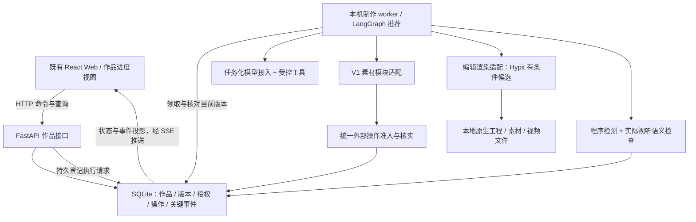

# S5 · 架构选型建议与取舍

状态：**RECOMMENDED — 技术推荐待评审，未锁定依赖，不代表已实现或验证。** 以下来源为 2026-10-16 的核查记录。

本轮从 `d25b8f83` 文档工作树再次只读复核 Easel 业务代码（与业务基线 `8eeafb6b` 相同）、V1 归档 `57c8e2ad` 与官方资料。既有需求、职责与主线由[架构基线](02_ARCHITECTURE.md)及[ADR-S5-001](decisions/ADR-S5-001-work-production-boundary.md)约束。下面每项均给出明确推荐；局部疑点不阻止其他项形成判断，也不把完整产品验收变成选型门槛。

## 1. 推荐组合与模块衔接

| 选型项 | 当前推荐 | 替代方案 | 推荐理由 | 主要风险/尚未证实 |
|---|---|---|---|---|
| 应用形态 | 沿用 React/TypeScript + FastAPI；模块化单体，制作由本机受管理 Python worker 推进，渲染用子进程 | 全部内嵌 Web 后台任务；微服务/云队列 | 保留已实现入口与部署方式；后台生命周期不依赖某条 HTTP 连接 | 新 worker 的启动/重启/取消与跨平台进程管理需落实；一个 worker 不等于强隔离沙箱 |
| 执行编排 | **LangGraph 有界状态图**，只承担阶段编排、等待与局部返回 | DBOS；小型显式 Python 执行器；Temporal | 确定阶段与模型选择并存，符合已确认三层规划，避免自研全部检查点机制 | 重放副作用、检查点与业务事务不原子；本地持久后端与现有依赖兼容待小范围核实 |
| 作品数据 | **SQLite + 本机媒体文件**；已有六维画像仍用原文件 | PostgreSQL + 文件/对象存储；JSON + 文件锁 | 单机范围部署轻；作品版本/授权/操作适合事务；V1 素材目录已有 SQLite 基础 | 单写者、长事务、备份与跨文件登记；不能把 SQLite 等同于外部生成恰好一次 |
| 模型接入 | **Easel 内任务化模型适配接口**，复用现有配置；程序提供受控工具，语义任务可走直接 API，需工具的任务经受限接入 | 让通用聊天 Harness 全权执行；再引入完整 Agent SDK/多 Agent 框架 | 保留模型可替换和既有入口，减少全会话污染；明确谁能调用收费工具 | 当前直接 API 无工具能力，不能原样承担全流程；实际图像/音频/视频能力与隔离依赖所选服务 |
| 编辑渲染 | **可编辑工程 + 渲染适配器；Hypit 保留优先候选但不可直接迁旧 parser，FFmpeg 为明确底层/替代** | 自有受限时间线 + FFmpeg；直接接入 Remotion | V1 已有 Hypit 原生工程与局部声音/文字保护代码，符合风格自由和局部修订；不复制旧 Delivery | Hypit 当前版本本地纯制作边界、隐式生成、协议及依赖/授权条件待核实；不假称其为已核实开源库 |
| 素材集成 | **迁入 V1 M01～M05 为应用内素材模块**，统一素材句柄与调用准入 | 重写；单独素材服务；让渲染器自带采购 | 用户已指定迁入，源码具备入库/作用域/权益/复用逻辑 | 旧 Attempt/Creation/报价耦合要适配；索引/Provider 当前可用性未证实 |
| 进度与观测 | **业务状态快照 + 持久关键事件 + SSE；命令用 HTTP**，沿用 React 展示 | WebSocket；仅轮询；框架调试平台当用户 UI | 现有 SSE/回放与媒体预览基础可用，制作主要是服务端向用户推状态 | 断连/重复/乱序、快照游标一致性、事件隐私与保留策略；不能沿用聊天消息作为作品状态权威 |

具体模型、媒体 Provider 和库版本按实际配置与能力要求在负责卡落实，不从技术推荐推导调用或配置变更授权。

图中领取工作不要求 Redis/消息中间件；当前建议由本机 worker 从持久请求中恢复待执行项。模型输出创意与选择，程序绑定版本和权限。付费操作只能走准入；渲染器不得成为绕过准入的第二生成入口。图不表达多套“总调度”：LangGraph 是 worker 内的编排能力，素材/编辑只是被调用模块。

## 2. 应用形态与执行编排

### 代码证据与取舍

[pyproject.toml](../../pyproject.toml)已有 FastAPI、Uvicorn、Pydantic、httpx、sse-starlette；[前端依赖](../../web/frontend/package.json)已有 React/TypeScript/Vite。[web/app.py](../../web/app.py)的 supervisor 已把聊天任务与浏览器转发解耦，但仍依赖应用进程内任务与对话记录，不能直接证明作品重启恢复。

因此推荐保留应用栈，将制作的生命周期交给本机受管理 worker，原生媒体进程由它启动和观察；不把渲染放在 Web 请求协程里，也不引入微服务平台。worker 的任务所有权、授权和外部操作仍由作品领域逻辑约束。跨平台启动器、资源上限和停止子进程是实施工作，不以 Python worker 名称宣称全部解决。

### 为什么推荐 LangGraph

[官方概览](https://docs.langchain.com/oss/python/langgraph/overview)支持把确定性代码与模型步骤组合，且不要求使用完整 LangChain。**本项目判断**：用显式节点表示已确认的创作/选材/编辑/检查等产物边界，用条件边处理具体缺口；模型在节点内做有界创作选择，不能任意跳过授权或自报完成。

[官方持久化说明](https://docs.langchain.com/oss/python/langgraph/persistence)将SQLite saver描述为本地开发存储，因此这里的本机产品推荐是Easel自身范围判断，不是厂商生产适用背书。S6-04须落实单worker、检查点访问串行/受支持异步接口、锁与崩溃测试；若该后端在目标环境不可用，保持领域合同，调整编排/检查点方案，不因此直接增加PostgreSQL服务部署。

[持久化](https://docs.langchain.com/oss/python/langgraph/persistence)区分检查点与长期数据；[中断文档](https://docs.langchain.com/oss/python/langgraph/interrupts)说明恢复可能从节点开头重跑。因此：图状态只放当前任务与业务记录引用，确认/额度/产物接受以作品记录为准；提交生成的节点调用幂等操作入口，恢复先查原操作，不因节点重跑重新收费。持久检查点不会自动启动 OS worker，也不提供凭证隔离。

| 替代 | 为什么不是当前首选 | 什么证据会改变选择 |
|---|---|---|
| DBOS 嵌入式流程 | 与普通 Python/FastAPI 接入相近，但本项目有较多语义分支、人工决定与局部返回，显式图更容易对应已确认主线 | 若 LangGraph 的检查点/业务状态集成需大量重复调度代码，而 DBOS 用更少边界即可支持同样流程，则改评 DBOS |
| 自有显式执行器 | 少外部抽象，但恢复、等待、取消与代码演进全需自研；V1 已说明“自己控制”不等于可靠 | 若主线最终足够简单且框架引入的状态耦合明显高于少量显式任务逻辑，可选；不得重造通用工作流平台 |
| Temporal | 单机产品当前没有支撑额外服务和运维复杂度的需求 | 后续正式要求多主机、独立 worker 部署和长期服务运维时再评估 |

[DBOS 官方指南](https://docs.dbos.dev/python/programming-guide)有默认 SQLite 与 FastAPI 集成说明；[Temporal 部署文档](https://docs.temporal.io/production-deployment)展示服务/worker 部署关系。这些支持机制比较，不证明哪一个已在 Easel 跑通。

### 依赖兼容依据

依赖需按平台受测约束锁定：核查时 PyPI 元数据 langgraph 1.2.15 与 sqlite checkpointer 3.1.2 的最低 Python 为 3.10，但不能据顶层推导全部传递依赖可用；例如 ormsgpack 新版与 1.12.0 的 Python 范围不同。实施卡要求按3.10/3.12分别解析并跑当前跨平台矩阵，不静默提高要求。[LangGraph 元数据](https://pypi.org/pypi/langgraph/json)、[SQLite saver 元数据](https://pypi.org/pypi/langgraph-checkpoint-sqlite/json)、[ormsgpack 1.12.0 元数据](https://pypi.org/pypi/ormsgpack/1.12.0/json)。不需要采用完整 LangChain 应用框架不等于没有 langchain-core 传递依赖；此次核查未安装依赖或解析完整锁；落实由 S6-04 负责。

## 3. 数据、版本和持久化

推荐 SQLite 保存新 V2 的作品语义记录，媒体存文件；图片/音视频不作为大 BLOB 塞进检查点。六维画像继续原有文件入口，作品保存所用版本依据，不能复制成另一套可独立编辑的人设。

建议把以下业务记录置于一个作品数据库的事务边界：方案修订及确认、授权/预留/消耗、运行/任务引用、产物索引/接受记录，以及对应的关键事件。模型调用、网络和渲染在事务外执行。状态更新与待推送事件同事务登记，浏览器按游标读取；不做“内存已更新、数据库稍后再补”的乐观完成展示。

LangGraph 检查点和 V1 素材目录各自使用独立表/文件所有权，避免修改第三方内部表；它们不是用户额度或接受状态的权威。框架/素材与作品记录跨写入仍采用稳定身份、幂等接收和核对，不能宣称不同 SQLite 文件天然同事务。V1 `library.py` 已用 SQLite，但不据此强行把其目录表和框架表全部合并。

| 方案 | 判断 |
|---|---|
| SQLite + 文件 | 当前推荐；本机数据库短事务，渲染不占事务；预留、计次与版本修改统一校验 |
| PostgreSQL + 文件/对象存储 | 多主机/高写入并发时更合适，当前新增服务成本较高；不能因框架示例常用就默认给用户安装 |
| 每作品 JSON + 文件锁 | 易读且 V1 有经验，但授权/操作/引用与事件跨文件一致性需更多自研协调；适合导出/证据，不推荐作全部权威状态 |

[SQLite WAL 文档](https://sqlite.org/wal.html)明确单写者及网络文件系统限制。因此推荐本机磁盘、短事务和正确备份，禁止渲染时持锁；若真实并发/恢复行为无法满足，再改持久化实现。精确库版本及 Python 兼容范围按项目 `>=3.10` 的承诺核对；不得静默提高系统要求。

## 4. 模型接入、工具与上下文

推荐在 Easel 内保留一个任务化调用边界：给模型完整必要的方案约束、当前场景、真实媒体证据及已有成果；模型返回创意、选择、编辑表达或缺陷定位。程序提供检索/媒体检查/编辑等受控工具与结果，模型不直接写授权、计次或完成状态。

[direct_api.py](../../easel/direct_api.py)当前只做流式聊天，明确无本机工具并拒绝 `tool_calls`；[Harness 合同](../../easel/harnesses/base.py)提供 cwd/env/model/sandbox 等接入信息，但这些字段不能证明隔离。故推荐**复用配置和传输基础，新增面向作品任务的接收与工具绑定**，不把已有 direct API 原样认领为完整 Agent。

| 任务 | 推荐调用能力 | 工具责任 |
|---|---|---|
| 创作依据/方案 | 文本规划 + 必要参考证据 | 程序组装事实与版本；需要公共事实时提供检索工具 |
| 参考拆解/选材 | 能消费实际视频/图像/音频证据的任务接入 | 提供可观察媒体与时间位置；抽帧/转写仅作辅助，不冒充完整观看 |
| 编辑表达/修订 | 按原生工程能力生成或修改局部表达 | 程序检查引用/时间/保护范围，并执行编辑与渲染 |
| 成片检查 | 实际视听检查 + 确定性媒体检测 | 输出具体问题而非笼统自评分，最终接受仍归用户 |

替代是让通用 CLI/Harness 接收整段聊天并任意调用工具，初期接入可能快，但权限、上下文污染、回执与恢复难控制；不作为 V2 付费主链的默认方式。另一替代是引入完整 Agent SDK/多 Agent 框架，目前没有必须叠加的需求；LangGraph 也不要求每个节点变成独立 Agent。

风险是模型能力、媒体输入上限和服务差异。当前不指定一个未经配置核实的供应商覆盖所有任务；角色可复用同一模型，也可因真实视听能力分别配置，所选版本/能力需记录，不自动降级或换音色。直接 API 与受限 Harness 均须遵守同一授权入口；无法实际限制付费通道的 Harness 不能承担收费工具执行。

现有 output/persona 删除、旧 GET 媒体入口及聊天 TURN_REMINDER 可能绕过作品边界；具体入口保护由[实施合同](15_IMPLEMENTATION_DESIGN.md)与 S6-02/08 落实，私有库不能仅靠隐藏目录名保护。

## 5. 编辑渲染：原生工程接入与有条件的 Hypit 候选

V1 的[CLI 适配](https://github.com/webxia/Easel/blob/57c8e2ade21af9fb6abccdab3f7ba8e50132314f/easel/integrations/hypit/cli.py)有 check/build/status/get/cancel 接口；[局部修订](https://github.com/webxia/Easel/blob/57c8e2ade21af9fb6abccdab3f7ba8e50132314f/easel/integrations/hypit/native_revision.py)有 `assert_composition_preserves_sound_and_copy`、视频区间与引用检查。它们为可编辑工程、观察渲染与局部保护提供现成证据，故保留这一接入方向。但本轮深审发现 V1 的 native_source.py 固定 @hypit/hypit 0.2.7 及内部源码摘要，并含 darwin-arm64 组件路径；现有局部保护不能据此宣称可直接迁入当前跨平台环境。

**推荐范围很窄**：Easel 决定素材/授权/任务；导演创作原生工程；Hypit 承担已选媒体的编辑/渲染并返回可观察结果。不能把整个 Hypit 创作 Skill/旧 service 当作总导演或总调度。当前本地 Hypit Skill 带生成媒体优先的创作倾向，而 S4 是外部素材优先，因此不直接继承其产品策略。当前 Runtime 是否能在受限媒体/凭证环境下完成纯制作，是首选尚未确定的关键边界。

| 替代方案 | 优点 | 代价/风险与采用条件 |
|---|---|---|
| 自有受限时间线 + FFmpeg | 沿用现有合成器、音视频工具，进程/文件边界直接可控 | 复杂视听表达、字幕布局和局部依赖需自行实现；现有 `assemble.py` 保留显式镜头时长，仅在缺时长时借旁白分配；静音、补帧、缺字幕回退等默认行为仍需显式适配。若 Hypit 无法分离生成/渲染，则评估此替代，不静默降为幻灯片 |
| Remotion 原生组件 + renderer | 可用 React 组件表达动态字幕/图形，已有前端技术基础和 vendored SDK 的使用经验 | 浏览器/Node 运行依赖、生成代码隔离与渲染性能；需核实所用许可，不把“源码可读”当成无条件免费。若主要缺口是复杂图形表达，作为明确候选 |
| 整体沿用原片 video-pipeline-sdk | 仓库已经内置版本并有 status/工序入口 | 契约要求自身的风格方式与 design-table/preview 审批，输入偏原片；与跨内容固定导演、一次确认不同，不作为统一主线直接使用 |

Easel [assemble.py](../../skills/builtin/auto-short-video/scripts/assemble.py)已有 FFmpeg 合成，[SDK 来源](../../skills/builtin/video-production/vendor/VENDOR.md)记录内置版本与本地修改，[SDK 契约](../../skills/builtin/video-production/vendor/video-pipeline-sdk/INTERFACE.md)暴露它自己的生产阶段。若要复用 SDK 能力，通过受支持接口适配或显式维护派生版本；不未经评估绕过其契约抽私有脚本。

[FFmpeg 滤镜](https://ffmpeg.org/ffmpeg-filters.html)可承担裁切、音频混合等机械处理；[Remotion renderer](https://www.remotion.dev/docs/renderer)提供渲染/静帧/取消等 API。发行前按实际构建核对 [FFmpeg 许可](https://ffmpeg.org/legal.html)与 [Remotion 许可](https://www.remotion.dev/license)。Hypit 当前发行与许可未作独立核验，本轮不将其列为已确认开源项目，也不执行其安装/生成。

Hypit 环境白名单仍可能读取 HOME 中的 Runtime 凭证，因此无真实凭证和受限媒体执行边界须由 S6-09 落实；只看定价结果不等于阻断收费通道。该卡提交具体编辑器决定、精确版本/许可与能力矩阵，并回写本节；一个简单可播放样片不能证明全部编辑能力。

V1 完整脚本 Voice 路径不等于句级配音修订；生产须显式固定 engine/voice 并登记音轨段依赖，实施合同及 S6-10 负责。

## 6. 素材与可观察制作

### 素材

推荐 M01～M05 作为应用内模块迁入，复用 V1 的作用域、入库、来源/权益、检索/去重与供应处理。保留内部数据库/文件实现的可替换边界，统一对外返回稳定素材引用、实际媒体、用途证据及明确缺口。素材生成必须引用作品操作身份；观察回执回写同一操作，不另计阶段调用预算。

替代为重写全部素材库（重复实现已证实有效的逻辑）、独立素材微服务（当前单机部署收益不足）或让渲染器自带采购（破坏统一授权与来源顺序）。风险是旧 Creation/Attempt/报价集成耦合；迁入适配以能力和测试意图为单位，不整包恢复旧运行态。语义索引先适配 V1 已有接口，不预先新增向量数据库，资源/模型不满足时明确检索能力限制。

### 进度

推荐 HTTP 命令/快照查询 + SSE 增量推送。已有 [Web 事件回放](../../web/app.py)包含 `/api/chat/jobs/{turn_id}/stream` 与 `after` 游标、心跳及最后结果读取；这些是可沿用经验，不是作品状态已完成。作品另用确定的运行/版本身份、持久关键事件和权威快照。

事件与状态更新在作品事务中登记；SSE 只负责发送。重连按游标补齐，记录被清理则回到带游标的快照；先取得快照再接续其游标，避免查询/订阅之间丢变化。前端分开展示并行任务和当前版本，旧事件不覆盖新版。大媒体经现有受控文件预览获取，不放 SSE 事件正文。模型的短解释只能补充事实，不能推动完成状态。

[MDN SSE](https://developer.mozilla.org/en-US/docs/Web/API/Server-sent_events/Using_server-sent_events)说明单向事件流及重连机制。选 SSE 是因为本产品主要服务端推状态，用户动作经 HTTP 即可；WebSocket 在需要持续双向低延迟交互时再采用，当前增加连接状态管理。轮询可作断连时恢复查询，不作唯一实时体验。框架调试平台不能代替用户制作视图，也不默认上传私人作品追踪数据。

## 7. T01～T08 重新归类：不再作为选型前置

场景与判据唯一保留在[验证清单](tasks/S5_VALIDATION_PLAN.md)，任务映射及 S6/S7 分段由[实施任务包](tasks/S6_IMPLEMENTATION_PLAN.md#3-覆盖关系与验收口径)维护。仅具体取舍存在关键疑点时使用下面的局部实验；完整产品验收不作为选型前置，也不因分段实施而省略。

## 8. 仅保留影响选型的具体疑点

以下疑点在负责卡落实具体接入时处理；没有证据缺口则不额外实验，不要求全部通过才允许独立任务开工。执行范围遵守任务包共同约定及实际用户授权：

- **Q1 编排与本机持久后端（S6-04）**：若文档/版本兼容核查仍不能确定，做“等待确认→恢复”和“对端已接受、回执未存→核实原操作”的最小假服务实验。只判断是否需要换后端/编排，不跑 T03 全矩阵。依赖兼容不通过不得静默提高 Easel 的 Python/部署要求。
- **Q2 模型工具接入边界（S6-08）**：当选择继续使用带任意执行能力的 Harness 时，仅验证是否能关闭付费绕过路径及额外指令注入；不满足则转为程序提供受控工具的任务接入。
- **Q3 渲染器边界（S6-09）**：核实所选 Hypit 版本能否只消费已有媒体、保持指定原声，修改一处字幕/画面后重渲染而不生成收费素材；如证据不足，使用许可测试媒体做最小样片。其余完整质量/长片覆盖留在实施验收。影响用户 Runtime 的安装/启动按实际授权执行。

推荐变更要记录原因和影响，不能静默退化目标。最终具体技术 ADR 在用户认可本轮取舍后记录，条件性未决项明确保留；不把“开始选型”自动写成“全部选型已接受”。
