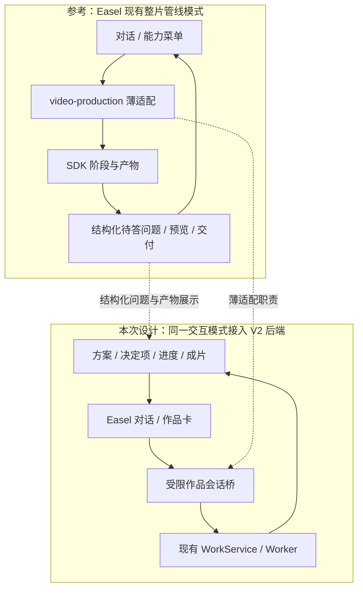
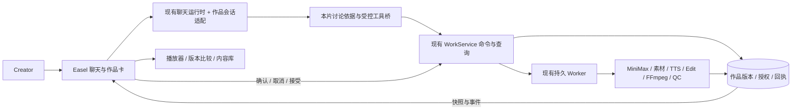
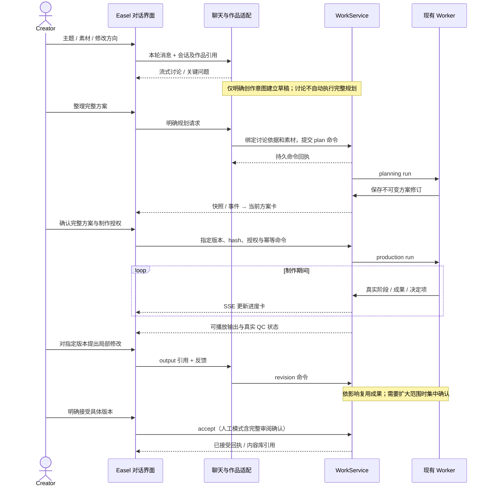
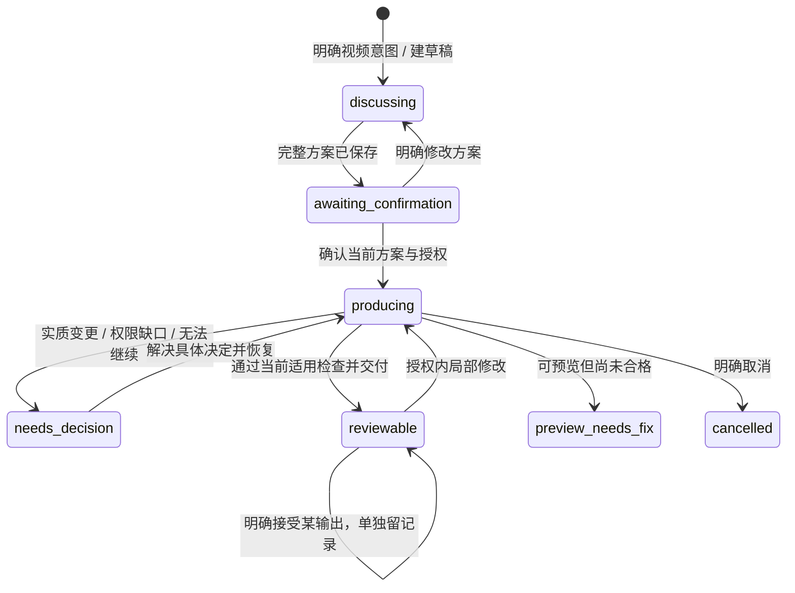

# Easel V2 · 对话式视频创作交互设计

状态：**DESIGN PROPOSAL / 待评审，尚未实施**。2026-10-18，源码基线 `406e523c`。用户已明确要求回到对话式创作、沿用 Easel 创作能力，并以已跑通的生产后端为基础；本文件提出具体交互方案。任务登记见 [S6-14A](tasks/S6-14A_conversation-integration.md)，第五轮生产证据见 [S6-14](tasks/S6-14_integration-release.md)。数据、API 和事件增量仅在[实施合同 §9](15_IMPLEMENTATION_DESIGN.md#9-s6-14a-对话接入增量提案待评审未实现)定义。

## 1. 目标与设计依据

**用户在 Easel 同一段对话里讨论创意、补充素材、确认完整方案、观察制作、审阅和修改；后端继续围绕同一 Work 执行。** 主人设沿用六维 Profile，Director 承载可复用叙事和视听风格，内容随作品变化。无需先填写一整张制作表单才能开始。

| 已确认需求 | 本次交互落实 |
|---|---|
| 001、004：利用已有信息先给方向，导演自主创作 | 用户直接说想法或发附件；Easel 提出具体方向，针对关键缺口追问；讨论期间不自动开始完整 Planning |
| 005、006：完整方案一次确认，之后自主完成 | 对话中展示同一版本的方案卡，展开脚本/分镜；统一确认设置、授权和补料次数，再由现有 worker 运行 |
| 007、008、026：自然语言局部改、明确接受 | 成片卡绑定具体版本，输入意见可带播放时间；后端判定影响，保留未改内容及旧版本 |
| 010、011、021：声音、附件与权益 | 沿用附件输入和设置控件，按本片展示用途、原声和权利缺口；试听是明确动作 |
| 019、020、034：画像可选、频道/导演可复用 | 输入框上方显示当前画像/频道/导演；未选画像也能创作；本片调整默认不写长期设置 |
| 024、025、027：进度、恢复与删除 | 对话里显示真实进度卡；关页面不取消；删除聊天不删除作品；作品列表可重新打开讨论 |
| 028、032：沿用 Easel 与真实依据 | 复用聊天、画像、附件、技能中的创作知识和可适配工具；公共事实/素材结论须有实际证据 |

## 2. 现状与差距（源码事实）

| 当前实现 | 对体验的影响 | 设计处理 |
|---|---|---|
| [ProductionPage](../../web/frontend/src/components/ProductionPage.tsx) 独立创建表单、方案字段编辑、服务勾选和版本列表 | 用户须在聊天之外组织参数和推进步骤 | 拆成可复用作品组件，嵌入聊天卡与侧栏；作品列表继续作为找回入口 |
| [ChatPage](../../web/frontend/src/components/ChatPage.tsx)、[App](../../web/frontend/src/App.tsx)、[streamChat](../../web/frontend/src/lib/api.ts) 未连接作品参数 | 普通聊天与生产作品没有连续上下文 | 明确绑定作品和当前版本，消息与作品引用一起回放 |
| [现有作品聊天桥](../../web/app.py) 遇到 workId 就将消息交给 plan/revise，再提示去工作台 | “解释一下”“换个方向”等讨论也可能变成执行命令 | 增加讨论/提案/命令区分，不因存在 workId 就执行 Planning |
| [PlanningTasks.context](../../easel/production/planning.py) 读取本片输入及 request，不读取完整聊天 | 多轮讨论中的事实、限制可能未进入规划依据 | 提交有来源的创作摘要和附件句柄，冻结时绑定具体摘要版本 |
| [普通聊天存储](../../web/frontend/src/lib/store.ts) 主要在浏览器，另有后端聊天回放 | 清理本地缓存或删聊天后不能据此恢复完整作品讨论 | 后端持久保存本作品必要讨论记录、卡片引用和绑定；业务状态继续只读作品库 |
| [direct API](../../easel/direct_api.py) 无工具执行；当前运行设置只读实测为 **OpenClaw** | 不能把任一聊天底座等同于已具备 V2 工具桥 | 首先验证当前 OpenClaw 的受限工具接入；API/其他 Harness 各自声明能力，不静默切底座 |

第五轮证明现有 MiniMax Planning → Supply/TTS → Edit → FFmpeg → 技术 QC 可自主到人工审阅。它没有验证上述 Web 对话链。交互改造不能以第五轮 API PASS 代替自己的验收。

### 2.1 参考 Easel 管线的具体取舍

按用户补充“可以参考 Easel 的管线设计”，本设计实际对照了两层：Easel 的五层内容工作流，以及内置 `video-production` 的整片产线。后者已有“宿主对话 → 薄适配器 → 管线 → 问答/产物回到对话”的模式，与本次目标相符。

| Easel 现有设计与源码依据 | V2 沿用/适配方式 |
|---|---|
| [五层工作流](../../README.md#-五层内容工作流)：发现→策划→创作→发布→归因 | 保留 Easel 创作入口和上游选题/脚本能力；本片可直接从用户内容开始，不强制走五层，发布/归因不成为视频完成前置 |
| [视频产线薄适配器](../../skills/builtin/video-production/scripts/video_pipeline.py)：只转发命令，不复制 SDK 主逻辑 | 作品会话桥采用同一职责划分：组织输入、转发有限命令、展示结果；生产主逻辑仍在 WorkService/worker |
| [管线机器接口](../../skills/builtin/video-production/vendor/video-pipeline-sdk/INTERFACE.md)：status、pending、answer、resume，结构化问题和回答 | 复用“后端给出当前状态及合法选择，前端渲染并回传”的设计；V2 用持久 Task/决定项与现有命令承载，不复制 questions/answers 文件状态机 |
| [视频产线技能](../../skills/builtin/video-production/SKILL.md)：设计表摘要/全文、预览图、成片直接贴进对话 | 方案卡先展示具体内容再确认；阶段产物和成片在对话可见。V2 媒体走受控 artifact API，不沿用旧 `/api/media/` 私有路径读取 |
| [QuestionCards](../../web/frontend/src/components/QuestionCards.tsx) 的单选/多选/自由补充 | 复用组件视觉与交互结构；新增业务 action adapter。当前卡片依赖活跃聊天流，V2 决定卡必须能跨回复结束/刷新持久显示，答案送 WorkService 而非冒充旧 gateway 的 question.resolve |
| [manifest 薄索引](../SKILL-SPEC.md#元数据契约easeljson)、[manifest.py](../../skills/shared/scripts/manifest.py)：产物引用 + 一句结论，brief 保存意图，下游读取实际产物 | 讨论摘要对应创作 brief，Plan/Artifact/事件提供产物引用；不把整段历史塞给每个任务，也不让下游重做上游判断。V2 不把 `.easel.json` 建成第二套运行/接受权威 |
| [管线 stage 实现](../../skills/builtin/video-production/vendor/video-pipeline-sdk/pipeline/run.py)：阶段、检查点、失败报告、实际产物 | 沿用“每步有产物、问题有范围、可恢复”的呈现方式。现有 V2 Run/Task/Operation 已承担执行，不将整个 SDK 再挂成并行生产者 |
| [Prompt Stack](../prompt-stack.md)：人格、编排、运行时、按需 Skill | 沿用分层和按需加载；把本片 Profile/Director/依据按作用域传入，不混入研发规则和旧产线独有约束 |

原 SDK 面向已有整条原片、内含 Remotion 和两道固定人工确认，接口还写有“风格由内容推出”及默认品牌包；这些不等于 V2 已确认的“主题/素材/原片组合、稳定 Director、完整方案一次确认、现有 FFmpeg 后端”。因此本次采用其交互与适配模式，保留 V2 已确认的产品行为和成功执行基线。若未来需要 SDK 的某种编辑效果，应单独评估 adapter 与能力证据，本次不替换渲染器。



现有 [BrushEntry](../../web/frontend/src/components/BrushEntry.tsx) 的“管线”入口只是预填“用视频产线做一支整片”，能力目录仍标 `incoming`；不能据按钮存在宣称生产已连接。A3 将视频创作入口明确绑定 V2 作品模式，保留其他能力菜单；避免把同一用户意图同时送到旧 SDK 和 V2。旧原片包装能力如需继续独立使用，须有清楚区分的入口及作用域，不与已绑定 V2 Work 混跑。

## 3. 页面组织与完整旅程

沿用 Easel 的聊天主界面、会话历史、画像选择、附件输入、媒体预览与内容库。侧栏的“视频创作”进入作品列表；新建作品打开带视频上下文的对话。普通聊天明确提出制作视频时，可在原对话建立作品草稿；仅咨询视频知识不建作品。作品名可由当前内容建议，随后可改，不阻塞第一句话。

桌面布局草图（交互示意，非已实现界面）：

```text
┌──────────────┬────────────────────────────────┬─────────────────────────┐
│ Easel 导航   │ 当前对话 · 作品名称              │ 作品详情（可收起）        │
│ 聊天 / 作品  │ [画像] [频道] [导演·版本]         │ 方案 / 素材 / 版本        │
│ 画像 / 内容库│                                │                         │
│              │ 用户：把这次经历做成一条短片      │ 当前方案摘要             │
│              │ Easel：建议从这个冲突切入……      │ 展开完整脚本与场景        │
│              │ [完整方案卡 · 版本2]             │                         │
│              │ [讨论修改] [确认方案并制作]       │ 真实制作步骤 / 已有成果   │
│              │ [制作进度卡：正在剪辑]           │                         │
│              │ [成片卡 · 版本1 · 待人工审核]     │ 新旧版本比较             │
│              │                                │                         │
│              │ [附件] 说想法或修改意见…… [发送] │                         │
└──────────────┴────────────────────────────────┴─────────────────────────┘
```

窄窗口把详情改为抽屉；讨论、确认、进度和成片始终能在对话内完成。卡片只展示对用户决策有用的内容，不暴露内部 Run/Task ID、JSON、数据库状态或原始模型思考。

| 时点 | 用户看到/操作 | Easel 与后端如何衔接 |
|---|---|---|
| 开始 | “用这个导演讲我第一次做产品的经历”，附图片/原片 | 带入本片画像和导演，建议方向。明确视频创作意图后建立 discussing 草稿；缺失规格先作为建议，不写成用户硬要求 |
| 讨论 | “别太励志，保留我失败的部分”“再解释一下开场” | 同一创作对话继续；记录事实、观点、禁区与建议的来源。解释不生成新方案、不调用 TTS |
| 整理方案 | “按这个方向整理完整方案” | 使用讨论摘要、已登记附件、有效默认项及规划服务授权，启动现有 Planning；用户未指定的时长/画幅/声音由导演建议并在方案中披露 |
| 修改方案 | “第二段更克制，最后一句留下” | 将反馈与当前方案绑定；明确修改方案才创建新 Plan Revision。旧方案卡标明已被新版本替代 |
| 一次确认 | 在当前完整方案卡点击“确认方案并制作” | 同一确认展示/提交具体方案、固定音色、素材许可、服务及 IMAGE/VIDEO 上限；无需再逐阶段审批 |
| 制作 | 卡片持续更新“寻找素材 / 配音 / 剪辑 / 渲染” | 读取真实快照和 SSE。可展开本步输入、动作、选择摘要、成果；没有证据不造百分比或承诺剩余分钟 |
| 异常 | 卡片解释缺口、已保留成果和可选处理 | 仅有真实决定项才让用户选择；授权/补素材后针对相应任务恢复，UNKNOWN 显示核实中且不重发 |
| 审片 | 对话中播放指定成片，侧栏看版本 | 技术检查、语义检查、待人工审阅分别标明；第五轮显示“技术检查通过 · 待人工审核” |
| 局部修改 | 在版本1上说“12秒这处换画面，声音保持” | 绑定 output_id 和用户明确的时间/场景；后端做影响分析，常规授权内局部修改直接推进，扩大影响/新增费用集中说明 |
| 接受保存 | 明确接受当前所看的版本 | 保存具体输出到既有内容库；人工模式确认完整音画审阅。接受作品与接受导演分别记录 |

**确认方式提案**：首期以版本卡上的明确操作作为生产、追加授权、接受和删除的提交点。自然语言“可以，按这个做”将当前唯一方案卡定位到确认操作；不先把文字当一次授权、再重复让用户批准。模糊“不错”“继续聊”绝不触发制作。后续若支持文字直接完成这些动作，须另做可追溯的语义授权合同及验收，不靠关键词匹配或模型自行生成授权字段。

制作时仍可询问进度和讨论新想法。改变冻结内容时先说明受影响范围，用户明确选择停止后续制作并改版，或等首版完成再修改；不在活动 Run 中偷偷改 Plan。输入框“停止回答”只停止当轮对话；进度卡“取消制作”才调用作品取消。

## 4. 前后端职责与 Easel 复用




### 4.1 前端

- ChatPage 保持对话容器，提取 ProductionPage 中的方案、设置、进度、决定、成片与版本组件供两处共用；界面里同一状态来自同一 Work 快照。
- 消息支持文字加结构化卡片引用。文字可流式；卡片内容由后端业务记录投影，不能从 Markdown 里解析“完成”“已接受”来更新状态。
- 一段对话可先后关联多个作品，但同一轮只有一个明确的当前作品；输入框和卡片显示目标。打开旧成片回复时绑定那一版，不猜“最新文件”。跨作品切换不带走旧授权、素材权限或个人事实。
- 画像/频道/导演、声音和字幕等放在上下文条与按需展开控件；依然能精确设置，但不要求逐项填完才讨论。长期默认保存须明确范围。
- 内容库和作品列表都能打开作品，恢复当前方案、进度和版本；无旧聊天时可开启绑定同一 Work 的新对话，无须重跑制作。

### 4.2 聊天与作品接入层（新增适配，非第二套生产编排）

同一个面向用户的 Easel 创作助手负责讨论、解释与调用有限的作品工具。Director 是风格和创作职责，不新增一个用户必须切换或单独部署的聊天 Agent。规划/选材/剪辑仍由现有任务化模型执行。

接入层组装本片上下文、校验工具参数和业务动作、登记对话引用，并调用既有 WorkService。对话历史用于理解；已确认方案、授权与实际运行记录决定能做什么。普通聊天回复结束只代表本轮回答结束。

**当前 OpenClaw 接入要求**：复用其已有会话、流式输出、附件理解和创作对话能力，作品会话仅开放受限的作品查询/草稿/规划/修订工具。必须在工具注册、执行权限及凭证访问上实际禁止该会话绕过后端运行旧视频生产脚本、任意 shell 或直接调用媒体 Provider；仅追加“请使用 V2”提示词不构成通过。采用现有 Harness 的按会话权限配置/隔离运行上下文，先用假服务验证。若当前版本无法实现该限制，应如实报告具体缺口并评审适配方案，不静默改用其他底座、关闭普通 Easel 功能或开放收费旁路。

API 直连目前只有文本/图片对话，不具有完整技能执行。若后续支持它，须明确实现有限工具调用和回放；不能把“与 MiniMax 共用配置”写成“已复用 Easel 全部创作能力”。本任务先覆盖当前实际 OpenClaw 入口，其他 Harness 的兼容性逐个记录。

### 4.3 具体沿用什么

| Easel 能力 | 本方案复用方式 | 接入限制 |
|---|---|---|
| 聊天、历史、流式回复与问答卡 | 保留现有交互与回放，增加作品引用和卡片 | 正文不是权限记录；重连不重新执行工具 |
| 六维画像与频道/导演目录 | 通过现有读取/目录服务组装上下文 | 使用全部必要六维；旧创作指令“制作不读 platforms”与 V2 要求的差异需显式适配；无画像不读取其他画像 |
| 技能的叙事、脚本和视听知识 | 经审查的相关知识片段供讨论和规划使用；保留来源和版本 | 不把旧技能的独立出片、输出目录、重试或发布流程全量塞入 V2 |
| 附件、媒体读取与预览 | 会话上传→校验归属→登记本片输入→媒体证据 | 允许看附件不等于已获制作权；参考视频风格分析不授予复用素材权 |
| 配音、字幕、剪辑等媒体工具 | 已有生产 adapter 优先；需要补工具时由 worker 包装受控调用 | 不让聊天与 worker 各出一片；不能静默换掉第五轮成功的供应/渲染实现 |
| 选题、画像编辑、非视频技能 | 继续走 Easel 现有功能；作品内需调用时声明作用域 | 修改长期画像、发布等不能由本片确认推导授权 |

研发 AGENTS、Git/Task 清单与个人调试资料不得进入产品创作上下文。产品 AGENTS 里与 V2 冲突的旧工作流也不能不加区分地继承。实际加载清单、工具权限和跨画像隔离都作为后续运行验收项。

## 5. 前后端交互时序



## 6. 上下文、卡片与状态规则

### 6.1 讨论如何进入规划

每项创作依据区分“用户明确”“画像/频道默认”“导演建议”，保留所来自的消息或设置版本。摘要包括主题、事实/核心观点、风格、必用/参考素材、声音保护、规格及未决项；用户更正覆盖旧的同一要求，但保留来源。普通闲聊、其他作品、推理过程不进入生产输入。

Planning 读取确定的摘要版本及有效附件句柄，而不是让下游模型重新猜整段聊天。摘要不是第二份画像，也不是授权。形成完整 Plan 后，方案卡与展开脚本都读该 Plan Revision；确认后以冻结方案为准。用户只要求解释时不修改摘要或生成新版本；内容有实质变更才使旧提案的确认操作失效。

### 6.2 关键卡片

| 卡片 | 必须显示 | 可执行动作 |
|---|---|---|
| 创作方向 | 具体构思、引用的画像/导演、关键缺口 | 继续讨论、补附件、整理方案 |
| 完整方案 | 摘要、可展开脚本/场景、规格、声音/字幕、素材方向、服务/补料次数、待解决事实 | 自然语言修改、一次确认当前版本 |
| 制作进度 | 当前动作、已完成成果、最近更新时间；断连单独提示 | 展开步骤、询问、取消制作 |
| 需要决定 | 具体原因、受影响部分、已保留成果、可选解决办法及新增消耗 | 仅显示当前合法动作；不固定要求每次先“追加额度” |
| 成片版本 | 实际视频、版本、技术/语义/人工审核状态、署名导出 | 定位反馈、比较、接受、基于此版新作 |
| 修订影响 | 变化范围、保护项、复用项、所需新增调用 | 正常局部直接执行；需要确认时同卡集中处理 |

原始异常、模型内部推理和所有工具日志不作为进度正文。Agent 可以解释已存在的事实，不能把缺失的选择依据补写成实际发生过的决策。

### 6.3 作品状态与聊天状态分开



此图是交互主路径，非后端全部合法转换表；执行仍以实施合同和 WorkService 为准。语义 QC 未测的人工模式保留 `needs_fix` 质量事实，并显式交人工审核，不能因 Work 可审阅而标成“完整自检通过”。

## 7. 刷新、冲突和异常场景

| 场景 | 预期行为 |
|---|---|
| 刷新/关页/聊天回复停止 | 作品后台继续；重开先取 snapshot/cursor，再续订事件；不重新发 plan/confirm/revise |
| 命令已落库但响应丢失 | 保留原 command_id 和请求内容，查询或原样重放取回执；不得自动造新 ID |
| 两个窗口同时确认 / 旧方案卡被点击 | 后端检查版本和 hash；重复原命令返回原回执，过期内容409并刷新卡片；不自动替用户确认新版 |
| SSE 重复、迟到或旧 Run 事件 | 按 work/seq 去重，核对当前 run/revision；旧事件留历史，不覆盖当前阶段 |
| 多轮讨论/多作品切换 | 串行处理同一会话变更；每条消息固定目标，其他作品的旧结果不会改变当前输入框目标 |
| 生成或模型结果未知 | 展示待核实及已有成果；由既有操作核验流程处理，不将“继续”解释为重发 |
| 后端版本过期 | 显示服务需要更新，拒绝新的生产命令；客户端不通过自动重试绕开503 |
| 删除聊天/浏览器清缓存 | 作品仍在作品列表和内容库；新聊天可绑定原作品。删除聊天应清除聊天副本/绑定，保留已被方案引用的必要业务证据 |
| 用户撤销/取消 | 分开“停止回答”“取消后续制作”；已提交的外部请求继续按原 Operation 收存，不承诺撤销费用 |

## 8. 实施顺序与本次交付边界

新增任务 [S6-14A](tasks/S6-14A_conversation-integration.md) 按以下次序推进：先验证 OpenClaw 受限工具与上下文接入，再接通会话绑定/命令/事件，接入对话卡片与作品侧栏，最后以离线假服务跑完整交互和回归。每一步都有可观察验收，不能只实现外观后标“对话式创作完成”。

第五轮现有成片可用于只读播放器和卡片验证；不改其 Plan、Operation 或接受状态。未来真实 Web 创作验收需具名授权，且不能套用第五轮 API 证据。当前文档/图和任务登记完成后，唯一研发下一步是评审这份交互设计与接入边界；Creator 可同时审阅第五轮成片。
