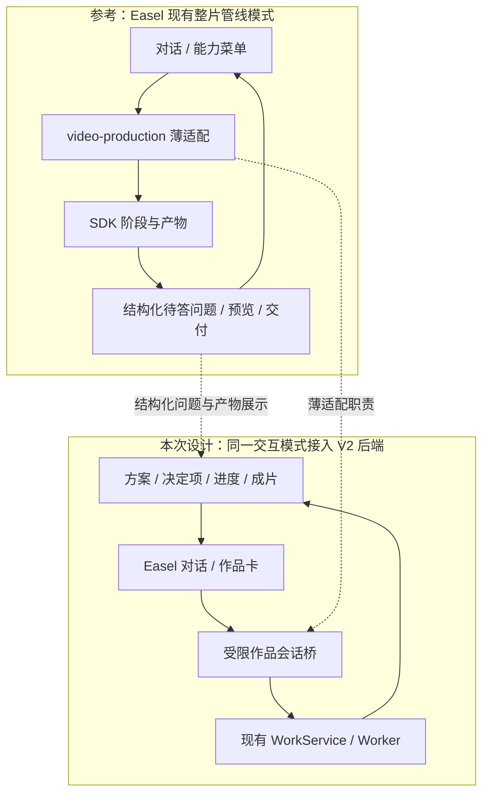
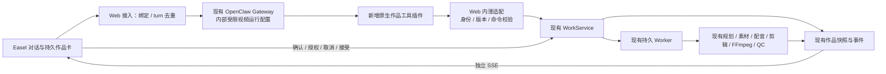
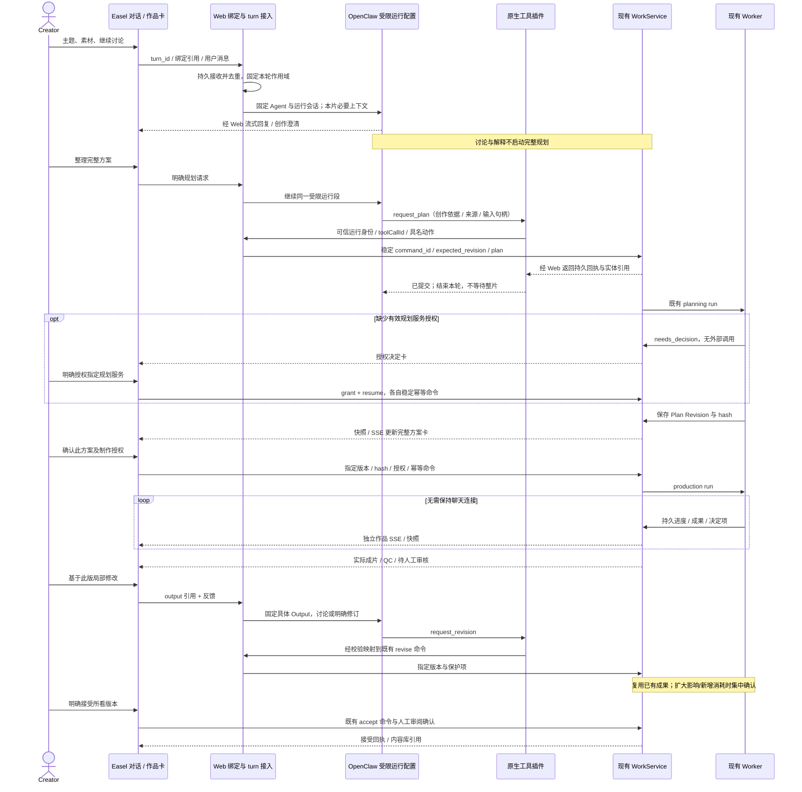
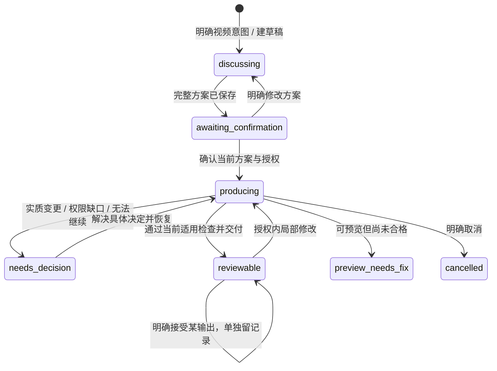
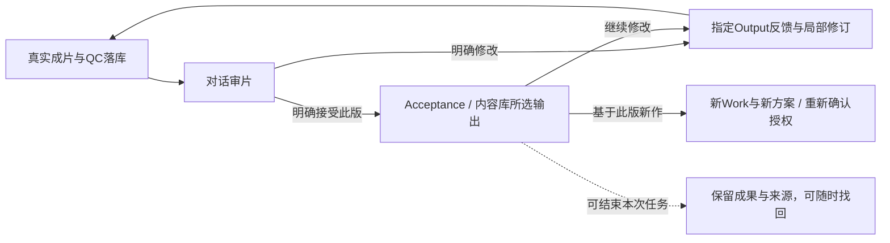

# Easel V2 · 对话式视频创作交互设计

状态：**方案已获准推进 A1；A1 ISOLATED_FAKE_PASS，完整交互尚未实施**。2026-10-18 研究修订；文档研究基线 `bac81d99`，成功生产源码基线仍为 `406e523c`。用户已明确要求回到对话式创作、沿用 Easel 创作能力，并以已跑通的生产后端为基础；本文件维护具体交互方案；A1 的实际证据与范围限制见任务卡，不能据此宣称正式 Web 已接通。任务登记见 [S6-14A](tasks/S6-14A_conversation-integration.md)，第五轮生产证据见 [S6-14](tasks/S6-14_integration-release.md)。数据、API 和事件增量仅在[实施合同 §9](15_IMPLEMENTATION_DESIGN.md#9-s6-14a-对话接入增量提案待评审未实现)定义。

## 1. 目标与设计依据

**用户在 Easel 同一段对话里讨论创意、补充素材、确认完整方案、观察制作、审阅和修改；后端继续围绕同一 Work 执行。** 主人设沿用六维 Profile，Director 承载可复用叙事和视听风格，内容随作品变化。无需先填写一整张制作表单才能开始。

| 已确认需求 | 本次交互落实 |
|---|---|
| 001、004：利用已有信息先给方向，导演自主创作 | 用户直接说想法或发附件；Easel 提出具体方向，针对关键缺口追问；讨论期间不自动开始完整 Planning |
| 005、006：完整方案一次确认，之后自主完成 | 对话中展示同一版本的方案卡，展开脚本/分镜；统一确认设置、授权和补料次数，再由现有 worker 运行 |
| 007、008、026：自然语言局部改、明确接受 | 成片卡绑定具体版本，输入意见可带播放时间；后端判定影响，保留未改内容及旧版本 |
| 010、011、021：声音、附件与权益 | 沿用附件输入和设置控件，按本片展示用途、原声和权利缺口；试听是明确动作 |
| 019、020、034：画像可选、频道/导演可复用 | 输入框上方显示当前画像/频道/导演；未选画像也能创作；本片调整默认不写长期设置 |
| 024、025、027：进度、恢复与删除 | 对话里显示真实进度卡；关页面不取消；删除聊天不删除作品；作品列表可重新打开讨论 |
| 028、032：沿用 Easel 与真实依据 | 复用聊天、画像、附件、技能中的创作知识和可适配工具；公共事实/素材结论须有实际证据 |

## 2. 现状与差距（源码事实）

| 当前实现 | 对体验的影响 | 设计处理 |
|---|---|---|
| [ProductionPage](../../web/frontend/src/components/ProductionPage.tsx) 独立创建表单、方案字段编辑、服务勾选和版本列表 | 用户须在聊天之外组织参数和推进步骤 | 拆成可复用作品组件，嵌入聊天卡与侧栏；作品列表继续作为找回入口 |
| [ChatPage](../../web/frontend/src/components/ChatPage.tsx)、[App](../../web/frontend/src/App.tsx)、[streamChat](../../web/frontend/src/lib/api.ts) 未连接作品参数 | 普通聊天与生产作品没有连续上下文 | 明确绑定作品和当前版本，消息与作品引用一起回放 |
| [现有作品聊天桥](../../web/app.py) 遇到 workId 就将消息交给 plan/revise，再提示去工作台 | “解释一下”“换个方向”等讨论也可能变成执行命令 | 增加讨论/提案/命令区分，不因存在 workId 就执行 Planning |
| [PlanningTasks.context](../../easel/production/planning.py) 读取本片输入及 request，不读取完整聊天 | 多轮讨论中的事实、限制可能未进入规划依据 | 提交有来源的创作摘要和附件句柄，冻结时绑定具体摘要版本 |
| [普通聊天存储](../../web/frontend/src/lib/store.ts) 主要在浏览器，另有后端聊天回放 | 清理本地缓存或删聊天后不能据此恢复完整作品讨论 | 优先引用既有转录；只新增本片必要绑定、消息/卡片索引与冻结依据，避免复制完整聊天；业务状态继续只读作品库 |
| [direct API](../../easel/direct_api.py) 无工具执行；当前运行设置只读实测为 **OpenClaw** | 不能把任一聊天底座等同于已具备 V2 工具桥 | 首先验证当前 OpenClaw 的受限工具接入；API/其他 Harness 各自声明能力，不静默切底座 |

第五轮证明现有 MiniMax Planning → Supply/TTS → Edit → FFmpeg → 技术 QC 可自主到人工审阅。它没有验证上述 Web 对话链。交互改造不能以第五轮 API PASS 代替自己的验收。

### 2.1 参考 Easel 管线的具体取舍

按用户补充“可以参考 Easel 的管线设计”，本设计实际对照了两层：Easel 的五层内容工作流，以及内置 `video-production` 的整片产线。后者已有“宿主对话 → 薄适配器 → 管线 → 问答/产物回到对话”的模式，与本次目标相符。

| Easel 现有设计与源码依据 | V2 沿用/适配方式 |
|---|---|
| [五层工作流](../../README.md#-五层内容工作流)：发现→策划→创作→发布→归因 | 保留 Easel 创作入口和上游选题/脚本能力；本片可直接从用户内容开始，不强制走五层，发布/归因不成为视频完成前置 |
| [视频产线薄适配器](../../skills/builtin/video-production/scripts/video_pipeline.py)：只转发命令，不复制 SDK 主逻辑 | 作品会话桥采用同一职责划分：组织输入、转发有限命令、展示结果；生产主逻辑仍在 WorkService/worker |
| [管线机器接口](../../skills/builtin/video-production/vendor/video-pipeline-sdk/INTERFACE.md)：status、pending、answer、resume，结构化问题和回答 | 复用“后端给出当前状态及合法选择，前端渲染并回传”的设计；V2 用持久 Task/决定项与现有命令承载，不复制 questions/answers 文件状态机 |
| [视频产线技能](../../skills/builtin/video-production/SKILL.md)：设计表摘要/全文、预览图、成片直接贴进对话 | 方案卡先展示具体内容再确认；阶段产物和成片在对话可见。V2 媒体走受控 artifact API，不沿用旧 `/api/media/` 私有路径读取 |
| [QuestionCards](../../web/frontend/src/components/QuestionCards.tsx) 的单选/多选/自由补充 | 复用组件视觉与交互结构；新增业务 action adapter。当前卡片依赖活跃聊天流，V2 决定卡必须能跨回复结束/刷新持久显示，答案送 WorkService 而非冒充旧 gateway 的 question.resolve |
| [manifest 薄索引](../SKILL-SPEC.md#元数据契约easeljson)、[manifest.py](../../skills/shared/scripts/manifest.py)：产物引用 + 一句结论，brief 保存意图，下游读取实际产物 | 讨论摘要对应创作 brief，Plan/Artifact/事件提供产物引用；不把整段历史塞给每个任务，也不让下游重做上游判断。V2 不把 `.easel.json` 建成第二套运行/接受权威 |
| [管线 stage 实现](../../skills/builtin/video-production/vendor/video-pipeline-sdk/pipeline/run.py)：阶段、检查点、失败报告、实际产物 | 沿用“每步有产物、问题有范围、可恢复”的呈现方式。现有 V2 Run/Task/Operation 已承担执行，不将整个 SDK 再挂成并行生产者 |
| [Prompt Stack](../prompt-stack.md)：人格、编排、运行时、按需 Skill | 沿用分层和按需加载；把本片 Profile/Director/依据按作用域传入，不混入研发规则和旧产线独有约束 |

原 SDK 面向已有整条原片、内含 Remotion 和两道固定人工确认，接口还写有“风格由内容推出”及默认品牌包；这些不等于 V2 已确认的“主题/素材/原片组合、稳定 Director、完整方案一次确认、现有 FFmpeg 后端”。因此本次采用其交互与适配模式，保留 V2 已确认的产品行为和成功执行基线。若未来需要 SDK 的某种编辑效果，应单独评估 adapter 与能力证据，本次不替换渲染器。



现有 [BrushEntry](../../web/frontend/src/components/BrushEntry.tsx) 的“管线”入口只是预填“用视频产线做一支整片”，能力目录仍标 `incoming`；不能据按钮存在宣称生产已连接。A3 将视频创作入口明确绑定 V2 作品模式，保留其他能力菜单；避免把同一用户意图同时送到旧 SDK 和 V2。旧原片包装能力如需继续独立使用，须有清楚区分的入口及作用域，不与已绑定 V2 Work 混跑。

## 3. 页面组织与完整旅程

沿用 Easel 的聊天主界面、会话历史、画像选择、附件输入、媒体预览与内容库。侧栏的“视频创作”进入作品列表；新建作品打开带视频上下文的对话。普通聊天明确提出制作视频时，可在原对话建立作品草稿；仅咨询视频知识不建作品。作品名可由当前内容建议，随后可改，不阻塞第一句话。

[六步交互分镜图](diagrams/s6-14a-interaction-storyboard.svg)展示讨论、方案、制作、决定、审片与续作。


桌面布局草图（交互示意，非已实现界面）：

```text
┌──────────────┬────────────────────────────────┬─────────────────────────┐
│ Easel 导航   │ 当前对话 · 作品名称              │ 作品详情（可收起）        │
│ 聊天 / 作品  │ [画像] [频道] [导演·版本]         │ 方案 / 素材 / 版本        │
│ 画像 / 内容库│                                │                         │
│              │ 用户：把这次经历做成一条短片      │ 当前方案摘要             │
│              │ Easel：建议从这个冲突切入……      │ 展开完整脚本与场景        │
│              │ [完整方案卡 · 版本2]             │                         │
│              │ [讨论修改] [确认方案并制作]       │ 真实制作步骤 / 已有成果   │
│              │ [制作进度卡：正在剪辑]           │                         │
│              │ [成片卡 · 版本1 · 待人工审核]     │ 新旧版本比较             │
│              │                                │                         │
│              │ [附件] 说想法或修改意见…… [发送] │                         │
└──────────────┴────────────────────────────────┴─────────────────────────┘
```

窄窗口把详情改为抽屉；讨论、确认、进度和成片始终能在对话内完成。卡片只展示对用户决策有用的内容，不暴露内部 Run/Task ID、JSON、数据库状态或原始模型思考。

| 时点 | 用户看到/操作 | Easel 与后端如何衔接 |
|---|---|---|
| 开始 | “用这个导演讲我第一次做产品的经历”，附图片/原片 | 带入本片画像和导演，建议方向。明确视频创作意图后建立 discussing 草稿；缺失规格先作为建议，不写成用户硬要求 |
| 讨论 | “别太励志，保留我失败的部分”“再解释一下开场” | 同一创作对话继续；记录事实、观点、禁区与建议的来源。解释不生成新方案、不调用 TTS |
| 整理方案 | “按这个方向整理完整方案” | 使用讨论摘要、已登记附件、有效默认项及规划服务授权，启动现有 Planning；用户未指定的时长/画幅/声音由导演建议并在方案中披露 |
| 修改方案 | “第二段更克制，最后一句留下” | 将反馈与当前方案绑定；明确修改方案才创建新 Plan Revision。旧方案卡标明已被新版本替代 |
| 一次确认 | 在当前完整方案卡点击“确认方案并制作” | 同一确认展示/提交具体方案、固定音色、素材许可、服务及 IMAGE/VIDEO 上限；无需再逐阶段审批 |
| 制作 | 卡片持续更新“寻找素材 / 配音 / 剪辑 / 渲染” | 读取真实快照和 SSE。可展开本步输入、动作、选择摘要、成果；没有证据不造百分比或承诺剩余分钟 |
| 异常 | 卡片解释缺口、已保留成果和可选处理 | 仅有真实决定项才让用户选择；授权/补素材后针对相应任务恢复，UNKNOWN 显示核实中且不重发 |
| 审片 | 对话中播放指定成片，侧栏看版本 | 技术检查、语义检查、待人工审阅分别标明；第五轮显示“技术检查通过 · 待人工审核” |
| 局部修改 | 在版本1上说“12秒这处换画面，声音保持” | 绑定 output_id 和用户明确的时间/场景；后端做影响分析，常规授权内局部修改直接推进，扩大影响/新增费用集中说明 |
| 接受保存 | 明确接受当前所看的版本 | 保存具体输出到既有内容库；人工模式确认完整音画审阅。接受作品与接受导演分别记录 |

**确认方式提案**：首期以版本卡上的明确操作作为生产、追加授权、接受和删除的提交点。自然语言“可以，按这个做”将当前唯一方案卡定位到确认操作；不先把文字当一次授权、再重复让用户批准。模糊“不错”“继续聊”绝不触发制作。后续若支持文字直接完成这些动作，须另做可追溯的语义授权合同及验收，不靠关键词匹配或模型自行生成授权字段。

制作时仍可询问进度和讨论新想法。改变冻结内容时先说明受影响范围，用户明确选择停止后续制作并改版，或等首版完成再修改；不在活动 Run 中偷偷改 Plan。输入框“停止回答”只停止当轮对话；进度卡“取消制作”才调用作品取消。

## 4. 前后端职责与 Easel 复用




### 4.1 前端

- ChatPage 保持对话容器，提取 ProductionPage 中的方案、设置、进度、决定、成片与版本组件供两处共用；界面里同一状态来自同一 Work 快照。
- 消息支持文字加结构化卡片引用。文字可流式；卡片内容由后端业务记录投影，不能从 Markdown 里解析“完成”“已接受”来更新状态。
- 一段对话可先后关联多个作品，但同一轮只有一个明确的当前作品；输入框和卡片显示目标。打开旧成片回复时绑定那一版，不猜“最新文件”。跨作品切换不带走旧授权、素材权限或个人事实。
- 画像/频道/导演、声音和字幕等放在上下文条与按需展开控件；依然能精确设置，但不要求逐项填完才讨论。长期默认保存须明确范围。
- 内容库和作品列表都能打开作品，恢复当前方案、进度和版本；无旧聊天时可开启绑定同一 Work 的新对话，无须重跑制作。

### 4.2 聊天与作品接入层（新增适配，非第二套生产编排）

同一个面向用户的 Easel 创作助手负责讨论、解释与调用有限的作品工具。Director 是风格和创作职责，用户不切换聊天 Agent。下述内部受限运行配置与普通聊天共用 OpenClaw Gateway，不增加用户人格、Agent 互相委派或生产编排。规划/选材/剪辑仍由现有任务化模型执行。

接入层组装本片上下文、校验工具参数和业务动作、登记对话引用，并调用既有 WorkService。对话历史用于理解；已确认方案、授权与实际运行记录决定能做什么。普通聊天回复结束只代表本轮回答结束。

**当前 OpenClaw 接入要求**：复用其已有会话、流式输出、附件理解和创作对话能力，作品会话仅开放受限的作品查询/草稿/规划/修订工具。必须在工具注册、执行权限及凭证访问上实际禁止该会话绕过后端运行旧视频生产脚本、任意 shell 或直接调用媒体 Provider；仅追加“请使用 V2”提示词不构成通过。现有 Easel 尚未接入按作品切换权限的能力，不能视为已具备。研究后推荐复用 OpenClaw 原生指定 Agent 路由和静态工具白名单，增加内部 `easel-video` 运行配置与薄工具插件，具体见下文。先用假服务验证实际工具、启动上下文和失败路径；不以配置声明代替通过证据。

API 直连目前只有文本/图片对话，不具有完整技能执行。若后续支持它，须明确实现有限工具调用和回放；不能把“与 MiniMax 共用配置”写成“已复用 Easel 全部创作能力”。本任务先覆盖当前实际 OpenClaw 入口，其他 Harness 的兼容性逐个记录。

### 4.3 具体沿用什么

| Easel 能力 | 本方案复用方式 | 接入限制 |
|---|---|---|
| 聊天、历史、流式回复与问答卡 | 保留现有交互与回放，增加作品引用和卡片 | 正文不是权限记录；重连不重新执行工具 |
| 六维画像与频道/导演目录 | 通过现有读取/目录服务组装上下文 | 使用全部必要六维；旧创作指令“制作不读 platforms”与 V2 要求的差异需显式适配；无画像不读取其他画像 |
| 技能的叙事、脚本和视听知识 | 经审查的相关知识片段供讨论和规划使用；保留来源和版本 | 不把旧技能的独立出片、输出目录、重试或发布流程全量塞入 V2 |
| 附件、媒体读取与预览 | 会话上传→校验归属→登记本片输入→媒体证据 | 允许看附件不等于已获制作权；参考视频风格分析不授予复用素材权 |
| 配音、字幕、剪辑等媒体工具 | 已有生产 adapter 优先；需要补工具时由 worker 包装受控调用 | 不让聊天与 worker 各出一片；不能静默换掉第五轮成功的供应/渲染实现 |
| 选题、画像编辑、非视频技能 | 继续走 Easel 现有功能；作品内需调用时声明作用域 | 修改长期画像、发布等不能由本片确认推导授权 |

研发 AGENTS、Git/Task 清单与个人调试资料不得进入产品创作上下文。产品 AGENTS 里与 V2 冲突的旧工作流也不能不加区分地继承。实际加载清单、工具权限和跨画像隔离都作为后续运行验收项。

### 4.4 OpenClaw 研究结论与方案选择

研究核对本机已安装 **OpenClaw 2026.9.4（3a9d69d）/ Node 24.21.0**、当前实际配置的非敏感字段、Easel 调用源码及 OpenClaw 官方文档。没有加载凭证正文、修改配置、安装插件或运行模型。该研究之后已完成 A1 的隔离原生组合验证，见 [A1 结果](tasks/S6-14A_conversation-integration.md#2026-10-18--a1-隔离原生验证结果)；正式生产入口仍未接入。以下研究事实保留：

| 核实依据 | 已知事实 | 对本方案的影响 |
|---|---|---|
| [Easel 聊天入口](../../web/app.py)：`_production_chat_command`、`_run_gateway_http` 及 CLI fallback | 有 workId 时先短路为 plan/revise；普通请求用 `openclaw/default`、`agent:main:...`，CLI 同样固定 main | 替换短路；HTTP/CLI/问题桥/历史解析共同使用服务端保存的运行绑定，不能只改一个 model 字段 |
| 当前实际 main 配置；[同步脚本](../../agents/sync.sh) | main 具有 shell、文件和直接媒体工具；同步脚本向其工作区复制全量技能，并附项目根和画像/输出访问说明 | 不复用该宽权限执行环境；普通 main 保留，新作品配置使用受限工具和经审查的产品上下文 |
| OpenClaw 本机 `docs/gateway/openai-http-api.md`；[官方 HTTP 合同](https://docs.openclaw.ai/gateway/openai-http-api) | 可显式路由到指定 Agent，并固定会话；现有 HTTP 流式入口可沿用 | 目标 `openclaw/easel-video`，服务端固定 `agent:easel-video:<runtime_session_key>`；不换 Gateway、不换聊天底座、不指定替代生产模型 |
| 本机 `docs/plugins/tool-plugins.md` 与 SDK `OpenClawPluginToolContext`；[官方工具插件](https://docs.openclaw.ai/plugins/tool-plugins) | 工具 factory 可读取运行时 agentId/sessionKey/sessionId；execute 有 toolCallId | 注册受限、具名作品工具；身份来自运行时和服务端绑定，不让模型传任意作品范围或命令 ID |
| 本机 `docs/tools/multi-agent-sandbox-tools.md`；[官方工具策略](https://docs.openclaw.ai/tools/multi-agent-sandbox-tools) | 工具策略/工作区可按 Agent 配置；这不等于 Easel 已有动态逐会话白名单 | 首期选择固定受限配置，减少对自定义逐轮拦截的依赖 |
| 本机插件 SDK 的 Agent/Tool hook context 与 `agent-tools.before-tool-call` 实现 | hook 有原生 runId/工具调用身份；factory 的会话信息本身没有 Web turn_id；执行前 hook 可阻断 | 插件采用工具+最小生命周期 hooks 的混合入口，绑定原生运行与 Web turn；仅按当前 session 找 turn 会误接晚到工具。所有入口覆盖仍待验证 |

**推荐方案：同一 Gateway 内的受限运行配置 + 一个原生作品工具插件 + Web 内的薄命令适配。** `easel-video` 是内部配置名，继承同一 Easel 助手表达与经审查的创作知识，Director 仍来自作品设置。它不是新增产品人格或第二个导演，不另起常驻服务，也不要求用户选模型。

| 候选 | 复用程度与代价 | 结论 |
|---|---|---|
| 旧 Skill 用 exec 调 V2 HTTP/脚本 | 最少封装，但 main 仍可绕过 API 直接生产，启动上下文也宽 | 不作为作品接入方案 |
| main 动态逐会话工具/启动上下文过滤 | 保留原生 main 转录，但须同时覆盖工具、bootstrap、自动能力和所有恢复入口 | 保留候选；当前 Easel 未接线，不将其写成现成功能 |
| 内部受限配置 + 原生工具插件 | 复用 Gateway、会话、流式、模型和工具 SDK；明确白名单与独立启动上下文 | **已通过 A1 隔离 HTTP/CLI 验证，待 A2 持久化与正式入口接线** |
| 新建聊天服务/另做生产 Agent | 重复上下文、权限和生产恢复职责 | 当前没有必要 |

受限工作区只含产品人格、V2 作品协议、已审查创作知识；无仓库根研发 AGENTS、`.env`、全画像目录、outputs 软链或旧产线执行指令。所选六维画像、导演版本、附件证据由受控上下文接口提供。默认不开放 read/exec/process/browser、任意网络/文件工具、直接媒体插件、会话委派、发布及全局画像写入；所需知识/输入读取通过限定句柄的作品工具完成。还须核对内建 slash 命令、自动记忆/检索、自动媒体和启动注入；工具清单不是全部边界。

这是一条防止模型绕过业务权限的能力边界，**不是已验证的 OS 或凭证物理隔离**。Gateway 本身仍需要聊天模型凭证，OpenClaw 文档也说明部分授权可能读取默认 Agent 配置；不能宣称内部配置天然消除了所有凭证继承。插件不向模型返回任何凭证，Worker 的制作凭证不进入作品上下文；A1 用替代值验证无文件/网络/Provider 旁路，不能暴露真实 Key。若无法限制启动注入或隐式能力，A1 判失败并报告，不能开放 main 兜底。

### 4.5 运行绑定、工具与后台状态如何连接

1. Web 在调用 OpenClaw 前，持久接受 turn 并保存 `chat_session → runtime_agent/runtime_session` 绑定，以及本轮固定的 Work/Output/版本/画像范围。模型正文中的 ID 不是权限来源。受限配置健康检查通过后才派发；既有普通聊天不静默换运行历史。
2. 显式视频入口从首轮使用受限配置。普通聊天提出制作意图时，先展示方向和“进入视频创作”；该明确动作在原 UI 对话开启受限运行段，只带本片必要的用户可见消息、附件引用及来源。旧 main 转录保留，原生运行段分开，后续按持久绑定取历史；切换失败不在 main 执行制作。此处产品交互需要评审，不能假称原生 transcript 无缝迁移。
3. 原生插件负责具名工具的参数解析、通过最小生命周期 hooks 关联可信原生 run 与 Web turn、向 Web 内部适配入口转发并返回回执。服务端再检查绑定、动作、版本、附件和命令身份，然后调用现有 WorkService。插件与 Python 服务分进程，因此这里有一层本地传输适配；不另建生产 HTTP 服务。
4. 多轮讨论不触发完整 Planning。明确“整理方案”时将有来源的创作依据与 input handles 交给后端，正式 Plan 仍由现有 MiniMax Planning 生成。缺规划授权时复用现有 needs_decision/grant/resume 路径，呈现具体服务授权卡；聊天模型授权不能替代它。方案卡确认时一次提交制作授权。
5. 工具拿到持久回执后结束当轮，不等待整片完成。前端用既有 snapshot/cursor/SSE 更新持久卡片；不依赖插件 delivery，后者只适合活跃回合且在 Gateway HTTP 场景可能不可用。关页后 Worker 继续，重进取快照即可。
6. 修订绑定用户所看的具体 Output，复用既有 revise/影响分析/授权；已有输入不能在活动 Run 中追加。制作中的新素材暂存为未提交建议，等完成或明确取消后再登记，不能自动取消或改冻结方案。

跨会话续作时，服务端验证新会话可关联该作品，并保存附件自己的上传来源；不能覆盖 Work.source_session_id。现有 `_input` 只接受原会话附件，因此须增加“已关联会话可提交本会话附件”的受控检查，继续保留路径、hash、symlink 和用途/Rights 校验。这是必要后端增量，不是前端传一个 workId 就已支持。

### 4.6 首期范围与复用清单

| 直接复用 | 必要适配 | 首期不新增 |
|---|---|---|
| OpenClaw Gateway/模型配置/流式/会话；Easel ChatPage、附件上传、画像和导演目录 | 内部受限运行配置、产品上下文装配、原生工具插件及其本地转发 | 新聊天服务、独立编排 Agent、第二个生产队列 |
| WorkService 命令、版本校验、command_receipts、Operation 准入与 Worker | 服务端运行/作品绑定、聊天入口去重、稳定工具命令映射 | 全量聊天副本、让每个制作 Task 重读完整对话 |
| Planning、素材、固定 TTS、Edit、FFmpeg、QC、Artifacts | 有来源的 brief 快照引用、跨会话附件归属 | 替换成功的生产 Provider/渲染器、重接旧 SDK 出片 |
| 现有 snapshot/SSE、ProductionPage 业务组件、媒体与版本接口 | 持久作品卡、侧栏、业务决定 action adapter | 用 Gateway question.resolve 代替制作授权 |

首期一个对话只设置一个当前作品；历史卡仍固定原作品/版本。后端关联信息允许保留多个历史关系，但不先做复杂多作品调度器。新对话续作可以恢复冻结依据和真实业务卡，不承诺找回已删除的全部聊天正文。数据/API 的精确候选字段和工具映射见[实施合同 §9](15_IMPLEMENTATION_DESIGN.md#9-s6-14a-对话接入增量提案待评审未实现)。

## 5. 前后端交互时序



## 6. 上下文、卡片与状态规则

### 6.1 讨论如何进入规划

每项创作依据区分“用户明确”“画像/频道默认”“导演建议”，保留所来自的消息或设置版本。摘要包括主题、事实/核心观点、风格、必用/参考素材、声音保护、规格及未决项；用户更正覆盖旧的同一要求，但保留来源。普通闲聊、其他作品、推理过程不进入生产输入。

Planning 读取确定的摘要版本及有效附件句柄，而不是让下游模型重新猜整段聊天。摘要不是第二份画像，也不是授权。形成完整 Plan 后，方案卡与展开脚本都读该 Plan Revision；确认后以冻结方案为准。用户只要求解释时不修改摘要或生成新版本；内容有实质变更才使旧提案的确认操作失效。

### 6.2 关键卡片

| 卡片 | 必须显示 | 可执行动作 |
|---|---|---|
| 创作方向 | 具体构思、引用的画像/导演、关键缺口 | 继续讨论、补附件、整理方案 |
| 完整方案 | 摘要、可展开脚本/场景、规格、声音/字幕、素材方向、服务/补料次数、待解决事实 | 自然语言修改、一次确认当前版本 |
| 制作进度 | 当前动作、已完成成果、最近更新时间；断连单独提示 | 展开步骤、询问、取消制作 |
| 需要决定 | 具体原因、受影响部分、已保留成果、可选解决办法及新增消耗 | 仅显示当前合法动作；不固定要求每次先“追加额度” |
| 成片版本 | 实际视频、版本、技术/语义/人工审核状态、署名导出 | 定位反馈、比较、接受、基于此版新作 |
| 修订影响 | 变化范围、保护项、复用项、所需新增调用 | 正常局部直接执行；需要确认时同卡集中处理 |

原始异常、模型内部推理和所有工具日志不作为进度正文。Agent 可以解释已存在的事实，不能把缺失的选择依据补写成实际发生过的决策。

### 6.3 作品状态与聊天状态分开



此图是交互主路径，非后端全部合法转换表；执行仍以实施合同和 WorkService 为准。语义 QC 未测的人工模式保留 `needs_fix` 质量事实，并显式交人工审核，不能因 Work 可审阅而标成“完整自检通过”。

## 7. 刷新、冲突和异常场景

| 场景 | 预期行为 |
|---|---|
| 刷新/关页/聊天回复停止 | 作品后台继续；重开先取 snapshot/cursor，再续订事件；不重新发 plan/confirm/revise |
| 命令已落库但响应丢失 | 保留原 command_id 和请求内容，查询或原样重放取回执；不得自动造新 ID |
| 两个窗口同时确认 / 旧方案卡被点击 | 后端检查版本和 hash；重复原命令返回原回执，过期内容409并刷新卡片；不自动替用户确认新版 |
| SSE 重复、迟到或旧 Run 事件 | 按 work/seq 去重，核对当前 run/revision；旧事件留历史，不覆盖当前阶段 |
| 多轮讨论/多作品切换 | 串行处理同一会话变更；每条消息固定目标，其他作品的旧结果不会改变当前输入框目标 |
| 生成或模型结果未知 | 展示待核实及已有成果；由既有操作核验流程处理，不将“继续”解释为重发 |
| 后端版本过期 | 显示服务需要更新，拒绝新的生产命令；客户端不通过自动重试绕开503 |
| 删除聊天/浏览器清缓存 | 作品仍在作品列表和内容库；新聊天可绑定原作品。删除聊天应清除聊天副本/绑定，保留已被方案引用的必要业务证据 |
| 用户撤销/取消 | 分开“停止回答”“取消后续制作”；已提交的外部请求继续按原 Operation 收存，不承诺撤销费用 |

## 8. 实施顺序与本次交付边界

新增任务 [S6-14A](tasks/S6-14A_conversation-integration.md) 按以下次序推进：先验证 OpenClaw 受限工具与上下文接入，再接通会话绑定/命令/事件，接入对话卡片与作品侧栏，最后以离线假服务跑完整交互和回归。每一步都有可观察验收，不能只实现外观后标“对话式创作完成”。

第五轮现有成片可用于只读播放器和卡片验证；不改其 Plan、Operation 或接受状态。未来真实 Web 创作验收需具名授权，且不能套用第五轮 API 证据。当前 A1 隔离验证已完成，唯一研发下一事项是 A2 持久绑定与创作依据；Creator 可同时审阅第五轮成片。

## 9. A1 实际验证与后续边界

用户批准后已执行隔离原生 A1，详细结果只维护在 [S6-14A](tasks/S6-14A_conversation-integration.md)。已实现未挂载的 WorkToolBridge、三个具名工具与原生运行 hooks、受认证的插件 status 和隔离探针；复用现有 WorkService，未改变正式后台生产。整体七工具、持久绑定、问题桥与对话卡仍为后续设计。

两项运行事实已修订实施合同：不能假设 x-openclaw-session-id 被本版本采用，需从可信钩子绑定原生 UUID；HTTP /health 成功不等于作品插件就绪，派发前必须核实受认证的插件 status。实际拓扑是临时 Gateway/临时工作区/假模型/临时数据库，图中的正式 UI 和现有主 Gateway 尚未启用新配置。

## 10. 创作结束后的闭环与回写（2026-10-18补充设计）

本节按用户补充“创作完成后如何闭环、结合 Easel 本身的回写设计”核对当前源码。**闭环包含作品交付、创作经验和可选发布复盘三部分。** 其中作品运行事实应自动登记，长期偏好须明确保存，发布与数据抓取按另外的明确任务执行；三者不能用一个“完成”状态替代。本轮仅补设计，不改代码/配置、运行画像写入、接受成片或发起发布。


### 10.1 Easel 原生设计实际怎样收尾

| 原生依据 | 已存在的机制 | V2 如何复用/适配 |
|---|---|---|
| [元数据契约](../SKILL-SPEC.md#元数据契约easeljson)、[manifest.py](../../skills/shared/scripts/manifest.py) | `.easel.json` 的展示头包含 title/summary/kind/cover/deliverables；跨层 steps 保存产物路径和一句结论，brief.md 保存关键决策，失败也登记 | 保留“产物+简短依据”的交接形式，V2业务权威仍是 Work/Plan/Artifact/事件；不额外复制一套运行状态 |
| [video_pipeline.post_deliver](../../skills/builtin/video-production/scripts/video_pipeline.py) | SDK成功后抽封面，更新“视频产线”项目卡与成品/QC/设计表引用；错误仅提示，属于 best-effort 收尾 | 借鉴完成后的项目卡刷新；封面/索引失败可补建，不能再制作整片。该包装器直接写的“已完成”与 manifest 的 draft/ready/published 枚举不同，不能照搬状态语义或当 Creator 接受 |
| [原生内容库扫描](../../web/app.py)、[OutputsPage](../../web/frontend/src/components/OutputsPage.tsx) | 旧项目来自 outputs目录与展示头；当前页面另取 production/library 显示“已接受的视频作品” | 接受后进入同一内容库已有部分实现；应增强同一页面的版本/继续创作入口，避免复制受管视频到旧目录制造第二份成品 |
| [Artifact登记](../../easel/production/artifacts.py)、[WorkService._accept](../../easel/production/service.py)、[版本修订](../../easel/production/revisions.py) | 文件/hash/依赖与事件、指定Output的reviews、独立acceptances和accepted_output_id已存在；新版本不自动替换已接受版 | 制作与审片事实自动持久化，明确接受只改变所选版本；前端卡片和内容库读取同一记录 |
| [产品创作规则“素材与画像”](../../agents/workspace/AGENTS.md)、[画像管理技能](../../skills/builtin/skill-profile-manager/SKILL.md) | 结束时仅有可复用内容才提炼1～3条，说明目标文件；同意后增量/去重写入 preferences/style/memory，拒绝/忽略/无画像不写 | 对话中提供“保存长期偏好”卡，复用六维画像与现有编辑原语；不能把每次完成/接受自动变成画像更新 |
| [发布记录入口](../../skills/shared/scripts/calendar_ops.py)、[publish-log](../../skills/builtin/skill-publish-log/scripts/log.py)、[Web发布流程](../../web/app.py) | 某些发布脚本成功后记日历并 best-effort 转发发布日志；Web发布页禁用脚本重复记录后自行写日历；日志默认record是追加，不提供V2输出级幂等 | 复用日历/日志底座，补具体作品/输出/账号/平台回执关联；必须选一个记录入口，补索引失败不重新发布 |
| [发布分析](../../skills/builtin/skill-publish-analytics/SKILL.md)、[数据追踪](../../skills/builtin/skill-data-tracker/scripts/track.py)、[单条复盘](../../skills/builtin/skill-content-postmortem/SKILL.md)、[月度复盘](../../skills/builtin/skill-social-performance-review/SKILL.md) | 分析消费已有发布日志/时序快照；分析本身不写画像。月度技能另约定更新context/best-performers.md/review-history.md | 复用计算与解读方法；报告绑定本片/当前画像，长期结论另经明确确认。旧共享context路径不直接用于多画像V2回流 |

这是源码与规则核对，不是本轮发布/归因的运行验收。原生 Skill 的“Agent按规则写回”与“程序已有可靠、幂等的自动回写”须分开表述。

### 10.2 作品交付闭环：完成、反馈、接受、复用

1. Worker 结束时，程序登记真实成果、依赖、hash、QC与任务结果；作品进入可审阅或待修预览。聊天卡由快照投影“已完成什么、当前检查与下一动作”，不需要再调用 OpenClaw/模型来制造一个完成状态。
2. Creator 在成片卡审阅。普通讨论保留为本片上下文；明确要求修改时，使用现有 reviews 绑定具体 Output 和反馈，产生修订影响/新版本。笼统的“不错”不变成接受或长期偏好。
3. Creator 明确接受具体版本后，使用现有 accept，写 acceptance 和 accepted_output_id，内容库读取该输出；自动语义QC未测的事实继续保留，即使人工审阅已通过也不改写成自动语义PASS。无需再次给旧成片盖一次“生成完成”的章。
4. 后续生成B版时，已接受A版继续留作内容库最终选择，直到用户明确接受B；“最新输出”“已接受输出”“已发布输出”分别指具体版本。
5. “继续修改此版”与“基于此版新创作”分别走现有 revise/fork。新作品可读取被允许的参考与已保存默认项，不继承旧付费授权、发布权限或整套素材使用权。
6. 只完成制作/人工接受即可结束本次创作任务。发布、复盘和长期记忆保存可另选，不成为交付或接受前置；没有可复用经验时不显示强制收尾问卷。



### 10.3 需要写回什么，谁可以写

| 信息 | 写入时机与目标 | 确认/复用规则 |
|---|---|---|
| 实际生产结果、QC、引用、调用与费用回执 | 事件发生时由现有服务写 Work/Run/Task/Operation/Artifact；卡片/内容库自动刷新 | 程序记录事实，无需再批准一次；聊天文字不能补造PASS或回执 |
| 对当前版本的修改意见 | 明确修订时写本片reviews；普通解释/讨论留在本片必要转录和依据 | 自动记录本片事实，不升级为长期画像；修订所需权限沿用既定规则 |
| 最终成片选择 | Creator明确接受时写acceptance；保留历次选择来源与旧输出 | 不因Run成功、导出或下载自动接受；复用既有命令幂等 |
| 个人长期表达偏好/红线 | 先提议，显示1～3条与目标 Profile 文件；用户明确保存后更新style.md/preferences.md | “这次结尾克制”默认仅本片；“以后都这样”先定位具体目标和变更，不推断身份/经历 |
| 有依据的历史经验 | 用户明确保存后增量写当前 Profile 的memory.md，带来源/日期/适用限制 | 已验证的发布表现与结构性猜测分开；不写全部对话、工程日志、凭证或全局MEMORY.md |
| 频道的声音/字幕/创作默认项 | 用户选择“保存为此频道默认”后，复用频道设置版本化更新 | 不顺带修改画像或其他频道；已冻结作品不随默认变化 |
| Director可复用叙事/视听风格 | 保存风格候选新版本，沿用现有参考依据→风格确认→实际使用该版本的试片→明确接受 | 成片接受不等于导演接受。不能用未使用新版导演的旧成片冒充新版试片，不自动重做付费试片或替换频道默认 |
| 工程问题/Provider失败、花费、UNKNOWN | 原Task/Operation/工程问题记录 | 不把后端故障或一次性调用参数写进用户创作画像/导演规则 |
| 发布事实、平台数据和复盘报告 | 另行明确发布/查询任务取得实际回执后，写既有发布/快照底座并保存范围内报告引用 | 未发布不造日志；无数据只作有标注的结构分析；报告不直接改画像 |

**模型提出语义结论，程序执行受控保存。** 沿用 Easel“先提出、用户同意、增量写入”的规则，不向A1受限助手开放任意文件编辑或profile写工具。现有 [画像文件编辑API](../../web/app.py) 已有原子替换原语，但没有本片学习提议/来源/CAS/幂等合同；接入时需补一层明确卡操作，不能直接认为“已有PUT”等于闭环已完成。

有用经验可以来自当前审片，不必等发布数据；效果归因则必须有真实数据或明确标为未验证。提议可由当前创作对话顺带整理，或者用户主动要求“总结本次经验”；不在每次完成后自动启动额外付费模型或后台学习任务。用户拒绝或忽略后，本片反馈仍保留，长期文件不变；没有画像时不创建全局替代记忆。

### 10.4 用户在对话中实际看到的收尾

| 场景 | 对话卡/操作 | 真实写入 |
|---|---|---|
| 首版完成 | 播放器 + “技术检查通过/语义未测/待人工审阅”，操作“修改此版、接受此版” | 已有成果/QC与运行事实，不写接受 |
| 接受成片 | “已保存到内容库 · 版本1”，操作“继续修改、基于此版新作、下载” | Acceptance及业务卡刷新，不自动发平台 |
| 本次存在可复用偏好 | 可选卡：“建议记住：表达保持克制，避免鸡汤式结论。目标：当前画像preferences.md；用于之后的新作。”操作“保存这条、调整、不保存” | 只有明确保存后才增量更新该文件并返回回执；其他收尾不等待它 |
| 用户调整了导演风格 | 说明“本片变化”与“保存新导演版本”的差异；选择后沿用已有导演确认/试片流程 | 仅另存确认的新版本；当前成片/旧导演不覆盖 |
| 用户另行要求发布 | 定位某个已接受输出，确认平台/账号/文案/署名及发布动作，转现有发布能力 | 有实际平台回执再登记；草稿箱保存与公开发布分别显示 |
| 有真实效果数据后要求复盘 | 展示数据日期/来源、发现与局限，再给“下次创作建议/保存长期经验”选项 | 报告引用自动保留；长期更新仍按明确保存处理 |

删除聊天不删除作品、已确认长期条目或发布回执；各自用原有对象的删除入口和影响检查。删除/撤回学习提议不撤销实际发布或成片接受。若用户要撤销已写偏好，展示当前文件差异再增量修改，不恢复整个旧文件覆盖后来的有效内容。

### 10.5 发布与归因如何接原设计：明确当前缺口

**当前“内容库可见”已经部分接通，“从V2成片直接进入原发布流程”尚未接通。** OutputsPage 已读取 production/library；但 PublishPage 的媒体选择仍从 fetchOutputs 目录树递归取文件，且旧 `_safe_output_path` 明确禁止访问受管的 works/_production。因此不能通过写一个 `.easel.json`、传内部路径或复制到普通目录来冒充接通。

另一个实际差异是导演试片资格：作品接受支持条件受限的人工审片模式，当前Director接受接口却要求quality_state=passed；这条路径尚未完整验收。保存经验或接受当前成片不能自动跨过该条件，A4需核对并补齐，不能改写QC事实制造通过。

后续推荐增加受控的“已接受Artifact → 发布输入”适配：由程序验证具体 output/digest、可见范围、用途和署名，固定发布请求所用字节后交给原publisher。原发布能力继续负责平台适配、登录、检查和明确发布；不把原publisher的shell/browser权限交给作品聊天模型。若平台需要转码/改版，产物另登记，不原地改接受版本。

发布回执应关联 Work/Output、发布时接受选择、Profile/平台账号、平台post/draft ID或URL与时间；重复成功回执只补记录，不再调用publisher。当前原生日历/日志多数是best-effort或追加写，Web与脚本的回流分支也不同，不具备这套完整关联/去重保证。后续只在兼容适配处补关联，不另造一套指标库。记录失败显示“发布已成功，记录待补”，不能因此把同一视频再发一次。

后续复盘按账号/画像和具体发布记录取 `skill-data-tracker` 快照、publish-log和评论证据；复用归因/复盘计算，生成本片或所选范围的报告，再进入可选长期保存。旧复盘SKILL的共享context文件、无画像时全量发布日志查询、OpenClaw全局记忆，都不能直接成为V2的跨画像回流路径。多个版本分别发布时，指标绑定实际发布版本，不能把A版数据自动归给后来接受的B版。

本节明确衔接目标，不自动新增公开发布、平台抓取、定时追踪或后台学习任务。S6-14A先闭合“作品→审片/接受→同一内容库→继续创作→可选保存长期项”的交互与引用；发布/归因的实际接入按后续具名任务与授权执行。

### 10.6 纳入 S6-14A 的实施与验收

- A2：保留本片交付/反馈/接受的实体引用、冻结依据和可选长期保存提议的来源；可恢复，不复制全量聊天或运行日志。
- A3/A4：共用已接受内容库组件，增加从具体输出回到对话/比较/修订的入口；交付卡与长期保存卡独立，不把保存记忆变成接受前置。
- A4：复用Profile/频道/导演既有编辑能力，补明确目标/差异/来源/版本/幂等回执。新增长期写入不作为模型自由工具，不随A1插件自动启用。
- A5：验证完成不自动接受/发布/改画像，接受A后制作B不替换A，忽略提议不写长期文件，重复保存不重复追加、并发编辑冲突不覆盖、无画像/跨画像拒绝、频道与导演升级不影响历史快照；发布日志失败不重发作为后续适配验收项保留。

精确候选字段与恢复规则仅在[实施合同 §9.7](15_IMPLEMENTATION_DESIGN.md#97-交付闭环与长期回写补充提案未实现)维护。A1已有通过证据保持原范围，不因补充闭环设计宣称这些新交互已实现。
