# Easel V2 · 对话式视频创作交互设计

状态：**A2～A4已获准实施并完成 SOFTWARE_PASS；A5完整隔离流程与28项离线判据已通过；正式部署/真实模型验收未执行。** 本轮实施起点44b3f08c，成功生产基线仍为406e523c。本文件保留交互目标与设计推演；早期“尚未实现/停止”的段落描述各次设计时点，不是当前任务状态。当前落地路径及有限调整统一见[实施合同§9.10](15_IMPLEMENTATION_DESIGN.md#910-a2a4实际落地与部署边界)，具名证据见[S6-14A](tasks/S6-14A_conversation-integration.md)，第五轮生产证据见[S6-14](tasks/S6-14_integration-release.md)。本轮未改正式配置或数据，也未启动真实付费制作。


## 1. 目标与设计依据

**用户在 Easel 同一段对话里讨论创意、补充素材、确认完整方案、观察制作、审阅和修改；后端继续围绕同一 Work 执行。** 主人设沿用六维 Profile，Director 承载可复用叙事和视听风格，内容随作品变化。无需先填写一整张制作表单才能开始。

| 已确认需求 | 本次交互落实 |
|---|---|
| 001、004：利用已有信息先给方向，导演自主创作 | 用户直接说想法或发附件；Easel 提出具体方向，针对关键缺口追问；讨论期间不自动开始完整 Planning |
| 005、006：完整方案一次确认，之后自主完成 | 对话中展示同一版本的方案卡，展开脚本/分镜；统一确认设置、授权和补料次数，再由现有 worker 运行 |
| 007、008、026：自然语言局部改、明确接受 | 成片卡绑定具体版本，输入意见可带播放时间；后端判定影响，保留未改内容及旧版本 |
| 010、011、021：声音、附件与权益 | 沿用附件输入和设置控件，按本片展示用途、原声和权利缺口；试听是明确动作 |
| 019、020、034：画像可选、频道/导演可复用 | 输入框上方显示当前画像/频道/导演；未选画像也能创作；本片调整默认不写长期设置 |
| 024、025、027：进度、恢复与删除 | 对话里显示真实进度卡；关页面不取消；删除聊天不删除作品；作品列表可重新打开讨论 |
| 028、032：沿用 Easel 与真实依据 | 复用聊天、画像、附件、技能中的创作知识和可适配工具；公共事实/素材结论须有实际证据 |

## 2. 现状与差距（源码事实）

| 当前实现 | 对体验的影响 | 设计处理 |
|---|---|---|
| [ProductionPage](../../web/frontend/src/components/ProductionPage.tsx) 独立创建表单、方案字段编辑、服务勾选和版本列表 | 用户须在聊天之外组织参数和推进步骤 | 拆成可复用作品组件，嵌入聊天卡与侧栏；作品列表继续作为找回入口 |
| [ChatPage](../../web/frontend/src/components/ChatPage.tsx)、[App](../../web/frontend/src/App.tsx)、[streamChat](../../web/frontend/src/lib/api.ts) 未连接作品参数 | 普通聊天与生产作品没有连续上下文 | 明确绑定作品和当前版本，消息与作品引用一起回放 |
| [现有作品聊天桥](../../web/app.py) 遇到 workId 就将消息交给 plan/revise，再提示去工作台 | “解释一下”“换个方向”等讨论也可能变成执行命令 | 增加讨论/提案/命令区分，不因存在 workId 就执行 Planning |
| [PlanningTasks.context](../../easel/production/planning.py) 读取本片输入及 request，不读取完整聊天 | 多轮讨论中的事实、限制可能未进入规划依据 | 提交有来源的创作摘要和附件句柄，冻结时绑定具体摘要版本 |
| [普通聊天存储](../../web/frontend/src/lib/store.ts) 主要在浏览器，另有后端聊天回放 | 清理本地缓存或删聊天后不能据此恢复完整作品讨论 | 优先引用既有转录；只新增本片必要绑定、消息/卡片索引与冻结依据，避免复制完整聊天；业务状态继续只读作品库 |
| [direct API](../../easel/direct_api.py) 无工具执行；当前运行设置只读实测为 **OpenClaw** | 不能把任一聊天底座等同于已具备 V2 工具桥 | 首先验证当前 OpenClaw 的受限工具接入；API/其他 Harness 各自声明能力，不静默切底座 |

第五轮证明现有 MiniMax Planning → Supply/TTS → Edit → FFmpeg → 技术 QC 可自主到人工审阅。它没有验证上述 Web 对话链。交互改造不能以第五轮 API PASS 代替自己的验收。

### 2.1 参考 Easel 管线的具体取舍

按用户补充“可以参考 Easel 的管线设计”，本设计实际对照了两层：Easel 的五层内容工作流，以及内置 `video-production` 的整片产线。后者已有“宿主对话 → 薄适配器 → 管线 → 问答/产物回到对话”的模式，与本次目标相符。

| Easel 现有设计与源码依据 | V2 沿用/适配方式 |
|---|---|
| [五层工作流](../../README.md#-五层内容工作流)：发现→策划→创作→发布→归因 | 保留 Easel 创作入口和上游选题/脚本能力；本片可直接从用户内容开始，不强制走五层，发布/归因不成为视频完成前置 |
| [视频产线薄适配器](../../skills/builtin/video-production/scripts/video_pipeline.py)：只转发命令，不复制 SDK 主逻辑 | 作品会话桥采用同一职责划分：组织输入、转发有限命令、展示结果；生产主逻辑仍在 WorkService/worker |
| [管线机器接口](../../skills/builtin/video-production/vendor/video-pipeline-sdk/INTERFACE.md)：status、pending、answer、resume，结构化问题和回答 | 复用“后端给出当前状态及合法选择，前端渲染并回传”的设计；V2 用持久 Task/决定项与现有命令承载，不复制 questions/answers 文件状态机 |
| [视频产线技能](../../skills/builtin/video-production/SKILL.md)：设计表摘要/全文、预览图、成片直接贴进对话 | 方案卡先展示具体内容再确认；阶段产物和成片在对话可见。V2 媒体走受控 artifact API，不沿用旧 `/api/media/` 私有路径读取 |
| [QuestionCards](../../web/frontend/src/components/QuestionCards.tsx) 的单选/多选/自由补充 | 复用组件视觉与交互结构；新增业务 action adapter。当前卡片依赖活跃聊天流，V2 决定卡必须能跨回复结束/刷新持久显示，答案送 WorkService 而非冒充旧 gateway 的 question.resolve |
| [manifest 薄索引](../SKILL-SPEC.md#元数据契约easeljson)、[manifest.py](../../skills/shared/scripts/manifest.py)：产物引用 + 一句结论，brief 保存意图，下游读取实际产物 | 讨论摘要对应创作 brief，Plan/Artifact/事件提供产物引用；不把整段历史塞给每个任务，也不让下游重做上游判断。V2 不把 `.easel.json` 建成第二套运行/接受权威 |
| [管线 stage 实现](../../skills/builtin/video-production/vendor/video-pipeline-sdk/pipeline/run.py)：阶段、检查点、失败报告、实际产物 | 沿用“每步有产物、问题有范围、可恢复”的呈现方式。现有 V2 Run/Task/Operation 已承担执行，不将整个 SDK 再挂成并行生产者 |
| [Prompt Stack](../prompt-stack.md)：人格、编排、运行时、按需 Skill | 沿用分层和按需加载；把本片 Profile/Director/依据按作用域传入，不混入研发规则和旧产线独有约束 |

原 SDK 面向已有整条原片、内含 Remotion 和两道固定人工确认，接口还写有“风格由内容推出”及默认品牌包；这些不等于 V2 已确认的“主题/素材/原片组合、稳定 Director、完整方案一次确认、现有 FFmpeg 后端”。因此本次采用其交互与适配模式，保留 V2 已确认的产品行为和成功执行基线。若未来需要 SDK 的某种编辑效果，应单独评估 adapter 与能力证据，本次不替换渲染器。

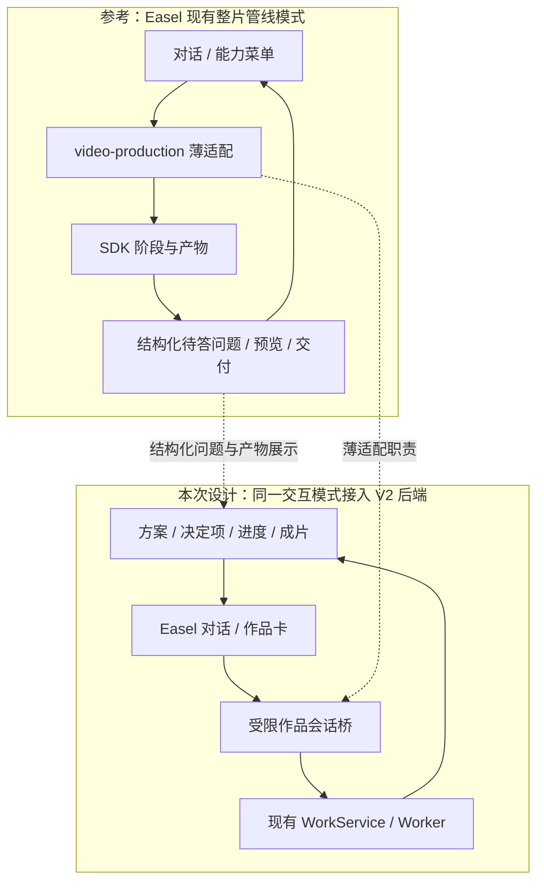

现有 [BrushEntry](../../web/frontend/src/components/BrushEntry.tsx) 的“管线”入口只是预填“用视频产线做一支整片”，能力目录仍标 `incoming`；不能据按钮存在宣称生产已连接。A3 将视频创作入口明确绑定 V2 作品模式，保留其他能力菜单；避免把同一用户意图同时送到旧 SDK 和 V2。旧原片包装能力如需继续独立使用，须有清楚区分的入口及作用域，不与已绑定 V2 Work 混跑。

## 3. 页面组织与完整旅程

沿用 Easel 的聊天主界面、会话历史、画像选择、附件输入、媒体预览与内容库。侧栏的“视频创作”进入作品列表；新建作品打开带视频上下文的对话。普通聊天明确提出制作视频时，可在原对话建立作品草稿；仅咨询视频知识不建作品。作品名可由当前内容建议，随后可改，不阻塞第一句话。

[入口与完整闭环图](diagrams/s6-14a-entry-loop.svg)及[§11](#11-导演频道入口与统一创作闭环)补齐普通对话、频道、导演三种起点；[六步交互分镜图](diagrams/s6-14a-interaction-storyboard.svg)展示讨论、方案、制作、决定、审片与续作。

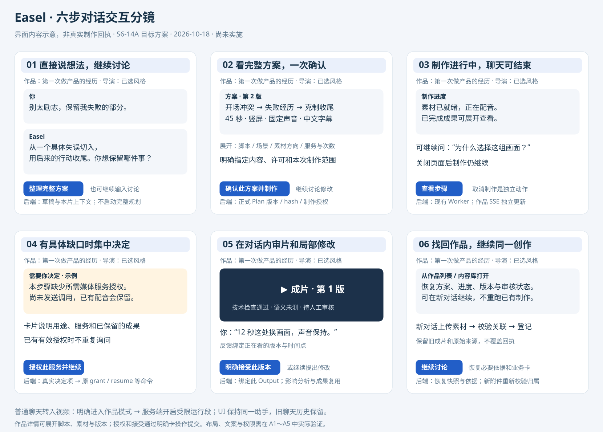

桌面布局草图（交互示意，非已实现界面）：

```text
┌──────────────┬────────────────────────────────┬─────────────────────────┐
│ Easel 导航   │ 当前对话 · 作品名称              │ 作品详情（可收起）        │
│ 聊天 / 作品  │ [画像] [频道] [导演·版本]         │ 方案 / 素材 / 版本        │
│ 画像 / 内容库│                                │                         │
│              │ 用户：把这次经历做成一条短片      │ 当前方案摘要             │
│              │ Easel：建议从这个冲突切入……      │ 展开完整脚本与场景        │
│              │ [完整方案卡 · 版本2]             │                         │
│              │ [讨论修改] [确认方案并制作]       │ 真实制作步骤 / 已有成果   │
│              │ [制作进度卡：正在剪辑]           │                         │
│              │ [成片卡 · 版本1 · 待人工审核]     │ 新旧版本比较             │
│              │                                │                         │
│              │ [附件] 说想法或修改意见…… [发送] │                         │
└──────────────┴────────────────────────────────┴─────────────────────────┘
```

窄窗口把详情改为抽屉；讨论、确认、进度和成片始终能在对话内完成。卡片只展示对用户决策有用的内容，不暴露内部 Run/Task ID、JSON、数据库状态或原始模型思考。

| 时点 | 用户看到/操作 | Easel 与后端如何衔接 |
|---|---|---|
| 开始 | “用这个导演讲我第一次做产品的经历”，附图片/原片 | 带入本片画像和导演，建议方向。明确视频创作意图后建立 discussing 草稿；缺失规格先作为建议，不写成用户硬要求 |
| 讨论 | “别太励志，保留我失败的部分”“再解释一下开场” | 同一创作对话继续；记录事实、观点、禁区与建议的来源。解释不生成新方案、不调用 TTS |
| 整理方案 | “按这个方向整理完整方案” | 使用讨论摘要、已登记附件、有效默认项及规划服务授权，启动现有 Planning；用户未指定的时长/画幅/声音由导演建议并在方案中披露 |
| 修改方案 | “第二段更克制，最后一句留下” | 将反馈与当前方案绑定；明确修改方案才创建新 Plan Revision。旧方案卡标明已被新版本替代 |
| 一次确认 | 在当前完整方案卡点击“确认方案并制作” | 同一确认展示/提交具体方案、固定音色、素材许可、服务及 IMAGE/VIDEO 上限；无需再逐阶段审批 |
| 制作 | 卡片持续更新“寻找素材 / 配音 / 剪辑 / 渲染” | 读取真实快照和 SSE。可展开本步输入、动作、选择摘要、成果；没有证据不造百分比或承诺剩余分钟 |
| 异常 | 卡片解释缺口、已保留成果和可选处理 | 仅有真实决定项才让用户选择；授权/补素材后针对相应任务恢复，UNKNOWN 显示核实中且不重发 |
| 审片 | 对话中播放指定成片，侧栏看版本 | 技术检查、语义检查、待人工审阅分别标明；第五轮显示“技术检查通过 · 待人工审核” |
| 局部修改 | 在版本1上说“12秒这处换画面，声音保持” | 绑定 output_id 和用户明确的时间/场景；后端做影响分析，常规授权内局部修改直接推进，扩大影响/新增费用集中说明 |
| 接受保存 | 明确接受当前所看的版本 | 保存具体输出到既有内容库；人工模式确认完整音画审阅。接受作品与接受导演分别记录 |

**确认方式提案**：首期以版本卡上的明确操作作为保存频道、提交参考拆解、确认风格、生产、追加授权、接受和删除的提交点。自然语言用于讨论、修订与定位目标；例如“可以，按这个做”定位并显示对应版本的确认卡，尚未提交命令，卡上一次明确操作才提交。不得先报告文字已经授权再让用户批准一次，也不得把模型整理的意图当授权。已成功提交的相同动作只展示回执；模糊“不错”“继续聊”不触发写入。后续若支持文字直接完成这些动作，须另做可追溯的语义授权合同及验收。仅进入受限创作模式不授予任何制作权限，不再额外确认频道/导演入口已明确表达的同一上下文选择。

制作时仍可询问进度和讨论新想法。改变冻结内容时先说明受影响范围，用户明确选择停止后续制作并改版，或等首版完成再修改；不在活动 Run 中偷偷改 Plan。输入框“停止回答”只停止当轮对话；进度卡“取消制作”才调用作品取消。

## 4. 前后端职责与 Easel 复用

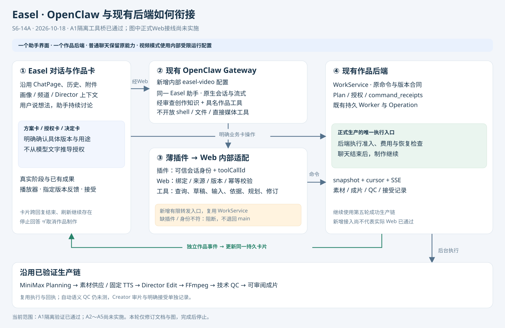

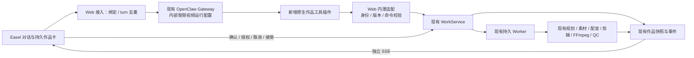

### 4.1 前端

- ChatPage 保持对话容器，提取 ProductionPage 中的方案、设置、进度、决定、成片与版本组件供两处共用；界面里同一状态来自同一 Work 快照。
- 消息支持文字加结构化卡片引用。文字可流式；卡片内容由后端业务记录投影，不能从 Markdown 里解析“完成”“已接受”来更新状态。
- 一段对话可先后关联多个作品，但同一轮只有一个明确的当前作品；输入框和卡片显示目标。打开旧成片回复时绑定那一版，不猜“最新文件”。跨作品切换不带走旧授权、素材权限或个人事实。UI对话可连续，但从已有Work切换到新Work或换画像须建立新的受限原生运行段；同一原生转录不能只靠换workId继续复用。恢复原作品可以恢复其匹配的运行段，失效时以必要可见依据建立新段。
- 画像/频道/导演、声音和字幕等放在上下文条与按需展开控件；依然能精确设置，但不要求逐项填完才讨论。长期默认保存须明确范围。
- 内容库和作品列表都能打开作品，恢复当前方案、进度和版本；无旧聊天时可开启绑定同一 Work 的新对话，无须重跑制作。

### 4.2 聊天与作品接入层（新增适配，非第二套生产编排）

同一个面向用户的 Easel 创作助手负责讨论、解释与调用有限的作品工具。Director 是风格和创作职责，用户不切换聊天 Agent。下述内部受限运行配置与普通聊天共用 OpenClaw Gateway，不增加用户人格、Agent 互相委派或生产编排。规划/选材/剪辑仍由现有任务化模型执行。

接入层组装本片上下文、校验工具参数和业务动作、登记对话引用，并调用既有 WorkService。对话历史用于理解；已确认方案、授权与实际运行记录决定能做什么。普通聊天回复结束只代表本轮回答结束。

**当前 OpenClaw 接入要求**：复用其已有会话、流式输出、附件理解和创作对话能力，作品会话仅开放受限的作品查询/草稿/规划/修订工具。必须在工具注册、执行权限及凭证访问上实际禁止该会话绕过后端运行旧视频生产脚本、任意 shell 或直接调用媒体 Provider；仅追加“请使用 V2”提示词不构成通过。现有 Easel 尚未接入按作品切换权限的能力，不能视为已具备。研究后推荐复用 OpenClaw 原生指定 Agent 路由和静态工具白名单，增加内部 `easel-video` 运行配置与薄工具插件，具体见下文。先用假服务验证实际工具、启动上下文和失败路径；不以配置声明代替通过证据。

API 直连目前只有文本/图片对话，不具有完整技能执行。若后续支持它，须明确实现有限工具调用和回放；不能把“与 MiniMax 共用配置”写成“已复用 Easel 全部创作能力”。本任务先覆盖当前实际 OpenClaw 入口，其他 Harness 的兼容性逐个记录。

### 4.3 具体沿用什么

| Easel 能力 | 本方案复用方式 | 接入限制 |
|---|---|---|
| 聊天、历史、流式回复与问答卡 | 保留现有交互与回放，增加作品引用和卡片 | 正文不是权限记录；重连不重新执行工具 |
| 六维画像与频道/导演目录 | 通过现有读取/目录服务组装上下文 | 使用全部必要六维；旧创作指令“制作不读 platforms”与 V2 要求的差异需显式适配；无画像不读取其他画像 |
| 技能的叙事、脚本和视听知识 | 经审查的相关知识片段供讨论和规划使用；保留来源和版本 | 不把旧技能的独立出片、输出目录、重试或发布流程全量塞入 V2 |
| 附件、媒体读取与预览 | 会话上传→校验归属→登记本片输入→媒体证据 | 允许看附件不等于已获制作权；参考视频风格分析不授予复用素材权 |
| 配音、字幕、剪辑等媒体工具 | 已有生产 adapter 优先；需要补工具时由 worker 包装受控调用 | 不让聊天与 worker 各出一片；不能静默换掉第五轮成功的供应/渲染实现 |
| 选题、画像编辑、非视频技能 | 继续走 Easel 现有功能；作品内需调用时声明作用域 | 修改长期画像、发布等不能由本片确认推导授权 |

研发 AGENTS、Git/Task 清单与个人调试资料不得进入产品创作上下文。产品 AGENTS 里与 V2 冲突的旧工作流也不能不加区分地继承。实际加载清单、工具权限和跨画像隔离都作为后续运行验收项。

### 4.4 OpenClaw 研究结论与方案选择

研究核对本机已安装 **OpenClaw 2026.9.4（3a9d69d）/ Node 24.21.0**、当前实际配置的非敏感字段、Easel 调用源码及 OpenClaw 官方文档。没有加载凭证正文、修改配置、安装插件或运行模型。该研究之后已完成 A1 的隔离原生组合验证，见 [A1 结果](tasks/S6-14A_conversation-integration.md#2026-10-18--a1-隔离原生验证结果)；正式生产入口仍未接入。以下研究事实保留：

| 核实依据 | 已知事实 | 对本方案的影响 |
|---|---|---|
| [Easel 聊天入口](../../web/app.py)：`_production_chat_command`、`_run_gateway_http` 及 CLI fallback | 有 workId 时先短路为 plan/revise；普通请求用 `openclaw/default`、`agent:main:...`，CLI 同样固定 main | 替换短路；HTTP/CLI/问题桥/历史解析共同使用服务端保存的运行绑定，不能只改一个 model 字段 |
| 当前实际 main 配置；[同步脚本](../../agents/sync.sh) | main 具有 shell、文件和直接媒体工具；同步脚本向其工作区复制全量技能，并附项目根和画像/输出访问说明 | 不复用该宽权限执行环境；普通 main 保留，新作品配置使用受限工具和经审查的产品上下文 |
| OpenClaw 安装包文档 `gateway/openai-http-api.md`；[官方 HTTP 合同](https://docs.openclaw.ai/gateway/openai-http-api) | 可显式路由到指定 Agent，并固定会话；现有 HTTP 流式入口可沿用 | 目标 `openclaw/easel-video`，服务端固定 `agent:easel-video:<runtime_session_key>`；不换 Gateway、不换聊天底座、不指定替代生产模型 |
| 安装包文档 `plugins/tool-plugins.md` 与 SDK `OpenClawPluginToolContext`；[官方工具插件](https://docs.openclaw.ai/plugins/tool-plugins) | 工具 factory 可读取运行时 agentId/sessionKey/sessionId；execute 有 toolCallId | 注册受限、具名作品工具；身份来自运行时和服务端绑定，不让模型传任意作品范围或命令 ID |
| 安装包tools目录中的 `multi-agent-sandbox-tools.md`；[官方工具策略](https://docs.openclaw.ai/tools/multi-agent-sandbox-tools) | 工具策略/工作区可按 Agent 配置；这不等于 Easel 已有动态逐会话白名单 | 首期选择固定受限配置，减少对自定义逐轮拦截的依赖 |
| 本机插件 SDK 的 Agent/Tool hook context 与 `agent-tools.before-tool-call` 实现 | hook 有原生 runId/工具调用身份；factory 的会话信息本身没有 Web turn_id；执行前 hook 可阻断 | 插件采用工具+最小生命周期 hooks 的混合入口，绑定原生运行与 Web turn；仅按当前 session 找 turn 会误接晚到工具。所有入口覆盖仍待验证 |

**推荐方案：同一 Gateway 内的受限运行配置 + 一个原生作品工具插件 + Web 内的薄命令适配。** `easel-video` 是内部配置名，继承同一 Easel 助手表达与经审查的创作知识，Director 仍来自作品设置。它不是新增产品人格或第二个导演，不另起常驻服务，也不要求用户选模型。

| 候选 | 复用程度与代价 | 结论 |
|---|---|---|
| 旧 Skill 用 exec 调 V2 HTTP/脚本 | 最少封装，但 main 仍可绕过 API 直接生产，启动上下文也宽 | 不作为作品接入方案 |
| main 动态逐会话工具/启动上下文过滤 | 保留原生 main 转录，但须同时覆盖工具、bootstrap、自动能力和所有恢复入口 | 保留候选；当前 Easel 未接线，不将其写成现成功能 |
| 内部受限配置 + 原生工具插件 | 复用 Gateway、会话、流式、模型和工具 SDK；明确白名单与独立启动上下文 | **已通过 A1 隔离 HTTP/CLI 验证，待 A2 持久化与正式入口接线** |
| 新建聊天服务/另做生产 Agent | 重复上下文、权限和生产恢复职责 | 当前没有必要 |

受限工作区只含产品人格、V2 作品协议、已审查创作知识；无仓库根研发 AGENTS、`.env`、全画像目录、outputs 软链或旧产线执行指令。所选六维画像、导演版本、附件证据由受控上下文接口提供。默认不开放 read/exec/process/browser、任意网络/文件工具、直接媒体插件、会话委派、发布及全局画像写入；所需知识/输入读取通过限定句柄的作品工具完成。还须核对内建 slash 命令、自动记忆/检索、自动媒体和启动注入；工具清单不是全部边界。

这是一条防止模型绕过业务权限的能力边界，**不是已验证的 OS 或凭证物理隔离**。Gateway 本身仍需要聊天模型凭证，OpenClaw 文档也说明部分授权可能读取默认 Agent 配置；不能宣称内部配置天然消除了所有凭证继承。插件不向模型返回任何凭证，Worker 的制作凭证不进入作品上下文；A1 用替代值验证无文件/网络/Provider 旁路，不能暴露真实 Key。若无法限制启动注入或隐式能力，A1 判失败并报告，不能开放 main 兜底。

### 4.5 运行绑定、工具与后台状态如何连接

1. Web 在调用 OpenClaw 前，持久接受 turn 并保存 `chat_session → runtime_agent/runtime_session` 绑定，以及本轮固定的 Work/Output/版本/画像范围。模型正文中的 ID 不是权限来源。受限配置健康检查通过后才派发；既有普通聊天不静默换运行历史。
2. 显式视频入口从首轮使用受限配置。普通聊天提出制作意图时，先展示方向和“进入视频创作”；该明确动作在原 UI 对话开启受限运行段，只带本片必要的用户可见消息、附件引用及来源。旧 main 转录保留，原生运行段分开，后续按持久绑定取历史；切换失败不在 main 执行制作。此处产品交互需要评审，不能假称原生 transcript 无缝迁移。
3. 原生插件负责具名工具的参数解析、通过最小生命周期 hooks 关联可信原生 run 与 Web turn、向 Web 内部适配入口转发并返回回执。服务端再检查绑定、动作、版本、附件和命令身份，然后调用现有 WorkService。插件与 Python 服务分进程，因此这里有一层本地传输适配；不另建生产 HTTP 服务。
4. 多轮讨论不触发完整 Planning。明确“整理方案”时将有来源的创作依据与 input handles 交给后端，正式 Plan 仍由现有 MiniMax Planning 生成。缺规划授权时复用现有 needs_decision/grant/resume 路径，呈现具体服务授权卡；聊天模型授权不能替代它。方案卡确认时一次提交制作授权。
5. 工具拿到持久回执后结束当轮，不等待整片完成。前端用既有 snapshot/cursor/SSE 更新持久卡片；不依赖插件 delivery，后者只适合活跃回合且在 Gateway HTTP 场景可能不可用。关页后 Worker 继续，重进取快照即可。
6. 修订绑定用户所看的具体 Output，复用既有 revise/影响分析/授权；已有输入不能在活动 Run 中追加。制作中的新素材暂存为未提交建议，等完成或明确取消后再登记，不能自动取消或改冻结方案。

跨会话续作时，服务端验证新会话可关联该作品，并保存附件自己的上传来源；不能覆盖 Work.source_session_id。现有 `_input` 只接受原会话附件，因此须增加“已关联会话可提交本会话附件”的受控检查，继续保留路径、hash、symlink 和用途/Rights 校验。这是必要后端增量，不是前端传一个 workId 就已支持。

### 4.6 首期范围与复用清单

| 直接复用 | 必要适配 | 首期不新增 |
|---|---|---|
| OpenClaw Gateway/模型配置/流式/会话；Easel ChatPage、附件上传、画像和导演目录 | 内部受限运行配置、产品上下文装配、原生工具插件及其本地转发 | 新聊天服务、独立编排 Agent、第二个生产队列 |
| WorkService 命令、版本校验、command_receipts、Operation 准入与 Worker | 服务端运行/作品绑定、聊天入口去重、稳定工具命令映射 | 全量聊天副本、让每个制作 Task 重读完整对话 |
| Planning、素材、固定 TTS、Edit、FFmpeg、QC、Artifacts | 有来源的 brief 快照引用、跨会话附件归属 | 替换成功的生产 Provider/渲染器、重接旧 SDK 出片 |
| 现有 snapshot/SSE、ProductionPage 业务组件、媒体与版本接口 | 持久作品卡、侧栏、业务决定 action adapter | 用 Gateway question.resolve 代替制作授权 |

首期一个对话只设置一个当前作品；历史卡仍固定原作品/版本。后端关联信息允许保留多个历史关系，但不先做复杂多作品调度器。新对话续作可以恢复冻结依据和真实业务卡，不承诺找回已删除的全部聊天正文。数据/API 的精确候选字段和工具映射见[实施合同 §9](15_IMPLEMENTATION_DESIGN.md#9-s6-14a-对话接入增量提案待评审未实现)。

## 5. 前后端交互时序

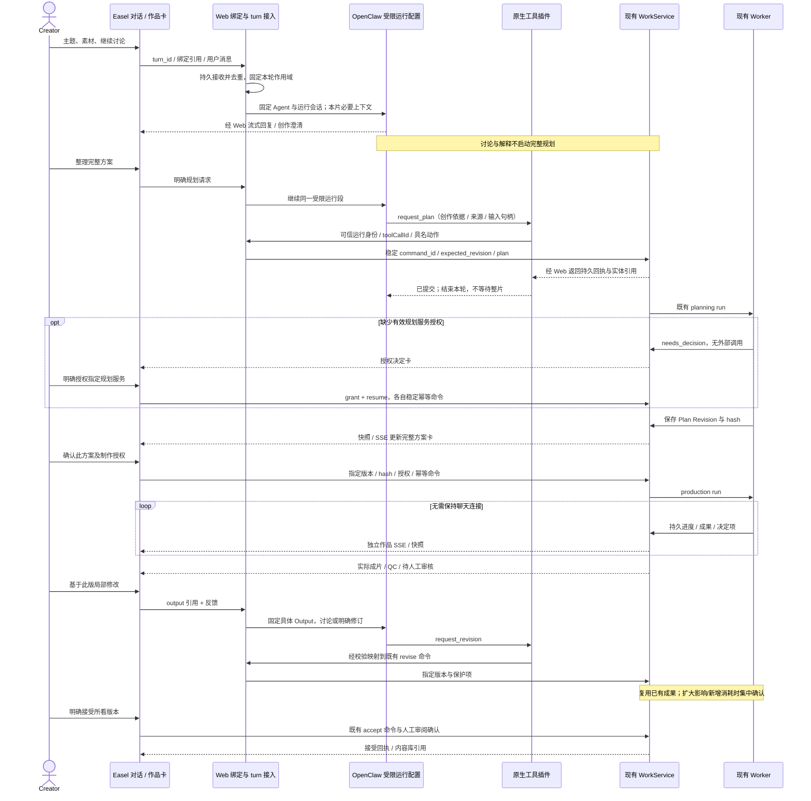

## 6. 上下文、卡片与状态规则

### 6.1 讨论如何进入规划

每项创作依据区分“用户明确”“画像/频道默认”“导演建议”，保留所来自的消息或设置版本。摘要包括主题、事实/核心观点、风格、必用/参考素材、声音保护、规格及未决项；用户更正覆盖旧的同一要求，但保留来源。普通闲聊、其他作品、推理过程不进入生产输入。

Planning 读取确定的摘要版本及有效附件句柄，而不是让下游模型重新猜整段聊天。摘要不是第二份画像，也不是授权。形成完整 Plan 后，方案卡与展开脚本都读该 Plan Revision；确认后以冻结方案为准。用户只要求解释时不修改摘要或生成新版本；内容有实质变更才使旧提案的确认操作失效。

### 6.2 关键卡片

| 卡片 | 必须显示 | 可执行动作 |
|---|---|---|
| 创作方向 | 具体构思、引用的画像/导演、关键缺口 | 继续讨论、补附件、整理方案 |
| 完整方案 | 摘要、可展开脚本/场景、规格、声音/字幕、素材方向、服务/补料次数、待解决事实 | 自然语言修改、一次确认当前版本 |
| 制作进度 | 当前动作、已完成成果、最近更新时间；断连单独提示 | 展开步骤、询问、取消制作 |
| 需要决定 | 具体原因、受影响部分、已保留成果、可选解决办法及新增消耗 | 仅显示当前合法动作；不固定要求每次先“追加额度” |
| 成片版本 | 实际视频、版本、技术/语义/人工审核状态、署名导出 | 定位反馈、比较、接受、基于此版新作 |
| 修订影响 | 变化范围、保护项、复用项、所需新增调用 | 正常局部直接执行；需要确认时同卡集中处理 |

原始异常、模型内部推理和所有工具日志不作为进度正文。Agent 可以解释已存在的事实，不能把缺失的选择依据补写成实际发生过的决策。

### 6.3 作品状态与聊天状态分开

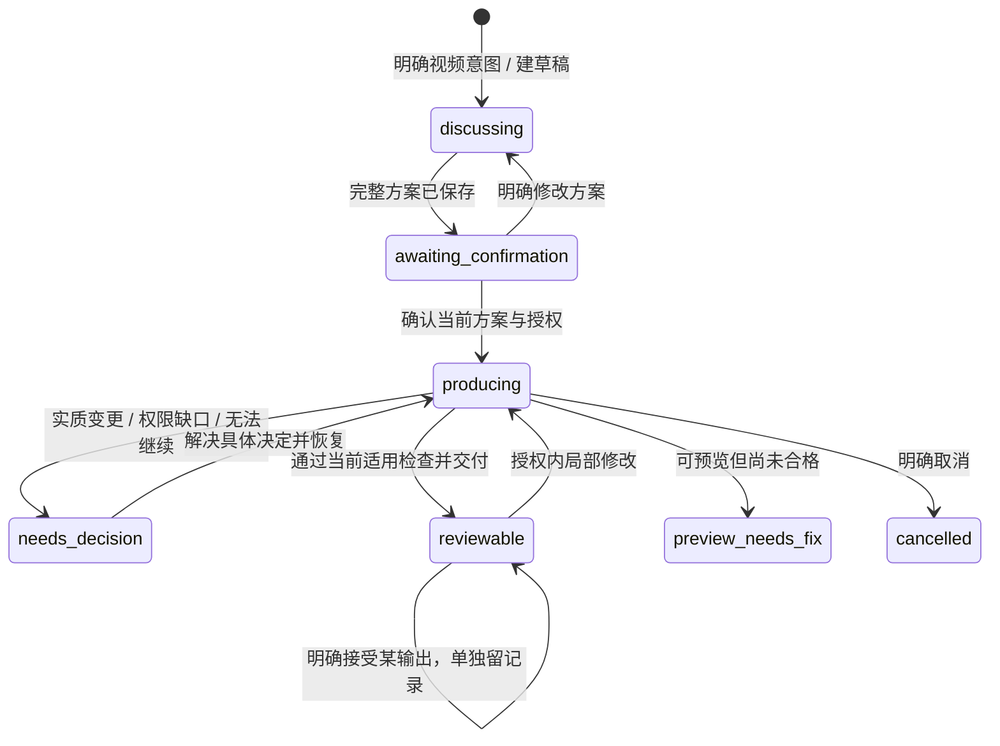

此图是交互主路径，非后端全部合法转换表；执行仍以实施合同和 WorkService 为准。语义 QC 未测的人工模式保留 `needs_fix` 质量事实，并显式交人工审核，不能因 Work 可审阅而标成“完整自检通过”。

## 7. 刷新、冲突和异常场景

| 场景 | 预期行为 |
|---|---|
| 刷新/关页/聊天回复停止 | 作品后台继续；重开先取 snapshot/cursor，再续订事件；不重新发 plan/confirm/revise |
| 命令已落库但响应丢失 | 保留原 command_id 和请求内容，查询或原样重放取回执；不得自动造新 ID |
| 两个窗口同时确认 / 旧方案卡被点击 | 后端检查版本和 hash；重复原命令返回原回执，过期内容409并刷新卡片；不自动替用户确认新版 |
| SSE 重复、迟到或旧 Run 事件 | 按 work/seq 去重，核对当前 run/revision；旧事件留历史，不覆盖当前阶段 |
| 多轮讨论/多作品切换 | 串行处理同一会话变更；每条消息固定目标，其他作品的旧结果不会改变当前输入框目标 |
| 生成或模型结果未知 | 展示待核实及已有成果；由既有操作核验流程处理，不将“继续”解释为重发 |
| 后端版本过期 | 显示服务需要更新，拒绝新的生产命令；客户端不通过自动重试绕开503 |
| 删除聊天/浏览器清缓存 | 作品仍在作品列表，已接受输出仍在内容库；新聊天可绑定原作品。删除聊天应清除相应聊天正文副本并撤销可继续对话的绑定；在途/待核实调用的最小身份与命令映射保留至核实完成，禁止晚到工具继续写入，保留已被方案引用的必要业务证据 |
| 用户撤销/取消 | 分开“停止回答”“取消后续制作”；已提交的外部请求继续按原 Operation 收存，不承诺撤销费用 |

## 8. 实施顺序与本次交付边界

新增任务 [S6-14A](tasks/S6-14A_conversation-integration.md) 按以下次序推进：先验证 OpenClaw 受限工具与上下文接入，再接通会话绑定/命令/事件，接入对话卡片与作品侧栏，最后以离线假服务跑完整交互和回归。每一步都有可观察验收，不能只实现外观后标“对话式创作完成”。

第五轮现有成片可用于只读播放器和卡片验证；不改其 Plan、Operation 或接受状态。未来真实 Web 创作验收需具名授权，且不能套用第五轮 API 证据。A1历史隔离验证保留，本轮A2～A4已完成软件验证，下一事项为A5完整交互验收；Creator 可同时审阅第五轮成片。

## 9. A1 实际验证与后续边界

用户批准后已执行隔离原生 A1，详细结果只维护在 [S6-14A](tasks/S6-14A_conversation-integration.md)。已实现未挂载的 WorkToolBridge、三个具名工具与原生运行 hooks、受认证的插件 status 和隔离探针；复用现有 WorkService，未改变正式后台生产。整体七工具、持久绑定、问题桥与对话卡仍为后续设计。

两项运行事实已修订实施合同：不能假设 x-openclaw-session-id 被本版本采用，需从可信钩子绑定原生 UUID；HTTP /health 成功不等于作品插件就绪，派发前必须核实受认证的插件 status。实际拓扑是临时 Gateway/临时工作区/假模型/临时数据库，图中的正式 UI 和现有主 Gateway 尚未启用新配置。

## 10. 创作结束后的闭环与回写（2026-10-18补充设计）

本节按用户补充“创作完成后如何闭环、结合 Easel 本身的回写设计”核对当前源码。**闭环包含作品交付、创作经验和可选发布复盘三部分。** 其中作品运行事实应自动登记，长期偏好须明确保存，发布与数据抓取按另外的明确任务执行；三者不能用一个“完成”状态替代。本轮仅补设计，不改代码/配置、运行画像写入、接受成片或发起发布。

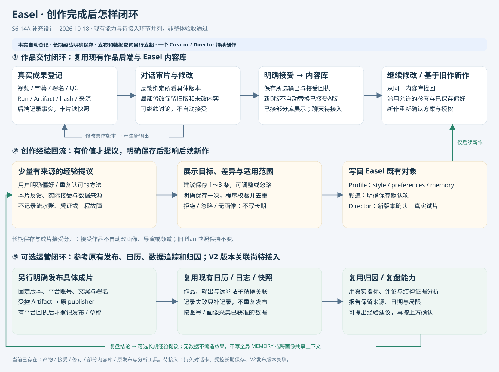

### 10.1 Easel 原生设计实际怎样收尾

| 原生依据 | 已存在的机制 | V2 如何复用/适配 |
|---|---|---|
| [元数据契约](../SKILL-SPEC.md#元数据契约easeljson)、[manifest.py](../../skills/shared/scripts/manifest.py) | `.easel.json` 的展示头包含 title/summary/kind/cover/deliverables；跨层 steps 保存产物路径和一句结论，brief.md 保存关键决策，失败也登记 | 保留“产物+简短依据”的交接形式，V2业务权威仍是 Work/Plan/Artifact/事件；不额外复制一套运行状态 |
| [video_pipeline.post_deliver](../../skills/builtin/video-production/scripts/video_pipeline.py) | SDK成功后抽封面，更新“视频产线”项目卡与成品/QC/设计表引用；错误仅提示，属于 best-effort 收尾 | 借鉴完成后的项目卡刷新；封面/索引失败可补建，不能再制作整片。该包装器直接写的“已完成”与 manifest 的 draft/ready/published 枚举不同，不能照搬状态语义或当 Creator 接受 |
| [原生内容库扫描](../../web/app.py)、[OutputsPage](../../web/frontend/src/components/OutputsPage.tsx) | 旧项目来自 outputs目录与展示头；当前页面另取 production/library 显示“已接受的视频作品” | 接受后进入同一内容库已有部分实现；应增强同一页面的版本/继续创作入口，避免复制受管视频到旧目录制造第二份成品 |
| [Artifact登记](../../easel/production/artifacts.py)、[WorkService._accept](../../easel/production/service.py)、[版本修订](../../easel/production/revisions.py) | 文件/hash/依赖与事件、指定Output的reviews、独立acceptances和accepted_output_id已存在；新版本不自动替换已接受版 | 制作与审片事实自动持久化，明确接受只改变所选版本；前端卡片和内容库读取同一记录 |
| [产品创作规则“素材与画像”](../../agents/workspace/AGENTS.md)、[画像管理技能](../../skills/builtin/skill-profile-manager/SKILL.md) | 结束时仅有可复用内容才提炼1～3条，说明目标文件；同意后增量/去重写入 preferences/style/memory，拒绝/忽略/无画像不写 | 对话中提供“保存长期偏好”卡，复用六维画像与现有编辑原语；不能把每次完成/接受自动变成画像更新 |
| [发布记录入口](../../skills/shared/scripts/calendar_ops.py)、[publish-log](../../skills/builtin/skill-publish-log/scripts/log.py)、[Web发布流程](../../web/app.py) | 某些发布脚本成功后记日历并 best-effort 转发发布日志；Web发布页禁用脚本重复记录后自行写日历；日志默认record是追加，不提供V2输出级幂等 | 复用日历/日志底座，补具体作品/输出/账号/平台回执关联；必须选一个记录入口，补索引失败不重新发布 |
| [发布分析](../../skills/builtin/skill-publish-analytics/SKILL.md)、[数据追踪](../../skills/builtin/skill-data-tracker/scripts/track.py)、[单条复盘](../../skills/builtin/skill-content-postmortem/SKILL.md)、[月度复盘](../../skills/builtin/skill-social-performance-review/SKILL.md) | 分析消费已有发布日志/时序快照；分析本身不写画像。月度技能另约定更新context/best-performers.md/review-history.md | 复用计算与解读方法；报告绑定本片/当前画像，长期结论另经明确确认。旧共享context路径不直接用于多画像V2回流 |

这是源码与规则核对，不是本轮发布/归因的运行验收。原生 Skill 的“Agent按规则写回”与“程序已有可靠、幂等的自动回写”须分开表述。

### 10.2 作品交付闭环：完成、反馈、接受、复用

1. Worker 结束时，程序登记真实成果、依赖、hash、QC与任务结果；作品进入可审阅或待修预览。聊天卡由快照投影“已完成什么、当前检查与下一动作”，不需要再调用 OpenClaw/模型来制造一个完成状态。
2. Creator 在成片卡审阅。普通讨论保留为本片上下文；明确要求修改时，使用现有 reviews 绑定具体 Output 和反馈，产生修订影响/新版本。笼统的“不错”不变成接受或长期偏好。
3. Creator 明确接受具体版本后，使用现有 accept，写 acceptance 和 accepted_output_id，内容库读取该输出；自动语义QC未测的事实继续保留，即使人工审阅已通过也不改写成自动语义PASS。无需再次给旧成片盖一次“生成完成”的章。
4. 后续生成B版时，已接受A版继续留作内容库最终选择，直到用户明确接受B；“最新输出”“已接受输出”“已发布输出”分别指具体版本。
5. “继续修改此版”与“基于此版新创作”分别走现有 revise/fork。新作品可读取被允许的参考与已保存默认项，不继承旧付费授权、发布权限或整套素材使用权。
6. 只完成制作/人工接受即可结束本次创作任务。发布、复盘和长期记忆保存可另选，不成为交付或接受前置；没有可复用经验时不显示强制收尾问卷。

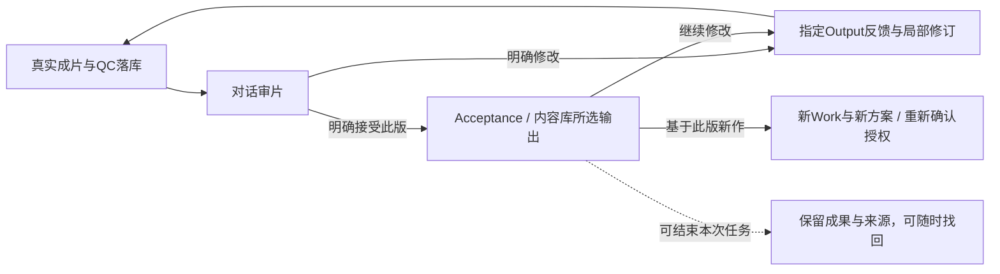

### 10.3 需要写回什么，谁可以写

| 信息 | 写入时机与目标 | 确认/复用规则 |
|---|---|---|
| 实际生产结果、QC、引用、调用与费用回执 | 事件发生时由现有服务写 Work/Run/Task/Operation/Artifact；卡片/内容库自动刷新 | 程序记录事实，无需再批准一次；聊天文字不能补造PASS或回执 |
| 对当前版本的修改意见 | 明确修订时写本片reviews；普通解释/讨论留在本片必要转录和依据 | 自动记录本片事实，不升级为长期画像；修订所需权限沿用既定规则 |
| 最终成片选择 | Creator明确接受时写acceptance；保留历次选择来源与旧输出 | 不因Run成功、导出或下载自动接受；复用既有命令幂等 |
| 个人长期表达偏好/红线 | 先提议，显示1～3条与目标 Profile 文件；用户明确保存后更新style.md/preferences.md | “这次结尾克制”默认仅本片；“以后都这样”先定位具体目标和变更，不推断身份/经历 |
| 有依据的历史经验 | 用户明确保存后增量写当前 Profile 的memory.md，带来源/日期/适用限制 | 已验证的发布表现与结构性猜测分开；不写全部对话、工程日志、凭证或全局MEMORY.md |
| 频道的声音/字幕/创作默认项 | 用户选择“保存为此频道默认”后，复用频道设置版本化更新 | 不顺带修改画像或其他频道；已冻结作品不随默认变化 |
| Director可复用叙事/视听风格 | 保存风格候选新版本，沿用现有参考依据→风格确认→实际使用该版本的试片→明确接受 | 成片接受不等于导演接受。不能用未使用新版导演的旧成片冒充新版试片，不自动重做付费试片或替换频道默认 |
| 工程问题/Provider失败、花费、UNKNOWN | 原Task/Operation/工程问题记录 | 不把后端故障或一次性调用参数写进用户创作画像/导演规则 |
| 发布事实、平台数据和复盘报告 | 另行明确发布/查询任务取得实际回执后，写既有发布/快照底座并保存范围内报告引用 | 未发布不造日志；无数据只作有标注的结构分析；报告不直接改画像 |

**模型提出语义结论，程序执行受控保存。** 沿用 Easel“先提出、用户同意、增量写入”的规则，不向A1受限助手开放任意文件编辑或profile写工具。现有 [画像文件编辑API](../../web/app.py) 已有原子替换原语，但没有本片学习提议/来源/CAS/幂等合同；接入时需补一层明确卡操作，不能直接认为“已有PUT”等于闭环已完成。

有用经验可以来自当前审片，不必等发布数据；效果归因则必须有真实数据或明确标为未验证。提议可由当前创作对话顺带整理，或者用户主动要求“总结本次经验”；不在每次完成后自动启动额外付费模型或后台学习任务。用户拒绝或忽略后，本片反馈仍保留，长期文件不变；没有画像时不创建全局替代记忆。

### 10.4 用户在对话中实际看到的收尾

| 场景 | 对话卡/操作 | 真实写入 |
|---|---|---|
| 首版完成 | 播放器 + “技术检查通过/语义未测/待人工审阅”，操作“修改此版、接受此版” | 已有成果/QC与运行事实，不写接受 |
| 接受成片 | “已保存到内容库 · 版本1”，操作“继续修改、基于此版新作、下载” | Acceptance及业务卡刷新，不自动发平台 |
| 本次存在可复用偏好 | 可选卡：“建议记住：表达保持克制，避免鸡汤式结论。目标：当前画像preferences.md；用于之后的新作。”操作“保存这条、调整、不保存” | 只有明确保存后才增量更新该文件并返回回执；其他收尾不等待它 |
| 用户调整了导演风格 | 说明“本片变化”与“保存新导演版本”的差异；选择后沿用已有导演确认/试片流程 | 仅另存确认的新版本；当前成片/旧导演不覆盖 |
| 用户另行要求发布 | 定位某个已接受输出，确认平台/账号/文案/署名及发布动作，转现有发布能力 | 有实际平台回执再登记；草稿箱保存与公开发布分别显示 |
| 有真实效果数据后要求复盘 | 展示数据日期/来源、发现与局限，再给“下次创作建议/保存长期经验”选项 | 报告引用自动保留；长期更新仍按明确保存处理 |

删除聊天不删除作品、已确认长期条目或发布回执；各自用原有对象的删除入口和影响检查。删除/撤回学习提议不撤销实际发布或成片接受。若用户要撤销已写偏好，展示当前文件差异再增量修改，不恢复整个旧文件覆盖后来的有效内容。

### 10.5 发布与归因如何接原设计：明确当前缺口

**当前“内容库可见”已经部分接通，“从V2成片直接进入原发布流程”尚未接通。** OutputsPage 已读取 production/library；但 PublishPage 的媒体选择仍从 fetchOutputs 目录树递归取文件，且旧 `_safe_output_path` 明确禁止访问受管的 works/_production。因此不能通过写一个 `.easel.json`、传内部路径或复制到普通目录来冒充接通。

另一个实际差异是导演试片资格：作品接受支持条件受限的人工审片模式，设计时Director接口只允许quality_state=passed；本轮A4已补齐受限人工资格及独立回执，离线正反例通过，仍未用正式成片执行导演接受。保存经验或作品接受不能自动接受导演，QC事实不被改写。

后续推荐增加受控的“已接受Artifact → 发布输入”适配：由程序验证具体 output/digest、可见范围、用途和署名，固定发布请求所用字节后交给原publisher。原发布能力继续负责平台适配、登录、检查和明确发布；不把原publisher的shell/browser权限交给作品聊天模型。若平台需要转码/改版，产物另登记，不原地改接受版本。

发布回执应关联 Work/Output、发布时接受选择、Profile/平台账号、平台post/draft ID或URL与时间；重复成功回执只补记录，不再调用publisher。当前原生日历/日志多数是best-effort或追加写，Web与脚本的回流分支也不同，不具备这套完整关联/去重保证。后续只在兼容适配处补关联，不另造一套指标库。记录失败显示“发布已成功，记录待补”，不能因此把同一视频再发一次。

后续复盘按账号/画像和具体发布记录取 `skill-data-tracker` 快照、publish-log和评论证据；复用归因/复盘计算，生成本片或所选范围的报告，再进入可选长期保存。旧复盘SKILL的共享context文件、无画像时全量发布日志查询、OpenClaw全局记忆，都不能直接成为V2的跨画像回流路径。多个版本分别发布时，指标绑定实际发布版本，不能把A版数据自动归给后来接受的B版。

本节明确衔接目标，不自动新增公开发布、平台抓取、定时追踪或后台学习任务。S6-14A先闭合“作品→审片/接受→同一内容库→继续创作→可选保存长期项”的交互与引用；发布/归因的实际接入按后续具名任务与授权执行。

### 10.6 纳入 S6-14A 的实施与验收

- A2：保留本片交付/反馈/接受的实体引用、冻结依据和可选长期保存提议的来源；可恢复，不复制全量聊天或运行日志。
- A3/A4：共用已接受内容库组件，增加从具体输出回到对话/比较/修订的入口；交付卡与长期保存卡独立，不把保存记忆变成接受前置。
- A4：复用Profile/频道/导演既有编辑能力，补明确目标/差异/来源/版本/幂等回执。新增长期写入不作为模型自由工具，不随A1插件自动启用。
- A5：验证完成不自动接受/发布/改画像，接受A后制作B不替换A，忽略提议不写长期文件，重复保存不重复追加、并发编辑冲突不覆盖、无画像/跨画像拒绝、频道与导演升级不影响历史快照；发布日志失败不重发作为后续适配验收项保留。

精确候选字段与恢复规则仅在[实施合同 §9.7](15_IMPLEMENTATION_DESIGN.md#97-交付闭环与长期回写补充提案未实现)维护。A1已有通过证据保持原范围，不因补充闭环设计宣称这些新交互已实现。


## 11. 导演、频道入口与统一创作闭环

**2026-10-18补充设计；本轮A2～A4已按下述流程实现并做具名隔离验证。** 依据已确认的 V2-EXP-019/020/028：频道回答“以谁的身份、面向什么内容和受众”，导演回答“如何叙事和呈现”，对话回答“这次具体做什么”。三种入口汇入同一个 Easel 创作对话、同一个 Work 后端；不要求先建频道、先建导演或先填完制作表单。入口选择仅带入上下文，不等于授权分析、制作、接受或发布。

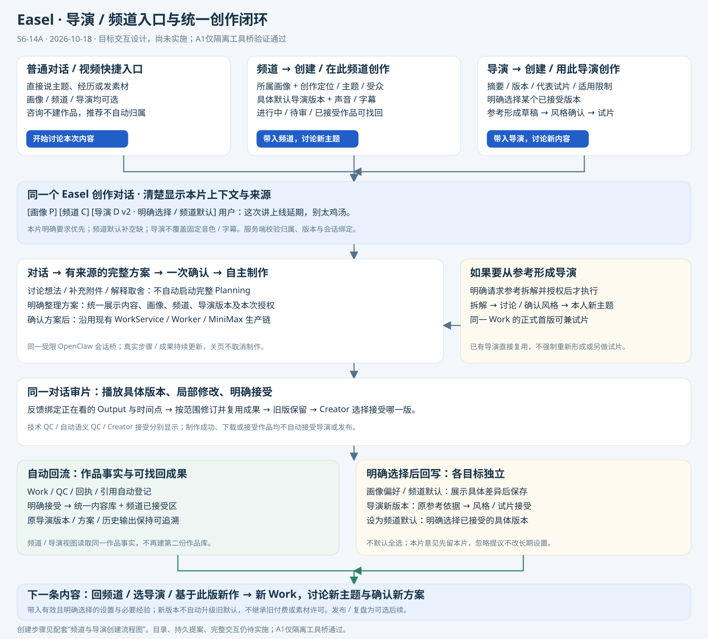

### 11.1 入口要展示什么，点进去发生什么

以下为目标界面，不声称已有独立频道/导演页面。沿用现有导航、选择器、媒体卡和对话容器组织入口；无需增加第二个聊天产品。

| 入口 | 用户先看到什么 | 主操作及进入对话后的行为 |
|---|---|---|
| 普通对话 / 视频创作快捷入口 | 当前画像可选；可选频道、导演；可直接输入主题或附件 | 明确制作意图后创建本片草稿；咨询不建 Work。推荐频道/导演只作建议，不自动归属或保存 |
| 频道列表 → 频道详情 | 所属画像、创作定位/主题/受众、默认导演的具体版本、声音/字幕默认；进行中作品及已接受作品分区 | “在此频道创作”打开新创作对话，带入所属画像和频道默认，先讨论本次内容；“继续某作品”恢复指定 Work，不取列表第一条代替 |
| 导演列表 → 导演详情 | 名称、风格摘要、已接受版本、对应代表试片、参考依据/适用限制；草稿与已接受版本分开 | “用此导演创作”固定用户看到的已接受版本，进入新对话；画像/频道可选。不借用导演参考人物、其他频道经历、付费额度或素材许可 |
| 导演草稿详情 | 拆解依据、待确认风格/待试片/待接受的实际状态 | 按状态显示“继续讨论风格”“用新主题试片”“审阅试片”；不将未接受草稿伪装成可设默认的导演 |
| 作品列表 / 内容库 / 频道历史 | 具体作品、制作状态、所选成片版本与原导演版本 | “继续创作”恢复原 Work；“基于此版新作”另建 Work。打开历史时不套用今天的频道默认或最新导演 |

频道和导演详情可各自管理，但创作主操作始终回到对话。内容库仍是已有统一内容库；频道历史是按归属筛选的作品视图，导演详情通过实际 Plan 的导演版本引用展示使用作品，不再建一份作品库。代表试片来自导演接受记录，不能用最近使用该导演的作品自动替换。

### 11.2 从频道开始：设置、创作、再回到频道

频道创建与导演形成的完整操作对照见下图；两条路径都可以从目录按钮或自然语言进入。

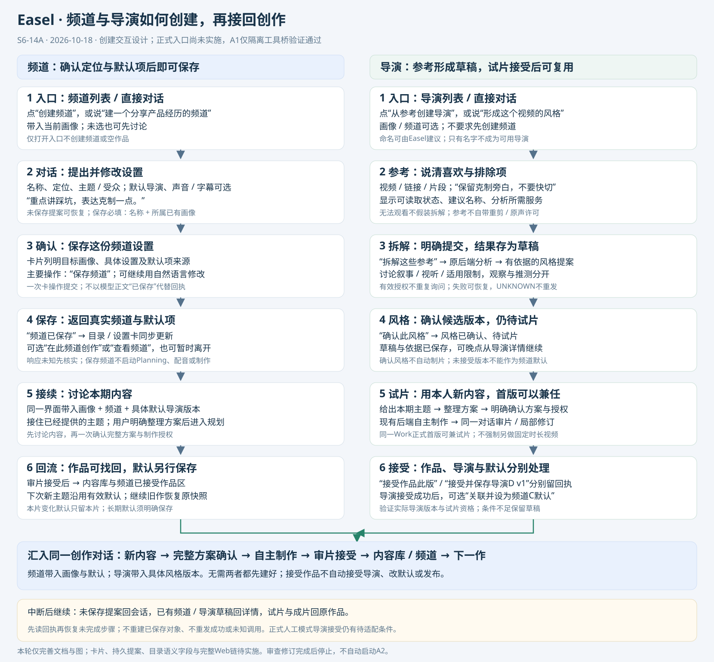


1. 已有频道：点击“在此频道创作”，对话顶部立即显示“画像P · 频道C · 导演D v2（频道默认）”。首条引导为“这次想讲什么？可以直接发经历、主题或素材”，不重复询问已有效的默认项。
2. 新建频道：用户说“我想建一个分享产品经历的频道”，先形成简短设置提案：名称、创作定位、主题/受众及可选默认。展示所用画像，明确“保存频道”才调用既有 catalog 命令；不强制平台账号、发布计划或先选导演。没有画像可继续临时创作，保存有归属的频道前需选已有画像或走原画像创建入口，不能暗建人设。
3. 同一对话继续说本期内容；频道自然语言定位作为有来源的默认创作依据，本期明确要求优先。无默认导演可推荐已有导演，或者按本期内容创作；也可走 §11.3 从参考形成，不阻断用户直接开始。
4. 方案卡统一展示本片画像、频道、导演版本、实际声音/字幕、时长/画幅、素材与授权范围；普通讨论不启动 Planning，明确整理完整方案才规划。确认当前完整方案后沿用已跑通的生产管线，不逐步审批。
5. 首版回到同一对话审片；明确接受后，内容库与频道的已接受区同步反映具体版本。未接受首版在频道“待审阅”区可找回，不伪装最终作品。
6. 下次“在此频道再做一条”另建 Work，带入届时有效的频道默认和用户明确的本次选择；不复制上片全文、旧授权或所有素材。若想沿用上片具体导演/结构，可在“基于此版新作”的上下文摘要中明确选择。

**本轮实现**：频道新增独立creative_basis字段保存定位/主题/受众，沿用目录revision；settings仍只保存合法制作参数。新Work保留所选频道语义快照并进入Planning依据，不写未知settings键或画像文件。

#### 频道创建：对话、确认、保存与接续

| 步骤 | 具体入口/对话与卡片 | 保存事实与后续动作 |
|---|---|---|
| 进入 | 频道列表“创建频道”，或普通对话“建一个分享产品经历的频道” | 开启有明确画像范围的设置讨论；没有画像也可先讨论，不创建频道或空作品 |
| 讨论 | Easel利用已有画像给出名称、定位、主题、受众建议；用户说“重点讲踩坑，别太鸡汤” | 保存可恢复的设置提案和来源，标“未保存”；画像本身不变。只有名称和所属已有画像是保存必填，其他可选 |
| 一次确认 | 设置卡显示“画像P / 产品手记 / 定位与受众 / 默认导演：暂不设置 / 声音字幕：继承”，可自然语言调整 | “保存频道”一次提交当前提案；缺画像则回原画像入口选择/创建后恢复此提案，不重新访谈，不自动保存 |
| 保存回执 | 返回“频道已保存”，显示实际名称与默认值；操作“在此频道创作”“查看频道” | 程序从持久回执取channel引用，更新目录与卡片。失败/响应未知时不展示已保存、不换ID重建；保存不会启动Planning/TTS/制作 |
| 开始本期 | 用户点“在此频道创作”，或继续给出明确本期内容 | 在同一UI对话切入该频道的新作上下文；内容齐备后建Work。若用户已经同时提供本期主题，直接承接，不重复问主题；整理方案和制作仍按各自明确动作 |
| 以后再来 | 频道详情“在此频道创作”或“继续某作品” | 前者用有效默认讨论新主题，后者恢复原作品快照。单纯保存后离开也完整有效，无须马上做一条视频 |

设置卡示例：“产品手记 · 所属画像P；定位：真实产品实践与复盘；默认导演：暂不设置；音色/字幕：继承。”主要操作为“保存频道”，讨论输入框保持可用。“保存并开始创作”如后续采用合并文案，仅表示保存后进入新作讨论，必须明确不包含直接出片；首期优先分开显示上述两个动作。

### 11.3 从导演开始：复用已接受导演，或用参考形成导演

**复用路径**：比较摘要/代表试片 → 选择明确的已接受版本 → 同一对话讨论新主题 → 整理与确认本片方案 → 生产/审片 → 接受作品。导演是独立可复用风格，不自带一个主人设。进入时未选频道仍可制作；以后选择频道，明确选中的导演保留为本片覆盖，不被频道默认顶掉，也不自动修改频道关联或默认。

**形成路径**：点击“从参考形成导演” → 在同一对话上传视频/链接、指出喜欢/不喜欢的片段 → 核对可访问参考和分析服务授权 → 明确请求拆解 → 参考拆解与风格提案 → 自然语言调整/确认风格 → 用本人新主题整理试片方案 → 确认方案后制作 → 对片子和风格分别判断 → 明确接受导演版本并可另设频道默认。

- 复用现有 `analyze_director` 任务、证据和版本服务，不另起一条视频产线。现有导演创建接口要求一个空闲 Work 及该 Work 的视频输入；明确开始参考拆解时，宿主可创建/复用本次讨论的草稿 Work 后登记参考。仅点入口、浏览详情不建空 Work 或发模型请求。
- 参考视频只用于风格分析；没有取得本次素材使用权时不切入成片。用户仍能讨论喜欢的特点，但无法观看的链接不能假装已拆解；参考获取/解析接入与失败呈现需验证。
- 该 Work 可在输入齐备且空闲时承接正式首版兼试片；确认风格只确认导演提案，不触发生产。试片范围随内容建议，不固定秒数；普通作品无此风格形成步骤，避免重复确认。
- 若用户只想建立风格草稿，拆解完成即可暂停，草稿详情可恢复；不要为凑齐“导演保存”自动生成试片。已在制作的 Work 不插入拆解任务或改其输入；另开明确的新草稿/等待本轮完成。
- 同一成片可兼作品和代表试片，但“接受作品”“接受此导演版本”“设为频道默认”是不同对象的操作与回执。可以在一张收尾卡显式选择，不默认全选；某项失败如实显示，重试仅处理未完成项。接受作品不强迫接受导演，反之亦然。
- 当前导演接受要求合格试片 quality_state=passed，作品接受另有人工审片条件。该差异按 §10.5 留给A4核对，不因采用正式首版兼试片就宣称当前人工审片样本已满足导演接受。

#### 导演创建：参考、草稿、试片与可复用版本

| 步骤 | 具体入口/对话与卡片 | 保存事实与后续动作 |
|---|---|---|
| 进入 | 导演列表“从参考创建导演”，或对话“把这个视频的叙事和镜头风格形成一个导演” | 进入导演形成讨论，画像/频道可选；不以空名称生成“已可用导演” |
| 给参考与偏好 | 上传/链接/片段；“保留克制的旁白，不要它的快切”。Easel可建议一个可修改名称 | 先保存会话提案/附件来源，展示实际可读取状态；链接须解析为允许的输入句柄后才能分析，无访问证据不推测已经看过 |
| 明确拆解 | 卡片列出建议名称、选中参考/区间、喜欢/排除项及分析所需服务；操作“拆解这些参考” | 有有效授权不重复问；缺授权时在该卡补齐后提交。服务端创建/复用本次空闲草稿Work、登记参考、调用原analyze_director；各步留稳定回执，未全成可恢复 |
| 讨论并确认风格 | 展示简明风格摘要，可展开时间点依据、观察/推测、适用限制；自然语言修改，操作“确认此风格” | 参考拆解产物和候选版本已自动登记为草稿；确认后为“风格已确认，待试片”，不变成已接受导演，不自动制片。调整已保存候选形成新版本，不改旧版证据 |
| 用本人的新内容试片 | “这次讲我上线延期的经历”；同一对话整理方案，选择正式首版兼试片 | 明确方案、试用导演版本、服务及额度后才生产。可以晚点继续，或把草稿留在导演列表；不强制另外做一条固定时长试片 |
| 审片并保存可复用导演 | 对实际视频评判风格与内容；“接受作品此版”“接受并保存导演D v1”为独立操作 | 作品接受进内容库；导演接受须风格确认、试片确实使用该版本、满足当前质量条件并明确接受，保存代表试片/版本。只接受作品时导演仍待确认；质量条件不满足则说明原因并保留草稿 |
| 频道关联与后续新作 | 已接受导演详情可“用此导演创作”；可选“关联并设为频道C默认” | 后者明确显示目标频道与具体版本，保留已有其他关联导演；只使用一次不自动关联。频道默认保存成功才回写；之后新主题沿用所选版本，不复制原参考人物/经历或素材许可 |

这里有两种“保存”：拆解后保存草稿与运行证据，保证中断可继续；用户接受合格试片后保存为可复用的已接受版本。两者在界面上明确标注。失败的拆解记录不冒充导演风格，刷新、重复点击或重新打开草稿不得重新发起已成功/未知分析。当前导演接受尚不支持作品的人工审片模式，按§10.5/A4保留差异；不能通过“接受并保存”按钮改写QC，也不自动追加收费检查。

### 11.4 多入口会合后的上下文与切换规则

下表的优先级适用于可调整的创作设置，不授权改写真实身份/经历、核心观点、明确禁区或素材权益。涉及这些冲突时按已确认需求说明差异并处理，不用“本片优先”掩盖。

| 情况 | 统一规则与用户可见结果 |
|---|---|
| 默认来源 | 本片明确要求/选择优先于频道默认，再参考画像默认和系统建议；音色、字幕有独立来源，导演不得覆盖已固定设置。上下文条与方案摘要显示实际采用值及来源，不把预填90秒等界面初值当用户要求 |
| 由频道进入新空对话 | 带入频道所属画像和有效默认，入口已表达选择，不额外弹一次相同确认；支持在方案前更改/清除频道与本片覆盖 |
| 先选导演再选频道 | 保留明确导演版本；展示“本片使用D v2，频道默认D' v1”。若确有风格核心冲突，给出具体取舍并随方案确认；正常覆盖不制造多余审批 |
| 草稿已有另一画像/作品 | 不因新入口点击静默改绑或把原素材/私人经历带进新画像；明确打开新创作上下文，原草稿保留。服务端校验频道归属，客户端参数/模型正文不能越过 |
| 方案确认前改频道/导演 | 更新本片上下文/依据，已有待确认方案标为需更新；只确认基于新依据的方案，旧卡不可执行 |
| 已确认/制作中/首版后换创作风格 | 先说明修改范围与新调用次数，再按原修订规则执行；旧Plan和成果保留。另一个入口不得重定向当前运行的工具绑定 |
| 只改收纳频道 | 明确“仅调整归属”，复用 assignment，必须属于同一画像；不导入新频道默认、不重拍、不重写已确认Plan，也不把原导演版本改掉 |
| 导演升级或对象归档 | 默认固定具体已接受版本，新版只推荐。新作发现默认已归档时提示改选/清除，不静默用最新版或其他导演；历史/在途保持原引用 |
| 回到旧作 / 新作沿用 | 旧作恢复冻结依据；新作展示本次采用快照。现有 fork 只复制主题/画像/频道与所选输出参考，可能重新解析当前频道默认，并不保证继承原导演/声音等设置；A2/A4须补明确“沿用哪些项”的适配和验收，不能把现状误称精确复刻 |

进入/离开详情页只改变导航。当前业务上下文固定在服务端的作品会话绑定中；对话模型不得靠读取界面当前全局选择决定该工具操作哪个 Work。多个窗口可以看不同作品，过期卡按版本冲突刷新。

### 11.5 与 OpenClaw、现有后端及完成回写的分工

| 环节 | OpenClaw 创作职责 | 程序复用与补齐 |
|---|---|---|
| 入口与讨论 | 基于允许的画像、频道定位、导演风格讨论新内容；区分建议、本片选择与长期设置意图 | Easel负责入口引用解析、可用状态/归属/具体版本、来源和会话绑定；只提供所选范围的目录信息，不加载其他画像文件或所有参考素材 |
| 创建频道 / 形成导演 | 从自然语言整理设置或拆解/风格提案，指出缺口；不宣称正文“已保存”就是成功 | 卡片明确动作复用 CreativeCatalog；参考登记与analysis仍走WorkService/worker的授权。A1的3工具尚不支持catalog变更，不自动新增任意写工具或开放shell |
| 规划与制作 | 复用Easel创作知识，使用有来源brief提出方案与反馈；聊天不能直接调用旧视频SDK/Provider绕过控制 | 沿用受限插件→宿主校验→现有命令/回执→持久worker；当前A1不等于这些目录/依据/界面已接通 |
| 审片与回流 | 解释具体版本，区分本片修订、可复用风格与长期偏好，必要时给保存提议 | 原accept/revise/library自动反映事实；频道作品视图和导演使用记录读取同一业务引用；明确保存才改Profile/频道默认/导演版本，按§10回写合同处理 |
| 下一次创作 | 使用新作已选的有效默认和用户明确引用的经验，随新内容创作 | 新Work、新方案和授权；已保存导演跨频道复用，新版本不升级旧默认。发布/归因仍是可选后续，不成为视频完成条件 |

### 11.6 一个贯通示例与实施边界

用户在“产品经历”频道点“在此频道创作”，对话显示“画像P / 产品经历 / 导演D v2（频道默认）”，说“讲这次上线延期，别太鸡汤”。Easel沿用P的事实与D的叙事风格讨论；“别太鸡汤”先记本片。用户要求整理方案，再一次确认方案和本次授权，后端自主生产。用户说“12秒这处换画面，声音不变”，反馈绑定当前输出；修订版明确接受后出现在内容库和频道已接受区。用户若再说“这个频道以后都克制一点”，卡片显示频道默认的具体差异再保存；若说“把这种新的节奏存成导演新版”，则进入导演新版本/试片接受，不覆盖D v2。下次新主题使用有效频道默认，D v2保持，除非明确选新版本。

本次只完善文档、图和[S6-14A任务](tasks/S6-14A_conversation-integration.md)的后续验收；目录语义字段、入口上下文持久化、导演形成对话及续作设置适配均未实施。不改正式后端、主OpenClaw配置或第五轮数据，不启动分析/付费/接受/发布。A1结论维持原范围；A2持久绑定与创作依据仍是下一实施事项。


### 11.7 创建过程中的恢复与退出

- **尚未保存**：设置提案、已选参考和修改意见留在当前会话的草稿卡；目录没有“正式频道/已接受导演”。刷新可恢复当前提案，明确丢弃只删除提案；已有原素材保留。
- **已提交但回执未收到**：显示“正在核实保存/分析结果”，复用原命令身份查回执；不能依据模型正文报成功，也不以新命令重建频道/导演。创建频道后的“开始本期”失败不回滚已保存频道，重试只恢复后续上下文。
- **拆解/制作进行中**：离开页面不取消任务。需要停止时明确取消；有效产物保留，UNKNOWN先核实。提交新参考/更改风格需等当前任务结束或明确取消后处理。
- **跨入口恢复**：未落业务对象的提案从会话恢复；已有频道从频道详情恢复，已有导演草稿从导演详情恢复，试片/成片从原Work恢复。没有原聊天时恢复必要证据与业务卡，不保证恢复已删除全文。
- **有新参考或新风格**：旧版本仍可复用；修改风格形成新候选版本并重新按试片规则验证。新参考须真实重拆且保留来源；当前catalog没有完整的同导演重拆入口，作为后续适配缺口，不能只改evidence字段或拿旧试片批准新版本。

## 12. 本次整体方案审查与修正（2026-10-18）

审查范围为本文件全部旅程、实施合同§9、S6-14A验收与五张交互图；对照已确认需求及现有WorkService/CreativeCatalog/附件和OpenClaw A1证据。**本轮文档审查完成，后续实现与交互验收仍未执行。** 不把纸面连通当产品通过。

| 审查项 | 发现与本次修正 | 后续验证落点 |
|---|---|---|
| 创建与保存衔接 | 补齐两类创建入口、未保存提案、明确确认、成功回执、暂停恢复与开始本期；区分导演草稿/已接受版本，保存本身不发起制作 | §11.2/11.3/11.7；UI26/27 |
| 无Work阶段与卡片 | 原卡片合同只面向Work，不能支撑频道创建提案；补设置提案的目标/版本/来源/恢复及后续Work关联，避免先造空作品 | 实施合同§9.9；UI26 |
| 确认与关联 | 澄清首期文字用于讨论/定位卡，卡片操作才提交；明确设默认同时显示关联关系，依赖接受成功后才能设置，不默认联动 | §3、§11.3；UI23/26/27 |
| 原生转录隔离 | 仅固定工具目标不能清除上一作品的原生聊天；新增换Work/画像使用新运行段、恢复原段和最小依据转接规则 | 实施合同§9.4/9.9；UI28 |
| 素材与优先级 | 纠正未知权益“一律拒绝登记”的验收表述，允许合法参考登记/分析但不据此授权重剪；明确默认优先级不覆盖事实/禁区 | §11.4、S6-14A UI09/22 |
| 删除与在途核实 | 删除聊天撤销继续调用能力，但保留待核实命令的最小映射，避免删绑定后无法对账；未接受作品从作品列表找回，已接受才进内容库 | §7；UI08/28 |
| 后端复用的真实缺口 | 保留频道语义字段、fork设置沿用、参考导入/同导演重拆、人工模式导演接受的待接入事实；候选接口不冒充已实现 | 实施合同§9.8/9.9；A2/A4/A5 |
| 图与任务状态 | 更正旧图“A1尚待验证”的阶段文字，修复UI19～UI25表格断开；本次完成后停止，A2列后续待启动 | 五图、S6-14A与当前状态 |

本轮到文档/图修订、校验和归档为止，不启动A2、不改代码或正式配置、不发起业务调用。下一次是否实施由后续任务指令决定。


## 13. A2～A4实施后的体验与验证范围

用户可从普通对话的笔入口、视频创作目录、频道/导演详情和已接受内容库进入统一创作对话。讨论与有来源的创作依据先保存；模型提案显示为待确认卡，实际创建、规划、修订、目录与长期保存由卡操作提交。完整方案/制作进度/决定/审片详情复用WorkCards及独立Work SSE，聊天结束不影响制作。

频道可先讨论并独立保存，然后在同一对话承接本期内容。导演仍须取得真实参考、分析结果、确认风格，正式首版可兼试片；作品、导演和频道默认分别明确接受/保存。没有画像、频道或导演也能开始普通视频讨论。当前受限对话采用HTTP，澄清直接跨轮提问；原普通聊天QuestionCards保留。公开参考导入仅支持受控HTTPS视频直链，不假装解析任意平台网页。

[任务卡](tasks/S6-14A_conversation-integration.md)登记实际代码与测试；[浏览器截图](evidence/S6-14A_A3_channel-browser.png)展示隔离合成数据的频道保存与刷新恢复。没有把所有28项界面矩阵标为PASS，也没有用假模型评价电影质感、自然语言理解质量或真实费用。正式部署、完整Web流程及真实调用归A5对应验收，Creator接受继续独立。

## 14. A5完整离线交互验收与闭环复核

实际浏览器已完成频道提案→保存→刷新恢复→本期草稿→上传参考→导演分析授权→风格确认→同Work试片→完整方案确认→本地成片→作品/导演分别接受→可选频道默认→指定输出局部修改→比较→可选长期保存→同一内容库继续创作→明确继承项的新主题。原生/API负例与回归补足并发、断线、UNKNOWN、越权、冲突和跨画像；28项判据的逐项证据只维护在[任务卡](tasks/S6-14A_conversation-integration.md)。

本轮修复入口恢复、固定设置合同比较、字幕继承、频道名称校验、已完成动作重复提交与内容库空态等问题。普通聊天保留直接输入，视频依据选项在明确进入视频模式后展开；参考卡显示文件名，进度显示可读动作与状态。交互图的主路径不变，实际分工与来源边界见[实施合同§9.11](15_IMPLEMENTATION_DESIGN.md#911-a5验收后的合同补正)。

这是一套实际Web/原生插件/本地Worker与FFmpeg的软件验收，模型答案与媒体供应为本地合成测试。真实模型意图理解、真实配音/素材供应、成片审美及Creator接受未由本轮验证；发布/日志/归因仍是另行具名接入。

## 15. 对话管线区域的统一入口（用户澄清）

主入口是当前对话输入框的笔按钮“看看能做什么”。沿用“视频产线”的管线卡片样式，三条完整流程并列显示：视频创作、创建导演、创建频道。按用户后续要求，左侧主导航移除独立“视频创作”菜单；已有目录组件保留复用。用户无需先离开聊天去目录选择。当前普通聊天和已进入视频创作的聊天都能打开这组入口。

| 管线入口 | 当前对话如何继续 | 实际执行仍在哪里 |
|---|---|---|
| 视频创作 | 预填本期主题/素材/风格的讨论引导，可沿用本段选定的频道/导演依据 | 现有草稿、完整方案确认、Worker制作、审片修订和接受 |
| 创建导演 | 预填参考视频与风格目标的讨论引导，明确分析/制作等用户确认 | 原reference登记、director_formation提案、分析任务、风格确认、同Work试片和独立接受 |
| 创建频道 | 预填名称、定位、主题与受众讨论引导，可先无Work讨论 | 原channel_create提案→明确保存→已有主题继续本期创作 |

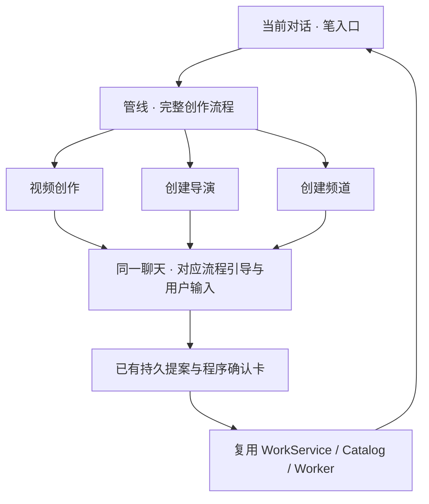

选择入口只建立/切换可信运行段、显示当前流程并预填文字；不创建空作品、不发送聊天或发起分析/制作。原文字和附件保留，用户可编辑后发送；在途/UNKNOWN无法切换时明确报错，原输入和绑定不丢。切换到新作品/创建流程不复制旧原生转录，现有作品继续由后台运行。普通技能菜单维持原预填行为。A6实施与验收见[任务卡](tasks/S6-14A_conversation-integration.md)。


## 16. 自有创作管线与原 Easel 的边界（A7）

普通对话保留两类入口：自有的画像/导演/频道创作管线，以及Easel原片包装和普通技能。前者进入可信作品运行段后，菜单只展示该段可执行的作品流程；原片包装及通用技能在新普通对话使用，避免展示能力与实际工具不一致。复用Easel的可见提案、确认、预览和交付经验，生产继续复用已经调通的Planning、供应、TTS、Edit、FFmpeg与QC，不让旧SDK成为第二个作品权威。

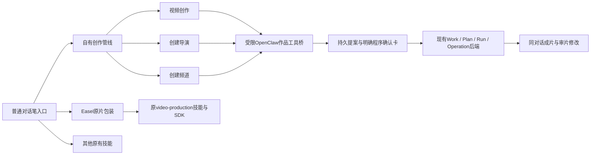

导演分析范围在确认卡明确显示：默认full提交实际画面与音轨，缺能力时阻断；visual是明确选择的画面/叙事/视觉节奏参考，仅允许reference用途，保留原文件与音轨未分析的事实。本期声音可独立设计，但不冒充参考听觉证据。后续Planning遵守同一参考范围；必用素材、实际原声使用及完整语义QC的能力要求不因visual变更。

模型内部字段按真实合同展开：频道定位/主题/受众为文字，参考ID为数组，提案前保存依据、最后提卡；程序在生成卡前校验类型与归属，依据变化使旧卡失效。真实运行中的失败、修复和结果只在[A7任务记录](tasks/S6-14A_conversation-integration.md)维护，不把模型自述当成执行回执。


## 17. 对话管线与本期创作边界（2026-10-19 用户澄清）

本节更新§15～16的可见入口职责，以用户本轮决定为准。仍复用既有对话、提案、目录版本与生产接口，不引入独立管理后台或另一条生产管线。

- 全局画像选择保持在外部，当前会话画像是可信依据；视频与设置管线内仅显示名称，不重复选择、访谈或改写六维内容。
- 笔入口并列显示「视频创作」「频道」「导演」。视频创作只选择已有频道与导演，讨论本期内容及完整方案，不混放频道/导演的新建、修改或长期保存按钮。原有长期提案保留记录并提示转入对应管线，不在视频面板隐藏地执行。
- 频道管线明确区分新建与修改已有频道；修改目标限定当前画像下的既有频道。入口只绑定设置讨论与预填文字，不发送消息、不创建Work。用户通过对话提出调整，现有channel_create/channel_defaults提案卡明确保存；未涉及的声音、字幕和导演默认保留。
- 导演管线明确区分从参考新建与修改已有风格版本。目标版本和参考依据可读，修改使用既有director_revision机制另存新版本，不覆盖旧版本、不自动接受。参考分析仍需登记输入和明确服务授权；已确认新风格经明确动作进入独立视频创作讨论，试片制作、作品接受与导演接受继续分开。
- 设置讨论的参考素材/分析进度界面不展示本期视频方案、声音调参及开始制作按钮。用户要制作试片时先明确进入视频管线，选择本期配置和主题，再确认方案。
- 新建/修改目标切换只有绑定成功才替换系统引导；输入框保留用户补充。待应用的目标变更不允许继续向旧对象发送讨论，明确提示先应用设置目标。切换管线不堆叠旧的系统创建/修改指令。
- 视觉复用Easel现有btn、field、surface、border、text、radius与亮暗主题变量；不增加另一套侧栏导航或默认白色表单。

这些调整只改变当前实证混乱的入口、作用域和呈现；不会修改已存在的画像、频道、导演、冻结作品或试片接受状态。


## 18. 既有管线的对话执行接入方案（2026-10-19）

状态：**用户已授权实施；对话适配已实现并通过隔离验证，部署与验收结果见本节末及S6-14A记录。** 当前S6 / F2 / CURRENT_BLOCKER；依据是用户已明确同意方案却仍须点击草稿和规划卡，以及频道、导演选择与管理仍依赖页面。后续授权已扩展为实施、验证和安全重启，明确禁止代用户生成视频。本节更新§3、§12～17中“文字只讨论、卡片才提交”及必选表单的目标约定，不把旧软件验收当作新交互已通过。六维画像不在本次修改范围。

### 18.1 必须保持的管线边界

本方案是**接入现有视频创作、频道、导演三条管线的对话操作能力**。保留Easel对话笔入口、管线身份和各自职责；用户可从入口进入，也可在对话中明确要求切换，由受控适配器完成既有绑定。不能将三条管线替换为一个拥有任意写权限的通用聊天Agent，不能把普通聊天、旧video-production SDK和V2 Worker并列执行同一作品。

- 对话层：理解用户意图、补问缺口、说明具体方案/差异，展示执行结果。
- 管线接入层：解析当前目标，关联用户消息与待执行动作，检查版本/授权/幂等，将允许的动作交给既有服务；不实现另一套制作调度。
- 业务层：ConversationService维护段、提案和讨论依据；CreativeCatalog维护频道/导演；WorkService及Worker继续负责作品、方案、授权、Run/Task/Operation与媒体生产。
- 展示层：复用Easel样式、方案/进度/媒体组件；表单与按钮不再是主流程的必经关卡。
- 普通聊天未表达进入管线的意图时不创建业务对象；进入频道讨论不创建视频Work。导演参考分析需要的承载Work是内部依赖，不伪装成新成片。

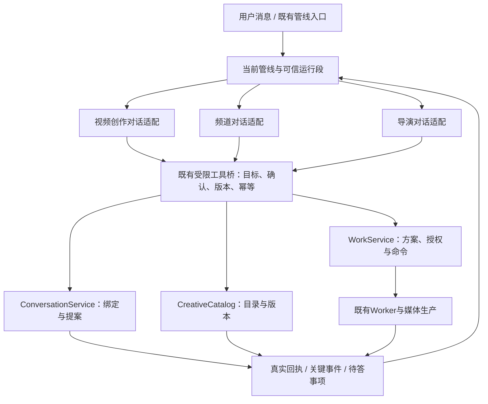

图中的适配表示职责，不代表新增三个Agent、服务、队列或独立状态机。三条管线可以在同一可见对话内衔接，但业务对象和可信段不能混绑。

### 18.1.1 Easel原有设计依据与复用优先级

本次已再次核对原生实现，结论是：**通过宿主对话推进管线本来就是Easel的设计，不是本方案发明的新架构；当前要补的是V2管线接入与文字操作覆盖。**

| 本仓库原生依据 | 已有机制 | 本次复用/适配边界 |
|---|---|---|
| [README](../../README.md)工作流及Web说明 | Agent贯穿内容工作流，多轮对话和结构化附件 | 沿用宿主对话与附件，不新建聊天产品 |
| [video-production技能](../../skills/builtin/video-production/SKILL.md)「交互循环」 | awaiting-answer → pending读题 → ask_user转问 → answer写回答 → resume继续；设计表、预览、成片回到对话 | 复用“管线提出问题—宿主收答—继续管线—产物回传”的模式，不以静态表单替代该循环 |
| [SDK接口](../../skills/builtin/video-production/vendor/video-pipeline-sdk/INTERFACE.md) | 问题/答案结构与继续执行接口，SDK不因宿主接入而改主线 | V2适配当前Work命令和决定项，不复制SDK的文件状态库或生产调度 |
| [QuestionCards](../../web/frontend/src/components/QuestionCards.tsx)、[Gateway问答桥](../../easel/gateway_questions.py) | 原生ask_user问题、选项/自由输入提交、Agent继续处理 | 先核对并复用可适配的问答展示/回复路径；文字回答绑定V2持久待答项，不能冒充另一个活跃Gateway question的答案 |

原生机制存在问答卡与提交按钮，因此它证明“对话推动流程”，不证明“任意自然语言确认已自动执行全部V2命令”。本次按用户要求让普通文字回复也能完成选择/确认，快捷卡可选且不二次确认。原video-production面向已有原片，具有自己的两道确认及渲染实现；V2从想法创作、完整方案确认和现有Worker职责保持，不整套导入旧SDK。

实施顺序进一步明确为：**先对照原生pending/answer/resume与现有V2状态/命令逐项映射，优先复用，再补最小接入缺口**。有持久待答对象时先尝试回答该问题；没有待答对象时才按当前管线理解新意图。不得另设与原问答和Work决定项并存的重复问题队列；原生问答生命周期不能覆盖的刷新/跨轮问题用V2既有持久记录承载。正式插件的兼容能力必须实查，不能仅凭前端组件存在就宣称可直接接通。

### 18.2 已核实的断点与调整落点

| 源码位置 | 当前事实 | 计划调整 |
|---|---|---|
| `easel/conversation_bridge.py` | 8个工具主要读上下文、保存依据、产生提案；提交结果要求卡片确认 | 在既有受限桥增加具名、按当前管线开放的查询/选择/提交能力，不开放任意命令或URL |
| `easel/conversation.py` | apply是卡操作入口；context缺少完整待执行动作与方案/运行结果；活动轮次禁止apply/enter | 提供统一业务应用内核，卡操作和可信对话操作复用；补充状态投影及受控的轮次衔接 |
| `web/conversation_api.py` | 对话交付与提案提交分离 | 接回业务回执及关键事件，保持可恢复消息与命令身份 |
| `VideoConversation.tsx` | 通过下拉选择目标、按钮绑定与应用提案 | 移除主流程必选表单，显示当前管线/配置摘要与对话待答事项 |
| `WorkCards.tsx` | 方案确认、授权、恢复、接受、局部修改等由UI直接调用现有命令 | 将主流程动作接入同一对话适配；保留方案、进度、播放器、对比和下载展示 |
| `conversationWorkflows.ts` | 入口预填要求逐步确认，切换依赖UI入口 | 保留管线入口，支持用户明确话语触发同等绑定，更新过时引导 |
| 正式OpenClaw插件与运行指令 | 仓库桥协议2只允许既有8工具；正式加载范围须实查 | 实施时同步schema、工具白名单、握手与已加载交互指令；不只修改Python或提示词就宣称打通 |

### 18.3 选择、继承与上下文切换

1. 外部已选画像直接继承，不在三条管线重新访谈或选择六维画像。
2. 视频创作缺频道或导演时，必须在对话提示选择；可先收集想法，但缺项未解决前不提交完整规划/制作。两项都缺可合并询问，只缺一项只问一项。不得静默采用“无频道”或“自由导演”。只有一个候选也不能将候选存在视为用户已选。
3. 已明确绑定且有效的配置沿用；有效的频道默认导演属于可说明的继承依据，不重复询问同一选择。无默认、归档、版本失效时对话补选，不悄悄换成最新版本。试片版本说明未接受，选择不修改接受或默认状态。
4. 名称/序号选择必须对应服务端提供的当前候选与版本；同名、跨画像或选择已过期时只问具体歧义。模型不能自由指定其他对象ID。
5. 频道/导演的新建与修改仍分别进入其管线。用户说“改这个频道”可受控切换，保存后只有在用户意图要求继续创作时返回创作管线，不能保存配置就自动制片。
6. 切换保留本次任务的必要目标、来源和返回位置；旧运行段保持审计。新段不能直接引用旧段消息ID冒充合法来源，需由宿主建立有来源的交接快照或既有正式配置引用。活动制作不被重新绑定，UNKNOWN未核实前不切换抢占。
7. 频道只读查询限制当前画像；导演依照现有目录可复用规则和生命周期筛选。本片调整不自动写长期配置，长期修改不回写旧Work冻结方案。

### 18.4 文字确认的执行合同

确认介质从卡片点击扩展为用户对话；确认的具体对象、范围和版本仍须明确。保留版本化提案与业务命令，不用关键字“可以”作为通用执行开关。

- 服务端持久保存待答动作：管线/段、动作类型、目标及版本/hash、用户可见摘要、必要授权范围和来源。复用现有proposal、plan、review及回执，只补确有缺口的字段，不另建平行审批系统。
- 模型解释意图，宿主绑定真实用户轮次。明确提交必须能回溯到用户原文以及此前已展示的动作。模型传入的布尔同意或助手自述不是授权。
- “就按这版制作”仅可确认该轮可唯一定位、已展示的完整方案及已说明范围；若只有方向草稿，应承接整理完整方案，不能假称方案已确认，更不能自动批准尚未展示的未来方案。
- “不错”“再聊聊”不执行。多个未决动作或语义不清时在对话中只补问必要区别，不要求固定口令，不追加同义按钮确认。
- 草稿创建、依据记录等无外部调用的内部衔接，可随明确创作意图执行，不单独设置确认关卡。纯咨询不建立作品；规划、参考分析和制作有授权缺口时集中说明并询问。
- 服务、模型、使用模式和生成上限来自真实配置及用户批准范围；默认配置不等于本作品授权，旧作授权不自动继承。不承诺当前按次数账本已具备人民币硬预算控制。
- 服务端校验目标、版本、当前合法动作、授权和幂等；同动作的重复回复/传输重试复用命令与回执。版本已变时刷新待答内容，不能以新hash自动替用户确认。
- 当前apply/enter会拒绝活动turn。实施不得移除通用保护：受信内部提交校验本轮原生身份和唯一动作，事务内串行应用；需要换段时在本轮安全结束后交接。旧轮工具失去后续写权限；UNKNOWN保持阻断，不把HTTP结束等同于原生结束。
- 一个明确复合指令可以包含多个动作，但逐项检查依赖并记回执。部分成功后只续未完成部分；不会回滚用户已接受结果，也不会重复执行成功部分。

### 18.5 三条管线的具体旅程

| 管线 | 对话推进 | 保留的业务边界 |
|---|---|---|
| 视频 | 一句想法 → 对话补选频道/导演 → 对齐内容 → 内部建草稿和保存依据 → 整理完整方案 → 文字确认方案与制作范围 → Worker自主执行 → 同对话审片/修订 | 缺必要授权才补问；制作后续不增加逐阶段审批。解释方案不触发重做；修订绑定具体输出与保护项 |
| 频道 | 新建/修改意图 → 明确目标 → 讨论定位/受众/默认 → 展示差异 → 文字确认保存 → 回执 → 按用户意图承接本期创作 | 修改采用现有合并语义，保留未提及声音/字幕；不改画像、不自动制片 |
| 导演 | 新建/修改意图 → 明确目标/参考 → 必要时说明范围并授权参考分析 → 讨论风格 → 确认保存/确认风格 → 用户要求时进入视频管线试片 → 审片后接受指定导演版本 | 复用有效参考不重复付费分析；新风格保留版本历史；风格确认、作品接受、导演接受和设默认不是同一事实 |

例：用户说“用这个频道和待试片的导演版本，讲我今天的一个想法”，系统绑定真实选择并继续讨论；说“整理成完整方案”后，在已有规划授权内推进；展示完整方案及范围后说“就按这版制作”，才提交制作。作品出来后说“12秒处换画面，声音不变”，绑定当前输出并走既有修订。说“作品和导演都接受，并设为频道默认”，只有审阅事实明确且各项条件满足时才依次应用，分别返回结果；不从“效果不错”推导这些动作。

### 18.6 结果回流与页面

- 将最新合法动作、待答问题、配置来源、方案版本、运行/决定项和执行回执投影到当前管线对话上下文；后端业务记录仍是唯一权威。
- 方案完成、需决定、失败、成片就绪等关键事件通过既有事件/SSE路径回到对话，持久去重并支持刷新恢复；必要的状态文本可直接由程序渲染，不为每次进度额外调用模型。
- 完成回执包含可继续的下一步，但不自动制造一个新的用户意图。失败说明实际完成部分与阻断；UNKNOWN只呈现核实状态。
- 主界面保留管线名称、画像/频道/导演/声音摘要、可展开方案与媒体。用户用文字选择和确认，不必进入管理页、勾服务或复制到修订框。附件上传、播放、下载和可选快捷操作保留，不能作为同一确认的第二次关卡。
- 复用Easel现有视觉体系；流式回复和状态更新不强制跳到卡片或底部。读者回看位置稳定，新消息提示不夺取滚动位置。

### 18.7 实施顺序、验证及停止条件

用户已给予本节执行授权；真实用户作品仍由用户自行发起。优先补接入能力再移除UI必经操作，不能先隐藏按钮使旧桥不可用。

1. 对齐本节及实施合同，核实正式工具注册/运行指令；列出三条管线各状态可执行的既有命令。
2. 补齐受控目录查询、缺项问答、选择绑定和段间交接；复验缺频道/缺导演/同名/失效及跨画像拒绝。
3. 实现文字提交与既有命令共用内核，接入草稿、规划、制作确认、频道保存、导演版本/风格确认、修订及接受；复验真实原文来源、歧义、旧hash、重复提交和活动轮次隔离。
4. 接通关键结果回流和断线恢复，整合页面展示；复验频道→导演→视频及从已有配置创作，不将三条管线混成无边界操作集。
5. 隔离数据下完成无必选表单的贯通验证；再核对正式界面部署。真实模型/参考分析/媒体制作按届时有效授权另行验证，不以Mock替代真实生产。

| 验收项 | 通过条件 |
|---|---|
| 缺配置 | 缺频道/导演必在对话询问；回答后有真实绑定，已明确项不重复问 |
| 对话执行 | 明确用户回复真正产生目标操作回执，无“已同意但还须点卡” |
| 管线隔离 | 频道讨论不产生视频任务；导演参考与试片按各自授权；切换不串旧目标 |
| 一环接一环 | 草稿、规划、保存、结果和下一步状态一致；不重复提案、不虚报执行 |
| 权限与恢复 | 过期版本、歧义、UNKNOWN不误执行；刷新与重复消息不重复调用；旧原生轮次不能写新段 |
| 资产与默认 | 画像未改、未提及设置保留；试片不自动接受；授权不跨作品继承 |
| 页面体验 | 主要流程无需下拉/表单/确认按钮；查看方案与视频时滚动稳定 |
| 真实验收 | SOFTWARE_PASS、真实模型管线验证、REAL_PRODUCTION_PASS、CREATOR_ACCEPTED分别报告 |

本轮不实施生产效果优化、不更换模型/渲染器、不扩新管线、不恢复旧任务。实施按本节一轮有界交付与原场景复验收口；新阻断另述证据，不能以对话改造为由重建整体架构。


### 18.8 本轮实施落点与验证边界

沿用现有OpenClaw原生工具生命周期和三条管线，新增具名 `easel_pipeline` 接入工具：pending读取真实目录、待答提案、完整作品及服务能力；bind在原生轮次结束后完成既有enter绑定；draft内部建立草稿；offer持久化具体业务动作；answer用当前用户原话回答此前展示的提案。原有8工具保留，新增工具纳入插件manifest、schema、白名单及握手。普通Gateway ask_user依赖活动轮次；V2使用原生pending/answer/resume模式，答案落既有持久提案而非伪造Gateway question ID，不引入第二套问题队列。

业务执行复用原apply与WorkService/CreativeCatalog。模型负责语义理解，宿主校验原文来源、既有待答对象、版本、管线、权限及幂等；不声称程序能靠字符串包含判定所有自然语言授权。新提案不能同轮自行确认，模糊答复按指令澄清。当前实现未增加自然语言专用分类模型或额外付费审核。内部草稿不单独审批；规划/制作/接受等以用户此前看过的具体提案为提交依据。多动作按成功回执逐项续接，尚未展示的新增动作仍要说明范围。

段间交接保留同会话、同画像的用户来源快照；来源再与原始消息核验后方可进入创作依据或附件登记。切换成功后才更换绑定；失败回执保留且原生轮次仍正常结束，旧工作段不被偷偷改写。频道保存后刷新上下文，保留未修改设置；原有在途/UNKNOWN保护不放宽。

视频对话不再包含必选下拉框、设置创建按钮或卡片确认按钮，固定管线/配置摘要及提案记录面板已按后续用户反馈移除，保留真实方案/进度/播放器。旧独立作品组件的高级操作仍保留兼容，但对话入口只投影结果。事件沿用现有Work SSE与可恢复对话回放；不为每次进度自动派发新模型轮次。

隔离软件检查：生产模块607 passed / 4 skipped；前端95 passed、build/lint通过，保留既有弃用/转义/包体警告。新增10项对话管线测试包含缺选择、原生结束交接、跨画像拒绝、用户来源、旧提案、频道保存、导演新版确认而不接受、完整方案单次排程及失败恢复。原生OpenClaw隔离假模型18项检查通过，包括新工具实际注册与文字答复保存频道；本机真实Provider调用0。软件/原生假模型结果不等于真实模型语义表现、真人滚动体验或用户成片接受，正式试跑由用户完成。

### 18.9 三条对话管线复核（2026-10-19）

复核范围为已进入受限管线后的创作、频道与导演业务推进。现有bind负责对话选目标及段间交接，draft负责本地草稿，propose/offer→answer负责具体操作与文字确认；WorkService/CreativeCatalog仍是唯一执行入口。频道/导演缺选择继续对话询问，声音/字幕字体/服务缺项按真实能力说明并询问，完全缺凭证时明确配置未就绪，不宣称聊天能凭空补出外部账户。首次笔入口、提供本地文件、播放和下载属于入口/媒体交互，不是业务推进审批。

发现并修复素材权益/原声确认仅有旧UI路径的遗漏：增加有限input动作，绑定已验证的同会话附件及digest，先展示用途、原声区间和本片权益声明，再由下一轮answer提交。不得传任意路径或模型自造rights字典；未声明时保持未知权益。普通参考原有登记路径保持，模型直接声明Rights/原声仍被拒绝。复用既有提案来源、版本、单轮隔离、幂等及Work输入校验，不新增权限判定模型。源码测试的范围及未覆盖的真实模型语义行为见原S6-14A任务补记。

### 18.10 规划授权与对话中断修复（2026-10-19）

真实用户路径暴露旧 `easel_work_request_plan` 仅保存request、应用时未传services的问题：确认后创建了planning任务，但没有规划授权，Worker在模型调用前拒绝。旧隔离测试只断言Run创建，未执行Worker，故未覆盖此断点。旧入口和pipeline plan现共用规划服务绑定：提案阶段从实际配置确定模型并把services写入提案hash，工具返回可展示的完整values；助手须在正文说明所用模型与整理范围，用户下一轮确认后，在同一业务事务保存授权并排程。已有有效规划授权可复用；应用旧的无授权提案、服务变化或授权撤销时，在创建任务前拒绝并回到对话澄清，不补造用户授权。

已因permission_missing暂停的整理方案，可通过grant提案同时指定purpose=planning、真实services和当前decision_id，说明“授权并继续原整理方案”，由一次后续answer原子完成授权与恢复；只支持当前Work的当前plan任务、真实授权缺失状态，无待核实外部操作，版本/幂等/UNKNOWN检查仍保留。不要求再去工作台或另确认一次恢复。

同轮上游对话模型发生超时/内部错误是另一项故障，不能等同于规划调用失败。回复中断时重读已落库的作品状态，显示当前授权阻断和对话内处理方向，保留原生轮次结束/UNKNOWN语义，不自动重复派发。只记录异常类别，不把Provider原始内容或用户运行标识写入日志/Git。恢复提示不是自动恢复或真实用户制作验收通过。
