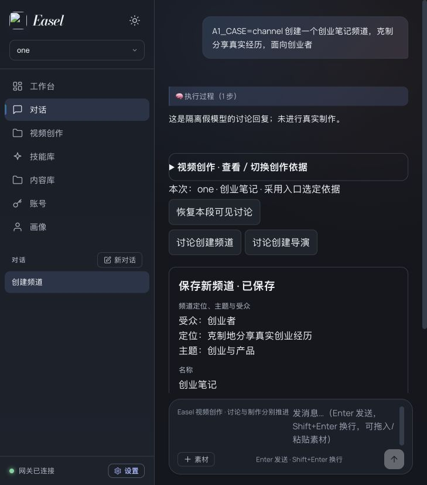
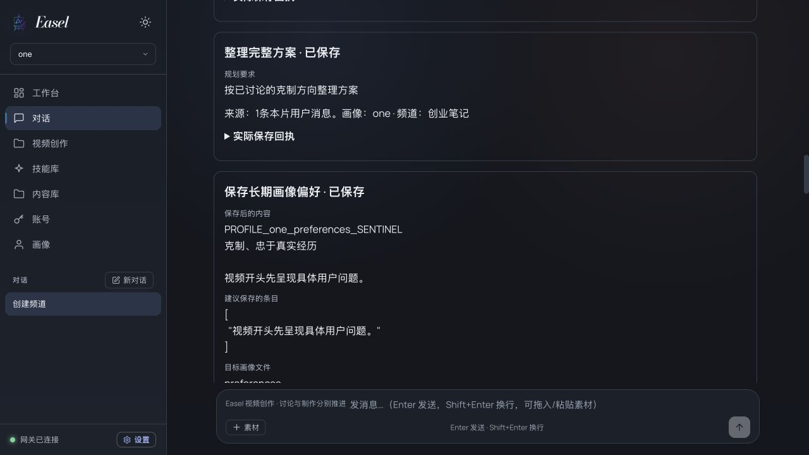
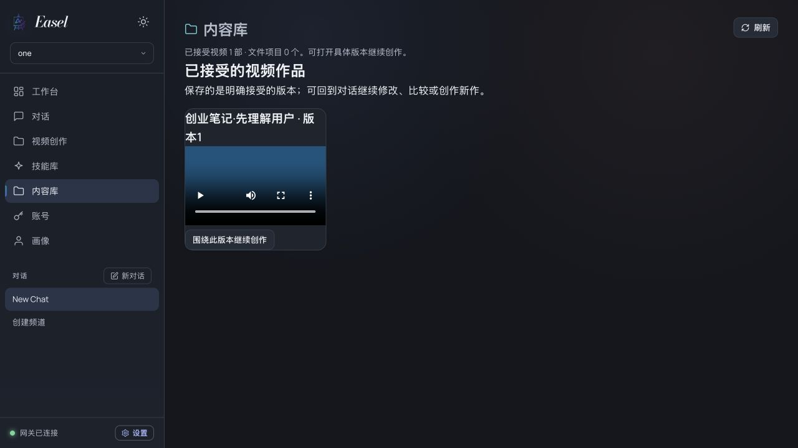
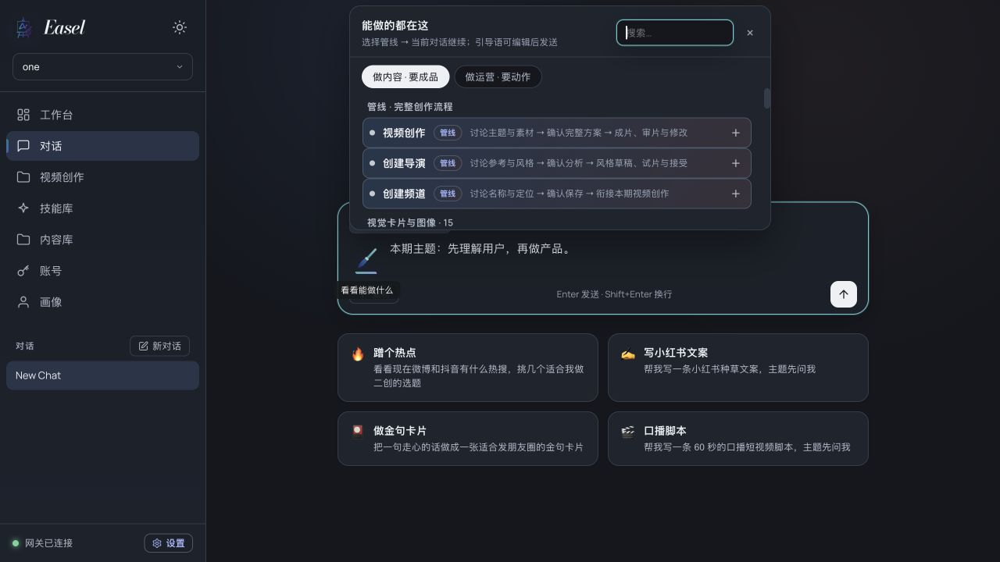
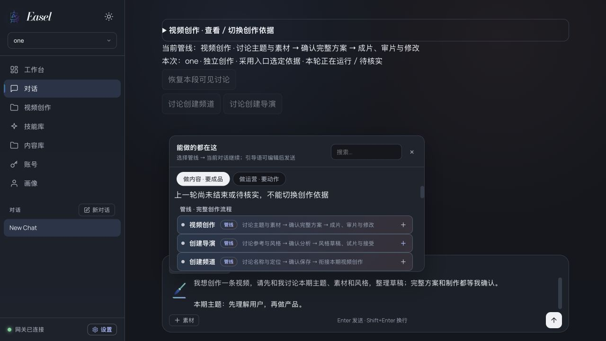

# S6-14A · Easel 对话式创作与生产后端接入
> **2026-10-19 任务调度收敛**：A1～A8原交互实施/验收任务行政关闭，保留已验证范围；A9既有声音诊断结束、A10旧专项架构/代码修复阶段结束，**不再各自独立派发旧轮次或重复验收**。声音选择现已按用户决定收口（见文末补记）；真实作品质量/人工接受、对话体验和画像默认归入[唯一三项主线](../04_CURRENT_STATE.md#唯一研发下一动作)，只按新作品实证问题继续小改。本卡的旧 `NOT_TESTED`、`PARTIAL` 和失败记录仍保留，不因关闭而补写PASS。

- **所属任务**：S6-14 新增交互子任务；不改变 S6-15 CLOSED/COMPLETE，不开启 S7。
- **状态**：A1～A6软件/隔离结果保留；**A7 REAL_WEB_PRODUCTION_PASS / QUALITY_ISSUES_OBSERVED / CREATOR_REVIEW_PENDING**。正式库已备份迁移4，服务已重载；真实首版已完成并回写同对话；Creator接受未执行，成片质量问题单列；**A8 LOCAL_REVISION_PASS / CREATOR_REVIEW_PENDING · 局部画面、字幕修复完成**；**A9历史诊断保留；当前声音选择 CLOSED / CONFIGURATION_CONFIRMED，成片自然度未据此验收**。
- **用户来源**：2026-10-18 明确要求基于已确认需求与 Easel，设计前后端交互，先出文档和图，作为 S6-14 新增任务记录。用户指出现有表单交互偏离对话式创作，后端已调顺。
- **关联需求**：V2-EXP-001、004～008、010～011、019～021、024～029、032～034；不另造同义需求。
- **目标**：从 Easel 对话完成方向讨论、方案确认、真实进度观察、具体版本审片/修改/接受，调用同一作品后端，不要求用户到独立表单推进创作。
- **本轮授权**：用户最新授权复用Easel交互经验与适用制作能力，建立自有管线，并在真实环境调通频道/导演/视频创作、真实调用大模型；主题与参考选择已全权委托。A7允许正式配置合成、备份迁移/重载和新作品具名调用；历史A5/A6禁付费范围保留为历史证据。不自动接受或发布，不重发历史UNKNOWN。
- **基线与现场**：`/Users/xgx/Projects/Easel`，分支`easel-v2-main-workspace`；生产基线`406e523c`，A2～A4起点`44b3f08c`，A5起点`6efb91e9`，当前HEAD以Git为准；主服务7860。原未跟踪 research、scratch、二维码和个人创作目录均保留，不纳入提交。当前聊天运行设置为 OpenClaw，生产模型为 MiniMax；两条路径不能混为已接通。
- **设计入口**：[交互文档与流程图](../20_CONVERSATIONAL_INTERACTION.md)、[OpenClaw 接入总览 SVG](../diagrams/s6-14a-conversation-flow.svg)、[六步交互分镜 SVG](../diagrams/s6-14a-interaction-storyboard.svg)、[频道与导演创建流程图](../diagrams/s6-14a-creation-flows.svg)、[实施合同 §9](../15_IMPLEMENTATION_DESIGN.md#9-s6-14a-对话接入增量提案待评审未实现)。

## 1. 成功基线与范围

第五轮 `9b9ed8da98e4437e89618ceee1cb7731` 在固定生产源码 `406e523c` 上已达到 `REAL_API_PRODUCTION_PASS / ZERO_MANUAL_RECOVERY_PASS / CREATOR_REVIEW_PENDING`，详细核验只维护在 [S6-14](S6-14_integration-release.md)。本任务可以只读使用其成片验证展示，不重建该作品，不自动接受。

本次交互设计保留 Work/Plan/Run/Operation/Artifact/Acceptance 的权威边界和既有 worker；只提出对话接入、上下文与可复用前端组件所需增量。当前任务不包含 S6-15 历史治理、素材供应重写、替换 MiniMax、重新选择编辑器、自动发布或第六轮付费试片。

## 2. 实施拆分与当前状态

| 子项 | 交付与源码落点 | 退出条件 |
|---|---|---|
| **A1 · 当前 Harness 接入验证（ISOLATED_FAKE_PASS）** | 临时环境验证同一 Gateway 的内部 easel-video 配置、原生 easel-work 工具插件、Web 具名动作转发和受限产品上下文；验证 HTTP/CLI 共用运行绑定与原生历史；正式问题桥接线留在A2/A3 | 假聊天模型/假 API 证明可信会话与原生run/turn关联、晚到工具拒绝、实际白名单和缺插件/身份不符时阻断；对实际暴露的HTTP/CLI入口验证旧脚本/直接Provider/文件/会话与记忆工具拒绝、研发指令和其他画像隔离；其余终端入口明确未覆盖。不能用配置静态检查冒充运行验收 |
| **A2 · 作品会话与创作依据（IMPLEMENTED / SOFTWARE_PASS）** | 复用现有 turn/job/转录/命令回执；增加可信运行/作品关联、turn 去重与工具意图映射、带来源 brief 和跨会话附件校验；必要前向兼容迁移及正式问题桥/历史解析绑定；保留交付/反馈/学习提议来源；入口来源/明确覆盖与版本、频道语义依据及导演形成绑定；无Work创建提案/卡、跨作品原生段隔离 | 多轮信息进入 Planning，解释不启动；同 turn/不同 callId/响应丢失/晚到工具不重复或串作品；合法新会话附件可用、越权拒绝；第五轮记录可读 |
| **A3 · 对话卡片与详情（IMPLEMENTED / SOFTWARE_PASS）** | ChatPage/App/store/api 接入；ProductionPage 提取方案/进度/决定/成片/设置组件；作品与内容库可续接；频道/导演详情主操作回同一对话，区分新作/续作/形成导演；创建提案→确认→回执→本期内容接续 | 同一对话完成全过程，卡片和详情使用同一业务快照；无画像可开始；旧卡失效可见 |
| **A4 · 审片、修订与恢复（IMPLEMENTED / SOFTWARE_PASS）** | 指定输出反馈、保护项、影响确认、版本比较、明确接受；同一内容库及频道/导演视图回到创作；首版兼试片分别接受、fork明确沿用设置；可选长期保存卡与既有Profile/频道/Director适配；分离停止回答与取消制作 | 修改命中指定版本，授权内局部改不重复审批，旧接受保留；删除聊天不删作品；UNKNOWN不重发；单片反馈不污染长期默认，保存有明确目标/差异/版本/幂等回执 |
| **A5 · 交互集成验收（ISOLATED_INTERACTION_PASS）** | 先用隔离数据/假模型跑 Web 到本地媒体完整流程，再按另行授权验证真实 Web | 软件、实际 Web、真实模型/媒体、Creator 接受分列。不得使用第五轮 API PASS 代替 Web 对话验证 |
| **A6 · 对话管线入口统一（COMPLETE / SOFTWARE_PASS）** | 在现有笔入口/能力菜单的管线区域并列视频创作、创建导演、创建频道；当前聊天预填引导并沿用持久桥和卡片 | 三入口在普通/已有视频聊天均可选择；不跳目录、不建空Work、不自动发送，保留文字和附件，失败/在途不切错段 |
| **A7 · 自有管线与真实接入（REAL_WEB_PRODUCTION_PASS）** | 分开原片包装/普通技能与画像导演频道创作；复用既有Work后端与Easel交互知识；正式插件权限合成、会话、真实模型/素材/配音/出片 | 正式真实对话创建频道、形成导演、创作新视频；逐项记录失败/费用/产物；Creator接受独立 |
| **A8 · 画面匹配与字幕局部修复（LOCAL_REVISION_PASS）** | 查明A7素材与剪辑偏差；复用指定输出、冻结Plan、既有配音/候选，有限补充缺口库存并增强字幕对比 | 实际Web revision出新版；声音/文案/时间结构保护有回归和真实对比，画面动作与字幕实审，不重建Work或整片生产 |
| **A9 · 声音重新选型与表达（DIAGNOSED / REDESIGN_PROPOSED）** | 用户不满声线、聊天感和语速/停顿/情绪；核实现有设计、合成适配、分段与模型合同，形成有限候选及对比方案 | 原诊断轮次范围保留；后续已完成用户选型、基础参数确认及频道调用依据保存（见文末补记），不代表通用演绎参数接入或成片听感通过 |

A1/A2 优先解决真实接入，A3 在接口明确后实施。推荐先用隔离配置完成“连续讨论 → 具名工具 → 持久回执 → 卡片更新”纵向最小切片，再补全旅程；普通 main 对话转入视频须明确进入作品模式并保存运行段。模型/工具能力不兼容不能以静默切底座消除。

## 3. 整体交互验收矩阵（A1证据仅覆盖其中接入部分）

| 编号 | 正例 / 负例 | 必须提供的证据 |
|---|---|---|
| UI01 | 自然语言主题+附件，带/不带画像均能开始；仅咨询不建作品 | 浏览器交互 + Work/输入快照 |
| UI02 | 连续讨论、解释、修改方向不触发完整 Planning/TTS；明确“整理方案”才规划 | turn/command/run 调用计数 |
| UI03 | Easel 利用所选六维画像、频道/导演、相关技能知识；不带另一画像/其他作品事实 | 固定测试上下文、来源与允许工具清单 |
| UI04 | 受限 OpenClaw 配置可调用作品工具；旧技能/直接媒体/隐式能力被限制，缺插件或绑定失效不回 main | 合成后的实际工具/上下文与可执行拒绝证据；不能用 Prompt 声明代替 |
| UI05 | 多轮明确内容进入同一摘要/Plan；模型建议不冒充用户硬要求 | 摘要来源、Plan版本及请求载荷比较 |
| UI06 | 完整方案一次确认；同 turn/不同 callId/请求丢失/晚到工具/旧卡/多窗口不重复执行或串作品 | turn/工具映射与 command_receipt、Run 数量、409和卡片刷新 |
| UI07 | 制作进度和成果来自快照/SSE；断线重连、乱序与旧Run不漂移 | 浏览器回放 + 持久事件对照 |
| UI08 | 关页/停止回答/删除聊天不取消作品；重新进入可继续看 | 原Run/作品/媒体仍可访问，无重复调用 |
| UI09 | 原会话与合法关联的新会话附件可登记；未关联会话/伪造句柄拒绝；合法未知Rights可登记参考，但不得据此授权重剪/复用原声，活动Run不改输入 | 输入/关联/来源引用、路径/hash/symlink负例及旧Work兼容 |
| UI10 | “只改12秒画面，保持声音”绑定具体输出；扩大影响/新增费用才集中确认 | ChangeSet、复用依赖、旧版字节与接受记录 |
| UI11 | manual 模式清楚标技术通过/语义未测；未明确审阅接受不得入已接受库 | UI与后端拒绝、明确接受回执，自动发布0 |
| UI12 | 当前成功后端与普通 Easel 功能无回归；缺Harness能力明确提示 | 生产回归、聊天/附件/技能/内容库检查，未覆盖项列表 |
| UI13 | 普通聊天明确进入视频模式；同一UI对话按绑定恢复运行段，HTTP/CLI/问题桥/历史不串main或跨画像 | 服务端绑定、用户可见上下文来源与路由证据；无原生秘密转录复制 |
| UI14 | 成片完成自动登记事实；未接受不入最终选择；接受A后生成B仍保留A为最终版 | Artifact/QC/event/acceptance与内容库投影对照；自动语义未测事实不被人工接受覆盖 |
| UI15 | 反馈默认本片；可复用项才提议1～3条；拒绝/忽略/无画像不写长期数据 | 提议来源与目标差异、Profile文件/频道/Director前后版本 |
| UI16 | 明确保存指定长期项；重复点击/响应丢失不重复追加，并发编辑/切换目标不覆盖 | 保存命令回执、before/after hash与409；模型无任意写工具 |
| UI17 | 保存偏好/频道默认只影响后续新作；导演另存仍须原确认/试片接受 | 冻结旧Plan不变、具名新版本/合法试片引用、无自动新增生成 |
| UI18 | 从同一内容库打开具体版本继续修改/fork，保留来源且不继承旧授权 | 导航与实体引用、版本与权限负例；发布/日志/归因端到端另行验证 |
| UI19 | 普通/频道/已接受导演三入口进入同一对话链；浏览目录不建空Work、不触发分析/制作 | 入口操作、上下文来源、Work/Run/Operation计数；无画像/无频道/无导演仍能开始 |
| UI20 | 频道默认自动带入；明确导演优先，固定声音字幕不被覆盖；归档默认不静默替换 | 合并前后来源/具体版本与方案；已选导演后换频道、核心冲突及无冲突覆盖对照 |
| UI21 | 频道自然语言设置明确保存；定位/主题/受众进入新作依据，不写未知settings键/其他画像 | catalog版本/brief来源/Plan对照；无画像保存频道拒绝、跨画像绑定拒绝，临时创作可继续 |
| UI22 | 参考形成→风格确认→同Work正式首版兼试片；入口不自动调用；参考许可不等于重剪授权 | 实际reference input/分析任务/证据及Plan版本；无法访问参考、活动Run改输入负例 |
| UI23 | 同一输出分别接受作品/导演/频道默认；不默认全选，部分失败仅重试未完成项 | 三目标独立幂等回执、正确试片版本/资格；作品人工接受不伪造导演QC合格 |
| UI24 | 恢复历史保留原依据；确认前切换失效旧卡，确认后风格变更走修订；仅收纳不改片 | 原Plan/output字节与引用不变、409/修订范围、同画像assignment；新入口不重绑活动工具 |
| UI25 | 新主题用有效频道默认；基于旧版新作明确选择沿用哪些设置，导演版本不被新默认暗换 | 新旧Work/settings/来源与rights/grants对照；原作不变，新作不继承旧付费/素材授权 |
| UI26 | 频道按钮/自然语言创建：未保存提案可恢复，无Work可保存；名称/画像校验；保存成功后承接已有本期主题 | 持久提案/目标/hash、一次卡操作与catalog回执；重复/丢响应不重建，保存不产生生产Run，创建失败不假报成功 |
| UI27 | 导演按钮/自然语言创建：参考→分析回执→草稿→风格确认→正式首版兼试片→独立接受→可选关联默认 | 分步恢复/重复与UNKNOWN拒绝；风格草稿不可默认；分析/风格确认不自动制片；依赖接受失败不设默认、不重复成功步骤 |
| UI28 | 同一UI聊天切换Work/Profile使用新原生运行段，恢复原作只取原段/允许依据；删除聊天后在途结果可核实 | 原生模型输入无上一作品哨兵、段/turn/Work绑定及撤销记录；旧段晚到调用拒绝，待核实命令不丢失或重发 |


实现后按变更选择既有 `tests/production/`、前端 Node 用例、lint/build 和真实浏览器检查；新增用例应覆盖以上用户行为及风险。文档阶段不创建空测试或把未来命令标为已经通过。

## 4. 本轮执行记录与结果

- 只读核验第五轮正式 API、SQLite 记录、素材引用、媒体 SHA/FFprobe 与导出署名；结果写入父任务。未发起模型/配音/素材生成，没有修改业务数据库或重启服务。
- 已提出对话旅程、布局、职责图、前后端时序、状态主路径、现有接口复用和必要增量；所有新增能力明确标为提案。
- 已识别三个实际缺口：前端未绑定作品；后端聊天分支将讨论直接转规划/修订；当前 OpenClaw 与生产工具未建立受限桥。API 直连也不能冒称具备技能执行。
- 按用户补充参考 Easel 管线设计，已核对五层工作流、video-production 薄壳、SDK 阶段/问答接口、manifest 薄索引、BrushEntry 与 QuestionCards。交互文档 §2.1 记录逐项映射和原片/双审批/Remotion/默认风格差异；A3 包含管线入口路由与持久决定卡适配，UI04/UI08 必须覆盖旧管线旁路和回复结束后的卡片恢复。
- 初版设计历史结果（A1实施之前）：**设计交付 COMPLETE；当时设计批准 PENDING；当时实现/软件交互/真实 Web/Creator 验收 NOT_TESTED**。具体本轮检查结果在父任务末尾记录。

### 2026-10-18 · OpenClaw 接入研究修订（本次）

- 用户要求先研究并完善文档/图，形成具体方案；本次未改业务代码、OpenClaw 运行配置或业务数据库，未安装插件、重启、发起模型/媒体调用。
- 研究基线 `bac81d99`；核对本机 OpenClaw 2026.9.4/Node 24.21.0 的文档、SDK 类型、工具执行策略和实际配置非敏感项，并交叉核对官方文档。插件/指定 Agent/静态工具策略具备接口依据，组合接入仍为 **NOT_TESTED**。
- 推荐同一 Gateway 内增加内部受限 easel-video 配置与一个 easel-work 原生工具插件，Web 内做具名动作转发，继续调用现有 WorkService/Worker。不新增用户人格或独立生产 Agent；普通 main 保留。原“现有按会话权限配置可直接沿用”的假设已纠正。
- 交互设计 §4.4～4.6 记录选择依据、候选比较、运行切换、权限范围与复用清单；实施合同 §9 记录七个候选工具、内部传输鉴权、幂等/绑定/brief/跨会话输入/事件及 A1 负例。逻辑记录优先扩展现有存储，不预设三套全量新表。
- 更新接入总览 SVG/PNG，新增六步交互分镜 SVG/PNG；完整时序明确聊天流与作品 SSE 分离、规划授权和指定版本修订。静态界面内容为示意，不是实际回执。
- 文档检查：本次6份受影响 Markdown 的105条本地路径引用0错误，代码围栏闭合，git diff --check 通过；两张 SVG 通过 XML 解析，PNG尺寸为1660×1080/1660×1190，已渲染目视检查。研究/设计状态保持待评审。
- 本轮仅文档与图，未重跑生产软件测试；插件实际运行、浏览器交互、真实生产和 Creator 验收均未执行。

### 2026-10-18 · A1 隔离原生验证结果

**结论：A1 ISOLATED_FAKE_PASS。** 代码起点 `1eeb1a09`，本机原生 OpenClaw **2026.9.4（3a9d69d）**；不是仅 mock 插件 SDK。启动临时 Gateway，使用脚本化本地假聊天模型、假 HTTP 接入和临时 SQLite 的现有 WorkService。未启动 Worker、未挂载正式 Web、未安装到正式 OpenClaw、未修改业务库。结构化证据见 [A1 验证摘要](../evidence/S6-14A_A1_openclaw_probe.json)，其文件 SHA 绑定本次受测实现。

| 验证面 | 实际证据与结果 |
|---|---|
| 原生工具链 | 连续讨论2轮无 Work/Run；明确请求后插件建立1个草稿；明确规划请求中两个不同 toolCallId 的相同意图只产生1个 Planning Run。总业务命令2个，授权和收费 Operation 均0 |
| 身份与生命周期 | 原生 before_agent_run 认领预留 turn，before_tool_call 获取 runId/toolCallId，经 prepare/dispatch 校验；agent_end 撤销本轮。HTTP/CLI 使用同一 Agent、原生会话和绑定作品，HTTP 历史可继续 |
| 权限与上下文 | 发给假模型的实际工具清单严格为 context/create_draft/request_plan 三个；exec/bash/read/file_fetch/browser/web_fetch/会话委派/直接 MiniMax 媒体/旧脚本执行等强制工具请求未执行。伪造作品/命令/授权字段被拒绝 |
| 会话隔离 | 第二个原生会话不含第一个会话的画像上下文；所选上下文来自服务端，main/研发规则/其他画像文件/凭证哨兵未进入视频模型输入；真实桥凭证与 Gateway 测试令牌也未进入模型输入 |
| 失败关闭 | 未预留的原生会话在模型调用前被阻断；禁用插件后活跃状态检查返回不可用，派发前停止，无 main 或模型兜底。未结束/未知的旧 invocation 不允许下一轮抢占；迟到工具不能落到新 turn（边界用例覆盖） |
| 工程复用 | 插件用原生 definePluginEntry/hooks/registerTool；Python 适配直接用原 WorkService/command_receipts，未复制生产状态机。原生 session UUID 从可信钩子绑定；不依赖未被该版本采用的 session-id HTTP 请求头 |
| 正式环境 | 新 router 未在 web/app.py 挂载，agents/sync.sh 与正式配置未改；7860只读 capabilities 核对 backend.reload_required=false；无真实创作或付费调用 |

实际命令与结果：

- `EASEL_RUN_OPENCLAW_A1=1 .venv/bin/python -m pytest -q tests/production/test_openclaw_work_bridge_native.py --basetemp=/tmp/easel-a1-final-check`：**1 passed**；原生探针 **19项检查通过**，见结构化摘要；最终运行39次请求全部到本地假模型，出站守卫拒绝计数0，后台自动更新已关闭。
- `.venv/bin/python -m pytest -q tests/production/test_work_bridge.py`：**14 passed**。覆盖绑定/伪造身份、重复 turn、不同 callId 同意图、原生命令参数、票据篡改、迟到工具、跨会话与旧版本冲突、独立凭证及缺插件预检。
- `node --test tests/production/workBridgePlugin.test.mjs`：**5 passed**。覆盖原生插件接口、严格工具与其他 Agent 不注册、阻断/运行关联/回合撤销和无任意网络目标。
- `.venv/bin/python -m pytest -q tests/production`：**479 passed / 4 skipped / 0 failed**；4个 skip 含本次默认关闭的原生安装集成测试（已单独显式执行）。仅有既有 Starlette/AnyIO 弃用提示。
- Python 编译、Node 语法及 git diff --check 通过；本次8份相关Markdown的139条本地路径引用0错误，脱敏证据的9份源码SHA匹配。以上是软件/隔离原生证据，不是正式 Web、真实生产或人工接受结果。

排障记录保留：最初临时配置使用了旧 logging/memorySearch 字段，被当前原生 schema 拒绝，已按安装版本修正；假模型适配曾因 Request 注解缺失返回422，已修正。原生请求头 session-id 未被采用导致首次绑定拒绝，已改为可信钩子首次绑定/后续核对。Gateway /health 先于插件可用曾返回503，探针现等待受认证的插件 status；失败期间均未走 main 或真实服务。旧临时运行目录只保留本机，不将随机令牌和原始请求写入 Git。

隔离方式：每次全新临时 OPENCLAW_HOME/STATE_DIR/CONFIG_PATH、工作区、显式临时 node_modules SDK 链接与临时数据库；不继承 Provider/代理环境或项目 .env。出站守卫仅允许临时 Gateway 和假 API 的回环端口，禁用后台更新/遥测统计。早期运行发现安装包默认版本检查外联并被守卫拒绝，已在临时配置关闭自动更新；正式配置未改。原生子进程在 finally 中关闭。Easel 人格复用权威 SOUL 的介绍/沟通片段，未把旧全链路执行规则带入作品工作区。

**范围说明**：A1验证的是隔离原生接入，任务包 UI01～UI13 仍须随 A2～A5 完整实施验收；原任务表中问题桥/历史的正式 Web 接线已明确归 A2/A3，不能以本次原生历史验证替代。

**范围限制 / A2 前置**：当前仅3个工具，输入证据/附件登记/brief/修订工具未实现；服务端选定意图是测试驱动明确提供，不证明真实模型判断。invocation/ticket 映射在内存，崩溃恢复、持久会话/运行段、重复消息入口和跨会话附件属于 A2。问题卡桥、真实产品上下文/媒体理解、UI卡片/SSE和所有终端内建命令入口尚未集成；本次只覆盖实际 HTTP/CLI 接入及其负例，不宣称 OS 沙箱或凭证物理隔离。正式启用前须把预检、绑定与生命周期检查接入生产 Web，不能仅安装插件就宣称完成。

### 2026-10-18 · 完成后闭环与 Easel 回写设计补充

用户要求继续理清创作结束后的闭环，结合 Easel 自身设计。只读对照manifest/post_deliver、内容库、accept/reviews、产品画像规则、Profile编辑、发布日历/日志与归因/复盘来源；在[交互设计 §10](../20_CONVERSATIONAL_INTERACTION.md#10-创作结束后的闭环与回写2026-10-18补充设计)、[实施合同 §9.7](../15_IMPLEMENTATION_DESIGN.md#97-交付闭环与长期回写补充提案未实现)和[闭环图](../diagrams/s6-14a-completion-loop.svg)补齐三条环：作品交付/接受/复用，确认后的长期经验保存，可选发布/数据/复盘。

已明确现状：OutputsPage部分接通已接受V2作品；原发布页媒体选择仍只认旧目录，不能靠manifest写入绕开受管路径；旧日志回流best-effort/追加写不具备V2输出级关联与去重；旧复盘共享context不能直接作多画像记忆。长期回写沿用Easel1～3条提议、明确同意、增量去重规则，Profile/频道/Director分别保存，作品接受不自动更新导演。

A2/A4/A5增加来源/卡片/目标差异/版本与幂等验收，未新增学习Agent/指标数据库或自动收费任务。发布、平台抓取和定时归因只记后续接入合同，不在本轮实现或执行。A1结果保持原范围；本轮只改文档和图，不重跑生产软件回归或发起任何业务写入。 本次6份受影响Markdown的136条本地路径引用0错误，git diff --check通过；闭环SVG通过XML解析，1660×1240 PNG已渲染目视检查；A1证据绑定的9份源码SHA均未变化。

### 2026-10-18 · 导演/频道入口与创作闭环补充

按用户要求补齐[交互设计§11](../20_CONVERSATIONAL_INTERACTION.md#11-导演频道入口与统一创作闭环)、[完整入口图](../diagrams/s6-14a-entry-loop.svg)及[实施合同§9.8](../15_IMPLEMENTATION_DESIGN.md#98-频道导演入口依据来源与续作补充提案未实现)。普通对话、频道、导演共用一个创作对话/Work后端；明确复用已接受导演与从参考形成导演两条路径，正式首版可兼试片，成片/导演/频道默认独立接受与回写。

只读发现三处不能误当已完成的能力：当前频道/导演主界面仍在ProductionPage管理区；频道settings没有定位/主题/受众持久字段；现有fork不保证沿用原导演/声音设置，会重新合并频道默认。已加入A2～A4范围与UI19～UI25待执行验收，保持旧Plan/在途运行、归属变更、默认版本和素材/费用权限边界。S6-13原离线证据保留，不把它升级为入口/真实导演稳定性通过。本轮仅更新文档/图；A1源码和正式环境均不修改。文档检查：6份Markdown的148条本地链接、28个锚点无错误，代码围栏配对及git diff --check通过；新SVG通过XML解析，1660×1500 PNG已渲染目视检查；A1证据绑定的9份源码SHA未变化。软件/浏览器交互测试未重跑，UI19～UI25仍待实施验收。

### 2026-10-18 · 创建流程补齐与全部方案审查收口

用户明确要求只补文档/图，审查本次全部方案，修正后停止。本轮从`b92228cb`只读核对交互文档全部旅程、实施合同§9、S6-14A矩阵和全部交互图，对照已确认需求及现有catalog/service/OpenClaw证据；[交互设计§12](../20_CONVERSATIONAL_INTERACTION.md#12-本次整体方案审查与修正2026-10-18)保存审查结论。

补齐频道/导演创建的按钮与自然语言入口、未保存提案、卡片确认、真实保存回执、草稿暂停/恢复、后续本期创作，新增[创建流程对照图](../diagrams/s6-14a-creation-flows.svg)。修正无Work目录卡合同缺失、切换作品仍可能残留原生转录、删除聊天对在途核实的影响、未知Rights登记表述、默认与关联一致性、旧图A1阶段文字及验收表格断开。对应增量合同归§9.9，加入UI26～UI28待执行验收。频道语义字段/fork设置沿用/参考导入与同导演重拆/人工模式导演接受仍明确为实现缺口，未改变第五轮或A1的通过范围。

本轮设计文档修订与审查完成后停止，不推进A2；发布/归因仍是后续可选接入，不新增自动任务或付费调用。检查结果：6份受影响Markdown的161条本地链接、34个锚点及35个表格通过校验；UI01～UI28连续且无重复，代码围栏和git diff --check通过。全部5张SVG/PNG的XML与尺寸匹配，新增创建图和3张更新图已重新渲染，全部5图已目视复核。A1证据绑定的9份源码SHA未变化，改动范围仅docs/v2文档与图片。未运行代码/浏览器/真实服务验收，新增UI26～UI28不记为通过。

## 5. 历史设计阶段风险与停止指令（已被后续实施授权替代）

A1 已证明当前版本在隔离 HTTP/CLI 下可接通受限工具，下一风险集中在持久绑定/崩溃恢复、正式入口的就绪检查与上下文装配、摘要来源和跨会话附件权限，以及交付后长期保存的目标/版本与来源保护。原生内存探针不能直接作为正式启用实现；它也不天然构成 OS 或凭证物理隔离。

**本轮完成文档审查后停止。后续待启动事项仍为A2持久会话/运行绑定、turn/工具命令映射与创作依据，须按用户后续指令实施；本轮不推进代码、正式接入或付费验证。** 第五轮 Creator 审片独立待反馈；S7 风格/品质/成本/跨题材矩阵保持后续事项。


### 2026-10-18 · A2～A4 实施与隔离验证完成

**结论：A2～A4 IMPLEMENTED / SOFTWARE_PASS；A5 NOT_STARTED。** 本轮由用户新的明确实施指令启动，不再受上一轮“只改文档、完成后停止”的旧范围限制。实现基线44b3f08c，实际提交SHA以Git为准；正式运行配置、库、第五轮作品/成功或UNKNOWN回执均未改。

| 子项 | 本轮实现 | 具名证据 |
|---|---|---|
| A2 持久接入 | 同一生产库中的运行段/turn/提案/brief/附件关联与参考导入记录；原生run认领、票据和工具意图回执原子提交；同turn重放、跨Work/Profile新原生段、撤销及UNKNOWN保留；有来源brief进入Planning任务和冻结Plan；频道语义字段；8个协议2工具 | `easel/conversation.py`、`conversation_bridge.py`、schema4；新增28个Python用例；原生Web探针16项 |
| A3 对话与入口 | ChatPage/App/api接线；普通笔入口/作品/频道/导演/内容库进入同一对话；程序提案卡、共享WorkCards和独立Work SSE；目录浏览不建Work；刷新恢复视频对话和卡片；可恢复本段可见讨论；本片声音/字幕/规格与附件控件 | 实际浏览器：目录→聊天→草稿卡→明确创建→同页作品详情；频道提案→保存→刷新直接恢复；隔离截图如下 |
| A4 闭环 | 指定输出反馈、原影响确认与局部复用；版本对比、独立作品/导演接受、已接受库续接；明确fork继承项且不复制授权；Profile只追加1～3项、有hash/锁/原子替换/回执恢复；频道默认/导演新版本明确保存；参考直链受控导入及同导演重拆；停止回答不取消生产 | 原有生产回归、新增画像冲突/重复/文件先写恢复、精确试片/人工资格/语义FAIL负例、fork/导入/旧Plan不变用例 |

**实际检查：**

- `.venv/bin/python -m pytest -q tests/production tests/test_chat_question_replay.py tests/test_harness_workspace.py tests/test_workspace_resolution.py`：**545 passed / 4 skipped / 0 failed**；其中`test_conversation.py`新增**28 passed**。4个skip维持原条件，未记成通过。
- `EASEL_RUN_OPENCLAW_A1=1 .venv/bin/python -m pytest -q tests/production/test_openclaw_work_bridge_native.py --basetemp=/tmp/easel-a1-compat-a2a4-20261018`：**1 passed**，确认原协议1探针兼容。本轮复测不覆盖或改写原A1历史JSON。
- `.venv/bin/python scripts/validate_video_conversation.py --root /tmp/easel-a2-a4-final3-native-20261018`：实际 **OpenClaw 2026.9.4 (3a9d69d)**、实际Web SSE/原生插件、临时SQLite、假模型，**16项PASS**；18次假模型请求全在本地，1个Work/1个未执行Planning Run，付费Operation和服务授权均0，子Gateway正常关闭。
- `node --test tests/production/workBridgePlugin.test.mjs tests/frontend/*.test.mjs`：**90 passed / 0 failed**；含协议2八工具、刷新/重复点击保持命令身份及原普通前端回归。
- `npm run build --prefix web/frontend`通过；`npm run lint --prefix web/frontend`通过，仅保留原`linkifyOutputs.ts`无用转义警告；构建仍有既有大bundle提示。Python编译、`git diff --check`通过；8份相关Markdown的175条本地引用/27个锚点和39张表通过检查，UI01～UI28连续，41份受测源码摘要与隔离截图SHA一致。
- [脱敏原生证据及源码摘要](../evidence/S6-14A_A2-A4_validation.json)绑定本轮源码SHA；[浏览器截图](../evidence/S6-14A_A3_channel-browser.png)来自合成画像/内容，非生产用户数据。

**实现时明确收敛：**

1. 不增加另一套生产状态机。Store支持在调用者既有事务中写原command_receipts，因此意图/业务命令/运行段首次绑定能一同提交；SQLite迁移4只增加字段/接入记录，旧作品和回执迁移兼容有用例。
2. 协议2的create_draft/request_plan/request_revision先产生程序校验的提案，用户卡操作才实际提交；另加只创建提案的`easel_work_propose`承载频道/导演/长期保存。模型没有grant/confirm/accept/publish/文件写权限；原协议1仍仅供A1。
3. 复用`/api/chat/video/{session}/enter`完成关联，复用其GET投影恢复上下文；没有额外创建原候选的三条conversation-links/briefs/context外部路由。brief仅由受限工具调用同一服务；卡片类型来自程序。作品快照/SSE仍为生产事实权威。
4. 首期视频对话采用已验证的HTTP传输，原生澄清使用对话追问；不开放通用ask_user/管理命令，不以“问题桥”放行授权。普通聊天的QuestionCards和原桥保持原回归。未启用CLI自动兜底，UNKNOWN不重派。
5. 参考导入只支持无需登录的公开HTTPS视频直链，限制100MB、DNS/IP固定及逐跳校验，使用现有ffprobe确认视频；不提供任意网页下载器。失败/UNKNOWN导入保留待核实，不自动重抓；用户可改为上传已取得的视频。没有真实外网导入实测。
6. 人工模式导演接受复用技术pass/语义not_tested/manual_review_only及无语义fail/partial条件，还要求成功Run、reviewable Work、准确导演Plan版本、实际文件hash和独立人工确认；只留`director_accepted`回执，不改QC为PASS。
7. Profile保存目标与冻结创作画像分开：长期提案读取当前目标文件/hash，旧Plan继续持有原快照。未接受/拒绝/忽略不写；已有并发编辑返回409。频道设置变更和导演新版本也不回改旧Plan。
8. 目录修改、作品接受、导演接受、设频道默认是独立卡动作。设默认必须关联已接受版本并保留已有关系，不默认全选，单项成功不会因其他项失败重新执行。

**实际范围与后续：** 这次完成研发实现及具名隔离验证，不是A5完整28项浏览器矩阵或真实生产验收。尚未在正式Gateway合并插件配置、验证实际既有插件/自动记忆组合权限，未重启com.easel.web、迁移正式库、发起第六轮或接受第五轮。正式源码已变更，部署时必须受控重载并核实`backend.reload_required=false`；本轮不宣称旧服务已加载新代码。A5应先验收离线完整Web流程/并发断线和全矩阵，再按对应授权安排正式安装与真实调用。发布/归因适配继续为后续具名任务；S6-15不重开，S7不自动启动。



### 2026-10-18 · A5完整离线交互验收完成

**结论：A5 ISOLATED_INTERACTION_PASS；UI01～UI28为28/28 OFFLINE_PASS。** 起点`6efb91e9`，实际归档提交以Git为准。判据分母保持原28条；证据组合为实际浏览器主旅程、原生OpenClaw/API完整本地媒体流程及可执行负例/恢复回归，不是28条真实模型浏览器E2E。付费调用0，正式配置/服务/数据库及第五轮作品均未改。

**完整链路：** 临时Web→实际OpenClaw 2026.9.4(3a9d69d)/8工具→持久提案→明确卡操作→原WorkService/Worker→本地合成素材供应→脚本化导演剪辑→实际FFmpeg→技术QC→人工审片卡→独立作品/导演接受→可选频道默认→指定输出局部修订→可选长期保存→已接受内容库续作。只有聊天/创作答案与供料为本地脚本/合成媒体；没有用手改任务/Run状态制造该链路通过。测试库中的模拟接受不代表真实Creator接受。

**发现并修复：**

- 永久复用入口导航回执导致再次进入时未实际选中对应运行段：每次导航生成新的enter身份，服务端仍复用精确匹配段；生产/保存动作保留持久幂等。
- 固定字幕/音色的部分设置与合同展开后的默认值直接比较产生假冲突：按同一合同归一化；等价通过，改变明确设置仍阻断。
- 创建前上下文按频道浅覆盖字幕，漏画像中未被覆盖字段：与Work创建共用设置合并函数，显式导演/固定音色身份仍整体保留。
- 频道非法类型名称可能被转为文字保存：非空文字校验，失败卡保留proposed、无catalog/Work/Run副作用。
- 受限工作区补充来源可追踪的Easel产线交互知识；模型仍无旧脚本/文件/记忆/直接媒体权限。
- 普通聊天不默认展开视频表单；明确视频入口后使用对话。入口文案对齐V2单次完整方案确认；导演/参考/任务显示可读名称与版本。
- 当前接受版及已生效频道默认显示完成并禁用重复提交；后续独立失败项仍可处理。内容库有接受版时不再显示“没有产物”。

**实际运行：**

| 检查 | 命令 / 结果 |
|---|---|
| 完整原生Web/本地媒体 | `.venv/bin/python scripts/validate_conversation_a5.py --root /tmp/easel-a5-release-final-20261018`：42项PASS；2个Work（含fork）、6个Run、6个脚本MODEL成功回执、0个真实付费请求；34次聊天请求均到本地假API；子Gateway关闭 |
| 媒体/局部修订 | 15秒1920×1080 H.264/AAC；A450,137bytes、B1,066,760bytes，SHA不同；完整解码音轨一致，2秒画面一致/13秒画面不同；旧A文件/接受选择保持；扩大影响后先等待确认，再创建未确认新Plan |
| QC真相 | A/B均technical=pass、semantic=not_tested/manual_review_only；接受不改写为语义PASS |
| 原生组合权限 | `validate_video_conversation.py --root /tmp/easel-a5-memory-composition-20261018 --memory-plugin`：16项PASS，实际加载easel-work+memory-core；24次本地假请求；显式exec/read/session/memory/旧管线/直接媒体攻击未执行；仍8工具 |
| 原协议兼容 | `EASEL_RUN_OPENCLAW_A1=1 .venv/bin/python -m pytest -q tests/production/test_openclaw_work_bridge_native.py --basetemp=/tmp/easel-a5-a1-compat-20261018`：1 passed |
| Python回归 | `.venv/bin/python -m pytest -q tests/production tests/test_chat_question_replay.py tests/test_harness_workspace.py tests/test_workspace_resolution.py`：557 passed / 4 skipped / 0 failed；4个skip不算PASS：2个Windows原生junction、900秒长片编码、默认关闭的原生集成；最后一项已在上行单独显式执行通过 |
| Node回归 | `node --test tests/production/workBridgePlugin.test.mjs tests/frontend/*.test.mjs`：91 passed / 0 failed |
| 前端 | build/lint通过；保留原linkifyOutputs转义警告和约559kB bundle提示 |
| 实际浏览器 | 本地合成画像/媒体走完上述创建、导演、方案、制作、审片、修订、明确回写、内容库与fork；刷新/关页/隔离服务重启后恢复。视频DOM duration15、1920×1080、readyState4、error空。模拟授权仅本地脚本模型 |

排障留痕：早期探针读错输入Rights字段、误按升序读取导演版本，新测试种子缺schema/试片约束，均为测试夹具错误并修正，失败运行未纳入PASS统计。部分设置比较则是真实业务缺陷，修复后重新跑通。早期纯色素材不能观察推近差异，最终探针改用自制图形，验证B画面真正变化。最终42项结果和557/91回归均为修复后实跑。

[脱敏结构化证据与受测源码SHA](../evidence/S6-14A_A5_validation.json)保留原生运行与最终浏览器前端各自的源码指纹，不重写A1/A2～A4历史证据。临时随机凭证、原生历史、完整模型请求和本地DB不入Git。

#### UI01～UI28逐项结果

N=完整原生Web/API/本地Worker媒体探针；B=实际浏览器主旅程；R=557个Python及91个Node回归。下表每行均为离线判据通过，源码中的确切测试名及具体原生检查名可在JSON按UI编号定位；没有把R中的合成验收资格种子当作N的真实任务执行证据。

| 编号 | 结果/层次 | 本轮证据与观察 |
|---|---|---|
| UI01 | OFFLINE_PASS · N/B/R组合 | 有/无画像主题和附件可讨论；咨询不建作品 |
| UI02 | OFFLINE_PASS · N/B/R组合 | 讨论、解释与brief无Run；明确卡操作才规划 |
| UI03 | OFFLINE_PASS · N/B/R组合 | 六维画像/频道/导演及受审查知识实际进入原生请求；跨画像哨兵不泄漏 |
| UI04 | OFFLINE_PASS · N/B/R组合 | memory-core组合下仍严格8工具；exec/read/记忆/旧脚本/直接媒体拒绝，缺插件不兜底 |
| UI05 | OFFLINE_PASS · N/B/R组合 | 多轮来源brief进入Planning并冻结；硬要求伪造被拒绝，建议单列 |
| UI06 | OFFLINE_PASS · N/B/R组合 | 断流同turn重放、不再调用；不同callId去重；确认重放同Run，第二窗口旧revision409 |
| UI07 | OFFLINE_PASS · N/B/R组合 | 真实Work SSE快照/游标事件重连一致；前端旧作品/旧cursor快照拒绝 |
| UI08 | OFFLINE_PASS · N/B/R组合 | 真实断流/停止回答不取消生产；关页/重启后恢复；删聊天保留作品/媒体 |
| UI09 | OFFLINE_PASS · N/B/R组合 | 实际上传参考；跨会话正例、伪造/越界/symlink/hash负例；未知Rights不可供剪辑，活动Run拒绝改输入 |
| UI10 | OFFLINE_PASS · N/B/R组合 | 指定A只改12～15秒，0～12秒取样画面/完整解码音轨不变；扩大范围先暂停再出未确认新Plan |
| UI11 | OFFLINE_PASS · N/B/R组合 | 实际技术pass/语义not_tested；未勾选接受禁用/API拒绝；测试库明确接受才入库 |
| UI12 | OFFLINE_PASS · N/B/R组合 | 557个Python回归、91个Node回归；普通聊天/附件/问题卡/技能目录/内容库检查；未测边界单列 |
| UI13 | OFFLINE_PASS · N/B/R组合 | 普通聊天笔入口明确进入视频；持久绑定恢复；缺字段不落main；问题卡旧入口回归；CLI仅A1兼容 |
| UI14 | OFFLINE_PASS · N/B/R组合 | 本地成片自动登记Artifact/QC/event；未接受库为空；接受A后B不替换选择，QC不改写 |
| UI15 | OFFLINE_PASS · N/B/R组合 | 本片修订不改长期项；1条长期建议在显式保存前零文件写入；拒绝/无画像负例 |
| UI16 | OFFLINE_PASS · N/B/R组合 | 明确目标/差异/hash保存一次；重复/文件先写崩溃恢复；并发hash冲突不覆盖 |
| UI17 | OFFLINE_PASS · N/B/R组合 | 频道新默认和Profile保存不变旧Plan；导演另存2版仍待风格确认/试片，未自动出片 |
| UI18 | OFFLINE_PASS · N/B/R组合 | 实际同一内容库展示A并续接具体A；fork来源保留且无旧授权；发布/日志/归因按原合同另测 |
| UI19 | OFFLINE_PASS · N/B/R组合 | 普通笔/频道/已接受导演入口汇入视频对话；浏览/进入无空Work/分析Run |
| UI20 | OFFLINE_PASS · N/B/R组合 | 频道默认/明确导演优先，固定设置不丢；字幕字段继承一致；跨画像/归档默认拒绝 |
| UI21 | OFFLINE_PASS · N/B/R组合 | 频道定位/主题/受众进入Work/Plan；无画像频道保存拒绝、临时无画像可讨论 |
| UI22 | OFFLINE_PASS · N/B/R组合 | 上传参考→实际媒体帧/音轨分析任务→风格确认→同Work正式试片；缺权限暂停；直链负例 |
| UI23 | OFFLINE_PASS · N/B/R组合 | 同一输出作品/导演/频道默认三步独立、完成项显示禁用；精确试片和QC负例 |
| UI24 | OFFLINE_PASS · N/B/R组合 | 旧Plan/输出字节保留；确认前设置变更使旧Plan失效；确认后设置变更要求修订；收纳仅改归属 |
| UI25 | OFFLINE_PASS · N/B/R组合 | 实际fork选择继承导演/字幕，来源输出UNKNOWN参考且无旧grant；新主题采用有效默认 |
| UI26 | OFFLINE_PASS · N/B/R组合 | 实际频道按钮/NL提案/保存/刷新/主题接续；重复只1频道，无Work/Run；非法名称失败不报保存 |
| UI27 | OFFLINE_PASS · N/B/R组合 | 导演按钮与NL形成链分步恢复；分析需授权；风格草稿不可默认，试片后独立接受；UNKNOWN不重派 |
| UI28 | OFFLINE_PASS · N/B/R组合 | 同UI跨Profile新原生段无旧哨兵；旧段409；删除在途后native end仍核实，保留最小身份不重发 |

**未覆盖边界保留：** 正式Gateway现有全部插件/slash/自动记忆权限合成、正式库迁移及服务加载；真实聊天意图理解与Planning/TTS/外部供料、真实外网参考导入；真实成片审美/完整音视频语义QC、Creator接受；V2发布/日志/归因适配；所有终端入口/OS凭证物理隔离。协议2使用HTTP和自然语言追问，不启用CLI兜底或通用问题授权工具；A1的HTTP/CLI与普通QuestionCards分别兼容复测，不冒称协议2已有这些入口。以上不改变原判据中明确另测的范围，也不允许自动发起付费任务。

本轮研发/离线验收收口；唯一下一事项以[当前状态](../04_CURRENT_STATE.md)为准，正式部署与真实调用保持独立授权。第五轮仍CREATOR_REVIEW_PENDING，S6-14仍PARTIAL，S6-15不重开，S7不自动启动。





收口检查：8份受影响Markdown的209条本地引用、29个锚点、43张表及UI01～UI28连续性通过；110份原生受测源码SHA与最终文件一致，最终浏览器前端与3张截图SHA匹配，Python编译/git diff --check通过。临时Web/Gateway已回收，7860正式服务未重启；未跟踪个人资料未纳入提交。

### 2026-10-18 · A6对话管线入口统一（用户澄清，SOFTWARE_PASS）

用户明确希望像对话能力菜单现有“视频产线”一样，将视频创作、导演和频道创建都作为对话内并列的完整流程入口。A5的离线PASS证据保留原范围；其目录入口覆盖不代表本次菜单形态已经满足。新增A6修正前端入口，不重写生产后端，不改正式环境或调用付费服务。实施起点c38ccbb9。

补充判据ENTRY01～06：三项并列可检索；普通/已绑定聊天都可进入；当前聊天绑定正确kind且不跳页/新建聊天；保留文字附件并预填引导、不自动发送；菜单切换只改变上下文，无Work/Run/Operation；绑定失败/在途阻断时保留原段和输入。频道/导演后续保存、风格分析与试片仍复用原卡片和授权。


实现沿用笔入口的管线卡片：三项常驻同一分组并可检索；已绑定的视频聊天仍保留笔入口。选择后调用原enter接口，服务端实际上下文决定画像/频道/导演继承；创建频道清空旧频道目标，创建导演不携带旧导演，三项均不继承旧Work/输出。引导语替换只处理菜单自己生成的完整前缀，用户文字和附件保留。旧轮询响应在切换/卸载后失效，避免把界面绑定切回旧段。

| 编号 | 结果 | 实跑证据 |
|---|---|---|
| ENTRY01 | ISOLATED_PASS | 实际浏览器三项并列；搜索“导演”命中创建导演；沿用原管线样式 |
| ENTRY02 | ISOLATED_PASS | 普通聊天进入导演后，绑定聊天仍能打开菜单并进入频道/视频 |
| ENTRY03 | ISOLATED_PASS | 同UI连续director_formation→channel_create→new_work，真实SQLite保留3个独立段，无跳页或新聊天 |
| ENTRY04 | ISOLATED_PASS | 原主题与reference.mp4上传附件在三次选择后保留；只预填不发送，切换时不叠加旧引导语 |
| ENTRY05 | ISOLATED_PASS | 选择三项后Work/Run/Operation/turn均0；最终构建另用新聊天复查导演→频道，业务计数仍0 |
| ENTRY06 | ISOLATED_PASS / UNIT_PASS | 真实桥reserve一条未派发turn后，切换返回409，菜单显示原因，原new_work绑定/输入保留；读上下文失败不enter由单测覆盖 |

Node全量相关回归97 passed / 0 failed（新增6条）；build/lint通过，只有既有linkifyOutputs无用转义警告与约561kB包体提示。最后一次构建后再次用浏览器复查导演→频道和原文字保留。此轮只改前端，无Python业务改动；A5的557/4与28项历史结果不重写，也不冒称本轮重新执行。ENTRY06的在途种子通过真实桥API预留，未派发原生模型，保留reserved原记录，没有手工改DB制造PASS。

[脱敏证据与当前源码SHA](../evidence/S6-14A_A6_chat-entry.json)记录独立A6范围；隔离Web/Gateway已回收。正式环境未部署、配置与业务数据未修改；真实聊天理解及后续生产质量仍不属于本次菜单验收，付费请求0。






A6后续微调（2026-10-18，起点c9778bee）：按用户要求移除左侧导航独立“视频创作”菜单，对话笔入口的三条管线保留，既有目录组件未删除。仅调整Sidebar导航项；build/lint通过（既有转义/包体警告保留），未重跑A5/A6完整流程，历史截图保留其对应版本。正式环境未部署，无付费调用。


A6本机前端展示（2026-10-18，界面版本231b5993）：用户明确授权本机部署前端且禁止付费调用。正式7860的index/JS/CSS均HTTP200；JS `index-C6RDoC8f.js` SHA-256为6862e18f81897c60078d292817ebc230e567443ff04b1d0e33099be55b9fdfe5，CSS `index-CVYQEL-L.css` SHA-256为3893632fb2fdcb3e392d846be61036feda60594c75aa5cfd265f5ccb7fd67d8a，HTTP字节与本地构建相同。实际浏览器打开新空聊天及笔菜单，视频创作/创建导演/创建频道三项可见，侧栏独立菜单已移除，并保留展示标签页。Web PID65084保持原进程，不重启或装配正式OpenClaw，不迁移库；只展示菜单，未发送聊天或发起付费调用。capabilities的backend.reload_required=true仍如实保留，后端正式接入未验收。上述结果补充前端展示状态，不覆盖原隔离验收或历史截图。


### 2026-10-18 · A7自有管线与真实接入（真实Web生产通过，质量待审阅）

起点17fa4df9。用户明确授权正式环境调通、真实大模型创作，并委托主题/风格/参考选择。本轮选择约30秒《把注意力还给自己》，新建频道与参考形成导演；只做一个新试片作品，优先合法库存，首轮不授权付费IMAGE/VIDEO生成。参考选择Blender Coffee Run，具体来源、许可和实际分析待记录。新旧管线独立身份/执行路径，不重接旧SDK为V2后端；保留原Easel原片包装入口，在受限作品聊天中不展示无法执行的通用技能。

正式预检：库schema3，6个Work/13个Run/49个Operation；无active/running任务，48成功/1历史unknown，历史unknown不重发。原Gateway无认证、未开HTTP创作端点、无easel-work插件；正式库无conversation表。配置/环境文件和SQLite一致性备份已放本机私有目录，凭证不入Git。先修复普通聊天的Gateway认证头兼容，保证启用认证后不使旧聊天退化。


A7真实接入中间记录：Web确认卡已保存新频道「留白实验室」与新Work（本机私有运行记录保存实际ID），官方Coffee Run完整184.67秒/22,518,840bytes参考已通过Web上传并登记；SHA-256 b022251a6812342178bd635315ad3420e0d03cd7185354f59d2bd852890b86bb。原素材未剪入新片。下载复用现有公网DoH/固定IP/TLS代理传输，整文件传输截断时改用精确Content-Range分片校验完整长度，未规避公网守卫。许可来源以Blender项目CC BY4.0页面为准，PeerTube条目许可字段Unknown也如实保留；作品输入Rights仍UNKNOWN，仅参考。

真实环境发现并修复：插件钩子与工具不同注册实例的票据共享（按端点/Agent/协议/凭证隔离）；通用提案内部JSON Schema缺失导致MiniMax将数组包装为item对象；频道纯文字/导演参考输入在生成卡前按同一领域合同校验；brief更新使旧Work卡失效；卡片错误改在本卡显示。实际首轮模型服务错误、错误工具选择、失效卡与非法字段均保留，不以重写DB或弱化权限制造通过。

当前模型只有文字/图像能力，全视听导演任务在发送前合法阻断并经Web取消，无该任务付费Operation。新增明确analysis_scope：full仍要求实际音轨输入；visual仅限reference用途、原文件不改，提交真实画面，记录原音轨语义NOT_TESTED，sound单列本期声音建议；必用素材不可借此少观察。范围由新确认卡显示并明确选择，后续Planning沿用同一参考范围。真实visual分析已成功：提交12张实际参考帧，原音轨未分析；随后经真实对话另存实拍适用的导演版本2，Web确认风格并选作本期试片。Planning真实MiniMax首稿出现4处多余scenes.title，自动字段修复成功；Web保存Plan2只调整本机可用sans-serif及对应文字，旁白、分镜、导演版本和声音身份完全保留。Web已勾选MiniMax/pexels/pixabay/固定配音并确认正式制作，AI图/视频额度0；该中间阶段Supply执行中；最终完整产线结果见下表。第五轮成功/UNKNOWN历史不重发，Creator接受和发布未执行。


#### A7最终真实验收

主验收从7860实际Web操作：对话笔菜单→创建频道提案→确认保存→创建导演/作品草稿→上传公开参考→导演分析确认与具名授权→真实画面拆解→确认风格并另存实拍适用版本2→选择本期试片→多轮brief→Planning确认→审阅Plan→制作确认→原Worker生产→同对话审片卡。API和SQLite只读用于核验回执，不以开发脚本代替Web业务动作。

| 项目 | 实际结果与边界 |
|---|---|
| 正式装配 | 原main/default模型/Provider配置与备份逐项相同；独立easel-video工作区、协议2、实际systemPromptReport严格8工具、skills为空，注入仅专用AGENTS/SOUL及原生空白IDENTITY/USER。无OS物理沙箱声明 |
| 频道与导演 | 新频道1个；全视听分析因无audio能力在调用前阻断并Web取消，空导演历史保留。视觉导演真实12帧分析成功，版本2经对话保留证据并适配实拍；风格已确认，试片待Creator接受，未设频道默认 |
| 方案 | 真实MiniMax草稿经一次自动字段修复生成Plan1；Web发现未配置字体，补充既有编辑器字体选项后保存Plan2，仅字体与对应说明改变，旁白/场景/导演/音色不变。随后Web确认Plan2 |
| 正式制作 | 单个新Work，production Run succeeded；Supply/Edit/Render/Quality均succeeded，13条真实库存候选，5条真实VOICE成功；生产侧MODEL共5次成功（分析1、Planning2、素材意图1、剪辑1），IMAGE/VIDEO0；新UNKNOWN/在途0 |
| 成片与回写 | 《把注意力还给自己》30.000秒，1080×1920，H.264/AAC，27,117,848bytes；SHA256 `63744d78fc05024df6df726f9c2554478b8913a8bf3429682ab49f2853f93730`与实际文件一致；technical pass / semantic not_tested / quality_state needs_fix；Work reviewable。事件、Artifact和同对话审片卡一致；实际Web播放23.87秒处无error，duration30/readyState4 |
| 历史保护 | 备份中6 Work、13 Run、26 Task、49 Operation、159 Artifact、10 QC原字段逐行完全相同；包括第五轮及原1条UNKNOWN。未修改成功回执、手工改库、接受或发布 |
| 软件 | Python686 passed / 4 skipped / 0 failed；Node99 passed；现装OpenClaw含memory-core隔离权限探针16/16、零付费且子Gateway已停止；build/lint通过（既有转义/包体警告）。最新正式backend.reload_required=false |

**质量问题与未测项：** 抽帧可见晨景城市天际线、午间教室等素材，没有完整落实Plan的手机亮屏/翻扣动作；亮背景字幕对比偏弱。不能把技术通过当成故事/导演风格/画面匹配或电影质感通过，后续修订应针对这些实际问题。原视觉分析成功证据的sampling标签仍是旧字面bounded_frames_full_audio，但analysis_scope=visual、audio_observed=false、audio_semantics=not_tested及实际请求均指向仅画面；保留成功历史不改写，源码已修正未来标签。当前没有完整音视频语义QC、Creator作品/导演接受或频道默认晋升；A5的28项依然是历史离线判据，未冒称28项真实付费验收。

**费用：** 真实付费调用已发生。以上生产Operation数量可核实；原生聊天usage返回0/缺失，不能据此记为零费用，实际金额暂无供应商账单回执。15条已结束的持久对话turn不等同于所有HTTP请求或计费调用总数，早期服务错误与工具修复记录保留。本次经历研发修复、授权恢复及Web字体改版，不记ZERO_MANUAL_RECOVERY_PASS。

[脱敏验收与源码指纹](../evidence/S6-14A_A7_validation.json)入Git；详细ID/Operation回执、截图及原始运行证据保留忽略的本机outputs/_debug/s6-14a-a7，凭证、原生历史和个人画像不入Git。A7接入范围收口，下一步由Creator在原对话审片并决定具体质量修订；不自动接受、发布、重建旧作品或进入S7。

工程检查：本轮Fetch官方upstream/main至8d08b216，本地main之后有42个官方提交，触及web/app、Gateway/会话与前端；存在集成重叠，应在单独同步窗口评估，未合并、未改V2基线。

本轮可复核检查命令：

```sh
.venv/bin/python -m pytest -q -rs tests/production tests/test_gateway_endpoint.py tests/test_web_security.py tests/test_chat_question_replay.py tests/test_harness_workspace.py tests/test_workspace_resolution.py
node --test tests/production/workBridgePlugin.test.mjs tests/frontend/*.test.mjs
npm --prefix web/frontend run build
npm --prefix web/frontend run lint
```

受影响文档174条本地路径引用无缺失；受测源码指纹与脱敏JSON一致，配置中实际凭证值扫描无命中，git diff --check通过。原未跟踪资料与真实媒体未暂存。


### 2026-10-19 · A8画面匹配与字幕局部修复（LOCAL_REVISION_PASS / CREATOR_REVIEW_PENDING）

用户要求先查素材选择/导演剪辑，再修复画面不匹配与低对比字幕，优先复用既有素材及配音，不重新生成整片。基线91df587c；保留原A7 Work、两版Plan与原成片。本轮全部业务操作经原Web版本卡，API/SQLite只读核验；不新建Work，不重跑Planning/完整Supply/TTS，不接受或发布。软件结果、真实局部出片和Creator接受分列。

**根因与修正：**

- 素材意图把冗长中文导演/灯光/许可说明作为query，部分还丢掉手机动作；13个旧候选多为风景、桌面，没有所需故事动作。未来检索意图明确保留主体/动作并采用简短英文；本轮复用既有供应器、具名授权、Rights、下载/入库/引用检查，仅为指定场景有界补库存。
- 原导演成功回执已报告`PENDING_VISUAL_MATCH`，程序却把它投影成未验证备注，manual模式仍交付概念预览。新增明确`unresolved_scene_ids`及旧标记检查，已知画面缺口必须阻断，不能当作已完成能力；不改变历史成功回执。
- 旧修订只看到上版选中依赖，拿不到同方案未选候选；又强制对image-only模型传音轨。现固定所选输出依赖和同方案有界库存；按实际模型能力提供画面，未听原音轨明确标注。`preserve_audio`逐字段保护完整AudioClip、场景原声开关/增益，不调TTS。
- 字幕原为白字64px、固定2px描边、透明底。修订为深色75%背景、4px深描边、y=.78安全区；五条文字和时序原样保留。真实导出又暴露跨素材色彩元数据切换触发FFmpeg滤镜图重建，后续稀疏字幕状态被丢弃；固定几何/像素格式的合成输入禁用该重建后，全部五条字幕实际显示。增加有/无音轨的跨色彩标签真实编码回归，覆盖全部字幕及空白间隔。
- 样片复查进一步发现第三镜头入点7秒漏过源片约3秒的“放下手机”。通过原Web精确局部修订为同素材入点0，仅改变该字段及工程版本号，逐字段对比已验证。不能用全源片存在动作冒充所选区间包含动作。

**真实尝试与保留记录：**

| 步骤 | 实际结果 |
|---|---|
| 第一次局部revision | 2条MODEL成功；补查4场16个库存候选，导演明确S4缺合书，程序正确阻断；Web取消保留全部回执/素材，未产新输出 |
| 第二次局部revision | 复用库存，仅补查S4的4条仍为写字/开书/静物；2条MODEL成功，缺口再次正确阻断；Web取消保留证据。UI仅对revision_scope_confirmation显示“同意影响→完整Planning”，视觉缺口不会误导重建 |
| 第三次局部revision | 官方[具体视频页](https://www.pexels.com/video/a-man-closing-his-book-and-laptop-after-working-9568957/)与[按ID合同](https://www.pexels.com/api/documentation/#videos-show)核对后，用规范Pexels页面精确取得1条合书/合电脑素材；2条MODEL成功，出版本2。仅精确匹配官方ID/固定API主机，非规范URL/错误ID发送前拒绝；不走任意媒体URL。精确来源不走语义关键词库排名，仍可按Provider身份复用同源文件；按清晰度选择文件。另一个8.133秒候选不够8.5秒，未拉长或冻结冒充 |
| 修复字幕合成后重新导出 | 原Web“只重新导出此版本”直接复用版本2登记工程，render/quality成功，出版本3；MODEL/VOICE/素材操作均0。工程不变，五条字幕实际恢复 |
| 精确修正第三镜头入点 | 原Web保留声音再修版本3；1条MODEL成功，无新库存/配音；revise/render/quality成功，出最终版本4。仅source_start 7→0，字幕样式及其余工程数据完全不变 |

**最终核验：**

| 项目 | 证据与范围 |
|---|---|
| 输出 | 原对话版本4；30.000秒、1080×1920、H.264/AAC、28,816,609 bytes；SHA256 `774a578ab4329657dd2d55b1f763801fbb892f72e463939ab75a3383db5d1fc8`与登记一致；Work reviewable，technical pass / semantic not_tested |
| 画面/字幕 | 真实成片2/8/14/16/18/23/25/29秒抽帧；手机使用→放下及合书动作在实际选用区间内，五条字幕均可读；29秒留白无字幕。原Web版本4实际播放15.976秒、duration30、readyState4、error=null，审阅框未勾选 |
| 复用 | 五条原旁白文件hash不变；整片解码PCM 5,763,072 bytes，SHA256 `9b24d72fa04d726aae804fbc707a981a8387acc1a1425efabf5d9cdad1a1e61b`与原版逐字节一致。原两版Plan/hash、字幕文案/时序、场景总时长均保留 |
| 素材/调用 | 本轮累计7条MODEL成功，新增VOICE/IMAGE/VIDEO为0、新UNKNOWN为0；库存共21条（16+4+1），最终用4条，其中3条复用早前A8候选，1条精确补齐末场。原A7的13条不含合适动作，不能声称复用了它们的画面；没有重做全片生产 |
| 历史保护 | 对照本轮一致性备份，A7原4Run/7Task/10Operation/21Artifact/2QC所有原字段逐行相同，原成片与5配音字节不变；第五轮Work、2Run/5Task/11Operation/37Artifact逐行不变，原UNKNOWN回执不变。当前Work的正常修订/授权/状态变动不冒称整库不变 |
| 软件/部署 | Python706 passed / 4 skipped / 0 failed；Node99 passed；build/lint通过，既有包体/转义及弃用提示保留。4项跳过为2Windows junction、现装原生opt-in、900秒编码opt-in。确认全库无在途调用后重载唯一com.easel.web，正式backend.reload_required=false，无7870服务 |

**实际限度：** 本轮修正核心叙事动作，不宣称逐字重现全部旧分镜。第三镜头为240×426源片放大，且亮卧室不具备原设想夜景/暖灯氛围；收手机替代机械翻扣、收手机与合书分镜表达，属于受托自由创作的局部适配。原Plan文本保留，不能把这些差异记成完全匹配或电影质感通过。抽帧与音轨字节比较不代替完整人工审片或自动音视频语义QC。版本2字幕缺失、版本3入点偏后均保留为中间版，当前建议只审版本4。

真实付费MODEL调用已发生，供应商未给本轮实际金额账单，不能记零费用；本轮包含研发修复、取消与精确反馈，不记零人工恢复。Creator作品/导演接受、频道默认晋升与发布均未执行。唯一下一步是Creator在原对话审阅版本4并反馈质量，不自动进入S7或重启生产。

[脱敏验收与源码指纹](../evidence/S6-14A_A8_validation.json)入Git；实际ID、备份、全部回执、媒体、抽帧与Web截图保留忽略的本机`outputs/_debug/s6-14a-a8`。未纳入凭证、原生历史、画像及无关目录；不覆盖A7历史证据。

工程收尾：受影响文档105条本地引用通过；整工作区扫描另有4条路径错误，均位于原未跟踪docs/research预研资料，未修改。配置中实际凭证值与本轮提交内容比对无命中；真实媒体/画像/原始回执及原未跟踪资料不入Git。


### 2026-10-19 · 任务收敛与主画像使用方向

用户要求先梳理全部任务和噪音，后续以其已创建主画像为使用起点。只读核对Git、任务卡、正式画像/频道/导演API、作品/Run/Operation以及相关V3/画像创作窗口状态；六维文件与API内容一致。个人名称、映射、配置及运行ID只记录到本机忽略的`profiles/_records/primary_profile.json`与`outputs/_debug/task-consolidation-20261019/`，不把个人运行档案复制进Git。该记录表达后续协作选择，不冒充产品已新增全局默认设置；不改画像、旧Work、冻结Plan、频道默认或导演接受。

本次将[当前状态](../04_CURRENT_STATE.md)收敛为唯一任务总览，区分01～13已实施、14分层验收、14A A1～A8已完成具名范围、15已关闭、主画像当前创作、S7后续验证、V3研究与素材库咨询。修正任务包和04/07/10三张卡的过期“真实未调用/待授权”摘要，历史执行记录不删、不补写未测PASS。另一窗口的自主创作仍使用其原Run，不重复派发；历史UNKNOWN保持核验边界。无业务代码改动、服务重启、模型调用、迁移、取消、接受、发布或聊天归档。检查仅覆盖文档引用、变更范围和私有数据未入Git，不重复跑生产媒体回归。

本次文档检查：8份受影响文档、144条本地引用通过，git diff --check通过；主画像映射与实际频道关联一致且为Git忽略/0600，8个实际配置凭证值比对零命中，个人名称/运行ID未入本轮文档。未重跑生产测试，既有706/4与Node99仍仅为A8历史结果。


### 2026-10-19 · A9声音重新选型与演绎诊断

用户明确反馈声线本身、自然聊天感、语速/停顿/情绪均不满意。本轮只读核对历史候选/确认记录、冻结声音、实际分段与剪辑，并查阅[MiniMax音色设计](https://platform.minimax.cn/docs/api-reference/voice-design-design)及[正式T2A合同](https://platform.minimax.cn/docs/api-reference/speech-t2a-http)。当前原生适配只开放speed，固定音量/音调，未接入独立emotion或通用导演instructions；不能把风格文字存在当作已经实际传入合成。官方模型支持的控制需限定能力，不使用2.6专属选项冒充2.8支持，不把导演说明当旁白朗读。

已有同音色HD/Turbo对照可复用；多次Voice Design得到不同voice_id，不能当作同一声线连续微调。已交付试片的旧长静默已修短，因此本次听感问题不能全部归咎于旧拼接空隙。用户反馈证明不满意，不等于助手已实际听审或查明唯一声学根因。方案先比较最多三个不同声线方向，再固定声线对比演绎及真实长段内容；当前仅为可执行提案，不冒称已生成候选或参数已实现。完整个性化方案留在Git忽略的主画像记录，并登记声音待重选；旧确认作为历史保留，正式频道及在途冻结声音未修改。

本轮新增付费/生成/试听请求0，业务代码/运行配置/六维画像修改0，未重配整片。A9状态DIAGNOSED / REDESIGN_PROPOSED，后续试听与实施保持未执行，等待用户对具体方案的推进指令；不重复开始新的画像访谈或换供应商绕行。

### 2026-10-19 · A10自主创作质量根因修复（进行中）

用户明确要求定位画像/导演与创作流程的责任，修复后从同一句想法自主重做，禁止外围人工改稿与剪辑救片。授权范围包括必要的代码修复、安全重载及新样片；不自动接受、晋升导演默认或发布。代码隔离在`codex/autonomous-video-quality`，基线`0394392d`，不覆盖主工作区原未跟踪资料。

已确认：画像/导演实际传入，不能把结果不佳归为配置没加载；旧声线未获最新认可。上一自主样片105秒而语音约51.83秒，12次按句TTS与多段5～8秒空白破坏连续表达；规划漏验required_input_ids导致伪brief句柄需外部恢复；普通库存搜索按API顺序可能选择SD；有效schema/技术QC不证明深度、视觉表达或真人感。

本次修复落点：列表句柄进入原生有界纠错；规划上下文提供可执行能力，未定长旁白草稿由原生模型复核具体论证及画面；新方案选择连续段落配音及实测语音定长，编辑模型在原流程内修正时长/完整语音约束；固定长度及旧缓存保留；支持模型明确开放的声音参数和真实字幕时间；库存优先足够清晰的流，同一意图的图像/视频按替代选项供料。实现依据见[实施合同§5](../15_IMPLEMENTATION_DESIGN.md)。更多风格形容词、手工图解/稿件、假呼吸及强制情绪不作为修复。

软件回归、部署及真实自主重跑结果随后登记；当前不记质量PASS。实际作品、声音候选、回执及过程仅留忽略的本机档案，不写个人数据/凭证进Git。

A10第一段已提交`25ccb33e`，正式部署`8adc5dc0`。全库1818 passed/16 skipped（最终缓存清晰度约束前），该补丁后的生产回归554 passed/5 skipped。新片原生完成规划及有界修正、20条高清库存、整段89.856秒语音、90.867秒实际成片；外围无改稿/图解/剪辑。原方案估计110秒保留，单音轨连续跨镜头，额外片头0.2秒/片尾约0.811秒。技术通过，Creator未接受。正式长期配置与旧作品原行保留。

实际抽帧发现语义不相干的道具画面仍被当作分类分析的示意，7个长镜头未兑现预期画面表达；供应商字幕地址未获准，原音频保留，字幕为editor_preview。**因此第一段不记整体质量修好**。第二段补充实际成片视觉抽样复核与既有原生修订的一次有界闭环，保留音频，已知视觉失败不允许manual接受或重新导出掩盖。测试/真实结果继续追加；不把外围人工指出某处问题冒充系统已自动发现，更不手工改源片和切点。

第二段`f927a899`经558 passed/5 skipped部署为`459acb1d`；无需迁移。对现有原生工程发起技术重导出及新增复核，外围未传入具体错误道具或替换素材。实际24帧复核独立识别不相干物件、错误标题、长镜头信息不足及字幕重叠，产生fail并触发原生保留声音的视觉修订，执行中。首次原工程/回执保留，不记已完成质量验收。

第三处实证根因：原生编辑模型已生成旁白与解释文字两类图层，但Creation统一caption_from_settings，把解释文字也压到频道底部，造成叠字且上方关系说明丢失；不是模型没写或画像文字不足。新增显式文字用途、保留解释布局、供应商对齐不丢解释层、共享真实排版几何及有界碰撞修正；同字节失败副本保护。该增量生产回归562 passed/5 skipped，实际像素检查及旧行为回归通过，待空闲部署；不覆盖正在执行的原生修订。

原生修订已生成18镜头、解释字移至上方、完整音轨相同的真实提案；程序旧preserve_audio列表比较却因7→18个静音镜头误报声音变化，正确保留提案后阻断导出。修正仅对原生静音重剪使用实际音轨/原声不变量，普通修订保护不变；增加成功提案恢复，不因后置检查问题重复付费MODEL调用。旧提案由同Task成功MODEL回执逐字段验证来源。该增量563 passed/5 skipped，含真实重剪且PCM不变、错误音轨仍阻断、旧提案恢复不增加模型调用；实际18镜头提案完整性、音轨一致与真实文字几何已只读复核。后续部署/恢复/成片结果继续登记，尚不记整体质量PASS。

上述恢复已正式执行：原生提案原字节与原Task一条MODEL调用均未变化，18镜头成功导出；完整声音逐字段不变。二次真实视觉复核再次fail，指出源卡片内容仍不相干、具体数量/类别/重判未兑现，以及本地修订擅改了固定透明字幕背景。全库1828 passed/16 skipped仅为当时软件检查，**不冒充该版质量通过**；两个失败版本及全部回执保留。

后续根因修复：在既有冻结方案→素材→FFmpeg链内补原生概念/假设图解能力，由Easel模型自行写图解数据，程序渲染实际卡片、分组及前后状态；不再用相似库存道具凑精确关系，外围不手绘本片图解或改稿。新模块对应上述两次实证风险，职责仍是Agent创作、程序如实执行；不换后端、不启用新付费服务、不变频道/导演数量。增加原生修订对固定旁白样式的保护。图解模型引用、真实横/竖PNG、来源/保留/复用、无生成额度与模型方案到真实导出用例已实现并通过具名测试，完整回归与真实同想法重跑进行中。

该增量生产回归573 passed/5 skipped；新增图解从模型方案到实际FFmpeg导出的离线链、状态次序/数量/原样文本/来源/无生成次数、类别标准变化和横竖实际像素验证。新增字幕文件只读恢复，验证字幕准入修正后POST合成仍仅一次、音频hash不变、不向素材或日志返回签名定位。新真实作品仍使用同一句想法，只增加“实际验证原生解释图解”这一制作能力约束，不提供旧文案、图解内容或镜头表；其余内容与图解数据由Easel自主决定。软件通过不作为新作品视觉/听感通过。


新方案暴露图解定义场景与实际复用场景不相同：模型明确规划同一解释图分三段推进并在结尾回看。修正MaterialIntent的真实图解/状态引用与供料映射，而非强迫创作模型按定义场景一次播完；所有状态覆盖、首次次序及每态全幅可读仍执行，合法细节特写和回看保留。该映射生产回归574 passed/5 skipped。

真实MiniMax整段声音返回8个段落锚点、最长71字，直接铺成字幕会恢复成大段朗读板。已确认实际CDN并增加只读准入，保持原音频及一次POST。补可选本地已缓存模型强制对齐：不生成/识别新稿，以原音频及原文字面计算估计词时，按原标点短行显示，元数据明示estimated及来源；本机实际验证得到45条、最长20字，音频hash不变。新增本地限定/文本不变/缓存复用/CDN边界回归，与图解聚焦共23 passed。真实制作与视听验收继续进行，不凭这些数字宣称电影感或真人感通过。

上述图解映射与本地字幕对齐最终生产回归576 passed/5 skipped（基线3755345d加本次增量）；前端未改，不重复宣称旧build为当前新测。

55351a00完整Python回归1841 passed/16 skipped；已在无pending/running/waiting任务时完成一致SQLite备份并部署，本机加载与配置检查通过。随后再补字幕对齐来源标记及损坏派生缓存的安全重算（无新TTS），具名相关回归25 passed；该增量在当前真实生产结束前不重启，不影响在途任务。已制作声音在本片剪辑准备阶段缓存复用，hash不变，真实提供商8段锚点和本地45条短字幕均登记到新剪辑音轨的来源元数据；旧试听回执保持原样。

真实原生剪辑的16个镜头合计85秒，独立归帧累积产生两帧漂移后被旧检查拦住。现按累计边界归帧，保留每个边界半帧内精度、全部镜头身份/顺序/素材/源起点/文字/音轨；不足帧镜头仍拒绝。实际原生回执本地验证保持16镜头/85秒/音轨与字幕相等；24/25/30fps及上下游具名回归35 passed，完整生产579 passed/5 skipped。随后空闲重载，从同Task复用已成功MODEL回执恢复，不将该技术恢复冒充全程无中断。

原生图解真实样片第二次抽样仍fail：后期已修正裁切与状态，但图解自身的两张卡片与列标题语义不匹配，开场库存还违背模型自行加入的不可读/无品牌承诺。原Plan/两版成片/两次检查全部保留，不记质量PASS。根因是冻结前仅重新写文字草稿，未审查其实际图解，后期局部修复又不能改冻结内容。补草稿PNG预渲染→原生独立审查→有问题时原生修正并复查，仍失败则不冻结/配音；审核同样检查整片是否机械说明板、是否对未选库存做不可兑现承诺，不新增品牌禁令、不放宽用户隐私。相关真实像素/原生修正/复查失败零TTS及已有规划回归38 passed。下一次真实重跑仅同一句想法，不强制使用图解，不给外围文案或镜头。

该冻结前草稿闭环完整生产回归581 passed/5 skipped。保留旧图解试片preview_needs_fix与7条MODEL/1条VOICE回执，不把其机械错误修复与一次局部修订写成整体质量通过。新作品解除“强制使用原生图解”技术约束，仅同一句想法、既有画像/频道/导演/工作级候选声音及现有费用授权，全部内容和视觉策略由产品内模型决定。

完整自主复验的初稿模型响应耗时约12分50秒，仍使用旧schema时把列title当groups键，已进入原生格式纠正；没有重复同一请求或TTS。补齐既有图解约束的schema自描述/Identifier引用与每列maxItems，并让固定设置差异在草稿审查前进入原生修正而非未捕获异常。相关新增回归包含名称误作ID、超每列上限和固定声音不可被审查批准；生产583 passed/5 skipped。此增量隔离保存，当前模型请求仍在途时不重启、不改其请求身份；下次安全窗口部署。afe516e5完整回归1846 passed/16 skipped。

实际草稿原生审查已收到PNG并在配音前指出结论过度概括，原生修正后正在复查；原始回执保留。其另一个“页脚与字幕可能重叠”判断未看到真实字幕合成，不能直接当作已证实碰撞。使用同一导出排版函数对实际原生草稿及实际配置字体只读验证，样例边界y=920～980、页脚区域始于1015，样例未相交。新增真实字幕样例合成与边界证据供草稿审查，原图解及最终素材不改，不声称样例等于全部字幕时序通过。相关40 passed、完整生产583 passed/5 skipped；仍在途的审查不重启、不改回执，待安全窗口加载。

真实草稿二次复查仍fail，发现新增的字面分类、脚本/narration不一致、抽象术语未展开及全片fallback说明板等问题；没有冻结和配音。补同任务成功原生草稿的可验证checkpoint/旧回执恢复，复用已生成草稿继续第二轮（总预算两轮），不重发最初约13分钟的作者请求，审查历史随轮次保留。模型仍负责改稿和视觉策略；程序拒绝手改checkpoint及结果未知请求。另取消渲染器自动追加的跨列序号：其在真实审查中被误读为连续流程，而非原生计划要求的排序；显式原文编号和真实计数保持。渲染器版本/能力展示同步v2，旧素材/预览像素不覆盖。恢复/篡改/UNKNOWN/实际无额外编号及相关回归44 passed，生产587 passed/5 skipped；新真实恢复与后续制作继续执行，未记整体质量PASS。

用户随后指出本轮可能回到V1式过度约束并偏离主线。核对架构后确认推进方式已偏向草稿反复审查及图解细节，实际声音/电影感仍未获Creator认可；暂停新真实调用与新增阻断规则。尚未提交部署的逐场素材源强制协议及配套渲染器改动已备份撤出，本轮不推广为新合同。事实/隐私/授权/权益及技术完整性保留，创作取舍仍归导演；没有据此宣称既有草稿检查已经全部重构。

用户新增明确字幕反馈：画面文字与字幕重叠、字号过大、口播只显示一行。针对性实现可选single_line，按真实字体宽度将长字幕拆为前后显示，预览与导出共用几何；独立解释层不随口播一起缩小。未启用的历史设置指纹保持不变。导演收到检查素材内烧录文字与新增文字关系的具体指示，不新增逐场审美硬门槛。实际图层/预览及历史兼容测试与生产模块回归590 passed/5 skipped；这仅证明字幕机制，烧录文字避让与整片质量还须实际成片验证。

单行字幕增量全库1855 passed/16 skipped。只读对比本机18份历史Plan，补丁前后合同序列化相同；其中16份历史记录早已存在当前合同规范化与原存储hash不同的情况，本次不更写历史数据，不将其误记为新增回归。已有无字幕合成底片上通过原生SubtitleService输出新字号/单行样例，仅作样式验证，不冒充自主新版成片。


### 2026-10-19 · A10架构复审与收敛实施

用户授权先审阅再修复，整理既有一个频道和一个导演，本轮不制作成片、不调用付费模型或TTS。按需求EXP-004/005/014/016/033、架构三层计划及既有Operation职责审阅：保留连续语音、实测时间、高清供料、真实媒体证据、历史恢复与权限；不合入已撤出的逐场素材强制协议，不升级为V3或更换编辑后端。

审阅通过的实施范围：审查结果分开必须修复的问题与非阻断建议，旧失败不降级；在既有编辑任务内提供有界只读素材复查工具，沿用模型调用预算和句柄作用域；自动视觉修复允许相邻镜头重新分配时长，保留叙事顺序、完整音轨、总长及字幕，用户局部修订仍守原范围。已冻结图解的字面状态与顺序承诺不能追溯取消；移除每态全幅和全面禁止补充标注的机械门槛，改由真实画面审查可读性，保留引用、状态覆盖和碰撞检查；新草稿明确图解是可选制作工具，不能要求每条内容均有案例、教程或说明板。更广泛的重排、新增解释文字和图解语义改写仍须回到内容授权，不能在本轮以“自由度”为由放开。

主画像、频道、导演与音色反馈只存本机档案；实际听感、连续视听质量和Creator接受本轮不验收。实施已完成：新测试实际生成离线测试视频并核对指定时刻图像进入工具下一轮，越界句柄/时间/路径参数拒绝；建议不阻断而真实缺陷仍阻断；自动调时不修改声音/身份/顺序/净总长；普通局部修改保护和图解状态缺失/逆序仍拒绝。生产模块593 passed / 5 skipped，全库1858 passed / 16 skipped；跳过与弃用提示沿用既有环境范围。56条受影响文档引用通过，未改前端，不重复宣称历史前端结果。本轮模型、配音及真实素材调用0，未制作用户成片。开发提交`0b080d9f`，正式工作区部署`8e8af420`；全库在途任务/操作均0后完成一致备份并重启唯一com.easel.web，backend.reload_required=false。原作品14、方案18、Run40、Task87、Operation135、素材374及质量记录36逐行不变。既有频道与导演已按当前画像对齐，风格新增版本4并保留全部旧版本和参考证据；关联仍为同一导演，试片接受与正式默认均未设置。声音仍为历史配置、最新反馈待重新选型，未晋升候选。私有总览、快照和交流记录已更新。本轮已完成并停止，不自动恢复旧方案或生成作品。


### 2026-10-19 · 声音选型与调用依据保存收口

用户完成候选试听、同音色HD/Turbo对照、语速及音调对照后，明确采用当前音色与Turbo基础配置，要求保存到既有频道调用链路并关闭音色确定事项。正式频道默认和运行时可用目录已回读一致，复用生产设置合并函数及MiniMax原生适配离线构造核对固定身份、语速1、音量1、音调0；未指定情绪或声音效果器。当前导演沿用作品明确选择的声音，无需新增导演版本。既有真实回执证明普通Key首次正式合成及M Plan HD/Turbo调用成功；不将直接接口对照冒充Easel新作品端到端验收。

独立声音选择事项 **CLOSED / CONFIGURATION_CONFIRMED**。个人音色编号、调用依据、费用与试听资产只存本机忽略档案，不写入Git。本轮无新Work/Plan、付费合成、成片、历史冻结配置改写或服务重启。原始设计试听比同稿Turbo更自然的用户反馈保留，内部试听模型和演绎设置未公开，原因未证实；不因选择收口而补记作品真人感或Creator接受PASS。系统性演绎优化仍留在当前状态已有S7候选池，不建立新Task、不自动执行。

本次离线复验：声音设置API及声音/字幕两组既有回归 **14 passed**（1条既有弃用警告）；两份受影响文档路径检查及 `git diff --check` 通过。全库文档扫描另报本机未跟踪研究材料中的4条既有缺失路径，本轮不修、不记全库通过；不影响本次声音保存与选型收口。


### 2026-10-19 · 新作品选择既有导演作试片的入口阻断修复

阶段S6 / CURRENT_BLOCKER：当前用户要用已确认风格但未接受试片的既有导演版本制作首片；入口原先只列出accepted版本，造成已存在的后端director_trial能力无法从新讨论选择。修复复用 `directorLifecycle` 的既有筛选，仅允许已确认风格或已接受的非归档版本，按所选版本传递精确director_revision与director_trial；未确认、归档或失效选择明确拒绝，不静默退回其他导演。选项、选择说明及绑定摘要区分试片与接受，选择不修改接受记录或频道默认。

用户澄清六维画像已经在独立流程确定；本入口只读取已有画像，不重新处理内容。新增前端回归核对试片/正式标志、不可用选择及接受状态不变；新增隔离后端回归从试片入口到草稿冻结依据，验证继承固定声音、无制作Run/Task/付费操作、六维文件与导演接受及频道默认不变。前端92项通过，后端对话40项通过，build/lint通过（既有包体和转义警告保留）。真实Web仅选择既有依据并绑定空讨论，已显示试片版本；不发送模型消息、不创建Work/Plan、不生成作品。个人名称、版本编号、会话标识、截图及生产快照均仅在本机忽略档案保存。

部署复验完成：前端重新构建并核对HTTP返回的index与JS/CSS字节；无在途制作或对话运行时重启唯一 `com.easel.web`，`backend.reload_required=false`。真实空讨论中试片依据及固定声音已绑定，生产Work/Plan/Run/Task/Operation未因本任务增加；六维文件hash、导演接受记录与频道默认均不变。只留空讨论供入口核对，模型请求和成片生成0；完整作品与Creator接受由用户自行试跑，保持未测。


### 2026-10-19 · 对话管线职责与Easel样式整理

用户指出视频创作中重复选择画像、混放频道/导演创建修改及样式不一致；进一步明确管理仍放在对话管线，通过对话处理，不增加侧栏管理页。本轮按S6 F2 CURRENT_BLOCKER处理，复用§17交互边界及既有ConversationService/CreativeCatalog；未新增后端控制器、Agent、质量Gate或数据迁移。

视频管线直接继承外部会话画像，仅选用已有频道/导演。频道与导演分别提供新建/修改目标、可读配置及讨论预填，绑定成功后继续对话，保存仍由原明确卡片执行。导演参考任务仅展示输入和分析进度；风格保存/确认后明确进入视频管线试片，不在设置面板开始制作。旧版本、默认声音及接受状态保留。修复切换管线时自动引导叠加的问题，保留用户补充内容；目标待应用时暂不发送到旧对象。样式改用Easel现有主题变量与按钮，不增加新导航。

新增隔离回归验证频道修改命中原目标并保留声音、导演修改另存版本且不自动确认/接受、无Work/Task/Operation与画像写入；前端回归覆盖创建/修改引导切换及草稿保留。真实Web只检查空设置讨论的目标选择、配置展示和预填，不发送模型消息、不保存实际目录、不做参考分析或成片。个人内容、截图、会话和运行记录仅留本机忽略档案。

本轮完成证据：前端 **93 passed**，后端隔离对话回归 **41 passed**；build/lint通过，既有包体与转义警告保留。亮暗主题、视频管线无重复画像选择/目录管理按钮、频道/导演修改目标绑定、配置摘要、目标待应用提示、跨管线系统引导替换及用户草稿保留均经真实Web空讨论复验。生产目录全行、六维文件hash及Work/Plan/Task/Operation数量不变；无在途任务与聊天时备份并重启唯一服务，`backend.reload_required=false`，HTTP index及JS/CSS与最新构建一致。没有真实模型讨论、参考分析或视频生成，故不记端到端创作或Creator接受PASS；用户自行开始本期试跑。


### 2026-10-19 · 用户授权收敛导演及清理历史试片

按用户确认“保留版本4及必要参考，其余历史试片和参考清理”执行本地有界维护。保留一个导演、一个风格确认但未接受的版本；删除其余3个导演及7个旧版本，现有目录没有版本删除接口，故在事务内核对默认/关联引用后定向维护，不扩建产品删除功能。13条旧Work及全部9个历史输出版本通过既有删除预检/命令移除可见性；参考承载Work的剩余旧试片生成资产进入同一引用感知清理队列，保留4条必要输入，并清除活动方案/运行指针，使之只承载参考。冻结Plan、调用及事件回执不改写；无模型调用、不自动接受、不改频道默认。移除2条无关参考输入及过期对话绑定；5份与已删输出digest一致的交付副本、7张明确属于旧试片的预览图已定向删除，未泛扫个人目录。

核验：正式HTTP目录恰为一个导演/一个版本，作品列表仅余必要参考承载记录，4条输入存在；外键检查无异常，87个画像/协作文件hash一致，全部频道行及唯一UNKNOWN原始回执一致。引用感知清理本批返回299项deleted、40项deferred、0 failed（deleted包含本来已不存在的文件，不等于物理删除数量）；40项延后原因均为旧UNKNOWN调用，未绕过或重发。保留版本4的4条原视频路径在清理前即为空，本机项目、下载及工作树有界搜索仅找到来源回执；分析依据和输入记录保留，原视频完整性未通过。审计备份及详细清单仅留本机忽略记录。停止清理，不启动新制作；本次不是Creator接受或真实生产PASS。


### 2026-10-19 · 暂缓文件清理与必要参考恢复收口

本轮属于用户明确授权的S6本地数据维护/SAFETY范围，不扩展产品架构。40项延后队列全部属于同一已删除旧Work；其同步MODEL请求两日前超时成为UNKNOWN，Run/Task已取消，Run无owner/lease且owner epoch已失效。系统无有效生产Run或执行Task，操作系统核对该工作目录无打开文件，现服务进程启动时间晚于旧请求；不据此伪造Provider成功/失败，只确认本地执行已结束。保留UNKNOWN完整行、请求身份和计费占用，以逐文件引用/路径/digest/文件身份检查定向清理；不放宽通用删除保护、不改变生产源码。40项均完成，27个实际文件共102945439字节被删除，13个路径本已不存在；队列无剩余，审计事件及操作回执保留，未重发。

4条必要参考已从各自同一公开视频来源恢复，未调用模型或付费媒体服务。1条公开MP4直接命中原digest，另3条选择原AVC画面和AAC音频流，通过本机ffmpeg copy/faststart恢复原封装，全部SHA-256与原输入/导演证据完全相同，恢复到既有source_ref路径，无需变更输入记录或导演版本。ffprobe可读且含视频流，正式HTTP仍返回4条必要输入；不同版本的临时下载已核验后删除。版本4完整行、频道完整行、87份画像/协作文件hash及UNKNOWN行均与维护前一致，外键检查无异常。私有恢复清单、来源和验收记录仅留本机忽略目录。0付费调用、无新成片/风格分析/接受/服务重启；本项收口。


### 2026-10-19 · 当前真实用户确认卡及页面跳动阻断

S6 / CURRENT_BLOCKER：Safari真实对话反馈卡住与页面乱跳。实查草稿/规划同时处于待确认且Work未创建，规划提案的work_id/work_revision为空；原稿确认仅绑定Work，未刷新提前提出的规划卡，导致下一步会以空revision执行。草稿创建事务中以原values/source_refs重新签发绑定准确Work/revision的规划卡，旧卡hash失效；保持显式确认、不自动制作。界面卡首展示第1步/第2步，草稿前规划按钮禁用并提示，长提案内容及来源可展开审阅。

原聊天对每个流式正文/思考/活动状态调用smooth scrollIntoView，读者回看会被强制拉到尾部并可能移动祖先视口。改为聊天容器内跟随，记录读者是否仍在底部；用户回看停止跟随，主动发送或切换对话恢复，不把纯状态更新当导航。新增回归覆盖连续百次状态更新保持回看、恢复跟随，以及预Work规划卡失效/重新绑定/仅创建草稿时无Run或Operation/规划明确确认后单次排程。后端42 passed，前端95 passed，build/lint通过，仅保留既有弃用/转义/包体警告。私有对话和运行ID不入Git，不替用户修改脚本或点击制作，实际制作与Creator接受未测。

部署补记：确认当前对话latest status=done、无有效制作Run/Task及sending/submitted操作后重载唯一Web服务；正式HTTP已服务最新JS，backend.reload_required=false。Safari原对话刷新后的可访问性树已显示第1步草稿、第2步规划前置禁用，未点击保存/规划/制作。原生窗口滚动控制返回noWindowsAvailable，截图与最新可访问性内容不一致，故现场滚动视觉复验NOT_VERIFIED，不记完整Web或Creator体验PASS。新方案绑定修复仅经隔离真实命令链验证，用户当前草稿仍待其确认。


### 2026-10-19 · 既有三条管线的对话执行方案

S6 F2 / CURRENT_BLOCKER：用户要求选用、确认和执行通过连续对话完成，缺频道/导演时在对话中选择，特别强调接入既有管线。已只读核对ConversationService、PersistentWorkToolBridge、VideoChat、VideoConversation、WorkCards及WorkService；当前桥只产生待卡确认提案，关键操作仍由UI提交，缺少对话可执行动作与完整结果回流。完整方案落在[交互设计§18](../20_CONVERSATIONAL_INTERACTION.md#18-既有管线的对话执行接入方案2026-10-19)，实施合同增加计划变更指针；不新增平行Task、Agent或控制器。

用户当前只授权写方案。文档涵盖目标选择、可追溯文字确认、当前turn保护、段间交接来源、版本/幂等/UNKNOWN、三条管线旅程、事件回流、页面和验收。未修改源码、正式配置、生产数据或个人资产；未重启、未调用模型/媒体服务。文档检查不记软件/真实生产/Creator验收通过。等待实施决定。

用户补充要求优先核对Easel原设计。已读取原生video-production交互循环、SDK question/answer/resume合同与QuestionCards实现，确认对话驱动是既有模式；方案§18.1.1补充原生依据、复用优先级及V2映射边界。原生问答卡能力不等于任意文字可提交V2全部命令，不能以此宣称无需适配或引入第二套管线。


### 2026-10-19 · 对话执行接入实施与隔离验收

用户后续授权按§18实施、验证并重启，明确不替其制作视频。沿用Easel原生pending→answer→resume交互模式、受限OpenClaw工具生命周期和既有业务服务；新增一个具名管线适配工具，未新增Agent、队列或媒体调度。视频缺频道/导演时对话补选；同画像/会话交接核验真实用户来源，绑定在原生end后完成，失败不遗留活动锁。文字答复作用于此前展示的版本化提案；草稿内部创建，频道保存/导演风格/方案确认等落现有命令。保留UNKNOWN/幂等/试片不自动接受，未改画像或声音。

生产模块607 passed / 4 skipped，前端95 passed，build/lint及diff检查通过；既有警告保留。新增10项针对真实断点的隔离测试。原生OpenClaw隔离假模型18项检查通过（含新增管线工具实际调用、文字答复保存频道、无视频副作用）。首次原生探针发现插件manifest缺新增工具声明，已补齐后复验通过；不是靠Python测试冒充原生接入。真实模型、用户制作与Creator接受未测试；只在临时目录创建合成测试数据，不生成用户视频。

部署收口：提交7eb48de2后，确认正式有效制作Run/执行Task/发送中Operation均0，非撤销对话无在途轮次；Gateway status活动任务0。保留1条已撤销历史对话记录，不修改或重发。备份本机运行配置后，将同一easel-video Agent指向新生成的受限指令目录并更新9工具白名单；同步仓库插件manifest后重启ai.openclaw.easel及com.easel.web。正式工具握手精确匹配9项，backend.reload_required=false，HTTP服务最新前端index-7hWLMJuI.js。受保护目录完整行hash、画像文件hash及Work/Plan/Run/Task/Operation计数均不变。

正式浏览器只读检查：网关已连接，频道对话显示管线摘要和文字操作提示，无必选设置表单；笔菜单仍有视频创作/频道/导演三条入口。未发送模型消息、未接受提案或创建用户作品。截图、配置备份和部署校验只留本机忽略目录。新增10项回归及原对话42项在最终改动后再次通过（52 passed）；完整生产回归607 passed/4 skipped为本轮先前结果。真实模型自由表达识别、流式滚动和真实成片留给用户自行试跑，不记Creator接受。


### 2026-10-19 · 清除对话页固定说明与记录入口

S6 F2 / CURRENT_BLOCKER：用户实际试跑仍看到管线/画像/待选择摘要、固定操作说明及本段记录/恢复按钮。本轮删除VideoConversation的固定说明与提案记录面板，选择提示继续由对话提供；保留实际Work的方案、进度、审片投影与错误提示。持久讨论、提案、确认回执及恢复数据不删除，未改后端执行合同或用户配置；不新增管线。同步移除仅供摘要使用的导演目录轮询。

前端95项通过，build/lint通过（既有转义及包体警告保留）。正式HTTP index与JS字节匹配最新构建，核对5项固定文案已从发布资源移除；静态资源即时生效，无需中断或重启产品服务。未做完整浏览器视觉复验，未发送模型消息或生成视频，Creator体验由用户刷新试跑。


### 2026-10-19 · 三条对话管线整体复核

S6 F2 / CURRENT_BLOCKER：用户要求检查三条既有对话管线是否仍依赖点击推进，禁止代生成视频。逐项核对绑定、缺选择、草稿、规划、完整方案确认、授权/恢复、取消、修订、作品/导演接受、频道保存及默认关联的工具→业务命令路径；旧WorkCards的高级表单位于conversationOnly提前return之后，不在对话推进路径。展开说明、播放器和下载不承载业务确认。

| 管线 | 已有文字路径与边界 |
|---|---|
| 创作 | 缺频道/导演列真实选项；选齐后内部草稿；规划/制作前展示具体范围再文字确认；补授权/恢复、修改/接受走有限命令，UNKNOWN不自动重试 |
| 频道 | 对话选新建/修改目标、propose提案、answer保存；默认导演独立确认，仅可用已接受版本，试片选用不冒充默认 |
| 导演 | 对话选新建/修改目标、登记参考、分析、保存风格、确认风格；进入视频管线试片，作品接受和导演接受分别确认 |

实查遗漏：原register_inputs直接拒绝Rights/原声，旧UI仍是唯一可确认路径。新增有限input提案，经前一轮具体展示与后一轮用户答复，使用同会话真实附件登记；程序绑定digest、拒绝跨会话/变更素材及任意字段，保留未声明权益的未知状态。未放宽原直接登记接口，未修改画像/频道/导演/声音数据。没有扩展任意URL下载、凭证设置、删除或内容库高级操作；首次进入与本地文件提供仍使用既有入口，不把媒体播放/下载当作流程审批。

隔离回归55项通过（含新增3项：素材权益/原声文字确认与幂等、跨会话/变更素材拒绝、缺单项选择及频道修改）；完整生产模块610 passed / 4 skipped，前端95 passed，原生假模型18项PASS、0付费请求。真实模型语义、真人交互和成片保持未验收。

部署核验：正式有效运行、发送中Operation、未撤销活动对话和Gateway活动任务均为0后，同步既有受限工作区指令及input动作schema，重载Gateway和Web；正式9工具握手通过、backend.reload_required=false。9张业务表及画像文件前后hash一致，未改变用户配置/接受状态、未创建实际作品或模型/媒体调用。私有校验清单留本机忽略目录；工作区已有的存储清理候选补记属于其他在途改动，本提交保留且不纳入。


### 2026-10-19 · image-01“缺权益凭证”只读诊断

S6 F2 / RESEARCH（用户要求调查；没有实际生图失败回执，不冒充Provider拒绝）：本地及正式capabilities均返回image-01/available=false/reason=rights_evidence_missing。MINIMAX_API_KEY已配置、模型有效，但EASEL_GENERATION_RIGHTS_JSON为空，_configured_rights返回空；supply_capabilities将Key、型号和本地许可依据合并为available，_generate发送前还有相同检查。因此当前提示出自Easel本地配置，并非MiniMax账户/套餐权限校验结果，也不是官方要求随API提交的额外证书。

官方MiniMax调试台 https://solutions.minimaxi.com/debug/image 的接口示例为Authorization Bearer Key及model/prompt/response_format/n/aspect_ratio等参数，没有本地Rights配置字段；开放平台用户协议 https://platform.minimaxi.com/zh/protocol/user-agreement 涉及输入/输出权利、第三方权利和标识义务，不能据此宣称全部输出当然享有无条件商用许可。官方接口文档直读失败，接口字段依据官方调试台，不伪称已读完整接口规范。没有远端账户读取或生成调用，实际额度/Key有效性及可用计费通道均未验证。

结论建议：将技术凭证/账户调用资格、供应商条款依据、作品内次数费用授权及具体素材来源记录分别表达；将此提示解释为“生成素材使用许可依据未登记”。核实实际适用的服务条款/用途后可保存真实本地依据，不应为消掉提示写虚假许可或直接删除权益检查。通用条款不是逐张素材无侵权证明；成功回执仍按既有逻辑追加asset_generation_receipt。此轮不改源码/配置、不中断服务、不生图、不启动S7或新任务。


### 2026-10-19 · 生图使用许可依据登记与提示澄清

S6 F2 / SAFETY+CURRENT_BLOCKER，用户明确授权核实官方条款并登记实际用途，不得绕过检查或付费生图；随后明确当前待授权任务不补授、不恢复，只保证后续新建作品可沿正确路径使用。读取当前官方开放平台用户协议及2026-08-18生效的付费协议；用户协议第9.5条提供遵守法律/协议、人工核查前提下选择输出用途的依据，第1.7条要求AI标识及保留水印，第6.2～6.4条保留输入与第三方权利责任。付费协议未额外授予图片无条件商用/独占版权。判断限定为经审阅的条件性用途依据，不声称逐张生成结果已无侵权。官方来源见运行说明，完整快照、SHA-256、核实时间和私有用途记录仅留本机忽略目录。

仅登记IMAGE，限定于自营知识分享视频的辅助插图/示意画面；保留人工审阅、AI标识、合法输入及第三方权利边界，不冒充真实影像、历史证据或亲历，商业广告/客户交付等新用途另核。通过既有EASEL_GENERATION_RIGHTS_JSON指向本机私有依据文件，不填PUBLIC_DOMAIN，不改Key/音色/频道/导演，不扩大VIDEO资格。原许可校验、逐作品服务/次数授权、操作准入、真实生成回执及UNKNOWN不重发继续生效。用途限制传给对话Agent和Creator审阅，不把自由文字当作已实现全部自动法律判断。

缺失依据的机器码保持rights_evidence_missing，新增可读reason_message区分“生成素材使用许可依据未登记或无效”和“Key/型号未配置”；本地就绪返回readiness_note明确账户资格/额度尚未经远端验证，usage_constraints传递登记边界。旧高级服务列表读取说明；对话指令采用同一说明，不再将其误说为套餐权益不足。

针对供应/Rights/Operation的61项回归及前端95项通过，build/lint通过（既有警告保留）。首次全量生产回归因并行任务修改model_operations.py触发源码新鲜度保护，记录为15 failed/8 errors/588 passed/4 skipped；单独复查通过，不删除保护，也不把失败重标PASS。并行的规划授权修复不纳入本提交。实际配置不增加授权或运行，当前停在needs_decision的规划任务保留。

稳定版本复验：生产模块611 passed / 4 skipped；正式HTTP返回IMAGE许可本地就绪及用途限制、VIDEO仍不可用、backend.reload_required=false，Gateway受限9工具握手及前端资源字节一致。受保护业务表和画像hash与登记前一致，未增加Operation/授权或恢复旧任务；未做付费生图/远端资格验证。私有许可文件与.env继续忽略，提交不含凭证、个人用途文件及并行规划授权修改。后续并行改动的验收由其各自任务负责。


### 2026-10-20 · F2 任务结果原生接续（CURRENT_BLOCKER）

用户实测要求“助手接收任务结果、解释失败并继续交互”，上一轮页面投影未满足该行为。本轮移除固定气泡，复用现有受限会话执行真实结果回合；提案回执订阅运行终态，持久去重、同会话排序、原生身份与撤销检查共同约束派发。事件不作为用户原话，不得在自动回合执行answer/授权/恢复/制作，当前成功方案只可提出待用户确认的提案。完整合同见交互设计§18.13，不重开独立旧任务或扩展生产架构。

软件证据：生产模块642 passed / 4 skipped；最终对话相关88 passed；前端97 passed，build/lint通过。真实OpenClaw/插件+loopback假模型25次/0付费，验证方案成功后原助手完整回复、下一轮用户文字确认才制作、剪辑链完成交付、模型超时/剪辑失败解释与后续发言、重复事件不重发；实际App浏览器看到2条持久结果消息和可加载的隔离测试视频，刷新不重复，发送后续问题获得回复。测试视频/质量结论仅为夹具；真实新作品与Creator接受仍NOT_TESTED。既有单元/组件验证不再冒充原生接续已通过。

正式重启：原生自动后台接续（非手动触发）验证通过后，同步既有产品工作区并重启Gateway/Web。9工具握手、backend.reload_required=false与新构建核对通过；10张业务表及schema不变，未增加既有作品的授权/操作或追溯模型回调。私有证据只存本机忽略目录。


### 2026-10-20 · F2/F3 独立真实对话验收（有界收口，PARTIAL）

用户授权新建独立产品会话完整走真实创作，保护原对话；参考既有Easel阻塞等待命令返回的语义，复用V2 Worker和原生结果回合，不增加按钮、固定气泡、新Agent或控制器。实际绑定字段/无变化交接、完整提案身份、同轮brief使提案失效、重复offer制造新确认及嵌套answer参数问题，均在现有合同内有限修复；详细边界见交互设计§18.14。

真实规划成功且两次主动回同对话展示正式Plan；正式制作一次确认后自主完成库存/配音/剪辑/渲染/检查及自动视觉修复，两版1920×1080视频已由助手自动交回对话，浏览器可加载。原会话93条受保护记录逐条hash一致。没有直接改库造Plan、补授权或代写最终稿，没有发布/接受/改画像，AI图片和视频调用均0。

**REAL_PRODUCTION_PASS=FAIL，CREATOR_ACCEPTED=未接受**。两版预览约19.97秒，偏离已确认30秒；实际画面未呈现完成动作，与旁白及连续性要求冲突，visual fail / needs_fix。听感和完整视听语义NOT_TESTED。助手主动解释了这些失败，随后在同对话接收具体反馈并提出一轮局部修订。确认曾遇身份嵌套/旧用户原话，修复后真实模型连续stopReason=length、0工具调用，修订仍未提交；不再盲目付费重试或放宽检查。未知请求不重发，旧对话与历史数据保留。

最终软件验证：生产模块651 passed / 4 skipped，对话95 passed，前端99 passed；原生Gateway/插件结果接续29项检查通过（25次假模型、0付费），build/lint通过（既有转义及包体警告保留）。真实播放器暴露原始宽度撑出对话的阻断，已仅补现有video的宽高约束；正式构建刷新后，聊天clientWidth/scrollWidth均860，两版视频readyState=4，正常播放且没有重复。运行与原生任务空闲时重载Web/Gateway，9工具握手、backend.reload_required=false通过；最终既有93条记录hash不变。本轮不能以软件或隔离假模型PASS宣称真实完整闭环成功。下一动作是由用户评审真实预览、模型截断阻断和未执行的修订范围，当前不自动扩大模型预算或开启更多整片重做。

### 2026-10-20 · F2 调用诊断与 UNKNOWN 对话续接（有界修复）

基线 `e61d256f`，开发分支 `codex/model-call-diagnostics`。用户明确授权补齐诊断、核对参数/超时和Web对话续接，禁止取消真实旧任务、重发付费请求或生成视频；另外两项（原试验会话输出截断、视频动作/时长）本轮不动。分类 CURRENT_BLOCKER + SAFETY，沿现有管线实现一轮并复验后停止。

只读证据：用户规划授权有效，唯一模型调用约900秒后UNKNOWN，配置等待900秒；任务needs_decision，无Plan/checkpoint，无自动重发。请求正文约1.8万字符，同配置其他调用有成功记录，因此不能归因于11.7万字符的另一会话。旧适配器擦除了底层超时分型，历史记录没有可用供应商请求标识，无法追补具体网络/服务端根因。当前正式型号为Preview；MiniMax官方OpenAI兼容接口说明正式Flash的默认推理及推理占输出额度，未明确覆盖该Preview，故本轮不更换模型、不调整输出/推理参数或900秒等待。参考：<https://platform.minimax.cn/docs/api-reference/text-openai-api>。

实现见交互合同§18.15：受控调用诊断落既有事件，错误关联Operation；并发诊断隔离；HTTP头部/响应体可分辨但模型仍为非流式。当前Work最近5条诊断可在pending读取。UNKNOWN新规划采用既有提案与下一轮真人确认，再在原事务复用取消本地运行+新规划；旧UNKNOWN原行不变，配置/依据/回执变化拒绝旧提案，入队失败回滚，重复回答幂等。程序返回完整风险与范围，不以提示词代替状态/权限检查。原生工具仍为9个，不新增页面控件、Agent或模型请求查询能力。

隔离验证：新增超时分型、响应体超时保留请求ID、敏感信息排除、并发诊断、旧UNKNOWN不重发；Web续接覆盖同轮自答拒绝、旧证据保持、后续明确确认幂等、配置/依据/回执/在途/跨任务变化拒绝、旧诊断不回填、入队失败事务回滚；结果事件回合不能提出恢复。生产模块667 passed / 4 skipped；前端99 passed。真实付费调用和用户实际新规划均NOT_TESTED；此软件修复不改变S6 PARTIAL、成片FAIL或Creator未接受。

原生复验：`scripts/validate_video_conversation.py` 使用临时库、临时Gateway和loopback假模型，28项检查PASS、42次假助手请求及1次本地模拟规划超时，0付费；在同一恢复对话提出新规划、下一轮确认及重复确认，验证只入队一次、旧UNKNOWN完整保留、没有自动Provider重发。早期探针的旧版无频道/导演夹具不满足当前管线前置，补全隔离选择；恢复场景独立于长攻击探针历史，避免假模型有限窗口触发不具摘要能力的压缩。这些夹具调整没有修改正式模型参数、上下文策略或另一项输出截断问题。

部署验收：正式运行/在途Operation/活动对话、Gateway活动任务及待派发历史结果回调均为0后，备份并同步已审阅产品指令，重启唯一Web及既有Gateway；正式9工具握手通过，HTTP 200且backend.reload_required=false。重启前后27张业务表和88份画像/配置文件hash完全一致，旧任务、UNKNOWN、授权及用户对话未修改；无历史回调、无新付费请求、无视频生成。原真实作品只读核对满足恢复提案前置，但未对其创建或确认提案。新行为已可在Web原对话使用，下一动作由用户发言开始：先要求解释当前状态并展示新规划范围，是否实际另行规划由用户后续明确确认。私有备份、校验和诊断仅留本机忽略目录，不入Git。

文档路径检查扫描1484条引用，仅报原有未跟踪研究目录的4条失效路径；本次文档未新增路径错误，未修改/提交该研究目录。原有状态页存储清理记录继续保留在工作区，不混入本任务提交。

### 2026-10-20 · F2/F3 截断与确认内容最小修复（离线）

基线 `55816dfa`（前轮诊断分支，PR #10 尚未合入长期主线），隔离分支 `codex/conversation-production-fidelity`。当前用户授权实现前轮诊断方案、离线验证和文档记录；分类 CURRENT_BLOCKER，停止点为软件复验完成。不重做上下文，不加审片层或收紧审美标准，不操作用户旧任务、UNKNOWN、原作品/素材/画像，不付费、不制作用户视频、不部署或重启正式服务。

已证实的输入证据：原生两次length且无正文/工具，未超时；配置请求组装为8192输出上限、adaptive/medium，并启用流式用量；历史成功与失败记录均出现全零用量，原始供应商流未留存，所以“推理耗尽8192”仍是待验证假设，11.7万字符不是上下文溢出的证明。原方案30秒、Work缺结构化片长，旧代码以缺字段判为voice_driven，实测旁白将执行长度变为约20秒。选材和修订模型实际抽帧却把翻文件误述为收好/清空，最终视觉检查正确报fail。原证据只保留本机，不将个人ID或对话复制入Git。

实施合同见§18.16。新增元数据附着既有原生结束回调；钩子无法提供最终wire参数时明确标配置来源，未修改安装的OpenClaw源码。用户给定片长可随既有规划提案一次确认并原子保存，生成策略缺省不再自动缩片。保持连续旁白和未限定时长的显式voice_driven分支。补齐模型工具交换reasoning_content，复用观察工具提供可追溯的镜头依据，允许不确定性、不校验审美或逐字道具。旧回执兼容，不向旧任务追写新依据。

离线复验发现并修复：新增证据字段为空时不得污染旧编辑工程序列化；无时间信息的历史/测试观察不伪造时间；原生stream错误早于agent_end造成页面只有泛化提示，改为最多0.5秒本地观察，保留UNKNOWN与无重试边界。诊断字段非法只丢弃诊断，不阻断原生生命周期结束。

验证：生产模块 `677 passed / 5 skipped`，最后诊断容错和修订上下文增量相关 `26 passed`；前端/插件Node `101 passed`；真实已安装OpenClaw + 临时Web/数据库 + loopback假模型 `32 checks PASS`，44次假模型请求、1次HTTP mock超时、0付费请求，子Gateway已停止。该验证覆盖原生length空回复→Web准确报错→无自动重试→同会话新消息；生产UNKNOWN恢复仅为既有隔离fixture，用户旧任务未被调用。文档路径1477条和技能命令312条通过，git diff --check通过。初次前端检查因独立工作树缺少typescript未启动，通过NODE_PATH只读复用已有依赖后101项通过，未安装或改写正式依赖。未改前端产品代码，未运行新的正式前端构建。

SOFTWARE_PASS；正式插件/服务尚未同步或重启。当前钩子不提供最终wire参数，原始provider finish reason/用量和网络统计缺失时保持缺失；不能据配置快照宣称历史8192已耗尽。没有新真实视听验收，真实生产/Creator状态沿用FAIL/未接受，不能把软件通过记为真实问题已消失。下一动作由用户决定部署与后续有界真实复验，本轮停止；旧付费请求不得作为测试自动重发。

## 2026-10-20 · F2 当前原生回合等待整个授权执行范围

**开工分类**：S6 / F2 / CURRENT_BLOCKER。用户真实对话确认整理方案后直接结束；本轮授权方案核验、有限实现和离线验证，不授权真实付费、旧任务重跑、正式服务重启。停止条件为一轮有限修复及适用复验完成；不扩展S7、模型选择、上下文重构或制作质量标准。

**基线与现场**：从`easel-v2-rebuild@e61d256f`创建隔离开发分支`codex/conversation-execution-wait`，主工作区未切换。已fetch核对远端V2仍为该提交；`55816dfa`在`codex/model-call-diagnostics`且尚未合入主线；`1ed2a27`在其后续独立开发分支。没有合并这些分支。正式Web仍监听7860，原进程未重启，read-only capabilities返回`backend.reload_required=true`，因此不能把磁盘HEAD冒充已加载版本；服务没有暴露可证实的加载SHA。原未提交状态记录、研究、私人素材、Profile、outputs及UNKNOWN未动。

### 根因与范围

执行插件在业务提交后立即返回，`VideoChat._deliver`据原生结束发送done；`ConversationResults`等原回合结束再创建结果回合。旧验证先断言done再运行Worker，只验证后台接续。文档将此等同旧Easel的阻塞等待有误。新增原生隔离测试在修改前明确失败：规划仍pending却已出现`event: done`（PREMATURE_DONE）；不是根据最终出现结果消息推断成功。

| 现有入口 | 提交/恢复回执与本轮范围 | 交付及下一确认边界 |
|---|---|---|
| `easel_work_propose director_formation` → `easel_pipeline answer` | Catalog create/analyze返回Work/Run；`analyze_director` | 分析结果/风格候选；不确认导演或制作试片 |
| `easel_work_request_plan`或`pipeline offer plan` → answer | planning Run，授权仍由既有提案绑定 | 完整Plan、逐字稿、分镜；下一轮确认制作 |
| `pipeline offer confirm` → answer | production Run | supply内部的素材/生成/配音、edit、render、quality和既定自动repair收口 |
| `pipeline offer resume` → answer | 原Work/Run，既有decision_id | 该Run收口或再次阻断；不创建重复运行 |
| `pipeline offer grant`（带已绑定decision_id）→ answer | 原子保存授权并恢复原Run | 同上；纯grant仅保存配置不等待 |
| `easel_work_request_revision`或`pipeline offer revise` → answer | 选定output的revision Run | 原范围的修订/render/quality完成；扩大范围时停在needs_decision |
| `pipeline offer confirm_revision` → answer | 已确认影响对应新的planning Run | 新Plan交付后仍须制作确认，不能越过该边界 |
| pending/context、draft、普通讨论、输入/brief/频道/导演风格保存、offer | 无启动运行回执 | 正常返回；不误等当前或别处的Run |

材料、配音等并不各建聊天状态：其任务关系及自动修复由原Worker管理，等待只跟随本次可信回执中的Run。完整范围由既有业务关系定义。未来合入`replan_after_unknown`时它返回同样的Work/Run可复用等待，但**本分支未包含/未验收该入口**，不将其当已部署能力。

### 有限实现

- `tools.mjs`：dispatch提交后原生execute保持pending，短轮询真实状态并复用onUpdate；AbortSignal、等待截止和读连接异常均不重提任务。
- `conversation_results.py`：复用既有结果投影、事件/Run终态、proposal回执订阅；查询可信已提交回执，返回本次范围真实结果。中间阶段及首版产物不提前交付。
- `conversation_bridge.py`、`conversation_api.py`：记本轮已收到结果事件；正文落盘才消费订阅。交付租期防止end hook与Web完成之间的抢占，断开不取消生产，已接管结果拒绝迟到确认；未核实原生状态仍遵守UNKNOWN保护。旧插件/不完整执行回执不发送成功done。
- `web/app.py`：只给既有loopback插件凭证增加精确`/result`入口，保留身份、票据、来源限制，未增加一般API权限。
- 未改变DB schema、原生产任务图、授权、权益、费用、幂等和质量阈值。未改前端流程或增加按钮。原后台结果能力仍作为恢复；旧原生探针标明其测试的是直接API提交后兼容接续。

### 离线证据

- `python -m pytest tests/production -q`：最终 **666 passed / 5 skipped**；跳过的原生/可选项不计通过。中间一次新夹具错误地取降序Plan列表末项已修正为按current_plan_revision选择，未改业务门槛。
- `python -m pytest tests/production/test_conversation*.py -q`：**111 passed**（包含16项新增等待/身份/授权边界/交付竞态用例）。
- `node --test tests/production/*Plugin.test.mjs tests/frontend/*.test.mjs`：**111 passed**。旧插件测试仍写8工具，已按主线实际9工具修正固定断言；没有新增第10个模型工具。
- `python scripts/validate_conversation_execution_wait.py --root <new-temp-directory>`：实际本机Gateway和插件，7次假模型、0付费；规划完成前没有done，当前助手实际收到Plan正文后才done；制作含中间quality→revise→render→quality不提前结束；局部修订同轮交付。首次页面流关闭后重连同turn，没有重复执行；停止回答使原生结束而生产仍pending。正常流程0个task_result回合，探针不生成媒体。
- 同探针加`--native-timeout`：隔离原生timeoutSeconds=3，1次假模型、0付费；Web出现error而非成功done，原生已结束，生产仍pending、0个生产Operation、没有取消或重提。
- `python scripts/validate_conversation_results.py --root <new-temp-directory>`：保留后台兼容恢复，**29 checks PASS**，23次假模型、0付费，验证成功、失败、UNKNOWN及后续讨论；不是正常当前回合等待的替代证据。
- `python scripts/validate_document_paths.py`及`git diff --check`通过。前端代码/构建未变，不为本次后端/插件修复重新生成正式前端资源。

测试均使用全新临时数据库、隔离Gateway/插件、loopback假模型及可控Worker；网络守卫限制外网，未读取正式Key。原生等待探针不生成媒体，生产回归中的合成媒体仅属本地测试夹具。没有启动用户真实制作，没有取消、重跑或更改旧UNKNOWN。

### 交接与部署（本轮未执行）

- `SOFTWARE_PASS`：见上方具名结果；`REAL_PRODUCTION_PASS=NOT_TESTED`；`CREATOR_ACCEPTED=NOT_TESTED`。原S6真实成片needs_fix及未完成修订的状态不变，不宣称S6完成。
- 本分支技术上基于V2主线独立通过；正式部署必须先核对/保护当前已加载功能，受控整合未合入的诊断与Web续接修复，再核对后续截断/规格修复。与这些分支共享插件、桥、Web交付及文档文件，需按最终组合重新验证，不能直接覆盖线上文件或假定合并无冲突。
- 获得部署授权后：检查生产Run/在途Operation、有效Web原生回合和Gateway均空闲；UNKNOWN保留并核对，不因空闲判断取消或重发。保存本地受保护配置/资产与必要业务快照，按受控Git流程合入，复验后同步插件/产品工作区并重启Gateway与Web，核对握手、源文件新鲜度及业务记录不变。不需要前端重新构建；本轮没有执行这些步骤。
- 已验证普通刷新、停止、完成竞态、等待网络错误及真实原生超时。没有模拟整台机器断电或原生结束回调永久丢失；此时原生状态UNKNOWN保持占用，需要证据核实，不能凭交付租期自动释放。未做两小时长视频/实际供应商网络实测，真实表达及视频质量继续由用户原路径验收。
- 本轮收口，不开启第二轮重构、S7或整片重跑。个人内容、运行ID、原始回执、凭证未入Git。

### 2026-10-20 · 本轮真实 Web E2E 完整复盘与有界修复顺序（S6 · F2/F3）

**作用域**：本段是本轮从 WebCodex 原生 Browser Use 实际操作 Easel Web、自然语言讨论、草稿、Planning、确认、Production、素材阻断及恢复的**唯一问题台账和 Codex 工作包**。原任务卡 1～680 行记录的早期 A1～A10 与其他真实作品属于历史证据，不因本轮改变原结论或重开排程；主状态页只维护摘要、唯一下一动作和 S7 候选。本段不新增另一套产品需求/架构、任务编号或持久库，不向 Git 保存私人画像、主题全文、会话/作品/任务 ID、真实凭证、原始回执及素材地址。用户当前批准的是**完整复盘、归因和既有文档整理**；实际付费 E2E、部署、迁移及发布均未因本段获授权。

#### 1. 执行事实、有效成果与尚未覆盖的环节

| 阶段 | 真实 Web/业务事实 | 当前判定 |
|---|---|---|
| Browser Use、画像/频道/试片导演、原生对话讨论 | 浏览器启动/选择/输入/发送成功；真实身份和既有声音参数已进入作品。曾用浏览器刷新，历史消息恢复。 | 已验证受测路径；不代表所有入口布局/多窗口覆盖 |
| 草稿与绑定 | 同一 UI 会话形成两个同名 Work、多个会话段；正式 Planning/Production 使用后一个，前一个未删除。具体是哪一轮 Agent 指令引起重复，待独立定位。 | 缺陷证据成立，根因未证实 |
| 首轮 Planning | 已授权的 MiniMax MODEL 调用共 3 次全部有成功回执，完整 JSON 仍因图解卡片多余 title 校验失败；其中一次另有旁白预算问题。 | 失败保留；费用已发生不能当作未调用 |
| 有界解析修复与第二轮 Planning | 修改 VoiceReadyCreativePlan 草稿入口，仅丢弃已知非渲染 title；相关测试 20 项通过，重启后第二轮 Planning MODEL 回执 3 次成功并生成 Plan V1：摘要、逐字稿、7 镜、1 组两状态图解、固定声音/字幕。 | 本轮字段问题 FIX_VERIFIED；不代表普适模型输出可靠 |
| 原生结果回传 | 后台 Plan 先结束，同一回合继续等待原生助手组织答复，最终经原 Web 对话自动交付全文；生产素材阻断也自动由同一原生对话说明。未使用测试工具注入成功消息；没有证据证明本轮结果重复气泡。 | 自动回传受测路径 PASS；等待期间状态表达不足 |
| 制作授权与 Production | 首个 confirm 遗漏后续 MODEL 服务，经同一 Web 对话纠正，实际制作提案应用后启动 Supply；未触发 IMAGE/VIDEO 生图、生视频及发布。 | 提案更正属于人工指导下绕过，非通用产品修复 |
| Supply 与外部来源 | 原生图解 2 张、库存视频 2 段真实落库但尚未做语义审片。其余 5 镜没有有效候选：部分 Pexels 下载 AcquisitionError，随后 Pexels/Pixabay source_unavailable；Wikimedia BGM 同为 source_unavailable。最终上报 music_material_gap。 | 本片 Supply BLOCKED；所有缺口都须披露，网络细分根因待验证 |
| 取消、纯旁白调整、再规划 | 用户确认取消受阻制作；取消是 Work 级、当前作品 state=cancelled，冻结已确认 Plan V1 和原素材仍保存。尝试以 basis 修改 audio_mode=voice 遭 revision_required；更早一次提案还因设置的数字/布尔被写成字符串而不合法。 | 同 Work 未出片修订 OPEN，不能继续真实生产 |
| 配音、剪辑、渲染、完整视听 QC、播放器、Creator 接受 | 本轮 Production 止于 Supply，未产生输出 MP4，也未启动后续真正的媒体加工。 | NOT_TESTED；不可将旧作品或软件用例算作本轮通过 |

**最新受保护现场**：同一 UI 会话两条 Work；实际制作目标共有两次 Planning Run（先失败再成功）和一次 Production Run（已取消），本片 7 条成功 MODEL Operation，无本片在途/UNKNOWN；其他历史作品的 UNKNOWN 原样保护。已确认 Plan V1、成功素材和审计回执保留。主分支仍处于 dirty 工作树；前轮在 easel/production/service.py 留有**未测试、未部署的预成片音乐恢复候选补丁**，正式服务当前报告 backend.reload_required=true。上方数字是本轮唯一作品的当时审计快照，不是长期指标；需要时依正式库核对，Git 不存 ID。

#### 2. 合并同根问题，而非为每个报错单独重构

| 根因组 | 相关编号 | 责任与已知边界 |
|---|---|---|
| G-A · 身份、版本、确认和权限仍由模型猜测 | W01/W03/W04/W05/W06/W14/W15/W16 | Work 身份、Plan 版本/hash、费用服务、取消粒度、用户来源和可恢复动作应由服务端按现有真实记录确定，Agent 负责自然语言解释，不得凭轻量 Task 回执推断 Plan 丢失。是当前核心 P0。 |
| G-B · 用户表达未完整落到冻结创作合同 | W02/W11 | 严格校验是必须保留的；模型草稿可有界兼容无意义附加字段，但“BGM 可省略”不能冻结成 music 必需的 mixed。任何真正变更须生成新方案/新确认，不改写 Plan V1。 |
| G-C · 外部素材来源和失败类型不足以恢复 | W12/W13 | 网络环境已由用户确认不稳定，但 Pexels/Pixabay/Wikimedia 的每个 source_unavailable/AcquisitionError 是否由代理、搜索、下载、无结果或权益造成仍需分类；一次性汇总所有镜头缺口，不仅展示先抛出的音乐异常。 |
| G-D · 自动执行与用户可观察过程没有完全闭环 | W07/W08/W13 | 单次助手回写机制已有真实正例；进度不应只显示长时间泛化等待，更不能把内部标识和日志当作用户说明。用户只有 Web，也必须能理解、选择、恢复。 |
| G-E · 外部调试环境与历史安全边界 | W09/W10 | Browser Use 通道或 ChatGPT 文件实例化审批不是 Easel 业务失败；别的作品 UNKNOWN 也不是本片应重发的调用。隔离保留，不扩大成本/权限。 |

#### 3. 统一问题台账（编号稳定，状态和优先级逐项独立）

| ID / 类别 | 已发生现象与最短证据 | 状态、解决重点与验证出口 |
|---|---|---|
| W01 · P0/F2 | 同 UI Session 的多段绑定曾产生两条同名 Work（conversation_segments、works）；浏览器没有直接调 API 代建。 | OPEN，创建原因待查；补用户意图/已有 Work 优先与幂等恢复，重放/刷新/多段仍最多创建一个预期 Work。保留两条历史不合并迁移。 |
| W02 · 已有界修复/F3 | MODEL 回执成功却未过 VoiceReadyCreativePlan，具体为 explainer_boards.cards 的冗余 title；第三次还有独立时长校验问题。 | 本片 FIX_VERIFIED：草稿入口精确剥离并保留严格 PlanDocument、原回执和费用，20 项相关测试与后续真实 Plan V1 PASS。Codex 先核对未提交代码，禁止当成新项目重新开发；额外字段、长度越界仍应失败。 |
| W03 · P0/F2 SAFETY | 失败 Run 占据活动位；Agent 称 cancel 可仅结束运行，实际 service._cancel 取消**整部作品**并令旧提案失效。 | OPEN；必须区分结束受阻 Run/暂停/放弃作品，动作影响范围服务端给出并经真实用户确认。已发生取消和回执不回写修改。 |
| W04 · P0/F2 | 第二轮真实 Plan V1 完整在 plan_revisions，Agent 却据轻量任务 result_json 声称正文丢失、提出重复付费 Planning。 | WORKAROUND_ONLY：工程诊断指导从 pending.work.plans 读到全文；需服务端稳定提供本版内容与可确认目标，Plan 存在时不得以“找回正文”启动重规划。 |
| W05 · P0/F2 | Confirm 曾混用 brief hash、task fingerprint 和 proposal hash，连续 stale_revision；只有真实 Plan revision/hash 匹配才合法。 | WORKAROUND_ONLY：人工纠正后确认成功；确认目标、旧版冲突与合法下一步由程序计算，用户不填写 hash。 |
| W06 · P0/F2 | 首次生产 services 缺少素材意图与精剪需用的结构化文本 MODEL；虽然尚未执行出错，但按授权合同将构成 permission_missing。 | PROVEN_PRECONDITION / 临时更正：同对话重新提出含 MODEL/TTS/库存服务的 confirm 并成功启动。正式预检由受控执行依赖生成实际服务清单，不让模型漏项或扩权；allow_ai=false 仍不允许 IMAGE/VIDEO。 |
| W07 · P1/F2 | 后台 Planning 成功后，Web 仍较长时间显示“正在处理”，直到原生模型给出完整答复；素材失败已自动在同一对话回写。 | PARTIAL：同轮等待和可信自动回写已验证；短阶段状态应区分 Worker 正在做、已完成但 AI 组织回复、网络状态未知。无依据不伪造进度百分比/ETA，不另建气泡。 |
| W08 · P1/F2 与 S7 UX | 对话正文暴露 proposal ID、运行号、能力回执和技术流程；“执行过程”可见；用户不该会 SQL 才可判断。 | OPEN：当前作品必须以用户能理解的说明替代技术正文；统一视觉/折叠样式的横向打磨留 S7 候选。未实测出现重复回传气泡，不当作已证实 bug。 |
| W09 · EXTERNAL/RESEARCH | WebCodex Tunnel 曾断连、Browser 点击提交后结果短时不可见；ChatGPT 截图/文件实例化另有平台审批。 | 非 Easel 产品故障：先核实原 Web/DB 是否接收，再决定能否重试操作；减少无必要截图，不绕过权限。 |
| W10 · SAFETY_GUARD | 正式库另有历史 UNKNOWN，但本片 7 条 MODEL 均有终态，不存在当前需盲重发的未知操作。 | 保护性不变量：UNKNOWN 不推断完成/失败，不强行重提、不借新用户授权消解历史结果，相关保护测试必须保持。 |
| W11 · P0/F3 | 用户曾允许“BGM 可不用”，Plan V1 仍 audio_mode=mixed；Supply 把音乐定为 REQUIRED，Wikimedia 未找到可用源而 music_material_gap；EditProject 也要求 mixed 有 voice+music。 | OPEN：区分配乐必需与可选并使自然语言/Plan/素材/编辑一致；本片只在合法确认后可生成 voice-only 新 Plan，不能跳过音乐校验冒充 mixed 成功。 |
| W12 · P0/F3 | S1 有 2 个视频候选；S2 Pexels 多次 AcquisitionError，S3/S4/S6/S7 Pexels/Pixabay source_unavailable，音乐源亦不可用。专用代理配置存在，但部分 API 搜索 Client trust_env=False，下载走另一路。 | OPEN：用户已确认代理不稳定是外部条件；每个调用的具体代理/HTTP/DNS/下载/无候选原因尚未证实。统一**受控**出站策略、脱敏错误分类/有界恢复，不放宽 TLS、DNS、SSRF、Rights 或无限重试。 |
| W13 · P1/F2+F3 | Supply 先以 music_material_gap 终止，原对话主要提示 BGM，但数据库事件已经显示另有 5 个视觉分镜无候选；两段视频/两张图解存在但 quality_state 未审。 | OPEN：保留已确认成果；聚合所有已知素材缺口与状态，显示哪些只是候选/尚未验收；网络异常不等于素材语义不合格，用户一次选择优先恢复方向。 |
| W14 · P0/F2 SAFETY | 确认制作后因 BGM 缺口停止，用户希望改 voice；Work 已取消，Plan V1 已确认，普通 basis 报 revision_required；现有 revise 接口又要求有具体成片，形成预成片恢复空缺。 | OPEN：先审计当前 service.py **未测试未部署补丁**；只允许受控、可追踪的同 Work 前成片新方案流程。旧 Plan/任务/回执/素材不可变；含成片、未知/在途、越权变更、过期版本均拒绝；任何新模型/媒体成本单独确认。 |
| W15 · P1/F2（参数可靠性） | 一次 basis 提案把 duration_seconds、布尔开关与音色参数等原有数值写成字符串；未应用即由开发诊断发现，后续仅更新 audio_mode 的新提案通过结构读取。 | WORKAROUND_ONLY：模型仅提交用户实际变更的 typed delta，保留服务端严格验证；无效提案在展示时可解释地修复，而不是让用户重复确认。 |
| W16 · P1/F2（来源绑定与自主恢复） | 恢复时模型尝试用没有出现在本轮用户文字中的绑定引用而触发 invalid_source；重复 offer、过期提案与 revision_required 使普通用户无法只凭 Web 完成继续。 | OPEN：保留真实用户原话/后续明确确认校验；服务器向 Agent 返回可用动作及影响，提示用户必要表达，不用用户手填内部 ID；不能为了 PASS 放宽 user_quote 校验。 |

**问题与验收状态的解释**：FIX_VERIFIED 只代表具名字段有测试加本轮真实正例；WORKAROUND_ONLY 指人工借后台证据指导 Agent 再次调用已有工具，不是正常用户体验可用；OPEN 指仍须修代码/合同；EXTERNAL 不交给 Easel 产品代码修复；NOT_TESTED 不升级为 FAIL/PASS。P0 是本片安全、版本、授权、实际交付阻断；P1 是当前用户应可理解和恢复的交互；横向多作品/美化属于 S7，不提前实施。

#### 4. Codex 合并修复工作包（同一 Task 内分批，不新建 Task/Backlog）

| 批次 | 归类与覆盖 | 修复与必须通过的检查 |
|---|---|---|
| B0 · 事实保护/预检 | SAFETY；所有 W | 审计 dirty worktree（含 planning.py、service.py 未提交补丁）、本片无在途 Operation、其他历史 UNKNOWN、正式服务加载版本与现有证据。只读确认原 Work/Plan/素材/原回执 hash；判断已解决 W02 不重复开发。明确代码与运行态不同，不盲目重启。 |
| B1 · 作品权威、确认与预成片恢复 | P0/F2；W01/W03/W04/W05/W06/W14，关联 W15/W16 | 复用现有 conversation bridge、WorkService、Proposal 身份和 immutable Plan；定位双 Work 原因，确定性 Plan 取回与 confirm 绑定、执行服务授权清单和各级取消含义；补一个受限的预成片失败→同 Work 新 Plan 流程。保留旧历史，外部 UNKNOWN/已出片/未授权/并发/过期版本都拒绝，离线模拟 Web 真实用户可完成。 |
| B2 · 素材链路与合同 | P0/F3；W11/W12/W13 | 搜索 API + 受控下载代理统一、错误分型（含授权/权益与真实空候选区分），网络断续与重连的隔离测试；可选音乐约束与 mixed/voice 结构保持一致，缺合格素材不偷偷替代或降级。无 AI 生图/生视频授权时缺口必须合理停下，已得候选可合法复用。 |
| B3 · 用户可见恢复与结果表达 | P1/F2；W07/W08/W13/W15/W16 | 使用现有原生会话回复/唯一短阶段状态，而非第二套消息气泡或技术 JSON；运行结果自动回同一原对话，准确说明全部缺口、确定与未知原因、保留成果、最少可选动作、追加服务/调用风险。测试刷新/断连/完成事件/过期提案/无效 typed 参数/来源绑定；不让用户输入 Run、hash 或查看后台。 |
| B4 · 独立验收与收口 | 持续；所有 W | 单元/组件/生产回归 + 使用隔离数据库/假 Provider 的原生 Gateway 与 Browser Use 真实页面 E2E；测试具体当前错误链以及正反例。区分 SOFTWARE_PASS/REAL_PRODUCTION_PASS/CREATOR_ACCEPTED；修后先报告证据和是否可部署，再由用户决定何时重新开展原作品的真实付费恢复。 |

**分批实施原则**：B0+B1+B2 中安全与实际出片的确定性阻断优先；B3 里“用户不知道发生了什么/无法从 Web 恢复”是当前 S6 必须过的交互验收，不得全部推入 S7。每批一轮有界修复，有明确因果与测试才能改代码，仍失败则记录 BLOCKED 和取舍，不自动扩大架构、不顺手治理其他历史项目。有效的 W02 不再派发；W09 外部工具问题不拿来改变 Easel 正式 Provider；W10 是保护条件而非要消除的 UNKNOWN 数据。

#### 5. 仅从 Web 出发的用户验收合同（不依赖开发者数据库）

| 场景 | 普通用户应当从 Easel 本身获得的结果 | 调试侧旁证，不能替代用户结果 |
|---|---|---|
| 开始/讨论/保存草稿 | 只围绕本次已选频道/导演的真实同一作品；重复操作仍是同一作品，讨论不会自动变付费 Planning。 | 同一 Session Work/segment/command 计数 |
| Planning 开始、执行中、成功 | 对话明确授权本次模型与服务；等待时一个真实阶段状态；结束后完整真实方案与费用清单主动返回原对话，允许摘要展开，不用用户索取 Plan hash。 | Plan 版本/hash、MODEL operation/事件、SSE turn delivery |
| 方案/制作确认 | 已确认要求只问必要一次；服务和生成次数按当前任务实际能力确定，用户一条确认触发一次可信执行，旧提案失效；不能为找回已存在 Plan 再付费。 | Proposal apply/Work revision/Grant/Run 去重 |
| 素材失败与安全恢复 | 同时说明哪些镜头缺候选、音乐是否必须、网络/版权/内容判断哪些已核实、已有何资产、费用是否已发生与下一步两三种真实可执行选择。 | Supply event、Rights/Operation、真实磁盘文件 |
| 修改冻结方案/取消 | 明确区分“结束当前步骤/运行”和“取消整部作品”；已经确认的不可变 Plan 保留，选定同一 Work 生成新版本并重新确认；旧成果有来源，未知请求不能重发。 | 新旧 Plan 与 Run 引用、版本冲突、UNKNOWN 占用 |
| 最终生产完成或继续阻断 | 原对话自动回传可访问 MP4 与真实技术/语义检查状态，或返回确定性阻断；刷新或恢复不创造额外作品/收费。由 Creator 手动审阅、决定修订或接受，未接受不能代写。 | Artifact SHA/媒体探针、Quality、Acceptance 和无自动发布 |

**验收硬边界**：后台 DB/API 200 和 Browser 自动点击属于证据，不是用户自主恢复 PASS。现阶段真实配音、精剪、渲染、质量和播放器因本片 Supply 阻断仍 NOT_TESTED，不能提前安排泛化质量重构，也不能声称已出 MP4。本 Task 对用户个人资料、收费授权、素材原件/UNKNOWN、发布和导演接受的保护继续有效。

#### 6. 交接与停止线

1. 当前只有文档级梳理获授权；上述优先级是拟交 Codex 的**单一有界修复范围**，不是自动允许运行网络/付费模型、正式媒体下载、TTS、渲染、DB 迁移、正式重启/部署、删除或推送。
2. Codex 从根 AGENTS.md、04_CURRENT_STATE、此任务记录和相关源码开始，检查未验收补丁；复用 B0/B1/B2/B3 既有组件，出具逐问题“保留/修复/不修+原因”台账。不新增类似名字的 Task 或“最新状态”。
3. 交接必须输出每个 W 号的实际状态/修改路径/回归证据、未解决/未覆盖、是否真正影响普通 Web 用户的下一操作；软件修好后仍需在已获批准的原会话、原作品上再开展真实 E2E。不能以清理、换作品、放宽 Rights/费用/语义审片绕过失败。
4. F2/F3 当前阶段结果：本片软件/业务局部已通过、真实自主成片 **BLOCKED（无 MP4）**、Creator 接受 **NOT_TESTED**；S6 PARTIAL，不自动进入 S7。一般 UI 美化、历史多作品样本、跨模式综合压力、模型/成本全局优化继续由主状态页的 S7 后续候选池统一维护。
#### 7. 可复用的真实 Web E2E 调试执行方案（后续继续使用）

**用途**：这一节只固定“如何调试、取证、判断、恢复与验收”的工作方法；问题事实和优先级在上方 W01～W16/B0～B4，不再复制出一份任务清单。适用于当前作品在代码修复后的继续验证，以及后续经用户批准的新真实作品。Easel 正式用户只需要 Web 对话；开发侧可用 WebCodex 只读数据库/日志解释因果，但不得以后台操作替代真实用户行为。

**A. 开始前的保护与定位（只读、一次）**

1. 连接 Mac 上现有 WebCodex Project/Workflow Session，读取 AGENTS.md、最新主状态和当前任务；核对 branch/HEAD/dirty worktree、运行服务版本和 backend.reload_required，不因文件已修改就认为 Worker 已加载新代码。
2. 确认实际 Easel Web 页面和既有 UI session、Profile/Channel/Director（含试片接受边界）、单一 Work、current_plan_revision、active_run。优先复用已选内容，不自动切画像、新建 Work、迁移素材、改导演默认或建新 Session；如果某个 ID 不可达，先报告而不是猜一个替身。
3. 后台只读核对在途/UNKNOWN Operation、授权服务与预算、真实资源和原始回执。任何可能付费/不可逆的动作由用户经 Easel 原对话明确确认。生产/Planning 已发送但结果未知时先观察 receipt，不能重发。
4. 测试环境须记录本次**确切**代码/服务版本、浏览器 Session 和作品关联；个人 ID、真实提示词、API Key、回执与媒体仅留受保护本机记录，Git 只留脱敏结论。

**B. Browser Use 操作准则：先看网页、后动页面、再核验**

- 优先使用 WebCodex 原生 browser_observe.snapshot（语义元素/输入值/按钮）和 browser_act（选择、点击、输入、发送）；有异常再用 diagnostics 看网络/控制台，视觉问题才按需 screenshot。遵守任何截图/文件实例化权限，不绕过宿主批准，不另装 Playwright 来替代真正的浏览器路径。
- 每一次业务写动作执行“观察页面 → 确认所在 Session/Work 与当前内容 → 只发送一次 → 在同一页面验证页面变化 → 只读核对数据库/Run/Proposal/Operation”。Browser 点击报告 completed 不代表业务一定入库，网络断线时禁止盲点第二次。
- Web 消息必须像普通用户一样自然输入；不要在正常创作测试里把 Run ID/hash/内部 SQL 当成必要提示。需要定位工程问题时才单独做诊断回查，不把诊断捷径记为用户可用 PASS。
- 只有用户授权的真实动作进入后端：讨论不触发 Planning；草稿确认只落 Work；整理方案的付费授权与正式制作确认分开；接受作品与接受导演也分开；不自动发布。

**C. 完整业务调试步骤和逐步 Gate**

| Gate | 页面实际操作 | 后台只读证据 | 成功判据 / 异常停止点 |
|---|---|---|---|
| G0 · 入口/身份 | 从 Easel Web 选已存在的 Creator、Channel、明确 Director 版本，进入同一对话；页面刷新后再进入 | conversation segment、Work 绑定、配置继承、权限和版本 | 用户看到正确创作身份，无越界默认、无额外 Work；断线恢复不重建 |
| G1 · 讨论/草稿 | 用自然语言提出主题、补充约束、确认草稿；修改讨论而非直接制作 | turn、draft proposal、作品创建及首次关联、brief/settings | 同一作品不重复创建；用户约束保留且来源明确；未授权无模型生产 Run |
| G2 · Planning | 从原对话看清模型、用途、预计次数/额外修复费用后确认一次；网页保持原对话等待 | grant、MODEL Operation、运行事件、模型终态、PlanDocument 校验、plan_revisions | 允许有界格式修复但必须如实计调用；成功冻结实际 Plan，失败给具体字段/费用/保留成果，不自动新 Run |
| G3 · 方案展示与确认 | 原对话自动收到 Plan 摘要/逐字旁白/分镜/时长/音轨/素材约束；用户核对后明确确认制作 | 实际 current_plan_revision+plan_hash、确认回执、完整 services/allow_ai/limits | 页面显示与数据库冻结的是同一版；确认目标由后端权威绑定；Plan 存在时不得为“找回正文”重付费 |
| G4 · 自主生产 | 在原对话确认制作一次，然后**仅观察**供应→TTS→Edit→Render→Quality；无必要不发送“完成了吗” | 同一 production Run 的 Task/Event、素材引用与 Rights、VOICE/MODEL/IMAGE/VIDEO Operation、媒体产物及实际技术状态 | 合法流程后台持续执行，不再逐步骤找用户；确认授权范围不扩张、旧成功素材复用、异常不盲重试 |
| G5 · 自动回传/审片 | 保持/刷新同一 Web 对话，等真实结果由原生助手主动呈现播放器或具名阻断；用户观看/反馈 | delivery_state、去重回执、output Artifact/digest、quality_checks、实际文件 | MP4 能从 UI 真正播放，技术 PASS/语义 NOT_TESTED/FAIL 分开说明；无播放器不能宣称出片 |
| G6 · 修订/接受 | 如用户认为有问题，仅在该作品对话提修改并锁定版本；或经完整审片明确接受 | review、revision、原版素材/音频复用、新版/接受目标、无发布动作 | 修改影响可控、无重复制作与预算越界；Creator 接受必须由用户操作，不等于 Agent 自评 PASS |

**D. 长时间等待与自动回传怎么调试**

- 正常路径：Web 发送明确授权 → 生产事务只创建一次 Run/Task → Worker 后台执行外部请求与本地处理 → Run/Task 实际终态落盘 → 宿主结果事件/原生助手将完整结果回写**同一个 Web 对话**。用户不必问“任务中断了吗”或重复发送确认。
- 分开观察 **① Web/SSE 是否仍连着，② 原生聊天轮次 active/ended，③ Run/Task 是 pending/running/waiting_external/needs_decision/terminal，④ Operation 是 reserved/sending/submitted/unknown/succeeded/failed，⑤ 实际 Artifact 是否存在**。其中任意一项独自成功，不代表业务闭环成功。
- 网页应有一个与真实事件一致的简短阶段状态，例如“正在找素材”“模型已完成，正在整理方案回复”“需要选择合法音乐来源”。禁止伪造百分比、估计完成时间或一次任务各阶段重复 AI 气泡；正常后台等待不是模型失败。
- 浏览器断连/刷新/Host Tunnel 不稳定时，只读核实是否已提交和有无在途调用；点击/发送超时属于**结果待核实**，不能自动重新发付费动作。只有明确失败且重新授权的合法动作才可重新提交。
- 完成/受阻后必须验证**页面确实显示**与后端一致的自然语言结果。数据库成功但 Web 不显示属于 F2 FAIL，不能以查库手工告诉用户替代回传。

**E. 遇到失败时的最小归因法**

1. 固定第一个真实失败的 Gate、Work/Run/Task/Operation、事件和时间；区分根因与后续衍生报错，不以最后异常覆盖更早的素材缺口。
2. 分类：网络/代理和下载、Provider 确实无结果、Rights/媒体技术拒绝、模型语法/合同/语义校验、权限/预算、状态/版次冲突、异步投递、外部 Browser/Tunnel。不能把 UNKNOWN 写为失败或成功。
3. 在 DB/日志精确定位，但输出给普通用户的是：**当前阶段、实际问题及确定程度、保留的成果、真实可执行的选择、是否可能重复计费**；必要时展示全部缺口（如视觉+音乐），不能只说第一个抛出错误。
4. 修复前先判定属于 SAFETY / 当前 S6 BLOCKER / S7 LATER / 外部研究。当前 Blocker 最多一轮证据支持的有界代码修复及同场景回归；不得为抢救出片篡改 frozen Plan、关闭 Rights/QC 或另建替身 Work。
5. 对用户已确认的实质变更，须经既有合法版本化流程产生新 Plan 和新授权，不直接 UPDATE 正式 DB、不删除旧素材/回执，也不能把作品级 cancel 描述为任务级取消。


**E.1 · 先安全临时恢复、继续调试，再由 Codex 统一归因修复（本次明确补充）**

- **允许先恢复，不强迫当场把所有根因修完**：真实 E2E 某一步受阻时，先判断能否用现有合法能力、当前授权与已确认业务范围进行**有界临时恢复**（如网络恢复后续查、读取已有成功 Plan、复用合格素材、经用户明确确认改选音频模式、恢复原有会话/运行）。恢复成功后继续走下一 Gate，以暴露整条链路后续问题；不要因一个非安全阻断就长期停在局部重构。
- **恢复必须有边界**：绝不绕过 Rights、权限/费用、UNKNOWN、不可变 Plan、Creator 确认或质量检查；不得直接改生产数据库制造 PASS、偷偷新建 Work、跳过必需音乐却仍保持 mixed、重发已发送的付费操作。若现有业务合同不支持合法恢复（例如已确认 Plan 又未出片），要标为 **BLOCKED**，必要时仅提出有限设计/代码修复并经测试和部署审批后再恢复，不能把非法操作称为“临时恢复”。
- **临时恢复也必须完整留账**：在继续下一步**之前**，记下失败 Gate、用户实际看到的现象、首个失败事件、Run/Task/Operation 的私有证据位置、判断依据及不确定性、已花费用/已有素材、采用的临时恢复方法、用户授权来源、是否可能影响后续步骤、恢复后的真实验证结果。历史失败记录原样保留，不能将 WORKAROUND_ONLY 改写为 FIX_VERIFIED。
- **不中断整条问题收集**：当前 Gate 合法通过就继续真实 Web 测试，后续新问题继续编号/归因；同根问题只补充证据，避免每次卡点马上新建模块或修改架构。阶段性制作结束或被确实无法恢复的阻断拦住后，再交由 Codex **统一审计全部问题 → 合并根因 → 评估已修复/临时绕过/仍阻断 → 给出最简方案 → 获批后批量修复 → 原场景回归**。不要把每个临时处理当作长期设计。
- **对普通用户的要求不变**：开发调试可查 DB/日志做旁证，产品内的用户只看 Web 时仍应收到真实原因、已保存成果、两三项可执行选择和新增费用风险，并通过自然语言完成恢复。后台工程师代查数据库后的继续，只能记录为调试临时恢复，不能判为普通用户自主恢复 PASS。
- **两本账不能混**：① 本次实际创作进度/Gate 的 PASS、FAIL、BLOCKED、NOT_TESTED；② 缺陷的 FIX_VERIFIED、WORKAROUND_ONLY、OPEN、LATER。允许「当前 Gate 在临时恢复后通过，而根因仍 OPEN」，最终 Codex 修复闭环必须单独复验。
**F. 统一证据记录与交接模板（每轮只追加该 Task 的实测事实）**

- 记录现场：测试日期、实际版本/加载状态、单一 Web 会话是否保留、各 Gate PASS/FAIL/NOT_TESTED、用户明确授权范围。
- 每个问题记录：发生阶段→普通用户看到什么→后台事实→确认的根因/未证实假设→受影响成果与费用→当前状态（FIX_VERIFIED/WORKAROUND_ONLY/OPEN/BLOCKED/NOT_TESTED）→最小方案→复验。
- 写入位置：S6-14A 记录该次详细运行与证据、04_CURRENT_STATE 只改当前结论/唯一下一动作；既有 S7 候选池只收非阻断的通用优化且避免重复条目；不创建新的同名 Task、最新报告、额外状态文档。
- 最终交付三个独立结论：**SOFTWARE_PASS**（对应代码/隔离验证）、**REAL_PRODUCTION_PASS**（真实可播放的整片及实际 QC）、**CREATOR_ACCEPTED**（用户看过并接受）；还要报告未覆盖的 Gate 和下一步的真实授权需要。
- 停止线：任何真实网络/权限/费用/UNKNOWN 的不可确定性先保护，绝不盲重派；真实成片尚未形成则不得声称完整 E2E PASS。用户批准实施修复，不等于自动批准再次付费出片或发布。

**本次样本的明确限制**：已经实测 G0～G4 的部分路径及 Planning/素材阻断自动回传；本次 Production 在 Supply 停止，真实 VOICE/Edit/Render/Quality/MP4/审片均未执行。后续需在用户确认的原 Work 和安全恢复条件下继续补齐，不能把旧作品的既往通过结果搬来充数。


### 2026-10-20 · 独立审计结论与已批准实施范围（禁止 E2E）

当前阶段 S6 / F2、F3，分类 CURRENT_BLOCKER；根据上述 W01～W16 真实失败及独立临时库复现实施 B0～B4 有界修复。本轮授权覆盖文档、代码及单元/组件回归，取代上文“仅文档”的旧授权快照；B4 本轮明确裁剪为离线单元/组件，禁止隔离 Gateway、浏览器旅程及真实生产 E2E。

B0 核实分支 easel-v2-rebuild、HEAD fb309910c3bf383977eb6193690cb4eaf354fc35。开工已有 9 个 tracked dirty 文件，另有预研、scratch、二维码及私人内容未跟踪；全部保护，不计作本轮成果。planning.py 的已知 title 兼容保留复验；service.py 的音乐恢复候选不直接采用：它要求先取消整部作品、只识别音乐错误、可夹带 input_text，且未证明后续规划保护完整。

- B1：bind 同配置保留当前 Work，显式新作沿已有入口；pending/结果突出当前完整 Plan，offer 从当前记录绑定版本/hash，answer 再校验。完整执行服务在 offer 展示并冻结，不能答复后扩权；allow_ai=false 不授 IMAGE/VIDEO。typed settings 在 offer 前校验，取消明确作品级范围和撤销授权。
- B1 预成片恢复：复用 plan 提案/命令，绑定已确认 Plan、当前 Run、批准的声音 delta、受保护内容及 Planning 服务。仅无成片、无 owner、无在途/UNKNOWN 的安全停止点；取消作品须明确恢复。安全等待 Run 复用 superseded，版本复核、旧 Run 收口、设置更新与新排程同事务。保留 V1/素材/回执，新 V2 重新展示确认，旧生产授权不继承。保护观点、逐字旁白、镜头身份和其他固定设置；越界模型结果沿既有有界纠正，失败停止。
- B2：严格 voice/mixed 合同；本片批准无 BGM/可选 SFX 必须进入新方案及素材意图。搜索复用专用显式代理，固定 API、不继承环境代理、不放宽 TLS/重定向/凭证及下载 SSRF。错误保留有限脱敏分型；只从已有事件一次汇总全部缺口与未审候选，不追加网络调用。
- B3：沿现有 activity 展示真实阶段/正在整理结果；原生助手解释已完成、阻断、保留成果、合法下一动作及新增调用风险，保持等待/断线/去重及真实用户来源守卫。
- W02 保留复验；W09 不改 Easel；W10 保留历史 UNKNOWN；其余按 W01/W03～W08/W11～W16 的既有优先级实施。横向表达美化和系统质量优化留 S7。

先补暴露缺陷的测试，使用临时库、假 Provider、受控 transport；不读正式凭证或生成媒体。不重启 Web/Gateway/Worker，不改正式库/画像/素材，不恢复/取消/重跑真实任务，不提交/推送/合并/部署，不新增表/状态/Agent/工具入口/后台节点。适用回归完成后报告并停止；E2E、REAL_PRODUCTION_PASS、CREATOR_ACCEPTED 本轮均 NOT_TESTED。


#### 本轮 B0～B4 离线实施收口（2026-10-20）

**基线与保护**：分支/HEAD 与交接一致，全部修改留在当前 dirty 工作区，未提交/推送。7860 capabilities 仅作只读核对，返回 backend.reload_required=true；未重启服务、操作正式库或重新核验私人运行回执，前述真实数据数量仍属上次审计快照。已有 planning.py/title 补丁与原回归保留，不能记为本轮新增。service.py 的旧音乐缺口候选片段先保存在本机临时文件，随后以本轮批准的 plan 恢复路径替代；普通 basis 恢复为冻结方案不可修改的保护。其他原 dirty 文档、未跟踪预研与私人材料保留。

| W | 本轮实际处置及落点 | 验证与限度 |
|---|---|---|
| W01 | conversation_pipeline.bind 继承当前 work_id 与配置；同配置/continue 不丢作品，配置变更不能借空段绕过；新作仍经 enter | 临时库覆盖重绑、continue、同名显式新作；本表记录离线收口时结果，后续部署见下方补记 |
| W02 | 保留已有精准 title 兼容与严格其他字段校验 | 原 narration_budget 回归通过；既有真实正例不计本轮成果 |
| W03 | cancel 返回作品级取消、撤销授权、保留回执及远端未知边界 | offer 返回真实范围，未对正式作品执行取消 |
| W04/W05 | pending 与结果单列 current_plan；制作 offer 自动绑定当前 revision/hash，显式错值及 answer 过期拒绝 | 对话组件验证完整稿、版本冲突及幂等 |
| W06 | production_values 在 offer 构造配置模型、素材检索、公共事实依赖、冻结声音及明确允许的生成服务；完整 summary 随提案返回 | 服务缺项补全在确认前；answer 服务变化拒绝；冻结声音/AI正反例通过 |
| W07/W08 | 原 activity 心跳读取可信当前回合绑定运行，显示真实阶段或正在整理结果；交付指令不让用户复制内部编号 | 状态与交付组件验证；未做浏览器视觉或真实模型措辞验收 |
| W09 | 不修改外部调试通道 | EXTERNAL/RESEARCH 保持 |
| W10 | 不动任何正式 UNKNOWN；新恢复拒绝所有在途/UNKNOWN | 四类 Operation 状态及旧专用 UNKNOWN 对话回归通过 |
| W11/W14 | plan 的安全预成片 mixed→voice 修订，原 Run 用 superseded 收口；旧授权撤销，新规划事务排程。保护原稿/观点/镜头/设置/画像快照/导演依据，追加无 BGM/SFX 约束并校验素材意图 | 临时 Worker+假文本模型生成未确认 V2；回滚、幂等、owner/成片/过期/UNKNOWN、取消恢复、三次有界纠正后停止均验证。严格 mixed 未放宽 |
| W12 | 三类搜索 Provider 接入同一显式 loopback 代理；有限网络/HTTP/响应错误码进入既有 SupplyFailure | 受控 HTTP transport、配置传递、原固定 IP/DNS/SSRF 负例通过；正式代理稳定性未测 |
| W13 | 仅从当前 Run 已有搜索事件聚合所有已知缺口，从已有 Artifact 投影保留候选及 unchecked 状态；同轮及中断恢复均接入 | 多视觉缺口+音乐缺口一次汇总；空结果/Rights/下载/网络区分，不额外检索、不把候选写为审查通过 |
| W15/W16 | basis offer 前校验 typed settings；pending 返回安全恢复选项，保留原话与下一真人回合确认、版本及作用域守卫 | 非法类型提前拒绝、同轮确认拒绝、取消后恢复意图及真实来源回归通过 |

**最终适用回归命令**（均临时库/假模型/受控传输；没有 Gateway 或浏览器 E2E、媒体生成/渲染）：

```bash
.venv/bin/python -m pytest \
  tests/production/test_conversation.py \
  tests/production/test_conversation_pipeline.py \
  tests/production/test_conversation_results.py \
  tests/production/test_conversation_execution_wait.py \
  tests/production/test_conversation_unknown_recovery.py \
  tests/production/test_preoutput_replan.py \
  tests/production/test_material_search_transport.py \
  tests/production/test_proxy_material_acquisition.py \
  tests/production/test_planning_narration_budget.py -q -p no:cacheprovider
node --test tests/production/workBridgePlugin.test.mjs tests/production/executionWaitPlugin.test.mjs
# 最后按音乐/SFX角色收窄服务清单后的增量回归
.venv/bin/python -m pytest tests/production/test_conversation_pipeline.py -q -p no:cacheprovider
git diff --check
```

最终结果：**综合 Python 207 passed、最后服务范围增量 54 passed、Node 12 passed、git diff --check 通过**。SOFTWARE_PASS 仅指上述具名离线范围；Python 保留既有 Starlette/AnyIO 弃用提示，不影响用例结果。没有运行整库媒体测试、原生 Gateway 验证脚本、浏览器旅程或真实制作。

**复杂度与交接**：新增数据库表/业务状态/Agent/模型工具/REST入口/后台调度节点/独立进度面板全部为 0。增加现有命令的有限参数与验证、结果投影及既有 activity 的状态读取；不新增恢复系统。实现合同§9.14、交互合同§18.17同步，主状态只保留摘要与下一动作。没有新增 S7 候选，已有横向 UX/恢复泛化候选仍留原池、不实施。

**离线收口时的停止与部署条件（历史，已由下方部署补记接续）**：本轮已停止在软件回归；代码未经正式运行验证。后续需用户另行决定部署，部署时同步后端与现有插件 schema、核验运行空闲及新鲜度，然后由用户决定何时在原会话/原 Work 进行真实付费验证。真实代理网络、模型对原稿保护的可完成率、实际声音/素材适用性与 Web 表达均未验；不能把离线正例当作整条用户路径已解决。E2E、REAL_PRODUCTION_PASS、CREATOR_ACCEPTED 本轮均 NOT_TESTED，S6 仍 PARTIAL，不进入 S7。


#### 用户授权部署补记（2026-10-20 19:35 CST）

用户明确指示“先部署”，本节取代前段对本次部署的等待授权状态；原禁止 E2E、真实模型/媒体生成、恢复旧任务、提交/推送及进入 S7 的边界继续有效。源码仍为 easel-v2-rebuild@fb309910 加当前未提交修复，没有制造新的发布提交或掩盖 dirty 状态。

- 部署前只读核对：无运行 owner、无活动 Run、无在途 Operation、无未结束原生回合、无可派发任务、无待自动回传结果；Gateway active tasks=0、queued system events=0。3 条历史 UNKNOWN 保持独立，不处理。
- 正式数据库 user_version 与当前代码一致，无迁移。先做 SQLite 一致性备份，并记录27张表与89份受保护画像/配置文件的内容摘要；备份与完整清单仅留本机私有临时目录，不入 Git。
- 既有 Gateway 配置直接加载本仓库 agents/plugins/easel-work，故无需另复制安装包或改动配置/凭证。按既有 LaunchAgent 重载 ai.openclaw.easel，协议2/easel-video/9工具完整白名单握手通过；随后重载唯一 com.easel.web（含 Worker），不另建服务。前端源码未改，无需重新构建。
- 部署后 Web 7860 HTTP 200、capabilities.backend.reload_required=false，两项 LaunchAgent 均 running；Gateway 协议与9工具握手通过。27张表及89份受保护文件与部署前内容摘要完全一致；UNKNOWN 仍3条，未结束对话仍0，Operation 内容不变，因此未新增生产模型调用。

部署健康检查 PASS；不等于用户路径或真实效果通过。未运行原生 Gateway 验证脚本、浏览器 E2E、付费模型或媒体生成；未恢复/取消/重跑旧任务，未提交/推送/合并。后续只等待用户在原会话/原 Work 决定如何继续；真实恢复与付费 E2E 仍需另有明确授权。SOFTWARE_PASS 沿前段具名回归，E2E/REAL_PRODUCTION_PASS/CREATOR_ACCEPTED 本次均 NOT_TESTED，S6 PARTIAL。


#### 文档核对与本地提交（2026-10-20）

用户指示“修改文档，并且提交”，授权将已部署的本轮修复、对应回归及相关权威文档统一提交到 easel-v2-rebuild；不包含推送、合并、新一轮部署或真实恢复/E2E。此次修正文档顶部混用“原失败现场”和“部署后状态”的表述，保留旧失败与各时点证据。运行源码未再修改，沿用上述软件回归与部署验证；提交前仅检查文档路径、diff 和暂存范围。已核对与本次修复直接相关的既有文档/title补丁一起保留；私人创作目录、qrcode、scratch、未跟踪预研、配置凭证、outputs 和 Profile 不纳入提交。


## 2026-10-20 · E2E-02 首次规划阻塞修复（S6 / CURRENT_BLOCKER）

本轮用户授权最小修复、单元/组件回归、空闲部署及推送 V2 主线；禁止 E2E、真实模型或媒体调用、重发旧任务及操作 UNKNOWN。基线 `ac35acdf`，原个人材料和未跟踪记录保留。

### 独立取证与根因纠正

E2E-02 的“45秒失败”归因不成立：只读核对三份成功 MODEL 回执，settings 与分镜合计均为45秒；真正冲突为固定声音 parameters。已选配置只有 speed=1，模型自行增加 volume=1 与 pitch=0。最终设置比较正确阻止擅自变更，但通用错误没有指出字段，且错误只在冻结阶段才暴露。未修改或重放原始回执，私有标识及内容不入 Git。

第二个根因是恢复覆盖缺口：既有 preoutput_target 仅覆盖已确认 mixed 方案的声音修订，首次 Planning 失败尚无 Plan 时仍被 active_run 拦截；取消 Work 不是结束失败 Run 的替代。现场作品和运行均 needs_decision，无有效 Plan。

### 最小实现与不变量

- 固定声音身份匹配时，参数由已选 Work 配置确定性回填，模型新增或修改的参数不参与合成；不更改已选值、不放宽身份匹配。冻结仍检查时长、画幅、字幕及声音身份；错误显示 settings 字段。沿用既有 schema 和有限格式修复，不增加模型请求。
- 沿用 easel_pipeline 的 plan 提案，增加可选 decision_id；pending.failed_planning_replan 给出安全恢复选项。服务端绑定失败 Task/Run 版本及依据摘要，展示费用和范围，必须下一真人回合确认。仅支持没有 Plan、没有执行 owner、已停止且结果确定的规划内容/合同失败；权限阻断和 UNKNOWN 仍走原入口。
- 确认时重核目标及全 Work 在途/UNKNOWN，在同一事务 supersede 旧 Run、停止其未完成 Task、创建新 Planning Run；失败全量回滚。原 Work、设置、历史回执和素材保留，旧 Task 不重跑。新 Plan 仍须确认制作，不自动下阶段。本轮不对真实作品执行该操作。
- 不新增数据库表、业务状态、Agent、工具入口、后台节点或 UI；复用现有提案/确认、状态机和等待回传。

### 软件验证

先以新回归证明缺陷，修复后相关 Python 单元/组件 184 passed，Node 插件单元 12 passed。覆盖固定参数继承、身份变更拒绝、同 Work 恢复、真人后续确认、stale 拒绝、幂等、事务回滚、reserved/sending/submitted/unknown 保护及原有声音修订、结果等待/回传。两项旧 handler 测试直接走已被禁止的无范围 confirmed Plan 重规划，已改为内部 fixture 调度以继续测试版本绑定，不放宽正式命令。

SOFTWARE_PASS 仅限上述具名范围；E2E=NOT_TESTED，REAL_PRODUCTION_PASS=NOT_TESTED，CREATOR_ACCEPTED=NOT_TESTED。真实旧失败保持，待用户自行回原对话确认新规划。部署结果另补于本节，不以测试冒充生产通过。


### 本轮空闲部署核验

单独追加真人同回合拒绝断言后，新恢复组件13项再次通过。正式部署前检查 pending/running/waiting 的生产运行、可派发任务、在途 Operation、原生回合/交付租约均为0，创建本机一致性恢复点；仅 kickstart 既有 `ai.openclaw.easel` 与 `com.easel.web`。随后Web首页200、backend.reload_required=false、Gateway插件协议2与9工具注册通过。数据库27张表和87份画像文件摘要部署前后一致，3条UNKNOWN及全部Operation保留，integrity_check=ok、foreign_key_check为空；部署后仍无活动任务。只读核验原失败作品已满足新恢复入口条件，没有提交恢复或产生模型调用。恢复点、私有摘要与原E2E记录保留本机，不入Git。按用户明确授权提交并推送 `origin/easel-v2-rebuild`，实际SHA与远端一致性在交付时核对。


## 2026-10-20 · 单 main 与管线回合权限（实施方案，用户已批准）

分类：S6/F2 CURRENT_BLOCKER，E2E-03 首条普通对话使用 openclaw/default 导致多 Agent owner 歧义；用户同时批准复用原生管线与钩子，停用 awei-creative、easel-video，新管线统一 main，保留 main 综合能力。用户明确历史会话不做兼容开发；历史数据库/文件仍保留，不删除、不迁移、不自动续跑。原有当前状态未提交补记保留。

实现范围：普通 HTTP 明确 main；新受控会话复用 Conversation Segment，使用 main 下独立管线 namespace，避免普通历史进入作品。扩展既有 easel-work 插件：before_prompt_build 用服务端认领结果提供受控系统指令和九工具 toolsAllow；before_agent_run 检查本轮准备成功；before_tool_call 对受控 namespace 拒绝旁路、对九工具逐次准备票据；普通 main 回合不改变原工具/技能。宿主继续通过身份、prompt hash、run/turn/ticket校验权限，并通过启动握手检查单 main 策略。受控回合失败不回退通用 CLI。

沿用现有管线选择/绑定与 pending→offer→answer，不增加业务状态、表、Agent、后台编排或用户审批。旧 Agent 不兼容迁移；旧结果回调不得由新 main 自动续接。停止讨论与取消制作保持原语义。历史通用能力仍由 main 承接，不把全部新聊天强制变成视频。

验证只允许单元/组件：普通main不受影响、受控工具集合/系统指令、无绑定/伪造/跨会话/并发/晚到调用、钩子失败、原生身份、同回合等待、授权/UNKNOWN回归和HTTP探针业务错误识别。禁止E2E、真实模型/媒体、旧任务重发。通过后空闲检查、一致性备份、仅重载既有Web/Gateway，核对唯一main配置、工具策略握手、数据库/画像摘要后推送origin/easel-v2-rebuild；否则保留证据停止，不放宽保护。

### 本轮实施与部署结果

- 普通 Web 与管线 HTTP 均显式指定 main owner；空消息 readiness 仅接受具名缺消息错误，不再把任意 400 当成功。
- 新管线复用 Conversation Segment，以 main 专属管线 session key 隔离。before_prompt_build 绑定宿主回合并替换产品指令、收窄九工具；before_agent_run 验证准备及输入，before_tool_call 验证工具白名单与原生票据。普通 main 回合保持原能力。未增加 Agent、业务表、状态或工具接口。
- 旧 Agent 结果不会自动续跑；历史文件和数据库不迁移、不删除。未新增通用对话意图路由，仍复用现有管线进入/绑定机制。
- 单元/组件：Python 259 passed、Node 18 passed；最终指令修正后相关 Python 61 passed。未执行隔离或真实 E2E、模型或媒体调用。
- 空闲核查：生产 Run/Task/在途 Operation/活动管线回合均为0，普通 Web 无 running 标记，Gateway active tasks为0。备份当前配置和一致性数据库后，仅重启 Easel 专属 Gateway 与 Web。
- 本机配置仅保留 main；其原模型、技能、工作区和通用工具配置保持，allow 追加九业务工具，插件启用受审 prompt hook。历史两个 Agent 数据目录保留。管线现在使用 main 原模型，不沿用旧视频 Agent 的模型覆盖。
- 部署核验：Web200、backend.reload_required=false；Gateway agent_id=main/protocol=2/permission_policy=main-pipeline-v1/九工具；空消息返回预期具名400且不触发模型。部署前后27张业务表、87份画像文件摘要相同，3条UNKNOWN不变，integrity_check=ok、foreign_key_check无异常。
- SOFTWARE_PASS：本轮单元/组件通过。REAL_PRODUCTION_PASS：NOT_TESTED。CREATOR_ACCEPTED：NOT_TESTED。实际原生模型回合中的权限钩子与完整创作闭环未经本轮E2E验证，不能用健康探针替代。S6仍PARTIAL。

## 2026-10-20 · E2E-04 证据核实与有界修复

分类：S6/F2 CURRENT_BLOCKER；实际首轮讨论出现收尾警告和疑似产物链接。先核实真实回执，不重发请求或制作。本轮不启动E2E。

### 核实结论

1. 两轮原生 transcript 均以 assistant stop 正常结束；最终正文完整包含在 Web token 事件中。不是已证实的模型输出截断或网络丢字。Web诊断将共享raw流的最后事件作为结束权威，而HTTP没有记录自身finish_reason/[DONE]；raw尾为assistant_text_stream时误报，即便同轮已观察过message_end。
2. 所提脚本和目录不存在，本题没有匹配Work，本会话没有Conversation Segment。首轮仅见read/exec查询资料及配置目录；续聊无工具调用。没有证据证明所报产物创建或媒体制作发生。普通推理调用已发生，不能说完全无模型费用。
3. 链接由MessageBubble调用linkifyOutputs，把计划中的裸路径/行内代码路径转成文件链接和“内容库”入口，不是业务创建回执。助手同时将未确认方向写成已锁定，参考了旧作品参数，不能作为有效Plan或配置依据。
4. 核心入口缺口仍在：普通新对话无videoSegmentId，走通用main；现有受控工具只绑定已进入管线的session。本次没有进入受控管线，不代表其权限钩子被绕过，但也证明仅统一owner不等于自然语言入口已接通。

### 已完成的最小修复

- HTTP收尾以该请求的finish_reason=stop、[DONE]且无错误为依据；共享raw仅保留诊断，不能覆盖本请求回执。length、缺结束、错误、工具结尾不记成功；保存和展示使用同一判据。移除无依据的网络归因和自动重试暗示。
- MessageBubble不再将普通文字/代码中的路径自动渲染为产物。保留显式Markdown交付链接及图片规范化，不新增查询API或产物状态体系。显式链接自身仍不构成服务端存在性证明。
- 回归：Python101 passed，Node6 passed，前端TypeScript/Vite构建通过。测试覆盖正常HTTP结束与滞后raw尾、缺DONE、length、错误、工具结尾，以及讨论路径与明确交付链接的区别。未执行E2E、模型/媒体调用、旧任务重跑或服务重启。

### 剩余当期阻断与下一最小设计

通用main到既有ConversationService.enter/bind的自然语言入口尚未接通，不能标完整修复。应复用现有entry类型与管线段：main识别用户视频/频道/导演意图，宿主验证入口及画像并切换后续受控回合；进入管线只建立讨论上下文，不创建Work、不授予制作或费用权限。不得全局收窄main、按关键词直接开工或新增创作Agent。入口如何由原生工具调用安全绑定当前Web会话，需要单独补齐可信身份和切换回执组件测试后实施；本轮未临时引入新入口工具或新状态机。

SOFTWARE_PASS：上述局部回归通过；REAL_PRODUCTION_PASS：NOT_TESTED；CREATOR_ACCEPTED：NOT_TESTED。现有真实G1 BLOCKED保留。代码本地待部署，前端构建产物已更新；不宣称正式后端已加载本轮改动。

### E2E-04 续修：自然语言入口（用户已授权实施、部署和推送）

目标/分类：S6/F2 CURRENT_BLOCKER；第04轮普通新对话绕开受控管线。仅复用enter/bind，不新增Agent/业务状态/表；不执行E2E、模型媒体调用或旧任务重跑。

- 普通main使用现有easel_pipeline工具名的enter模式表达视频/频道/导演意图；宿主提示要求先进入再读取创作配置，其他能力不收窄。模型只提交类型与完整用户原话，不能指定他人会话、画像、作品或费用权限。
- Web在持有现有会话锁时保留短期入口凭据，原生before_agent_run核对实际输入/session/run，before_tool_call绑定调用参数；内部鉴权entry路由调用现有ConversationService.enter。只新增一个内部路由和短期身份映射，不新增模型工具名称、调度器或持久状态机。必须新增短期映射，因为普通讨论没有生产turn可直接验证，不能相信模型传入session/profile。
- 进入后原始用户输入与附件保存为已有conversation_turns中的ended来源；不创建Work/Plan/Run/Task/Operation/授权。pending返回真实配置与候选；当前回合只能解释及问缺项，后续工具调用阻断。下一用户回合自动按已有segment路由，复用bind选择频道/导演；无需用户重复主题、输入内部编号或点击入口。
- 入口调用结果丢失不退回通用工具，不自动重发。映射随Web回合结束释放，身份错配和跨会话访问拒绝；已落库segment可通过既有view恢复，前端只读同步segment。历史数据不迁移或自动续跑。
- 一轮有界单元/组件回归通过后按空闲检查部署、推送并停止；真正模型是否按意图选用入口以及完整视频链仍需后续独立E2E，不能由本轮软件测试代替。

#### 续修验证与部署

- Python单元/组件270 passed；Node26 passed；前端TypeScript/Vite构建通过。最终状态标记调整后的插件14项复验通过。
- 旧“遗漏客户端segment必须400”测试因新宿主自动接续而不再适用，已改为隔离stream替身验证自动路由到受控段，禁止走普通main。首轮该测试触达Gateway后在绑定准备阶段被拒绝，没有模型assistant记录；修正后完整回归仅使用测试替身/临时库。
- 空闲核查：生产Run/Task/在途Operation/管线回合0，普通Web running标记0，Gateway active tasks0；建立一致性恢复点后仅重启Easel专属Gateway和Web，无配置或Agent增加。
- 部署：Web200；backend.reload_required=false；Gateway main/protocol2/九工具/main-pipeline-v1/natural_entry=true。认证但无活动Web回合的入口请求返回409 binding_mismatch；该探针不创建讨论、不调用模型。
- 部署前后27张业务表和87份画像文件摘要相同，3条UNKNOWN保留；integrity_check=ok，foreign_key_check无异常。未重发旧任务、未执行E2E或付费生产调用。
- SOFTWARE_PASS：本轮单元/组件通过。REAL_PRODUCTION_PASS：NOT_TESTED。CREATOR_ACCEPTED：NOT_TESTED。自然语言意图识别仍由main判断，软件测试证明入口、权限与续接，不证明真实模型每次都选对工具。后续由用户决定新Web E2E，S6仍PARTIAL。

## 2026-10-21 · E2E-06 独立复核及最小修复设计（待实施）

本轮为 S6 CURRENT_BLOCKER 的独立审阅与设计；依据本机第06轮审阅记录（私有证据不入库）、当前源码、实际 Plan 与编辑工程。未重发 UNKNOWN、调用付费模型、运行 E2E、修改生产代码或部署。未进行完整人工视听审片，视觉事实仍受原抽样证据范围限制。既有未提交修改保留。

### 归因修正

1. **末尾无旁白/字幕是编辑时间安排问题，不是渲染丢字。** 工程总长45秒，voice 2.0–33.176秒，末字幕至33.2秒。`narration.measured_execution_plan` 仅处理 voice_driven，fixed 不产生同等实测时间安排；`creation.edit` 因而缺少供剪辑与核验共同使用的固定时长实测旁白锚点。不能仅归因为旁白偏短，也不能把任何留白都当失败。此次近12秒尾部留白与确认的连续讲述意图需要共同审查。
2. **画面错配需要分层。** 已确认 Plan 允许通用桌面、输入和文件画面，不能仅因看不出具体 AI 界面判失败；文件多也不独立证明与“积累少”矛盾。核心案例、动作方向、画面与实际旁白时间关系才是重点。当前 visual_evidence 验证引用和观察范围，不能证明语义匹配；抽样视觉 QC 未完成全片音频审查，不能冒充全片视听判断。
3. **自动修订存在范围不匹配。** `creation.quality` 将 findings 一并交给 preserve_audio 的视觉修订；`visual_repair.assert_visual_repair` 明确保护 AudioClip、字幕字句/时码和总长。该路径可换素材、重剪画面，却不能保证修复旁白结束时间。保护本身正确，应该修输入范围和首版时间安排，不能删除保护。
4. **HTTP500上游根因仍未知，但客户端有可落地的收敛点。** 175张图片、约5.45MB、154秒收到500，不证明超限或本地900秒超时。`revisions` 全量候选观察与 `ModelTaskRunner` 后续工具媒体累积造成较大请求；完全重复图片仅约6.2%，去重不是充分方案。非200正文未留下可用脱敏错误类别，影响归因。已有>5MB合成测试只证明协议和UNKNOWN保护，不证明端点稳定。
5. **已有改动不解决上述三项。** 本轮既有 confirm 待确认摘要可以保留；它不改变确认事务，也不能代表成片或修订已修复。其他先前 Dirty 不归功于第06轮。本次不重跑或扩大既有测试结论。

### 推荐实施批次

**A：先让首版编辑使用真实声音时间。** 复用 `narration.measured_execution_plan`、真实对齐字幕和 `creation.edit`，为 fixed 模式提供真实 voice 区间、可可靠映射的句子/场景锚点及剩余可用时间，保持确认总长与冻结 Plan 不变。句子映射只能来自实际对齐结果与文本匹配，不能比例伪造。将同一时间依据传给现有 QC；先区分计划留白与无叙事用途的长尾，不新增“每秒必须有字幕”硬门槛。已有编辑生成/校验范围内安排有目的的视觉段落，不追加模型修复轮数。若自然旁白、既定文案和固定时长确实无法合理兼容，通过现有 needs_decision/提案说明“保留时长重规划文案”或“确认调整时长”，不得偷偷改音色、拉伸字幕、补写旁白或重合成。

验证：固定45秒/实测约31秒的合成工程；正常留白不误拒；真实字幕字句与时码正确；无对齐证据不制造锚点；voice_driven 与完整声音保护回归。不能仅靠检测尾部时长就宣称修复质量。

**B：修订只处理其权限内的具体问题。** 在 `creation.quality` 到 `revisions.revise` 的既有反馈中区分画面替换/选段、时间安排和需改声音或文案的问题；不新增状态或第二套审片流程。纯画面问题进入现有一次视觉修订；被保护的声音/字幕修改要求走既有范围确认，不能让模型在锁定条件下反复尝试。保留 `assert_visual_repair`。将关键表达、实际旁白区间、选用素材区间传入现有编辑/视觉评审；关键动作有观察依据，氛围镜头不要求逐字配图。实际视频帧不足以证明动作时明确不确定，不能凭资产标题补证。素材缺口复用现有有限检索及 Rights/授权检查。

验证：普通桌面B-roll不因无AI界面自动失败；核心动作方向错误可形成具体时间点反馈；音频问题不派给无法改变音频的视觉任务；混合问题不漏报、不增加修订次数或越权改时码。

**C：有界缩小当前自动修订请求，并补错误诊断。** 在 `revisions._observe/revise`、`edit_observation` 和现有 runner 内先观察失败场景及实际依赖素材，保留其他候选元数据供按需 inspect；取消“所有候选必须先全看”的要求。同一资产摘要/时点复用观察结果，保留来源关联；为本次修订的初始观察及后续工具观察共用有限帧预算，不引入通用压缩器或新后台系统。不删必需 reasoning，不更换模型，不以5MB冒充官方上限。预算耗尽时返回已有证据及缺口，让既有有界流程收口，不自动重发或把未观察素材当已验证。为非200响应增加有长度上限、字段白名单的错误类别/请求ID等诊断；不保存任意原始正文、图片、密钥或推理文本。500继续保留UNKNOWN，不宣称该批保证消除上游故障。

验证：局部修订不装载无关全部图片；重复观察不重复携带媒体但引用可追溯；预算跨工具轮有效；正确保留工具协议/reasoning；模拟500、非JSON错误、读取超时与UNKNOWN重放不产生重发；错误诊断不泄漏敏感正文。新的观察策略只作用于新任务，已冻结操作及历史成功回执不可重写。

### 可用性与复杂度边界

复用现有输出回传显示可播放但 needs_fix 的版本，清楚解释哪些已完成、哪些未通过和安全选择；无需新进度面板。先验证已有回传，不预设另造交付机制。

本方案新增数据库表、业务状态、Agent、后台任务节点、正常流程确认步骤均为0。优先修改上述现有函数及针对性单元/组件测试；通用上下文管理、全题材质检矩阵保持S7待评审。本次仅针对已出现的视觉修订请求收敛，不能扩大为通用上下文架构重做。

实施顺序 A→B→C，每批先用离线失败fixture证明缺口，再实施并运行单元/组件回归。仅在软件回归完成后另行决定部署及真实验证；不重派旧UNKNOWN，不以新请求替代旧请求查询。本轮方案未实施，SOFTWARE_PASS（本方案）=NOT_TESTED；原REAL_PRODUCTION_PASS=FAIL/BLOCKED；CREATOR_ACCEPTED=NOT_TESTED。完成设计后暂停，等待用户评审。

## 2026-10-21 · E2E-06 A/B/C 有界实施收口（单元与组件验证）

用户批准上述三批实施，明确不执行 E2E、付费请求或旧 UNKNOWN 重发。阶段保持 S6 / CURRENT_BLOCKER；不推进 S7。基线 `easel-v2-rebuild@d9aa2899`，原有 Dirty 与私有未跟踪内容保留。本轮未修改正式数据库、运行配置或服务进程，没有部署、提交或推送。

### 实际实现

- **A / 时间安排**：`narration.measured_execution_plan` 为 continuous + fixed 提供实测完整旁白长度、建议音轨位置和可靠的逐句对齐时间。只有文字完全对应且实际字幕片段完整落在场景文本内时才建立场景锚点；跨场景片段不比例切分，缺少对齐时明确无锚点。冻结 Plan 与确认时长不变；固定模式位置是创作建议，不增加静默时长、语速或“每秒必须有字幕”的硬门槛。`creation.edit` 使用该依据，`creation.quality` 同时收到实际工程的声音/字幕/画面区间及无旁白尾部长度。此事实不能替代听审，也不保证模型必然给出优质剪辑。
- **B / 语义与范围**：既有视觉抽样合同只增加两个有默认值的内部字段 `repair_scope`、`affected_scene_ids`，不新增检查层。评审按确认的视觉意图区分通用镜头与核心动作，不因缺具体软件界面或正常留白直接否决。纯画面问题仍进入现有一次自动修订；涉及受保护声音、字幕时码或内容的问题进入同一个 revise 节点，由程序将原工程和已取得的 QC 问题整理成现有 RevisionProposal，再进入既有 `confirm_revision`。此分支不调用模型、观察媒体、改工程或自动重配音；用户确认后仅新建 planning，默认保持已确认时长，后续制作仍须确认。没有另造恢复入口。
- **B / 衔接修正**：实施中发现单纯让 quality 返回 needs_decision 会让用户面对已有成片不能直接 replan 的限制，故未采用该中间方案。已用临时数据库组件用例验证现有修订范围 Hash 校验、用户确认→planning 的路径，原输出仍可读。不能将“可调整时长”承诺为本轮新增的直接变更能力。
- **C / 当前自动视觉修订收敛**：在既有 `revision_asset_ids` 首次冻结时登记 `observation_policy=targeted-v1`。此前已冻结候选的任务不补标记，保留原观察策略。新自动视觉修订优先观察受影响场景、当前选用源片区间及原片对应位置；其他候选只带元数据，通过既有 inspect_media 按需观察。初始观察和后续工具共用64帧预算，同资产同时间复用，补料后的既有选择调用继承证据和剩余额度；没有新增模型轮数。64为本修订的工程采样预算，不是服务商上下文或请求体上限；耗尽返回已知证据/未观察时点，不能伪称观察完成。原模型、Thinking、完整工具协议与 UNKNOWN 状态规则不变。
- **C / 诊断**：HTTP 非200只保存正文长度/摘要/格式、现有安全 request_id，以及闭集错误码；仅解析不超过64KiB的错误 JSON。不记录任意错误消息、原始正文、密钥或推理。500提示不再武断归因为请求格式或权限错误；依旧进入UNKNOWN，不自动重发。此修复不证明第06轮上游500已经消失。

### 验证与限制

先补的 A 两项回归在旧实现失败（fixed 没有时间依据），修复后通过；C 的预算与诊断用例在旧实现失败，修复后通过。新增 `test_s6_edit_repair.py` 共13项，包含直接 edit/quality/revise 组件、原范围确认事务、跨工具轮预算与 reasoning 保留；全部使用假模型、MockTransport、临时文件/数据库，没有运行完整制作闭环。旧 fixed 测试更新为“时长保持且建议位置非强制”，补齐实测素材 fixture 的真实句柄结构，不降低合同断言。

最终命令：

```sh
.venv/bin/python -m pytest -q tests/production/test_s6_edit_repair.py tests/production/test_model_tasks.py tests/production/test_model_call_diagnostics.py tests/production/test_operations.py tests/production/test_visual_repair.py tests/production/test_director_freedom.py tests/production/test_fidelity_repairs.py tests/production/test_continuous_narration.py tests/production/test_editor_contract.py tests/production/test_creative_captions.py tests/production/test_revision_acceptance.py tests/production/test_e2e06_model_boundary.py -k 'not autonomous_worker and not draft_auditor'
```

结果：**105 passed / 2 deselected**，1条既有Starlette弃用警告；日志 `/tmp/easel-s6-edit-repair-unit-components.log`。其中名称含 e2e06 的文件仅为先前已存在的合成大请求/UNKNOWN组件用例，并非 Web 或隔离 E2E。没有运行完整 production 测试目录、浏览器、Gateway隔离 E2E 或真实制作；个别既有单元用例使用本地合成小媒体，不涉及用户作品及付费媒体。`git diff --check`通过。

复杂度：新增数据库表/业务状态/Agent/后台节点/工具入口/正常流程确认轮数均0；新增测试文件1个，生产模块仍为原6个文件。既有音轨、字幕时码、Rights、费用授权、幂等和UNKNOWN保护未放松。通用上下文管理与跨题材质量矩阵仍留S7候选，不在本轮实施。

**SOFTWARE_PASS=PASS（上述具名单元/组件范围）**；**REAL_PRODUCTION_PASS=NOT_TESTED（本次，原06轮FAIL/BLOCKED不变）**；**CREATOR_ACCEPTED=NOT_TESTED**；**DEPLOY_PASS=NOT_TESTED**。语义质量依赖后续真实观察，不能把本次离线通过当成成片已修好。当前新增观察策略只覆盖新自动视觉修订，历史任务不自动迁移；旧MODEL请求若上下文/合同已变化仍由既有指纹保护拒绝改变，不承诺任意历史任务可无缝重放。

后续如批准部署，应先核对源码与并发改动、生产/Gateway/原生回合空闲及UNKNOWN保护，按现有规范部署；本轮没有执行这些动作。完成本轮修复与离线复验后停止，等待用户决定下一步。

### 2026-10-21 · A/B/C 正式部署与具名推送授权

用户明确批准：先确认空闲，再部署本次修复、提交并推送 `origin/easel-v2-rebuild`；不运行E2E、不重发旧任务或付费请求。已核对本地/远端基线均为 `d9aa2899`，没有分叉。

发布前确认生产Run、Task、在途Operation、未结束原生回合、待派发结果、普通聊天running标记、Gateway active/queued均为0。历史4条UNKNOWN独立保留，不视为可重发任务。在本机忽略的备份目录保存SQLite一致性恢复点、原6个生产模块、发布源码及运行配置；恢复点与原始核验清单不入Git。

仅重载既有 `com.easel.web`，Web PID5948→34352，启动时间2026-10-21 23:05:45 CST；Gateway未重启。首页HTTP200，`backend.reload_required=false`；现有Gateway认证握手为main、protocol2、main-pipeline-v1、natural_entry及9工具。部署后再次确认全部上述活动计数为0。

部署前后27张业务表逐表内容摘要、全部134个登记存储路径的存在性/文件摘要、89份画像/配置等受保护文件摘要完全一致，4条UNKNOWN不变；`integrity_check=ok`、`foreign_key_check`为空；发布的6个源码文件摘要与恢复点登记一致。登记文件核验为前后相等，不把既存缺失文件误报为已修复。软件验证继续使用本轮105 passed/2主动排除的具名单元/组件结果，没有为发布运行E2E或模型调用。

提交仅包含本次6个生产模块、对应测试和本任务/状态摘要；先前入口、插件、Web及其他历史Dirty不并入此提交，继续保留在本地。合成大请求/UNKNOWN组件测试一并纳入，供重现本轮具名验证；无用户媒体或原始运行数据。当前部署是本次提交内容加本地既有未提交环境，不宣称工作区已全部清洁或所有历史修改均已推送。

DEPLOY_PASS=PASS（上述健康、源码新鲜度及保护数据核验）；SOFTWARE_PASS=PASS（具名离线范围）；本次REAL_PRODUCTION_PASS/CREATOR_ACCEPTED均NOT_TESTED，原第06轮FAIL/BLOCKED事实不变。下一步由用户自行测试，部署窗口不自动续作。


<a id="conversation-usability-next"></a>

### 2026-10-21 · 下一任务：对话交接、确认与异常恢复可用性优化

**状态：方案已记录 / 待实施。** 用户批准把本会话审阅方案写成下一任务；本轮仅编辑任务记录及状态摘要，不授权代码实施、部署、E2E、付费请求、旧任务恢复或 UNKNOWN 操作。归属现有 S6-14A / F2，不新建任务体系，不推进 S7。以下为候选实施设计，不表示代码已经具备所述优化。开工须重新核对 AGENTS、HEAD、Dirty、实际版本与当前授权，保留他人未提交修改。

#### 目标与证据

目标：用户用普通对话完成选择、讨论、确认、制作和审片；内部上下文切换不要求额外回复“继续”；真正影响内容、费用、Rights 的决定仍由用户确认。用户已明确指出流程与提示可用性问题，本次源码核验基于 easel-v2-rebuild@7911ff21 加既有 Dirty，不冒充纯提交版本或新真实复现。

- `ConversationService.enter` 拒绝活动/UNKNOWN 原生回合中切换；`conversation_pipeline.dispatch(bind)` 保存交接，`PersistentWorkToolBridge.end` 在旧回合结束后应用。保持权限与不可变上下文边界有必要，但等待用户再发消息不是业务必要条件。
- `NaturalEntry.call` 成功只建立讨论段，明确要求下一条消息继续；Web 已支持按当前 segment 路由。普通 main 的综合能力保留，进入管线后使用现有产品指令、九工具白名单和可信票据。
- `planning_values` 已可合并规划服务授权，`production_values/offer(confirm)` 已展示制作范围；优先统一使用这些能力，不再拆成重复确认。
- `supply_tasks` 已登记搜索来源、候选数量和失败原因，但最终可能归为 material_gap；音乐获取抛错会提前退出，不能声称后续音效/补料已检查。
- `WorkService._resume` 将任务重新置为 pending，本身不解决素材或配置缺口；无条件“继续”可能再次遇到原阻断。此为代码风险，不冒充新的真实失败记录。

#### A：内部交接自动续接

保留 enter/bind、原生回合结束和权限重新认领。由现有 Web 交付宿主在确认旧回合结束且绑定成功后，自动启动目标管线的受控续接；用户不必补发“继续”。涉及 `web/conversation_api.py`、`web/app.py`、`conversation_bridge.py`、`conversation_pipeline.py`、现有插件工具生命周期，实际改动面以实施核验为准。

1. 复用已有 turn/payload、交接回执和来源记录；原话、已选择对象、未完成意图随交接保存。
2. 续接是宿主事件，不伪造成新真人输入。不能复用 task_result 的权限含义冒充用户；如需 payload 判别字段，须在既有协议内限定用途，不新增平行协议/表/状态机。
3. 续接可读取上下文、处理已有选择和提出下一份提案，不能自动回答本轮刚提出的提案。对于原用户在交接前对已展示提案的回答，必须保持原来源、展示顺序及精确目标校验；无法证明时不执行。
4. 旧回合结束与目标绑定两项都需确定成功；UNKNOWN/丢失回执不得按时间猜测。每次交接只消费一次，使用现有幂等记录；刷新、重连和结果竞态不重复执行。
5. 相同绑定直接继续；阻止同一交接循环。无需展示内部两次回复或额外进度气泡，沿现有流/事件交付最终正文。
6. 自动续接可能多一次聊天模型调用，纳入现有诊断；不借此扩大生产服务授权。是否能在现有 Gateway 生命周期安全续接须先用组件证据核实，不能退回等待用户后宣称完成。

#### B：合并选择与确认

- 不询问“是否进入管线”；用户明确选择后不再确认同一绑定。
- 同时缺频道/导演时，一次给出少量有效组合并一次回答。已有明确选择和有效频道默认沿用；唯一候选不自动等于已选，试用导演不自动记为已接受。
- 内部草稿不另设审批；只讨论时不擅自创建作品。已有 draft 路径优先复用。
- 规划与所需规划服务授权合为一份提案；完整方案和制作服务/生成额度合为一份制作提案。提案展示后用户明确答复一次即执行。
- “方案不错”不等于制作授权；要求改变或费用范围变化仍需说明并确认。查询、绑定、保存内部讨论依据不额外套生产授权。
- 工具参数错误由助手根据真实 pending 修正，不让用户重新授权同一提案；实质版本变化才重新展示差异。
- 不要求每个生产阶段点击或确认。作品接受、导演接受及频道默认关联语义分别保留，不能将一项推断为另一项。

#### C：异常提示与可执行恢复

复用现有错误码、搜索事件、ConversationResults、pending 和合法恢复命令，整理当前状态与可执行选项。程序判断确定性资格，助手负责自然语言解释，不新增通用错误恢复系统。

| 情况 | 用户应知道什么 | 可用处理及边界 |
|---|---|---|
| 网络异常 | 检索未完成，不等于没有素材 | 仅在现有安全恢复/授权规则内继续；其他来源须实际可用 |
| 搜索完成但无合格候选 | 哪类画面缺失、其余成果保留 | 已授权补料按现有策略执行；否则提出补料、提供素材或调整画面方案 |
| 下载失败 | 找到候选但未取得可用文件 | 复用现有下载恢复或替代候选，不重复整部制作 |
| Rights不足 | 文件可读但使用依据不足 | 补依据或换合法素材，不能用普通“继续”绕过 |
| 语义不合适 | 候选存在但表达不匹配 | 既定范围内换选，改变确认表达则提案 |
| 必用素材不可用 | 指定素材不能被擅自替换 | 补文件/依据，或明确同意调整 |
| BGM/音效缺失 | 具体缺项及尚未执行步骤 | 合法素材补充；符合现有 preoutput 恢复条件才提供纯旁白调整，不承诺任意音频重规划 |
| 服务授权不足 | 缺什么服务、用途、费用范围 | 一次展示所需授权，确认后续接允许的原任务 |
| 旧提案失效 | 哪项实质内容变化 | 读取最新状态，必要时展示差异并重新确认 |
| 回复连接中断 | 回复中断不等于生产失败 | 查询现有记录，不重复执行，不承诺远端自动查回 |
| UNKNOWN | 请求结果不确定，保留原回执 | 不自动重发；另行新请求须说明重复费用风险和授权 |

提示统一表达次序：已完成什么 → 当前阻断与证据 → 保留成果 → 推荐下一步及其他真实可选项。用户不需复制内部 ID、Hash 或了解数据库。只有确实可执行的选项才展示；不要用静态按钮列表制造假能力。

示例（仅在实际记录支持时）：“方案和已取得画面已保留。当前卡在背景音乐，尚未开始配音和渲染。你可以提供有使用权的音乐，或调整为纯旁白；后者需要重新整理并确认方案，可能产生规划费用。”

汇总已完成检查与可安全执行的本地检查；不为收集完整报告新增付费调用。未检查明确标注，不能把首次抛错后的步骤报为成功或失败。恢复前核对本次选项是否解决原条件，避免无变化地重新置为 pending；普通暂时网络错误与 UNKNOWN 严格区分。用户“停一下/重来”须辨别停止回答、取消作品、局部重做，不能默认取消或整片重跑。

#### 复杂度与保护边界

目标新增 Agent、业务状态、数据库表、后台调度系统、正常流程确认步骤均为0；不新增独立进度面板。允许在现有交接 payload、结果投影和组件测试中补充必要字段/规则，但须说明其权限、消费和恢复含义。保留普通 main 综合能力、管线九工具保护、现有状态机、冻结 Plan、费用、Rights、幂等及 UNKNOWN 规则。减少交互不等于降低确认标准。

#### 实施顺序、验证与停止条件

顺序 A → B → C。先补能暴露现状的单元/组件测试，再在现有模块修复；不得把全部历史现象重新建成开发任务。

- A：验证进入/改绑后自动续接；相同绑定不循环；身份失败、断线、刷新、双回执竞态不重复提交；宿主续接不能自行 answer 新提案；普通 main 不受错误收窄。
- B：验证已有选择不重问，缺项合并；默认与试用资格准确；规划/制作各合并授权；模糊表态不当确认；同轮自批、跨作品/旧版本提交仍被拒绝。
- C：使用临时数据库和假供应器验证网络、零候选、下载、Rights、音乐、未检查步骤及 UNKNOWN 分支；返回选项符合当前能力和恢复前提；已有成果复用；缺口不变不能无限恢复；无自动收费降级。
- 验证范围为下一轮建议：单元和组件回归优先。真实模型、媒体制作、隔离/真实 E2E、服务重启、部署和推送均须按届时用户授权，不由本方案自动授权。
- 真实验收另行验证用户无需为了内部交接额外发消息，以及素材受阻后可仅用对话作出合法选择；软件通过不能替代真实生产和 Creator 接受。
- 完成授权范围、具名验证及文档回写后报告停止；若现有原生生命周期无法支持安全续接，报告硬限制和最小替代，不放宽权限或暗增编排系统。

本条 SOFTWARE_PASS / REAL_PRODUCTION_PASS / CREATOR_ACCEPTED 均为 NOT_TESTED（优化尚未实施）；不覆盖前述已部署 A/B/C 修复的历史结果。后续跨题材质量、普遍供应优化和完整体验矩阵继续属于 S7，不是本任务前置。


### 2026-10-21 · 对话可用性优化实施与部署

用户随后授权实施上述方案、验证后部署并推送 origin/easel-v2-rebuild，以及给出后续E2E指令；本轮不执行E2E或付费调用。S6/F2 CURRENT_BLOCKER，保留既有Dirty。部署源含本次增量及复用的既有自然入口身份绑定/失败关闭、main具名权限配置修复，不宣称全部历史Dirty均为本次新写。

**A 实施**：`PersistentWorkToolBridge.continue_handoff` 在事务内验证原生ended、目标段当前有效、没有其他活动回合，原子转移交付租约并消费交接一次。沿现有turn payload登记origin=handoff、来源与深度，最多三次内部交接防循环，无新表/业务状态/Agent。宿主事件的answer被程序拒绝；不伪装新真人授权。NaturalEntry新增经原生身份校验的end回执，插件agent_end报告；普通Web及VideoChat在验证成功后自动续接，最终交付才发结束事件。相同绑定仍直接继续；回执未确定、已消费或循环上限不自动重派。Web结束回执观察为有界等待，未核实进入中断提示，不按超时推断成功；进程崩溃后未派发的保留回合不自动重发模型。

**B 实施**：沿既有产品指令及offer/answer合同合并缺项询问、规划服务授权与制作范围确认；明确仅讨论不建立作品、已有选择不重复问、内部参数错误自行纠正。未改变用户确认顺序、冻结方案与导演试用/接受语义。语义判断仍由main完成，不声称软件能证明所有自然语言回复都正确。

**C 实施**：现有搜索事件投影区分检索未完成、无结果、下载失败及资格待核实，保留来源错误和候选数量；结果明确只覆盖已检查步骤。pending提供真实阻断、已具备资格的恢复选择和输入修改限制。进一步核验发现活动/needs_decision运行禁止直接修改输入，因此不提供“上传即可续作”的假选项、不擅自取消作品；纯旁白选项只在既有preoutput资格允许的音乐/音效缺口出现。网络恢复等语义条件由助手核对并沿既有授权/恢复规则执行，没有新增通用重试或素材输入迁移。不能解决的配置问题如实交回，尚未执行的检查不额外付费补齐。

**验证**：新增 `test_conversation_handoff.py` 7项，先证明缺少自动续接/分类入口，再验证自然入口必须有真实end、绑定续接、原子消费竞态、宿主不能确认、无虚假素材恢复选项。Web假Gateway组件证明：旧回合结束后自动发生第二次受控调用，第二次前无done，最终仅一次done；并非原生Gateway或浏览器E2E。已有插件延迟fetch fixture补充end回执，避免测试等待不存在的响应。

```sh
.venv/bin/python -m pytest -q tests/production/test_conversation_handoff.py tests/production/test_conversation.py tests/production/test_conversation_pipeline.py tests/production/test_conversation_results.py tests/production/test_conversation_execution_wait.py tests/production/test_main_pipeline_config.py tests/production/test_work_bridge.py tests/production/test_material_supply.py tests/production/test_supply_tasks.py
node --test tests/production/mainPipelinePlugin.test.mjs tests/production/executionWaitPlugin.test.mjs
```

结果：232 Python通过（1条既有Starlette弃用警告），24 Node通过；Python语法编译和diff检查通过。使用临时数据库、假模型/供应器及本地合成fixture，无真实请求或完整制作E2E。首次Web组件暴露旧交付租约阻止续接，已修为事务内转移并通过；不降低断言。

**部署**：部署前生产Run/Task、在途Operation、未结束原生回合、待回传、聊天标记、Gateway active/queued均0。保存私有一致性恢复点及原Dirty源码；定向重载 `ai.openclaw.easel` 与 `com.easel.web`。部署后Web reload_required=false，Gateway报告main/protocol2/main-pipeline-v1、九工具及automatic_handoff=true；27张业务表、134个登记路径快照、89份受保护配置/画像摘要与部署前一致，4条UNKNOWN不变，integrity_check=ok、foreign_key_check为空。加载依据为重载、源码摘要、健康及新增握手字段，不声称读取进程内Python模块哈希。

**验收口径**：SOFTWARE_PASS=PASS（上述范围）；DEPLOY_PASS=PASS；REAL_PRODUCTION_PASS/SCENARIO_RETEST/CREATOR_ACCEPTED=NOT_TESTED；独立审核=未执行。没有跑E2E、重发旧任务、修改UNKNOWN或生成作品。素材供应的任意输入变更/任意失败自动恢复不在现有合同内，本次如实暴露限制，不以放宽状态机解决。

<a id="conversation-usability-e2e"></a>

### 后续 Web E2E 执行指令（可直接交接）

```text
任务：验收本次对话交接、确认合并与异常提示优化，阶段S6。
项目 /Users/xgx/Projects/Easel；分支 easel-v2-rebuild；正式Web http://127.0.0.1:7860/。
按 docs/v2/tasks/e2e-runs/README.md V1.2 执行，读取AGENTS、INDEX、当前状态及本任务“对话可用性优化实施与部署”。执行前重查HEAD、Dirty及实际加载版本，不硬套旧PID或通过数，不覆盖既有修改。

本指令不自动授权付费：先核对当前已获授权的Provider/媒体范围、费用上限和调用/复验次数；缺失时向Creator说明具体范围并取得确认。方案确认与最终接受仍由Creator亲自作出。未授权前只做只读准入核验。

有有效授权后由正式Web执行，不能用生产API、SQL写入、脚本提交任务或手工生成媒体替代产品流程。只读取日志/数据库取证，旧UNKNOWN原样保护，不重发、不取消旧任务。工程修复和再次部署不由此指令自动授权。

先区分原场景是否有合法安全恢复入口；没有时不强行恢复。新增交接行为建议在全新Conversation/Work进行独立验收，使用用户实际选定画像、频道、导演及声音；记录实际操作者，作者自检不称独立审核。用户内容与运行ID仅存私有证据。

沿G0～G6验证：
1. 自然语言只讨论选题：自动进入受控管线，不要求回复“继续”，不擅自创建Work或生产授权。
2. 缺频道/导演时一次询问；用户一次选择后自动绑定并继续原意图，不重复选择、不把试片导演标为接受。
3. 明确创作后保持唯一Work；规划提案合并实际服务授权，用户确认后真实Planning并交付完整方案。
4. 展示制作范围、费用和生成额度；用户明确确认一次后连续完成授权范围，不逐阶段问确认。不得把称赞当同意。
5. 任务执行期间当前交付不提前结束；真实MP4自动回传原对话，可播放且对应本轮方案及运行。
6. 若自然发生素材/网络/权益/服务阻断，核对提示与实际证据一致，未执行部分标明，选项确实可执行，不能靠盲目“继续”循环。不要故意破坏正式网络或配置来制造异常；未发生分支记NOT_TESTED，可引用组件证据，不能补PASS。
7. 刷新只在安全步骤进行，不重复执行；停止回答不冒充取消生产。不要为覆盖矩阵额外启动付费作品。
8. Creator亲自审片声音自然度、画面表达、字幕、同步、片长与观感，接受或提出局部修订；没有反馈则G6未测。

首次失败保留Web所见、后端状态与业务副作用三重证据，分类PRODUCT_BUG/TEST_BUG/ENVIRONMENT/UNKNOWN；安全/真实阻断停止相关业务动作并报告，不临时改库或重试收费请求取得PASS。合法临时恢复明确标WORKAROUND_ONLY。
使用当前日期和下一个未占用轮号登记e2e-runs记录，保留首次失败；当前状态只维护摘要。报告G0～G6、软件/部署/真实生产/Creator接受各自结论、版本、费用与次数、未测项和唯一下一动作。完成授权范围后停止，不进入S7。
```


### 2026-10-22 · G1入口原话复述依赖修复

用户授权针对最新真实Web入口失败修复、测试、推送及重新部署，并核查未推送内容；不授权重放真实请求或新E2E。S6/F2 CURRENT_BLOCKER，复用现有管线。

根因已由真实工具参数与原生输入比对确认：模型在原话前混入宿主画像说明的第一句，既不匹配纯用户原话，也不匹配完整宿主包装；NaturalEntry在事务前返回invalid_input。随后视频上下文GET的409是未绑定的结果，不是原始冲突。只读核验本轮无segment/Work/Run/Task/生产Operation/授权新增，历史UNKNOWN不变；聊天调用发生过，不能声称无任何费用。私有消息和运行ID不入本文。

修复：入口工具schema只要求mode/kind，Web提醒不再要求复述；宿主使用已认领Web回合中的原始message/profile作为唯一来源。内部EntryCall兼容旧user_quote字段但忽略其内容，不将模型改写当用户事实。claim的完整prompt及原生身份、session/run/tool调用绑定、既有管线枚举、幂等、end与handoff确认保护不变。后续answer/bind/draft的用户来源合同不受影响。Gateway握手新增host_owned_entry_input以核验新插件加载。

验证：新增三种入口回归（不复述、部分画像前缀、改写），先在旧实现全部失败；修复后均保存宿主原话且无作品创建。更新旧“复述作为身份”断言为“复述永不改变事实”，保留跨会话、过期身份、空工具调用及非法管线拒绝。Node测试明确工具schema无user_quote，最小参数仍经可信hook进入。

命令：Python执行test_conversation_handoff、test_conversation、test_conversation_pipeline、test_conversation_results、test_conversation_execution_wait、test_main_pipeline_config、test_work_bridge，**168 passed**（1条既有Starlette警告）；Node执行mainPipelinePlugin及executionWaitPlugin，**24 passed**；diff检查通过。全部单元/组件，无原生隔离或真实E2E，无付费请求。

部署：生产运行/任务、在途Operation、原生回合、待回传、聊天标记和Gateway活动/队列均0后保存私有恢复点；定向重载Gateway和Web。握手确认host_owned_entry_input/automatic_handoff，九工具及main权限策略保持；Web HTTP200，reload_required=false。27表、134登记路径、89受保护文件前后摘要一致，4条UNKNOWN未变，SQLite完整性与外键检查通过。以源码摘要、进程重载和握手证明加载，不声称读取Python进程内哈希。

未推送盘点：开工HEAD与origin无领先/落后提交；剩余为既有未提交内容而非漏推commit。包括8份研发/状态/任务文档修改、1份素材来源测试断言修改，以及11份E2E记录、2份研究文档、1份入口验证脚本、3份测试文件、2份临时技能文件及本地二维码/图片资产。仅检查与保留，不把它们打包进本次提交；真实记录和图片必须单独审查隐私与入库范围。当前没有遗漏的生产代码修改；本次修复文件与具名测试单独入库。

SOFTWARE_PASS=PASS；DEPLOY_PASS=PASS；SCENARIO_RETEST/REAL_PRODUCTION_PASS/CREATOR_ACCEPTED=NOT_TESTED。真实首次失败保留，后续沿本任务已有E2E指令与V1.2进行正式Web准入和授权后复验；本轮停止，不自动重发或制片。


## 2026-10-22 · 第03轮规划长等待的受控参数修复

- 用户继续授权 Codex 调试、修改和发布，沿用 E2E 流程，不使用 WebCodex。S6/G2 CURRENT_BLOCKER：非流式规划请求900秒无响应头后进入UNKNOWN；既有成功规划还出现过838秒/16140个思考token、398秒/24716个思考token。成功与超时同属现有生产调用，不据此声称远端超时根因已完全确定。
- 官方[模型调用](https://platform.minimax.cn/docs/guides/text-generation)与[OpenAI兼容接口](https://platform.minimax.cn/docs/api-reference/text-chat-openai)说明M3.1省略effort时默认为max，支持low/medium/high/xhigh/max且不能关闭思考。当前配置仍使用已选Preview模型身份，未擅自迁移GA或更换Provider。参数深度是可调的已知耗时因素，不是证明本次远端排队或链路故障的证据。
- 最小实现：既有HTTPModelTransport支持可选`EASEL_PRODUCTION_REASONING_EFFORT`并记录实际档位；model_configuration将显式档位加入指纹，留空保持原配置指纹和原请求兼容。未知档位在发送前拒绝；不新增表/状态/Agent，不改变Plan/Rights/授权，不增加重试、不延长900秒超时、不截短输出、不关闭思考。
- 预期部署选择high保留认真推理，实际有效性仍须正式Web验证；旧UNKNOWN不改写/重发，改参数不得覆盖原Operation，使用现有恢复提案建立新的授权尝试才可验证。
- 软件验证：8个新增参数/历史身份测试先暴露缺口后通过，连同模型传输、诊断、Operation、首次规划恢复、UNKNOWN恢复、同回合等待共89 passed。既有默认请求不变、旧成功或UNKNOWN在新配置下拒绝同ID重放且零额外HTTP调用；正式E2E和部署结果另记。


### 本轮参数修复发布核验

- 正式发布前：无在途Run/Task/Operation、无活动原生回合或Gateway Job、无待回传结果；创建一致性SQLite及原配置恢复点。
- 本机配置仅追加生产reasoning_effort=high，模型身份、Key、声音、Provider与900秒超时未变。只重载正式Web，未重启Gateway或发起模型调用；Web回读reload_required=false、Gateway九项工具正常。
- 前后27张业务表核对：仅38条既有cleanup_jobs.updated_at因维护刷新变化，其余业务字段/表不变；5条UNKNOWN、156条登记文件路径及89份受保护文件均核验（.env只含本次明确参数变更），完整性/外键通过。没有触发历史生产重跑。
- 软件89项通过；DEPLOY_PASS；真实复验尚未执行。已向用户说明原UNKNOWN仍可能计费，新的规划尝试须在原Web确认既有恢复提案；本次没有自动答复或取消原请求。不把软件/部署通过当作超时根因已根治。


### 2026-10-22 · 新规划配置变更与UNKNOWN重放边界

真实Web续接确认恢复提案时，因显式思考强度改变配置指纹，被unknown_replan_target一律拒绝；未提交新模型调用。根因是把新任务授权与原Operation重放约束混用。保留同模型、同依据、旧运行空闲、UNKNOWN不可修改及原Operation配置锁；允许重新offer绑定当前配置，摘要明确配置变化和思考强度，answer仍比对完整target，因此旧提案不能执行。复用现有恢复事务与授权，无新表、状态或接口。119项单元/组件回归通过，包含新提案恢复与旧提案拒绝；真实复验继续原对话，不把软件PASS当生产通过。


### 2026-10-22 · 未通过草稿交付与已确认UNKNOWN作用域

原Web新规划的模型调用均获得结果，但草稿两轮审阅仍因新增未要求品牌禁令而失败；没有Plan。助手却从任务payload中的native_draft_checkpoint提取全文并称成功。新增对话投影保留审阅结论、移除内部草稿全文，结果显式标出blocked；后台checkpoint与业务状态不变，冻结Plan仍是唯一制作确认依据。另核实同作品已明确接受并完成恢复的历史UNKNOWN仍被后续已知失败恢复无差别拦截：现仅依据applied恢复提案、准确previous_run及cancelled规划运行豁免历史阻断，当前UNKNOWN/在途/无授权回执仍拒绝。125项单元与组件回归通过；不增加审阅次数、不放宽内容/Rights合同、不人工修稿。继续原Web定向验证与合法新规划，未宣称G2通过。


### 2026-10-22 · G4取源越界未进入模型修正

原Web已完成正式方案确认，素材与配音成功；剪辑末段从11.3秒取6.4秒，但真实视频仅17.36秒，FFmpeg检查拒绝。原source检查在模型返回后，无法进入现有两次格式修正；未擅自循环或定格。现将实测视频长度和经帧对齐/转场编译的取源范围检查接入既有validate_result，保留最终FFmpeg复核与两次上限。剪辑请求使用版本化namespace，任务存在任何未定Operation时先阻断，不能绕过旧UNKNOWN。74项针对性单元/组件回归通过，保留Plan/素材/配音；后续仅经原Web确认恢复剪辑，不手改时间线。


### 2026-10-22 · 剪辑恢复入口可见性

原Web对已修复的取源错误未能提出恢复，助手误称无接口；pending.blockers缺少可执行choice。现对已知剪辑阻断返回既有resume和准确decision_id，提示先解决原因、展示范围费用并由下一回合确认，当前UNKNOWN不提供该选项；无新接口/状态。83项回归通过，包括同任务恢复与提案不自动执行。


### 2026-10-22 · 第03轮首次剪辑局部补料续接

G4真实证据：原生连续length空回复，现有模型运行预算contextTokens=512000热加载并压缩后，同一原恢复提案成功执行；原取源越界不再阻断，剪辑明确报告一个镜头的收藏动作缺口，未渲染。输入重复负担为有证据因素，不能把供应商空回复唯一根因写成已证实。无新Agent或上下文架构，模型与8192输出预算未变。

当前阻断根因：首次edit只把unresolved_scene_ids转换为泛化错误，未复用已有修订库存补料。现在CreationTasks只针对冻结Plan的最多4个明确缺口镜头生成一次MaterialIntent，调用既有revision_visuals（授权、Rights、围栏与持久回执复用），然后用新候选再次编排；仍有缺口停止并带具体镜头，不循环补料、不重新规划或配音。原生模型请求使用稳定命名空间，旧UNKNOWN前置保护仍保留。补料排除原edit素材，避免重取同一不适用候选。未新增表、状态、Agent或Worker节点。

软件：42项剪辑/恢复回归与75项素材/运行时/修订回归通过；候选配置官方本地schema校验通过。服务空闲后仅Web重载，27表业务摘要一致（仅既有cleanup更新时间变化）、5条UNKNOWN及89个保护文件不变，外键/完整性正常，reload_required=false、Gateway9工具。真实补料与成片尚待原Web确认后复验，不记REAL_PRODUCTION_PASS或Creator接受。

## 2026-10-22 第03轮三项真实阻断修复与部署

范围：S6 CURRENT_BLOCKER，沿用V1.4及当前Codex直接执行覆盖。保留原Work、冻结Plan、声音、素材与UNKNOWN，不新增Agent/状态机/表，不推进S7。

根因与修复：
- 原剪辑已在visual_evidence中识别标题主题冲突和缺少动作，却仅写uncertainty继续选用。既有VisualSelection增加兼容默认的match_status，区分抽样未知、合理示意、匹配、明确缺核心动作及主题冲突。程序只对模型明确自报的后两类要求换片或进入对应场景既有素材缺口；不做关键词语义裁判，不把小字不可读/普通气氛镜头作为新增否决。首次剪辑及修订共用验证，修订补料仍沿material_searches。该修复不能保证模型不会漏判，真实视觉结果仍须QC与Creator核验。
- 原ModelTaskRunner对超过8个工具直接退出。现在整批不执行，并逐一返回executed=false，复用现有max_format_repairs/max_rounds要求拆批；达到既有限额仍明确停止。保留工具白名单、作用域、每次调用授权和UNKNOWN保护，不增加自动修订轮数。
- 原对话Markdown中的video未带controls；内容库播放器本来正常。渲染器在DOMPurify消毒之后统一添加音视频controls/preload=metadata并移除autoplay；没有放宽HTML权限。

验证：两组46和110项单元/组件通过（重叠24项，合计132个不同测试）；前端TypeScript/Vite构建通过，lint仅原linkifyOutputs无用转义警告。空闲核对：生产Run/Task、在途Operation、活动原生回合、待回传结果、Gateway active/queued均0。创建一致性恢复点后定向重载Web，未重启Gateway。27表业务快照一致（仅既有cleanup更新时间例外），89项受保护文件与180条登记文件路径核验一致；UNKNOWN仍5条，integrity_check=ok、foreign_key_check无异常，reload_required=false、Gateway九工具完整。

正式原Web非付费定向复验：旧MP4 controls=true、readyState=4、duration=45；用户界面播放后currentTime实际到8.413秒、paused=false，随后暂停。原对话G5播放缺口已修复。画像异常为旧页面列表：同浏览器/api/personas返回当前画像，刷新后列表及原会话恢复；未修改画像或新建会话。

结果：SOFTWARE_PASS/BUILD_PASS/DEPLOY_PASS=PASS；G5定向复验PASS；REAL_PRODUCTION_PASS仍FAIL、CREATOR_ACCEPTED=NOT_TESTED。未重发付费修订、未生成新媒体、未改旧UNKNOWN。原视频仍needs_fix；后端变化的真实修订效果尚未复验。下一步沿原作品、合法修订入口定向验证，不能以本次软件通过冒充原片视觉通过。

## 第04轮G4实际帧边界阻断修复

同一正式Web作品真实Planning及确认通过，素材供应和一条VOICE已成功。剪辑inspect_media请求13.2秒被拒，而实际素材25fps/331帧，末帧确为13.2秒；观察器为解码减去1微秒后又将该值用于校验，误拒合法末帧。真实同规格本地视频正反测试先失败，修复后通过。仅容许2微秒舍入/解码余量、实际seek夹至原安全末帧；13.21秒等真实越界仍拒绝，不放宽权限或增加重试。30项单元/组件通过。服务空闲后备份并定向重载Web，27表业务、89受保护文件、195登记路径和5条UNKNOWN核验一致（既有cleanup时间例外），数据库完整性/外键正常，reload_required=false、九工具完整。当前软件/部署通过，真实恢复待原UI执行，未新建作品或重配音。

## 第04轮G4转场量化顺序修复

真实恢复后取得剪辑结构化输出：原始镜头合计45秒、含1.05秒溶解。先量化再补重叠时raw_frames发生舍入偏移，程序误报edit_duration_mismatch，并非助手声称的方案文字时间表导致；不采纳其取消重规划建议。实测同构时间线回归先失败；调整为先按现有语义补重叠、再累计量化，检查和正式编译使用同一顺序，严格保持1350帧/45秒，仍检查源长度。23项关联单元/组件通过。空闲备份并重载Web，27表、89保护文件、195登记路径及5条UNKNOWN一致（既有cleanup时间例外），完整性/外键正常、reload_required=false、九工具完整。仅针对本轮真实阻断，无新Agent/状态/表或媒体重做。真实恢复等待原Web提案确认；未标记生产通过。


## 第04轮原生空length与上下文重复修复

真实两次原生返回约4秒、content空、usage缺失、无工具执行，不能据length声称已耗尽输出额度。原会话累计约87万字符；每轮自动pending重复注入完整Plan、已执行提案和任务/产物详情，会话保存的最后成功预估为472409 tokens；失败请求日志实际达到535091/596361，超过492000提示预算，记录compact_only但仍admitted provider attempt，最终compactions=0。现有原生预检查存在诊断溢出而未完成压缩的路径，不能简化为阈值未触发。供应商空length的唯一原因未有原始响应证明，不把相关性写成唯一因果。

复用既有机制：只收窄每轮自动状态投影，完整pending/context工具与持久记录不改；保留当前待确认提案、准确Hash、失败及UNKNOWN。Web错误提示明确长度限制不等于已证实输出耗尽。本机现有M3 contextTokens由512000收窄到256000，让原生既有compaction提前介入；同模型、8192输出额度、权限与生产状态机不变，配置备份仅留私有恢复点。先失败回归复现重复载荷，修复后对话/权限/UNKNOWN/等待等160项通过；另含结果回传的24项通过（有交集，不叠加）。空闲检查后Web定向重载，27表/89受保护文件/195引用和5条UNKNOWN一致（cleanup检查时间例外），完整性及外键正常、reload_required=false、Gateway九工具完整。尚待原Web同一作品续接，不重规划、不重配音、不重发UNKNOWN。
